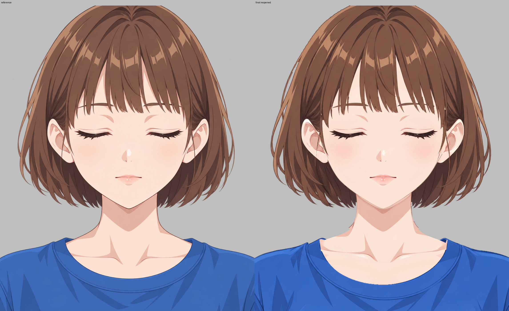

# 人物与衣服组装报告

已交付 [分层 KRA](character-assembled.kra) 和 [透明背景 PNG](character-assembled.png)。Krita 5.3.4.1 中完成组装、保存、关闭重开及遮罩切换；原画布保持 **1145×1374**。保留人物 41 层、衣服 8 层，共 49 个普通绘画层；32 个原生透明度遮罩包含人物原有 22 个、衣服原有 7 个、本次新增 3 个。无合层、无新增绘画层。两份输入工程未覆盖。

**配准与穿插。** 整套衣装先在临时衣装组内统一等比放大至约 **144%**，以原画布原点计平移 **x=-247、y=+687 px**。原生缩放的整数尺寸取整后，实际横纵系数分别为 1.440070、1.439681，差异仅来自栅格取整。领圈两端及肩部作为主要锚点；各衣片及其原有遮罩接受同一次变换。[配准记录](evidence/registration.json)。之后把现有 `0040 neckline_band :: back_arc` 放到脖子、躯干和手臂后方，其余七片保留原先相对顺序，位于人体前方。后领不再横跨裸露锁骨区；两端正常的深蓝内壁仍保留。

**局部贴合。** 独显两臂和躯干、关闭原有遮罩确认后，发现初始合成的上肩皮肤超出不透明衣料。在 `0030 arms/arm_left`、`0031 arms/arm_right`、`0040 body/torso` 各增加一个名为 `assembly • shoulder tucked under opaque T-shirt • toggle to restore` 的原生透明度遮罩，仅收起两侧上肩的多余外露，并平滑接回正常露出的颈肩弧。底层人体像素及原有遮罩均保留，关闭新增遮罩即可恢复。[遮罩说明](evidence/assembly-masks.json)、[人体独显前后](evidence/body-isolation-comparison.png)、[重开后遮罩开关对照](evidence/mask-toggle-comparison.png)、[Krita 遮罩检查](evidence/krita-shoulder-masks.png)。

收起漏肤后，左肩衣料外缘还显露约 4–12 px 的参考轮廓缺口。在现有 `0070 tshirt_body :: front_body` 及其原生接缝遮罩中，仅对 x=0–300 的上肩窄带作局部牵引，向下约 42 px 渐变回零位移；使用组装工程自身衣料像素与 Qt 平滑重采样，保留原有细描边、高光与褶皱，没有复制参考像素。修改窗口为 `[0,1030,301,160]`，实际变化局限在肩缘附近。[局部调整记录](evidence/shoulder-fit.json)、[参考／调整前／调整后](evidence/shoulder-patch-check.png)。

**检查范围。** 本参考是胸像。领口、肩部、衣身及画布边缘处的袖片可见；无肩带、薄纱或裙装。袖口、腋下、腰线及下摆在最终画布外，不能据此声称其穿戴效果已获目视验证；这些现有部件与连接余量完整保留，未裁掉画布外内容。保存重开后的普通层边界中，两袖内返分别始于 y=1698、1711，下摆内返始于 y=2376，详见[图层清单](evidence/reopen-verification.json)。

首次正确合成保存后，用 `locate_pixel_differences` 检测 `clothing:neckline_band :: front_U` 与 `clothing:tshirt_body :: front_body`，最终保存重开后按完全相同的两条路径复查。工具按实际工程生成范围，周边扩展 8 px。逻辑短名不识别原有 `::` 分片后缀，因此使用工具返回的完整分片路径，未为检测改名或拆层。

| 检测 | 范围预览 | 标记／热图 | 同坐标对照及记录 |
|---|---|---|---|
| 首次合成 | [范围](evidence/diagnostics-initial/scope-preview.png) | [标记](evidence/diagnostics-initial/marked.png)／[热图](evidence/diagnostics-initial/heatmap.png) | [对照](evidence/diagnostics-initial/comparison.png)／[JSON](evidence/diagnostics-initial/differences.json) |
| 最终重开、相同衣物范围 | [范围](evidence/diagnostics-final/scope-preview.png) | [标记](evidence/diagnostics-final/marked.png)／[热图](evidence/diagnostics-final/heatmap.png) | [对照](evidence/diagnostics-final/comparison.png)／[JSON](evidence/diagnostics-final/differences.json) |
| 最终重开、连接补查 | [范围](evidence/diagnostics-connections/scope-preview.png) | [标记](evidence/diagnostics-connections/marked.png)／[热图](evidence/diagnostics-connections/heatmap.png) | [对照](evidence/diagnostics-connections/comparison.png)／[JSON](evidence/diagnostics-connections/differences.json) |

连接补查包含后领、左右袖前片，以及 `character:neck`、`character:body/torso`、`character:arms/arm_left`、`character:arms/arm_right`。完全位于画布外的袖内返和下摆未用于像素范围检测。最终衣物范围 27 个候选、连接范围 41 个候选均作同坐标裁切检查；标记图最多显示前 40 个，连接范围第 41 个保存在完整 JSON 和第 7 页。数量仅用于索引，不作为验收分数。

| 候选与判断 | 处理或保留理由 |
|---|---|
| 初检两侧肩部 extra 候选 | 独显确认来自手臂／躯干的上肩外露；由上述 3 个可关闭遮罩解决。完整合成无同类裸露肩帽。 |
| 收起皮肤后出现的左肩缺口 | 由衣装局部贴合造成，已在现有衣身及接缝遮罩内作窄带调整。最终衣物候选 10、14、23 的细小轮廓差仍可见，主要是领根形状、约数像素的上游轮廓差和抗锯齿；并非内部透明裂缝或漏肤。 |
| 最终衣物候选 1–2、6、9、17–19 | U 领边与锁骨均连续，皮肤与衣料没有透明断口。衣服原有领圈弧度比穿衣参考略深，中心内缘约在 y=1255，参考约 y=1228；此项仍保留并明确记录，没有为追平而重画整圈衣领或改变整套比例。 |
| 最终衣物其余颜色候选 | 衣褶、亮暗面、双缝线与细描边的形态和位置差异；对应区域衣料连续、不透肤，保留原有绘制。 |
| 连接候选 7、9、11、17、21–22、24–26、28–29、32、35–36、41 | 下颌描边、颈侧轮廓、颈肩接点及锁骨高光属于人物输入已有差异；与首次合成一致。正常露肤与外露发尾保留，未把参考中的这些像素当作衣装缺口填上。 |
| 连接范围其余候选 | 与衣物范围重复的领圈、肩缘、袖片和衣褶差异，按上述同一理由处理或保留。 |

全部局部页：衣物 [1](evidence/diagnostics-final/candidates-page-1.png)、[2](evidence/diagnostics-final/candidates-page-2.png)、[3](evidence/diagnostics-final/candidates-page-3.png)、[4](evidence/diagnostics-final/candidates-page-4.png)、[5](evidence/diagnostics-final/candidates-page-5.png)；连接 [1](evidence/diagnostics-connections/candidates-page-1.png)、[2](evidence/diagnostics-connections/candidates-page-2.png)、[3](evidence/diagnostics-connections/candidates-page-3.png)、[4](evidence/diagnostics-connections/candidates-page-4.png)、[5](evidence/diagnostics-connections/candidates-page-5.png)、[6](evidence/diagnostics-connections/candidates-page-6.png)、[7](evidence/diagnostics-connections/candidates-page-7.png)。各页左参考、右最终，裁切位置一致，放大仅供检查。

**保留的上游外观。** 人物的发色、细发丝、发梢、面颊与下颌笔触、颈肩高光和轮廓线，以及衣服的蓝色色阶、褶皱、织物笔触和双缝线均沿用输入。与参考仍存在发丝轮廓、皮肤明暗、领圈深浅及局部衣褶位置差异。除左肩边界窄带外，没有重画衣料，也没有改写人物原始像素。[领口对照](evidence/neckline-comparison.png)、[左肩](evidence/left-shoulder-comparison.png)、[右肩](evidence/right-shoulder-comparison.png)、[颈部与发尾](evidence/neck-and-hair-comparison.png)。

**保存重开核对。** 最后一批调整后保存指定 KRA，关闭并重新打开，比较图层／遮罩清单、原始像素哈希和合成哈希，重开前后一致。41 个人物原层的 UUID、原始像素及全部原有遮罩像素与输入逐项核对一致。重开后再关闭／开启新增遮罩，恢复默认开启状态；最终透明 PNG 与 KRA 内保存合成一致。[核对记录](evidence/reopen-verification.json)、[Krita 重开全图](evidence/krita-reopened.png)。全图目视及局部检查未发现本次组装遗留的明显错位、衣外漏肤、内部透明缺口或后领盖肤；上述原有外观与领圈几何差异保留。

