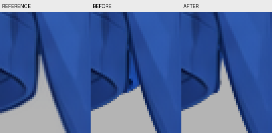

结论：已修复

本轮逐项处理review-01唯一确定问题R1，已完成当前KRA局部返修、原尺寸和400%自检、保存重开，并更新clothing-depth.png及report.md。其余已合格衣片、补全与配准继续保留。

## R1｜左袖内端搭接料外露

反馈原框[240,772,30,42]。已对照纯衣服参考及review-01逐层/隐藏分片证据确认，主要是0050袖根完整补全在默认蒙版中没有收回，导致透明凹口被填低，不能只作为第二步柔边处理。

处理结果：沿实际内端回折曲线局部收紧0050现有原生透明度蒙版，恢复与0070之间向上收尖的透明凹口；后续独显发现0020内端残余小尖点，也仅在其原生蒙版中局部收顺。0050可见内缘用两条b) Airbrush Soft小笔触接顺，取色只来自本袖参考。没有粘贴相邻衣片、扩大衣身遮盖、重生图或擦去整段补全。

- 0050：`0050 sleeve_image_left :: front_tube`，绘画UUID {77df1e21-6b5d-4629-928d-4c3c4b99b201}，蒙版UUID {fc9452e9-d136-4d85-a255-daa65cae0b24}。
- 0020：`0020 sleeve_image_left :: cuff_return`，绘画UUID {4650a7bc-e69c-40d0-bc45-1889e42d7b21}，蒙版UUID {da6bcf63-8bf5-42b0-bd31-5d63d2738258}。
- 两个蒙版保持原名`M sleeve_image_left own_cuff_aperture; root_occluded_by_tshirt_body`，附着原层，默认启用。控制区域是本袖的实际回折边，与0070已合格边缘保持正常开口。
- 0070：`0070 tshirt_body :: front_body`，UUID {df7c9d8e-1b0e-469b-9acf-db276719b189}，绘画和蒙版不变。

## 自检与证据

1. 默认组合：短蓝凸片和突兀竖线已收回，透明凹口恢复参考外露范围；[参考/修前/修后400%](repair-01-evidence/R1-reference-before-after-400.png)。
2. 单层与隐藏上层：检查0050、0020、0070独显，分别隐藏0050、0020，以及隐藏0070查看袖根；0020深蓝内壁、0050双缝边及近侧前缘完整，前后两端连续。[逐层归属](repair-01-evidence/R1-layer-diagnosis-400.png)、[隐藏分片](repair-01-evidence/R1-occlusion-check-400.png)、[隐藏衣身的原尺寸投影](repair-01-evidence/left-part-without-0070.png)。
3. 完整底稿：蒙版停用后完整连续的袖根生成余量仍在，没有将相邻衣身内容加入左袖。[开关对照](repair-01-evidence/R1-completion-mask-check-400.png)、[停用蒙版原尺寸](repair-01-evidence/left-part-disabled.png)。
4. 邻接与整体：[上方至袖口的原尺寸比较](repair-01-evidence/left-root-reference-after-native.png)、[袖口原尺寸比较](repair-01-evidence/left-cuff-reference-after-native.png)、[当前默认PNG](clothing-depth.png)。上段肩袖接缝无新缺口，袖筒褶皱和双缝线未错位。

本次只改变0020、0050两个现有蒙版的局部显示；绘画方面仅0050局部两笔，在[245,788,3,7]内9个像素发生改变。其余7层底稿及其他5个蒙版保持，全部图层/蒙版UUID不变。底稿保留核对见[retained-content.json](repair-01-evidence/retained-content.json)，局部修改范围见[local-change-check.json](repair-01-evidence/local-change-check.json)，笔触见[native-brush.json](repair-01-evidence/native-brush.json)。这些记录核实内容保留，视觉结论由上述实际看图给出。

## 结构同步和保存重开

保持4个逻辑part、8个普通绘画分片、7个透明度蒙版，20/50/70层序不变，无新增层、复用、人体占位或剪贴组。完整SVG与groups.json无需改动；通过edit_occlusion保存左袖20/50的局部默认显隐职责及核对依据，完整底稿仍作为有效形体。已更新默认预览PNG和report.md的当前证据链接与蒙版职责。

保存后关闭并重新打开指定KRA，8个绘画层、7个蒙版的UUID、父属、深度顺序、底层像素、蒙版选区与默认开启状态均与保存前一致，默认投影一致。重开后重新导出clothing-depth.png。见[reopen-verification.json](repair-01-evidence/reopen-verification.json)、[Krita重开400%](repair-01-evidence/krita-R1-reopened-400.png)、[重开整体](repair-01-evidence/krita-reopened-default.png)。

返修前KRA、PNG和绘画报告保存在[history/pre-repair-01](history/pre-repair-01)。本轮全部反馈处理完成，无未解决的本阶段问题。review-01所述细微硬边/阶梯仍留给第二步精修，不作为本轮未修完项目。
