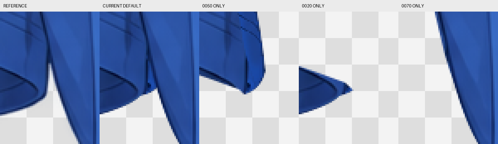

结论：需要修复

本次已完成全部 4 个逻辑衣片、8 个普通绘画分片和 7 个透明度蒙版的独立检查。确认 1 项本阶段问题：左袖根补全在默认合成中外露，挤占袖口内端与衣身之间的正常透明开口。其余区域未确认需要本阶段返修的内容、形体、归属或明显画风问题。

## 检查依据与实际工程

- 工程：`/Users/wutian/Desktop/coding/AstraLayering/.run/closed-face-full-20261026/clothing-raster-layering/step01/clothing-depth.kra`，1145×1374。SHA-256：`2da2ea9c004a381e4f6728155143e143a68c374b38514c5ceaab9551ecb50d8d`。
- 唯一绘画参考：[clothing.png](../../clothing-part-layering/references/clothing.png)，与 [report.md](report.md) 一致；全程保持原画布坐标，没有移动或缩放参考来配准差异。
- 已阅读 [groups.json](../../clothing-part-layering/groups.json)、[occlusion.json](../../clothing-part-layering/occlusion.json) 和 `parts/` 中四份完整 SVG。沿用已落实的 10/70、20/50、30/60、40/80 深度分片及共同逻辑归属。
- 检查开始时，本步目录没有已发布的 `review-*.md` 或 `repair-*.md`；绘画报告记录的右袖根补缝、领圈切片清理均重新看图核验，没有将其自述结论当作验收证据。
- 在现有 Krita 5.3.4.1 会话中检查实际 KRA，使用已有 Python bridge 进行临时显隐、蒙版切换、原生投影导出和窗口截图。未保存或修改工程、SVG、groups.json、occlusion.json；结束时恢复全部原始显隐和默认蒙版状态，文档 modified=false。输入哈希及默认投影恢复核对见 [readonly-verification.json](review-evidence/independent-01/readonly-verification.json)。哈希仅证明只读及恢复，不作视觉通过门槛。

## 检查方法与覆盖

先看原尺寸参考及当前 KRA 投影，再在 Krita 100% 分上、下查看整体；随后 200% 平移覆盖领圈、双肩、双袖、袖口、胸腹、两侧腰线和全部下摆。对左腋下疑点追加 400% 原图/当前、同 part 合看、0050/0020/0070 独显，以及分别隐藏 0050、0020 的遮挡检查。

- 原尺寸证据：[当前 KRA 默认投影](review-evidence/independent-01/default.png)；Krita [上部 100%](review-evidence/independent-01/krita-100-upper.png)、[下部 100%](review-evidence/independent-01/krita-100-lower.png)；参考在 Krita 的 [上部 100%](review-evidence/independent-01/krita-reference-100-upper.png)、[下部 100%](review-evidence/independent-01/krita-reference-100-lower.png)。
- [11 个 200% 原生窗口截图索引](review-evidence/independent-01/native-inspection.json)及[覆盖缩略总览](review-evidence/independent-01/native-200-contact.png)。总览仅索引检查范围，细节判断依据原生截图和同坐标局部图。
- 全部 8 层分别在蒙版启用、停用时导出原尺寸投影；4 个逻辑 part 各自以前后分片合看的两种蒙版状态检查。层名、UUID、类型、默认状态、蒙版映射及全部原尺寸独显/合看证据路径见 [layer-audit.json](review-evidence/independent-01/layer-audit.json)。实际均为 paintlayer，7 个附着蒙版均为 transparencymask，inheritAlpha=false，无剪贴组。[diagnostic-provenance.json](review-evidence/independent-01/diagnostic-provenance.json) 记录默认恢复投影及R1隐藏分片对照的原始导出路径。
- 四个节点均未设置 hiddenInReference=true，本次没有完全隐藏的额外衣片或为此建立的隐藏控制组。停用蒙版后检查的是各片袖根、领缝等隐藏余量；未将合理补全与原图遮挡物强行匹配。

## 确定问题清单

### R1｜左袖内端搭接料外露，缩小正常腋下开口

**位置与相关图层**：原画布框 `[240,772,30,42]`，画面左袖口靠衣身的回折端，重点约 x=246–257、y=778–801。主要涉及 `0050 sleeve_image_left :: front_tube` 及其 `M sleeve_image_left own_cuff_aperture; root_occluded_by_tshirt_body`。关联核对层为 `0020 sleeve_image_left :: cuff_return`、`0070 tshirt_body :: front_body`；它们的 20/50/70 前后关系不需要改变。

**当前表现**：全部分片及蒙版启用时，0050 袖根补全末端仍从衣身边缘下方露出一块短蓝色凸片，带有突兀的竖向深线。原应向上收尖的透明楔形开口被填低约十余像素，袖口内端由圆滑回折变成与衣身贴连的小凸块。它改变的是开口形状和可见衣料范围，并非仅需第二步处理的抗锯齿或柔边。

**参考与职责依据**：纯衣服参考在约 `(247,780)` 起已显示袖口内端和衣身之间的透明凹口，袖口后内壁向下圆滑回转；`groups.json` 要求左袖以真实肩袖接缝划界、保留正常开口，隐藏搭接应埋入衣身。完整 SVG 中的袖根余量可以保留，但不能在默认组合中填掉这个实际开口。

**来源确认**：同坐标独显可见 0050 的末端搭接向衣身侧多出一小块，0020 保留袖口内壁，0070 自身边缘未填此开口。隐藏 0050 后该凸片消失；只隐藏 0020 时凸片仍在。左袖 part 蒙版启用/停用时均保留该末端，说明当前默认蒙版范围没有将这段暴露的搭接控制住。

**修复方向**：优先局部修正 0050 在此回折端的原生显隐蒙版，使默认可见袖片止于参考实际回折曲线，恢复与 0070 之间向上收尖的透明凹口；把剩余可见接缝用画笔接顺。同步复核 0020 内端的接续，若有残余外露，仅调整相应局部显示范围。保留蒙版停用后完整、连续的袖根衣料，不要整段擦去隐藏搭接；不要扩大衣身或贴入衣身像素来遮盖凸片。

**需要保留**：0020 的深蓝袖口内壁、0050 的双道缝线和近侧前缘、上方已连续的肩袖接缝，以及 20 在 50 后、两者根部在 70 后的层序。不能将整个深色内壁挖成空洞，也不需合层、改逻辑 part 或添加人体层。

**复查条件**：全部蒙版启用时，凹口恢复参考的轮廓和外露范围，不再出现蓝色短凸片或粘连；0050 与 0020 两端回折连续，袖根上段无新缝。停用蒙版后仍能看到完整本袖补全，且不含相邻衣片内容。

证据：

- 框选工具：[整图编号框](review-evidence/independent-01/annotations/marked.png)、[原坐标及图层清单](review-evidence/independent-01/annotations/regions.json)。
- 框选局部：[参考](review-evidence/independent-01/annotations/R1-reference.png)、[当前](review-evidence/independent-01/annotations/R1-current.png)、[左参考/右当前](review-evidence/independent-01/annotations/R1-comparison.png)。
- [同坐标 400% 五栏归属对照](review-evidence/independent-01/comparisons/left-notch-layer-diagnosis-400.png)：参考、默认合成、0050 独显、0020 独显、0070 独显。
- [400% 隐藏分片对照](review-evidence/independent-01/comparisons/left-notch-occlusion-400.png)：默认、隐藏0050、隐藏0020。
- 原生 Krita：[当前 400%](review-evidence/independent-01/krita-400-left-notch-default.png)、[参考 400%](review-evidence/independent-01/krita-reference-400-left-notch.png)、[左袖合看/蒙版启用](review-evidence/independent-01/krita-400-left-notch-part-enabled.png)、[停用蒙版](review-evidence/independent-01/krita-400-left-notch-part-disabled.png)。

## 其余部件及衔接检查结果

下表的“未确认问题”均指本次实际看图结果；R1 已单列，不因其他区域合格而豁免。

| 逻辑 part / 实际分片 | 内容、归属及深度检查 | 独显和蒙版证据 |
|---|---|---|
| tshirt_body：0010 hem_return / 0070 front_body | 肩胸、躯干、腰侧、完整下摆、全部双缝线保留；0010 为远侧内返，位于0070之后，按真实前缘而非双缝线分片。左右回折及底缘连续，未见缺块或相邻袖片内容误归入衣身。停用蒙版后两侧窄搭接和领缝补全存在，色调、折面与同件衣料协调。 | [0010 独显](review-evidence/independent-01/comparisons/0010-tshirt_body-hem_return-enabled.png)、[0070 独显](review-evidence/independent-01/comparisons/0070-tshirt_body-front_body-enabled.png)、[衣身蒙版开关](review-evidence/independent-01/comparisons/tshirt_body-mask-check.png)、[完整底稿](review-evidence/independent-01/tshirt_body-disabled.png) |
| neckline_band：0040 back_arc / 0080 front_U | 后领横弧、双侧回转和整个前U形带齐全；40在80后，80覆盖衣身领缝。前U独显未见悬浮后弧残线；前后合看连续，开口中空，没有将中央参考残蓝点画为领标。无明显色块断层。 | [0040 独显](review-evidence/independent-01/comparisons/0040-neckline_band-back_arc-enabled.png)、[0080 独显](review-evidence/independent-01/comparisons/0080-neckline_band-front_U-enabled.png)、[蒙版开关](review-evidence/independent-01/comparisons/neckline_band-mask-check.png) |
| sleeve_image_left：0020 cuff_return / 0050 front_tube | 前后确为独立绘画层，双缝线属于0050、深色远壁属于0020；袖口内壁保留，未错当透明洞删除。肩根和筒面主要折线、色彩完整，无人体或衣身大面混入。内侧末端的默认外露范围不合格，见R1。 | [0020 独显](review-evidence/independent-01/comparisons/0020-sleeve_image_left-cuff_return-enabled.png)、[0050 独显](review-evidence/independent-01/comparisons/0050-sleeve_image_left-front_tube-enabled.png)、[蒙版开关](review-evidence/independent-01/comparisons/sleeve_image_left-mask-check.png) |
| sleeve_image_right：0030 cuff_return / 0060 front_tube | 右袖独立绘制，未镜像替代其相反斜向袖口和独有折线；0030远壁在0060之后，双缝线留在0060。重新核验报告记录的肩根及下段补缝，当前默认组合未见内部贯通裂缝；隐藏衣身后袖根余量连续。未见借用衣身覆盖来掩盖缺口。 | [0030 独显](review-evidence/independent-01/comparisons/0030-sleeve_image_right-cuff_return-enabled.png)、[0060 独显](review-evidence/independent-01/comparisons/0060-sleeve_image_right-front_tube-enabled.png)、[蒙版开关](review-evidence/independent-01/comparisons/sleeve_image_right-mask-check.png) |

可见区域的固定坐标参考/当前对照：

- [领圈](review-evidence/independent-01/comparisons/neck.png)、[左肩袖接缝](review-evidence/independent-01/comparisons/left-shoulder.png)、[右肩袖接缝](review-evidence/independent-01/comparisons/right-shoulder.png)。
- [左根下段](review-evidence/independent-01/comparisons/left-root.png)、[右根下段](review-evidence/independent-01/comparisons/right-root.png)、[左袖口](review-evidence/independent-01/comparisons/left-cuff.png)、[右袖口](review-evidence/independent-01/comparisons/right-cuff.png)。
- [胸腹](review-evidence/independent-01/comparisons/chest.png)、[左腰](review-evidence/independent-01/comparisons/left-waist.png)、[右腰](review-evidence/independent-01/comparisons/right-waist.png)、[左下摆](review-evidence/independent-01/comparisons/hem-left.png)、[右下摆](review-evidence/independent-01/comparisons/hem-right.png)。

整体轮廓、比例、位置、大面蓝色渐变、锐折面与柔和底纹总体协调。除R1外，没有发现局部合格但叠加后明显膨大、收缩或错位的问题。参考为不透明蓝色布料，没有需要保留而被删去的薄纱。领口透明开口、左右袖口深色内壁及下摆内返分别按其真实职责检查，未将内壁与空腔混为一谈。

肩外轮廓、领口内缘和下摆仍能见到局部硬边、阶梯及细小描边偏差，这些属于第二步边缘精修，不列入本步返修。未要求新增阴影、AO或投影；参考已有的衣料折面、深色内壁和缝线属于衣片内容，已纳入完整性检查。

## 交接要求

本次没有未检查的部件或执行故障。下一轮仅需先处理R1，并复核其邻接的0020/0050/0070及默认透明开口。保留现有8分片、4个逻辑part的共同归属、七个原生蒙版与其余已完成衣料内容；不需要合层、退回拆组或制作身体装配说明。
