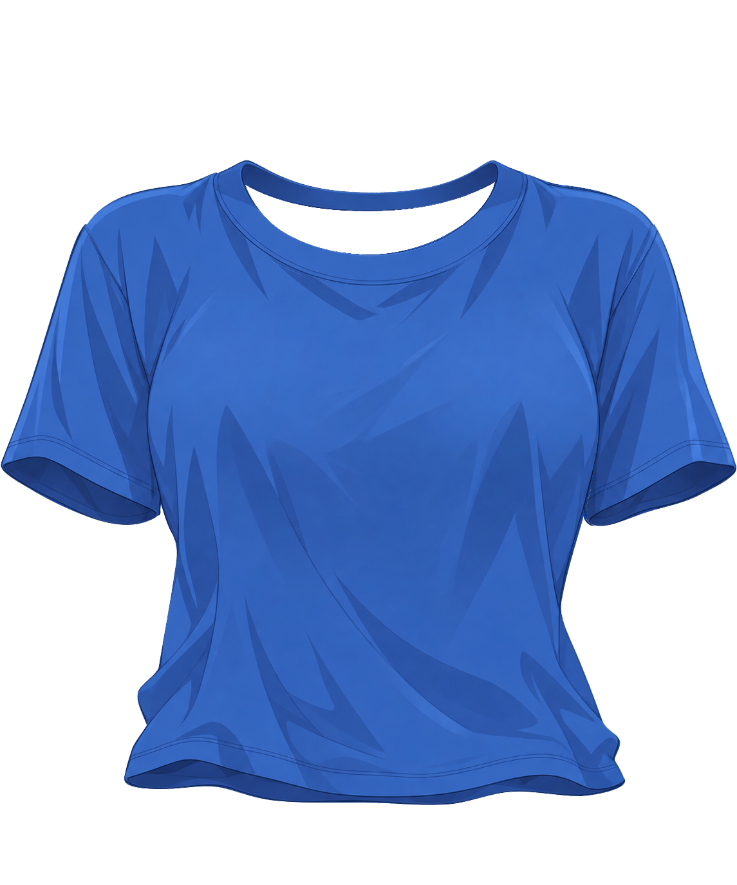

# 衣服边缘精修报告（step02）

交付：[clothing-soft-edges.kra](clothing-soft-edges.kra)；[重开后透明合成](clothing-soft-edges.png)。原画布1145×1374，4个逻辑part、8个普通绘画层、7个原生透明度蒙版；顺序、名称、UUID、归属及默认开启状态沿用step01。

已先读[step01报告](../step01/report.md)，从其返修后clothing-depth.kra另存到workspace开始，按批保存，最终另存指定交付路径并关闭重开。第一步文件及上游parts、groups.json、occlusion.json没有改写。采用[纯衣服参考](../../clothing-part-layering/references/clothing.png)判断细节，原穿衣角色未作像素来源，未执行身体装配或动画验证。

## 方法与差异候选

先以原尺寸全图差异候选进入局部对照，再扩展到八片的完整外缘与隐藏接缝；最后对保存重开后的实际PNG重新运行差异工具。最终42个候选均逐框看图，见[标记图](evidence/candidate-review/marked.png)、[原始候选记录](evidence/candidate-review/differences.json)及200%对照页：[1](evidence/candidate-review/page-1.png)、[2](evidence/candidate-review/page-2.png)、[3](evidence/candidate-review/page-3.png)、[4](evidence/candidate-review/page-4.png)、[5](evidence/candidate-review/page-5.png)、[6](evidence/candidate-review/page-6.png)。图中左参考、右最终工程，灰底仅为检查显示。

候选主要围绕袖外弧、腰侧、肩弧、领口、袖口和下摆。检查时区分硬边/描边问题与第一步既定轮廓的坐标差异，不依候选框填衣料或追求差异数量归零。部件范围查询不能识别当前带深度后缀的根层名称，尝试逻辑ID与工具显示的分片名均报找不到；改用全画布候选，并以实际Krita独显投影逐片核对，没有为适配查询改名或改层。

实际修画全部使用Krita 5.3.4.1原生`k) Blender Blur`与`b) Airbrush Soft`。模糊笔刷2.1–3.7px、低不透明度逐段处理；最初后领中央短段用4px笔刷测试。尺寸是笔刷直径，不是统一羽化宽度。恢复细边用2.5–3.2px柔边笔刷并锁alpha，从对应衣料参考取单点颜色，不复制参考像素。之后用原生连续paintPath轻顺右袖/右肩的笔段接点。脚本只记录路径、切换现有层/蒙版、调用原生画笔、保存与导出检查图。

无全层模糊、全局羽化、阈值生成修复、原图粘贴、新阴影/AO/投影；无新层、新组、合层或深度变化。原衣料无纱料部件；袖口深色内壁完整保留，不将其当作透明孔删除。

画笔依据：[首批外缘日志](evidence/native-brush-log.json)、[细描边日志](evidence/fine-rim-brush-log.json)、[接缝日志](evidence/seam-brush-log.json)、[最后接点日志](evidence/rim-finish-log.json)。

## 每层问题、处理与验收

下表从后到前。每层都在其他绘画层关闭时独显检查外缘；关闭上方层看接续；再停用本层蒙版检查隐藏补全；检查后恢复默认显隐。原尺寸投影证据保留完整画布，另有200%外缘/补全裁切与400%关键部位对照。

| 深度与普通绘画层 | 问题及处理 | 检查结论与证据 |
|---|---|---|
| 0010 tshirt_body :: hem_return | 下摆远侧内返的浅弧阶梯和两端回折硬边。沿下外缘分左/中/右三段柔顺；上方隐藏搭接边轻柔化。保留原深蓝内返、纹理与两端回转。 | 下摆双缝线仍在70；10/70合看无透明裂缝。 [独显](evidence/solo-enabled/0010.png) / [蒙版停用](evidence/solo-disabled/0010.png) / [隐藏上方](evidence/hide-above/0010.png)。[外缘200%](evidence/layer-details/0010-enabled-200.png) / [补全200%](evidence/layer-details/0010-disabled-200.png)。 |
| 0020 sleeve_image_left :: cuff_return | 远壁下外弧和内端的硬像素台阶。窄笔顺下弧；隐藏上搭接边轻柔化。原生蒙版只柔顺边缘，不重裁R1开口。 | 深色内壁完整；与50的前口缘连续，R1腋下凹口保留。 [独显](evidence/solo-enabled/0020.png) / [蒙版停用](evidence/solo-disabled/0020.png) / [隐藏上方](evidence/hide-above/0020.png)。[外缘200%](evidence/layer-details/0020-enabled-200.png) / [补全200%](evidence/layer-details/0020-disabled-200.png)。 |
| 0030 sleeve_image_right :: cuff_return | 远壁弧线的阶梯、前后切边的硬接点。沿下弧和上方隐藏搭接边做小范围柔化。 | 内壁不作为孔洞删除；30/60同part合看开口、回折连续。 [独显](evidence/solo-enabled/0030.png) / [蒙版停用](evidence/solo-disabled/0030.png) / [隐藏上方](evidence/hide-above/0030.png)。[外缘200%](evidence/layer-details/0030-enabled-200.png) / [补全200%](evidence/layer-details/0030-disabled-200.png)。 |
| 0040 neckline_band :: back_arc | 后领开口边缘有明显单像素阶梯，外顶弧偏硬。后领内缘按左/中/右短段调节，既有蒙版与绘画边缘分别轻柔化；外顶弧较轻处理。 | 后弧保持整片，40/80在两侧最高回转处相接，无领标或悬浮蓝点。 [独显](evidence/solo-enabled/0040.png) / [蒙版停用](evidence/solo-disabled/0040.png) / [隐藏上方](evidence/hide-above/0040.png)。[外缘200%](evidence/layer-details/0040-enabled-200.png) / [补全200%](evidence/layer-details/0040-disabled-200.png)。 |
| 0050 sleeve_image_left :: front_tube | 左袖外缘硬边、袖口前缘和隐藏根缝细硬线。外缘分上/下段轻柔化；前口缘先锁alpha轻顺线条，再小笔柔化切边；隐藏根缝短段淡化。 | 双缝线未擦除；停用蒙版仍有完整袖根余量，默认R1内端未重新外露。 [独显](evidence/solo-enabled/0050.png) / [蒙版停用](evidence/solo-disabled/0050.png) / [隐藏上方](evidence/hide-above/0050.png)。[外缘200%](evidence/layer-details/0050-enabled-200.png) / [补全200%](evidence/layer-details/0050-disabled-200.png)。 |
| 0060 sleeve_image_right :: front_tube | 右袖外缘偏硬且中下段深色轮廓被裁薄，隐藏根缝有硬线。外缘分段柔化；仅在现有衣料边内用小柔边笔补顺细暗边，再以连续原生模糊路径接顺笔段；前口缘和隐藏根缝局部轻修。 | 右袖独立保留原不对称折面；与30回折相接，肩根和腋下无新增内部裂缝。 [独显](evidence/solo-enabled/0060.png) / [蒙版停用](evidence/solo-disabled/0060.png) / [隐藏上方](evidence/hide-above/0060.png)。[外缘200%](evidence/layer-details/0060-enabled-200.png) / [补全200%](evidence/layer-details/0060-disabled-200.png)。 |
| 0070 tshirt_body :: front_body | 肩外缘、腰侧、下摆回转硬边；右肩和左腰细轮廓裁薄；袖根隐藏条切边偏硬。两肩、左右腰及下摆端点分别按不同力度柔化；锁alpha以自身参考取色补顺五个细边段中的相关段；原生袖根蒙版及绘画切边轻处理，前下摆接边轻柔化。 | 肩胸大面与褶皱不重画；领缝补全仍在80下方；双缝线和70/10的近远关系不变。 [独显](evidence/solo-enabled/0070.png) / [蒙版停用](evidence/solo-disabled/0070.png) / [隐藏上方](evidence/hide-above/0070.png)。[左肩200%](evidence/layer-details/body-00-200.png) / [右肩](evidence/layer-details/body-01-200.png) / [根缝左](evidence/layer-details/body-02-200.png) / [根缝右](evidence/layer-details/body-03-200.png) / [领缝](evidence/layer-details/body-08-200.png) / [下摆](evidence/layer-details/body-09-200.png)。 |
| 0080 neckline_band :: front_U | 前U开口边缘阶梯及外缝细硬线。左右内弧分别柔化现有蒙版和绘画边；外缝锁alpha轻柔顺，不抹掉细缝线。 | 独显仍只有前U，无遮错后弧；开口透明，两侧与40接续。 [独显](evidence/solo-enabled/0080.png) / [蒙版停用](evidence/solo-disabled/0080.png) / [隐藏上方](evidence/hide-above/0080.png)。[外缘200%](evidence/layer-details/0080-enabled-200.png) / [补全200%](evidence/layer-details/0080-disabled-200.png)。 |

## 同part连续性与整体

依groups.json部件职责，衣身10/70、领圈40/80、左袖20/50、右袖30/60都仍是独立普通绘画层，未因共同运动合并。没有新增剪贴/alpha继承；原有七个蒙版仍附着原层且默认启用。

- 衣身：[合看](evidence/parts/tshirt_body-enabled.png) / [停用蒙版](evidence/parts/tshirt_body-disabled.png)。前下摆与远侧内返接续，双缝线归70；左右回折不封口。
- 领圈：[合看](evidence/parts/neckline_band-enabled.png) / [停用蒙版](evidence/parts/neckline_band-disabled.png)。后横弧和前U在两侧回转处接续，中空保留。
- 左袖：[合看](evidence/parts/sleeve_image_left-enabled.png) / [停用蒙版](evidence/parts/sleeve_image_left-disabled.png)。R1腋下上收凹口与实际内壁保留，隐藏余量停用蒙版后仍在。
- 右袖：[合看](evidence/parts/sleeve_image_right-enabled.png) / [停用蒙版](evidence/parts/sleeve_image_right-disabled.png)。完整根缝余量仍埋在70后；内外口缘连续。

关键细节的参考/step01/step02三列400%：[后领内缘](evidence/collar-400.png)、[前U](evidence/front-U-400.png)、[右肩细边](evidence/right-shoulder-400.png)、[右袖细边](evidence/right-sleeve-400.png)、[左腰](evidence/left-waist-400.png)、[R1左腋下](evidence/left-aperture-400.png)、[下摆](evidence/hem-400.png)。全部都是实际工程投影裁切，放大只供检查。

原生窗口证据：[上部100%](evidence/screens/upper-100.png)、[下部100%](evidence/screens/lower-100.png)、[领圈400%](evidence/screens/collar-400.png)、[左袖口400%](evidence/screens/left-cuff-400.png)、[右袖口400%](evidence/screens/right-cuff-400.png)、[左腰200%](evidence/screens/left-waist-200.png)、[右腰200%](evidence/screens/right-waist-200.png)、[下摆200%](evidence/screens/hem-200.png)。

## 保存、重开与保留核对

最后一批修画后保存指定KRA，关闭并重新打开，再导出clothing-soft-edges.png。8层及7蒙版的名称、UUID、顺序、默认显隐、底层像素、蒙版像素和默认合成在重开前后完全一致。见[重开核对](evidence/reopen-verification.json)、[结构保留](evidence/structure-retention.json)。所有层保持normal、100%不透明度、inheritAlpha=false。完整纹理仅在记录的边缘/隐藏接缝短带局部变化，未替换底稿。

[局部变化统计](evidence/local-change-check.json)仅核实操作范围，不用于替代看图：八片raw alpha=128轮廓发生变化的位置距原轮廓最多1px；默认合成轮廓最大距离为1.0px。边缘描边、原有抗锯齿与隐藏根缝的RGB调整不等同于轮廓移动。

## 保留偏差与未解决事项

第一步确认的轮廓与纯衣服参考并非逐像素重合：右袖外侧约y530–650局部仍有约4–6px的既有位置差，肩弧、腰侧、领口及下摆也有小幅位置差。最终候选页明确展示这些偏差。本步沿用既定轮廓，只在边缘带内处理过渡与细线，没有擅自把衣片移动或扩大到参考边界；不声称这些既有几何差异已被消除。参考中的领口零散蓝点仍按上游职责排除。

本步检查未发现遗留的局部断缝、异色孤点、补全外露封口、前后片归属冲突或保存持久性问题。原参考不可见的隐藏余量继续采用第一步的合理补绘，不能据参考不可见像素宣称其纹理逐像素一致。上述既定几何偏差作为继承限制保留，未用模糊或贴图掩盖。
