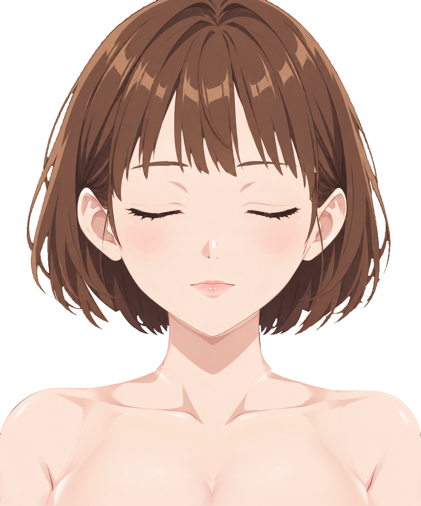
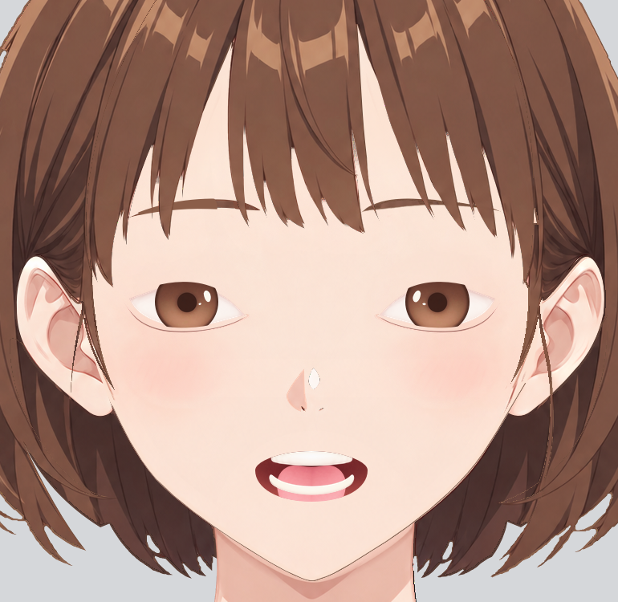
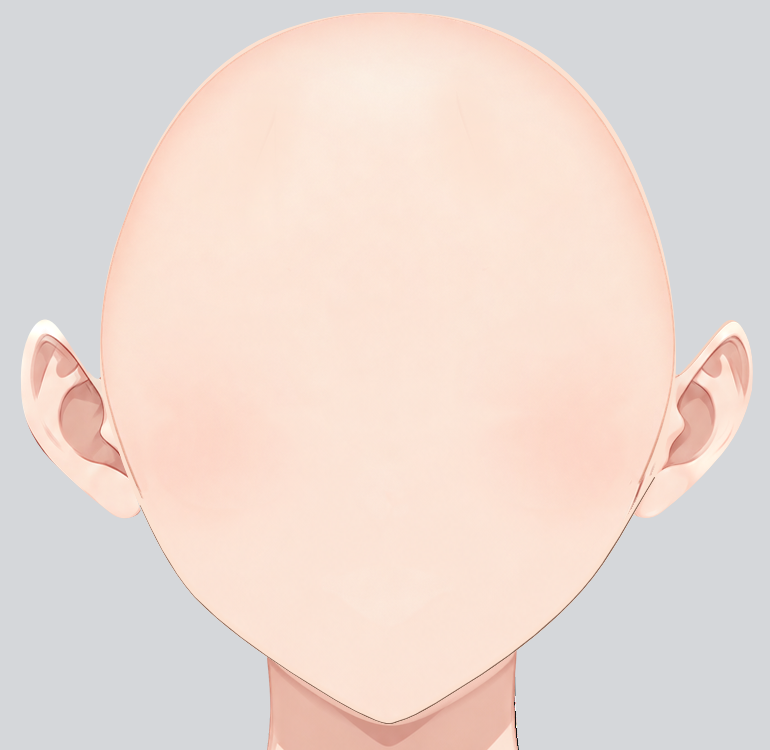

# Step01 分层人物绘画报告

状态：本阶段绘画、分层、显隐和保存重开自检完成。

## 交付与输入

- [Krita 工程](character-depth.kra)：1145 × 1374，37 个逻辑 part，41 个普通绘画层，21 个启用的原生透明度蒙版。
- [透明 PNG](character-depth.png)：由重开的 KRA 在默认闭眼、闭嘴和蒙版启用状态导出。
- 当前报告仅保存为 `report.md.tmp`；未写正式报告或推进下一步。
- 配准与真实可见像素参考：[base-subject.png](../../../../part-layering/references/base-subject.png)；整体风格另对照上游 `standard.png`、`simplified-subject.png`。参考坐标没有移动或缩放。
- 直接读取并续用上游 `parts/`、`groups.json`、`occlusion.json`。临时服装在上游说明中仅用于辨认身体范围；身体层补成其自身皮肤材质，不把背心、肩带或衣边复制到身体层。

## 逐件生图、配准与修画

33 个部件采用独立 image_gen 内容，另外 4 个隐藏右眼部件在 Krita 中从对应左件复制、镜像并配准。实际事件记录有 36 次成功生成、2 次失败；中间文件版本还包含配准版本，不以文件名推断生图次数。完整生成记录和模型实际 revised prompts 见 [generation-prompts.json](evidence/generation-prompts.json)，最终采用/复用归属见 [generation-manifest.json](evidence/generation-manifest.json)。全部控制素材保存在 `workspace/controls/<part ID>/`。

每件的红色表示本件真实可见内容，黄色为遮挡补全；完全隐藏件以完整补全 SVG 作黄色范围。输入编辑图先将黄色遮挡物和绿色外部区域清为中性灰。补全使用与参考协调的浅暖肤色、棕色头发和低对比动漫材质，未用原图遮挡物代替黄色补全。生成后按局部坐标配准、遵循 SVG 轮廓，再叠加仅属于本件的可见参考像素。

已弃用/重做的情况包括过密虹膜细节、侧发耳后漏补和躯干下缘不合画布裁切。胸前及左肩臂首次请求曾被输出审核拒绝（请求 ID `9b481eac-c552-4112-982d-7c93691e05ac`、`ea72f98f-9e5e-4ee4-8b9c-a23533b074ad`）；改用同范围的中性“浅桃色曲面材质”描述后成功生成。没有用原图冒充这些补全。

可见区域覆盖按几何归属和默认遮挡关系限制：头发在本件实际可见区域内取原图自身发色；脸底排除五官、腮红、耳和头发。发际及衣边混色像素几何排除后，使用本件颜色收边。最终覆盖记录见 [reference-overlay-ledger-v3.json](evidence/reference-overlay-ledger-v3.json)。未建立整图覆盖层。

已在实际 Krita 工程中使用原生 Basic-5 Size 与 Airbrush Soft 画笔逐处修过脸底接色、下颌边线、侧发隐藏根部与耳后过渡、发缘、肩颈接缝、胸前层暗边/接痕、右眉隐藏区方形残痕以及身体画布下缘。另以原生蒙版柔和衔接躯干、颈肩和胸前层，底层纹理保持完整。腮红最后保留独立低透明度色素，避免把基础肤色带成不透明椭圆或噪点。

检查使用实际 alpha 合成到灰/白底的原尺寸图；透明 PNG 的 alpha=0 RGB 不作为可见残色。逐层原始纹理与灰底裁切均从当前 KRA 导出，裁切仅减少空白，没有缩放。

## 结构修正与多深度

已先保存对应 SVG，再用 `edit_groups` 保存完整分组树、用 `edit_occlusion` 保存完整深度表。两工具均校验通过。逻辑 ID 没有增删，所有更新已成为后续 raster 的有效上游输入；没有重新启动上游。

| 改动 | 原因与落实 |
| --- | --- |
| 左侧发 20 / 150 → 5 / 20 / 150 | 20 耳后、150 耳前为上游预注；组装新发现顶部隐藏延伸须退到后发 10 之后，新增同 part 的 5 `__hidden_root`。 |
| 右侧发 21 / 151 → 6 / 21 / 151 | 21 耳后、151 耳前为上游预注；同理新增 6 隐藏根部。 |
| `hair/back_hair.svg` | 增加 `raster-ear-underlap-continuity` 两侧耳垂至后颈承接形，补实际组装透底；仍为同一后发、单深度 10。新增区约左 x195–374/y540–847、右 x780–959/y540–847。 |
| 右眼 sclera / iris / highlight / lower_eyelid SVG | 完全隐藏的正面设计采用左件的全局镜像 `x右=1157−x左，y不变`，修正原右侧不必要的尺寸/偏移及偏平下睑；保留各自原 ID、显隐和独立控制身份。 |

侧发三片从已完成的同件纹理分配现有像素：隐藏根部取顶部补全相对原 source 的外延，耳前片仅取跨耳窄束/细丝，余下为耳后宽帘。内部采用互斥分配避免重叠 alpha 衰减；三片合起来仍是连续完整的同一逻辑部件。宽帘没有整体搬到耳前。完整侧发检查见 [左侧](../../evidence/solo-gray/hair-side_hair_left-logical-complete.png)、[右侧](../../evidence/solo-gray/hair-side_hair_right-logical-complete.png)。

除上述 5 个已同步的 SVG，未另外改变终止部件 ID 或内容归属。修改前 SVG 保存在 `report-assets/back_hair-upstream-before.svg`、`workspace/upstream-before-eye-symmetry/`。受影响的 [分组预览](../../../../part-layering/preview.svg) 与 [深度预览](../../../../part-layering/step14_occlusion/preview.svg) 已更新；深度预览以当前 41 片的 alpha 和默认显隐表现实际分区，逻辑轮廓仍在各 `parts/*.svg`。记录见 [preview-update.json](evidence/preview-update.json)。

## 实际图层、UUID、深度和检查

以下按实际由下到上的顺序列出。所有行都是普通绘画层；同一侧发的多行共享逻辑 part 和运动身份。UUID 为保存重开后核对不变的原生 UUID。

| 深度 | part ID | KRA 图层名 | UUID | 检查与复用来源 | 原尺寸独显 |
| --- | --- | --- | --- | --- | --- |
| 5 | `hair/side_hair_left` | `0005 hair/side_hair_left__hidden_root` | `{ba109cee-df06-4530-9f49-95bf6d283203}` | 组装新发现的同 part 隐藏顶部延伸；位于后发之后。 | [查看](../../evidence/solo-gray/0005-hair-side_hair_left__hidden_root.png) |
| 6 | `hair/side_hair_right` | `0006 hair/side_hair_right__hidden_root` | `{0d681884-b1c3-4e8b-86b0-fbea47ec59ba}` | 组装新发现的同 part 隐藏顶部延伸；位于后发之后。 | [查看](../../evidence/solo-gray/0006-hair-side_hair_right__hidden_root.png) |
| 10 | `hair/back_hair` | `0010 hair/back_hair` | `{828fce76-68bd-44a5-95a5-1c9cc25c322e}` | 完整后发底面；补齐耳垂至后颈的两侧承接区。 | [查看](../../evidence/solo-gray/0010-hair-back_hair.png) |
| 20 | `hair/side_hair_left` | `0020 hair/side_hair_left__rear` | `{cbfc3f39-64b2-4eab-bd15-0769e040dd4b}` | 上游预注耳后区；完整纹理的后部绘画分片。 | [查看](../../evidence/solo-gray/0020-hair-side_hair_left__rear.png) |
| 21 | `hair/side_hair_right` | `0021 hair/side_hair_right__rear` | `{7156ca97-323f-4615-b4bd-f1d623ff542d}` | 上游预注耳后区；完整纹理的后部绘画分片。 | [查看](../../evidence/solo-gray/0021-hair-side_hair_right__rear.png) |
| 30 | `arms/arm_left` | `0030 arms/arm_left` | `{e971b32b-a4d5-44f6-9a0a-2a3701928f09}` | 完整肩臂，补全被服装遮住处，画布下缘收口。 | [查看](../../evidence/solo-gray/0030-arms-arm_left.png) |
| 31 | `arms/arm_right` | `0031 arms/arm_right` | `{299f5cdb-52eb-40e4-94b8-3a2f028c95b9}` | 完整肩臂，独立生成，未因近似对称而强行镜像。 | [查看](../../evidence/solo-gray/0031-arms-arm_right.png) |
| 35 | `neck` | `0035 neck` | `{28285caf-fec2-47a1-8607-58813906b82d}` | 完整颈部及颈根，上缘在下颌后延续。 | [查看](../../evidence/solo-gray/0035-neck.png) |
| 40 | `body/torso` | `0040 body/torso` | `{90c56c5d-2d89-4563-a1e9-2918f8f05207}` | 完整皮肤底面，颈肩处原生蒙版混合；无临时背心像素。 | [查看](../../evidence/solo-gray/0040-body-torso.png) |
| 50 | `body/breast` | `0050 body/breast` | `{8c772161-d068-47e6-adcf-44ee74724c9e}` | 完整前层曲面材质；暗边与接痕已修，原生蒙版衔接躯干。 | [查看](../../evidence/solo-gray/0050-body-breast.png) |
| 60 | `face/ear_left` | `0060 face/ear_left` | `{ce7e5ed3-0d26-4f64-8397-2012ccc093af}` | 耳轮、耳甲及耳根连续；接色处用本耳颜色收边。 | [查看](../../evidence/solo-gray/0060-face-ear_left.png) |
| 61 | `face/ear_right` | `0061 face/ear_right` | `{7a70b6b4-fc54-43b3-ac55-84ba99b2de3c}` | 耳廓和耳根连续；不含相邻鬓发。 | [查看](../../evidence/solo-gray/0061-face-ear_right.png) |
| 70 | `face/face_base` | `0070 face/face_base` | `{aef3e0d1-b12b-49b3-a99f-f18141a36488}` | 无五官连续脸底；额头、太阳穴、面颊、下颌补全，隐藏上层检查。 | [查看](../../evidence/solo-gray/0070-face-face_base.png) |
| 72 | `face/blush_left` | `0072 face/blush_left` | `{6b47a8a3-9eef-4fa1-8a67-09805094edb6}` | 独立低透明度斜向腮红，不含脸底 RGB 图块。 | [查看](../../evidence/solo-gray/0072-face-blush_left.png) |
| 73 | `face/blush_right` | `0073 face/blush_right` | `{ca46a4b0-fc0d-47b8-9ece-c28387534b69}` | 独立低透明度斜向腮红，不含脸底 RGB 图块。 | [查看](../../evidence/solo-gray/0073-face-blush_right.png) |
| 74 | `face/nose/volume_shadow` | `0074 face/nose/volume_shadow` | `{ca51f878-5c67-4b62-a57e-ee69ff47fa4f}` | 鼻部体积明暗独立薄层。 | [查看](../../evidence/solo-gray/0074-face-nose-volume_shadow.png) |
| 75 | `face/nose/tip_highlight` | `0075 face/nose/tip_highlight` | `{03708806-48b7-4a96-bf78-69a9c31f0676}` | 独立暖白鼻尖高光。 | [查看](../../evidence/solo-gray/0075-face-nose-tip_highlight.png) |
| 76 | `face/nose/tip_mark` | `0076 face/nose/tip_mark` | `{e2e57431-6b4e-482a-9cc6-f51aa6363f6b}` | 鼻尖/鼻翼细小独立短线。 | [查看](../../evidence/solo-gray/0076-face-nose-tip_mark.png) |
| 80 | `face/mouth/mouth_interior` | `0080 face/mouth/mouth_interior` | `{a6714c71-ef89-4ea5-8912-8b63190b0bda}` | 完整口内补设计；闭唇开口蒙版默认启用，停用后检查完整内容。 | [查看](../../evidence/solo-gray/0080-face-mouth-mouth_interior.png) |
| 81 | `face/mouth/tongue` | `0081 face/mouth/tongue` | `{58c28208-a656-45cb-8a62-77d12d3cc400}` | 完整口内补设计；闭唇开口蒙版默认启用，停用后检查完整内容。 | [查看](../../evidence/solo-gray/0081-face-mouth-tongue.png) |
| 82 | `face/mouth/lower_teeth` | `0082 face/mouth/lower_teeth` | `{3016c5b5-1c3b-46f2-a582-4e76f1cbb2cf}` | 完整口内补设计；闭唇开口蒙版默认启用，停用后检查完整内容。 | [查看](../../evidence/solo-gray/0082-face-mouth-lower_teeth.png) |
| 83 | `face/mouth/upper_teeth` | `0083 face/mouth/upper_teeth` | `{e09b96ee-1087-4dd6-906c-c3f9c2db68e3}` | 完整口内补设计；闭唇开口蒙版默认启用，停用后检查完整内容。 | [查看](../../evidence/solo-gray/0083-face-mouth-upper_teeth.png) |
| 84 | `face/mouth/lower_lip` | `0084 face/mouth/lower_lip` | `{887a247f-0a52-4009-8bdb-1b88877d4557}` | 完整下唇及自身柔和明暗，无口内像素。 | [查看](../../evidence/solo-gray/0084-face-mouth-lower_lip.png) |
| 85 | `face/mouth/upper_lip` | `0085 face/mouth/upper_lip` | `{ce791675-e46f-4c63-860b-eea06d5dc610}` | 完整上唇与闭合唇线，无口内像素。 | [查看](../../evidence/solo-gray/0085-face-mouth-upper_lip.png) |
| 90 | `face/eye_left/sclera` | `0090 face/eye_left/sclera` | `{ec25b6cd-3e6b-496a-b42b-3ceb934dfc6f}` | 完整隐藏结构；默认原生蒙版闭合，停用后逐件检查。 | [查看](../../evidence/solo-gray/0090-face-eye_left-sclera.png) |
| 91 | `face/eye_right/sclera` | `0091 face/eye_right/sclera` | `{94f8669c-1049-42fa-ac3e-2e99b1993caa}` | 完整隐藏结构；默认原生蒙版闭合，停用后逐件检查。右侧来自对应左件的原生镜像。 | [查看](../../evidence/solo-gray/0091-face-eye_right-sclera.png) |
| 92 | `face/eye_left/iris` | `0092 face/eye_left/iris` | `{77cfdad5-814b-412f-8662-9f7e1fa1d524}` | 完整隐藏结构；默认原生蒙版闭合，停用后逐件检查。 | [查看](../../evidence/solo-gray/0092-face-eye_left-iris.png) |
| 93 | `face/eye_right/iris` | `0093 face/eye_right/iris` | `{27ebce59-aae6-458b-942f-32c6b34be388}` | 完整隐藏结构；默认原生蒙版闭合，停用后逐件检查。右侧来自对应左件的原生镜像。 | [查看](../../evidence/solo-gray/0093-face-eye_right-iris.png) |
| 94 | `face/eye_left/highlight` | `0094 face/eye_left/highlight` | `{9c9556bd-359d-4b20-b838-eeb8e5773c68}` | 完整隐藏结构；默认原生蒙版闭合，停用后逐件检查。 | [查看](../../evidence/solo-gray/0094-face-eye_left-highlight.png) |
| 95 | `face/eye_right/highlight` | `0095 face/eye_right/highlight` | `{37ec8df4-7543-4092-b33c-c16987262f4a}` | 完整隐藏结构；默认原生蒙版闭合，停用后逐件检查。右侧来自对应左件的原生镜像。 | [查看](../../evidence/solo-gray/0095-face-eye_right-highlight.png) |
| 96 | `face/eye_left/eyelid_crease` | `0096 face/eye_left/eyelid_crease` | `{13e413d1-bebd-4556-aef2-74dfcc6cb30b}` | 独立细软褶线，不并入眼球或眉毛。 | [查看](../../evidence/solo-gray/0096-face-eye_left-eyelid_crease.png) |
| 97 | `face/eye_right/eyelid_crease` | `0097 face/eye_right/eyelid_crease` | `{99b3cf10-413f-4da7-b9fa-bb688ed51b87}` | 独立细软褶线，不并入眼球或眉毛。 | [查看](../../evidence/solo-gray/0097-face-eye_right-eyelid_crease.png) |
| 98 | `face/eye_left/lower_eyelid` | `0098 face/eye_left/lower_eyelid` | `{58739c35-1b04-4e02-a7c1-105293d2a0fe}` | 完整隐藏结构；默认原生蒙版闭合，停用后逐件检查。 | [查看](../../evidence/solo-gray/0098-face-eye_left-lower_eyelid.png) |
| 99 | `face/eye_right/lower_eyelid` | `0099 face/eye_right/lower_eyelid` | `{755fbc9e-690c-4e31-9fba-f0cfc3eca24e}` | 完整隐藏结构；默认原生蒙版闭合，停用后逐件检查。右侧来自对应左件的原生镜像。 | [查看](../../evidence/solo-gray/0099-face-eye_right-lower_eyelid.png) |
| 100 | `face/eye_left/upper_eyelid` | `0100 face/eye_left/upper_eyelid` | `{59562826-f0d7-42b7-83f9-b1d5e81fb643}` | 闭眼主线、睫毛及其所属上睑局部肤色；排除眉和眼球内容。 | [查看](../../evidence/solo-gray/0100-face-eye_left-upper_eyelid.png) |
| 101 | `face/eye_right/upper_eyelid` | `0101 face/eye_right/upper_eyelid` | `{57d1cce4-8056-4486-ada7-d60560aad693}` | 闭眼主线、睫毛及其所属上睑局部肤色；排除眉和眼球内容。 | [查看](../../evidence/solo-gray/0101-face-eye_right-upper_eyelid.png) |
| 102 | `face/eyebrow_left` | `0102 face/eyebrow_left` | `{69d20734-2629-4e46-a76f-675535f2e685}` | 眉弓完整，保留本侧形状与色阶。 | [查看](../../evidence/solo-gray/0102-face-eyebrow_left.png) |
| 103 | `face/eyebrow_right` | `0103 face/eyebrow_right` | `{2dd08a5b-aa4d-4e8b-b164-90d579dd5021}` | 被刘海遮住处已补全；隐藏区方形残痕用原生画笔修净。 | [查看](../../evidence/solo-gray/0103-face-eyebrow_right.png) |
| 150 | `hair/side_hair_left` | `0150 hair/side_hair_left__front` | `{f0fcb119-ffaa-4167-bd8a-d2bfbead549a}` | 上游预注耳前区；只含同件窄鬓发和跨耳细丝。 | [查看](../../evidence/solo-gray/0150-hair-side_hair_left__front.png) |
| 151 | `hair/side_hair_right` | `0151 hair/side_hair_right__front` | `{83cd096a-f7f1-4950-a041-10a058bf7ead}` | 上游预注耳前区；只含同件窄鬓发和跨耳细丝。 | [查看](../../evidence/solo-gray/0151-hair-side_hair_right__front.png) |
| 160 | `hair/bangs` | `0160 hair/bangs` | `{d848dc1b-56e6-4e7d-ad60-6e51e8ad4df6}` | 刘海尖束、间隙和发流保持各自头发归属。 | [查看](../../evidence/solo-gray/0160-hair-bangs.png) |

完整机读对应见 [layer-index.json](evidence/layer-index.json)。四个右眼复用件的独立图层、UUID、原生蒙版均保留；眼白、虹膜、暖白高光和下睑采用协调的正面设计。闭眼参考无异色或明确不对称证据，两眼使用同一暖棕虹膜与漫射光风格。双耳、眉、上睑、双臂因真实形状、照明或透视细节不同而分别制作。

## 原生显隐与裁切关系

12 个完全隐藏件均有完整绘画纹理，绘画层保持启用，以原生透明度蒙版保存默认闭合状态。眼白、虹膜和高光各使用由同侧上下眼睑内缘定义的相同闭合开口，参考状态区域为空；虹膜和高光另有完整眼白裁切。下眼睑的接触显隐由同侧上眼睑控制。口内四件共用上下唇闭合开口；舌与牙另裁切到完整口内范围。蒙版附在各自深度的绘画层上，保留跨部件全局层序。

| 所属绘画层 | 蒙版名称 | 蒙版 UUID | 控制区域 / 目标 | 默认 |
| --- | --- | --- | --- | --- |
| `0040 body/torso` | blend • neck and shoulder roots • controller neck + arms | `{079b4443-1b3c-422c-8135-d402a78ccf44}` | `neck + arms/arm_left + arms/arm_right；仅衔接区柔和混合` | 启用 |
| `0050 body/breast` | blend • upper surface into torso • controller body/torso | `{8527e030-0762-4e7f-9168-50c3d5a884bf}` | `body/torso；上缘与两侧柔和混合，完整前层纹理保留` | 启用 |
| `0080 face/mouth/mouth_interior` | aperture • mouth • upper_lip + lower_lip • CLOSED | `{43af3811-c18a-48f3-8152-6031b79153e4}` | `face/mouth/upper_lip + face/mouth/lower_lip` | 启用 |
| `0081 face/mouth/tongue` | clip • full mouth_interior | `{48e12ed9-bee4-408d-bbd6-9140e359c43f}` | `face/mouth/mouth_interior` | 启用 |
| `0081 face/mouth/tongue` | aperture • mouth • upper_lip + lower_lip • CLOSED | `{155871c1-abfe-41f3-8a51-140a1d16ec6f}` | `face/mouth/upper_lip + face/mouth/lower_lip` | 启用 |
| `0082 face/mouth/lower_teeth` | clip • full mouth_interior | `{11b527ac-a02f-4002-871d-88f90e83e405}` | `face/mouth/mouth_interior` | 启用 |
| `0082 face/mouth/lower_teeth` | aperture • mouth • upper_lip + lower_lip • CLOSED | `{57e3410e-65ef-4d48-9e77-9c04c50498f3}` | `face/mouth/upper_lip + face/mouth/lower_lip` | 启用 |
| `0083 face/mouth/upper_teeth` | clip • full mouth_interior | `{150b821c-c16e-4fc5-bcbd-7969fedc53b3}` | `face/mouth/mouth_interior` | 启用 |
| `0083 face/mouth/upper_teeth` | aperture • mouth • upper_lip + lower_lip • CLOSED | `{e6509547-793f-45f6-86ac-2045c99cc2da}` | `face/mouth/upper_lip + face/mouth/lower_lip` | 启用 |
| `0090 face/eye_left/sclera` | aperture • eye_left • upper_eyelid + lower_eyelid • CLOSED | `{fa38857b-eef9-42d7-8b1b-8350489e4668}` | `face/eye_left/upper_eyelid + face/eye_left/lower_eyelid` | 启用 |
| `0091 face/eye_right/sclera` | aperture • eye_right • upper_eyelid + lower_eyelid • CLOSED | `{82ff287e-f5be-435c-9f6b-4f19df2c99a5}` | `face/eye_right/upper_eyelid + face/eye_right/lower_eyelid` | 启用 |
| `0092 face/eye_left/iris` | clip • full eye_left sclera | `{700765c5-e08d-4c9a-9c83-39600d60ce1c}` | `face/eye_left/sclera` | 启用 |
| `0092 face/eye_left/iris` | aperture • eye_left • upper_eyelid + lower_eyelid • CLOSED | `{423cd416-4126-4c5f-a275-96596c184644}` | `face/eye_left/upper_eyelid + face/eye_left/lower_eyelid` | 启用 |
| `0093 face/eye_right/iris` | clip • full eye_right sclera | `{27d5394b-2a8b-47a5-990d-1ab30faebd6a}` | `face/eye_right/sclera` | 启用 |
| `0093 face/eye_right/iris` | aperture • eye_right • upper_eyelid + lower_eyelid • CLOSED | `{b3421a72-604f-400e-9d74-4e44ed5760fd}` | `face/eye_right/upper_eyelid + face/eye_right/lower_eyelid` | 启用 |
| `0094 face/eye_left/highlight` | clip • full eye_left sclera | `{ea3e662d-80d1-4d03-bdb7-b8c4103bd6b9}` | `face/eye_left/sclera` | 启用 |
| `0094 face/eye_left/highlight` | aperture • eye_left • upper_eyelid + lower_eyelid • CLOSED | `{a0d9020c-8b1f-460e-89de-3891fef95b53}` | `face/eye_left/upper_eyelid + face/eye_left/lower_eyelid` | 启用 |
| `0095 face/eye_right/highlight` | clip • full eye_right sclera | `{b4f6f33f-c77c-4c20-9220-9006abf26183}` | `face/eye_right/sclera` | 启用 |
| `0095 face/eye_right/highlight` | aperture • eye_right • upper_eyelid + lower_eyelid • CLOSED | `{c5b2d787-8707-4189-a9e5-6ad44a284e9c}` | `face/eye_right/upper_eyelid + face/eye_right/lower_eyelid` | 启用 |
| `0098 face/eye_left/lower_eyelid` | closed contact • upper_eyelid occludes lower_eyelid | `{f5d68f91-380a-4775-9969-2f5f49835984}` | `face/eye_left/upper_eyelid` | 启用 |
| `0099 face/eye_right/lower_eyelid` | closed contact • upper_eyelid occludes lower_eyelid | `{c8c844c7-ee6c-47af-8cfd-15d86445163e}` | `face/eye_right/upper_eyelid` | 启用 |

逐件原生蒙版检查证据如下。左栏为默认启用状态，右栏为临时停用后显示完整纹理；检查后全部恢复启用。

| part ID | 启用 / 临时停用原尺寸证据 |
| --- | --- |
| `body/torso` | [查看](../../evidence/mask-checks/body-torso.png) |
| `body/breast` | [查看](../../evidence/mask-checks/body-breast.png) |
| `face/mouth/mouth_interior` | [查看](../../evidence/mask-checks/face-mouth-mouth_interior.png) |
| `face/mouth/tongue` | [查看](../../evidence/mask-checks/face-mouth-tongue.png) |
| `face/mouth/lower_teeth` | [查看](../../evidence/mask-checks/face-mouth-lower_teeth.png) |
| `face/mouth/upper_teeth` | [查看](../../evidence/mask-checks/face-mouth-upper_teeth.png) |
| `face/eye_left/sclera` | [查看](../../evidence/mask-checks/face-eye_left-sclera.png) |
| `face/eye_right/sclera` | [查看](../../evidence/mask-checks/face-eye_right-sclera.png) |
| `face/eye_left/iris` | [查看](../../evidence/mask-checks/face-eye_left-iris.png) |
| `face/eye_right/iris` | [查看](../../evidence/mask-checks/face-eye_right-iris.png) |
| `face/eye_left/highlight` | [查看](../../evidence/mask-checks/face-eye_left-highlight.png) |
| `face/eye_right/highlight` | [查看](../../evidence/mask-checks/face-eye_right-highlight.png) |
| `face/eye_left/lower_eyelid` | [查看](../../evidence/mask-checks/face-eye_left-lower_eyelid.png) |
| `face/eye_right/lower_eyelid` | [查看](../../evidence/mask-checks/face-eye_right-lower_eyelid.png) |

原生关系与检查状态详见 [mask-audit.json](evidence/mask-audit.json)。整图还临时停用 10 个眼/口开口蒙版和 2 个下睑接触蒙版，保留完整眼白/口内裁切，隐藏前层睑线与唇后检查眼内与口内装配；随后恢复全部默认状态。单独检验虹膜在眼白裁切之外没有内容。

隐藏头发和独立五官检查脸底、耳根及颈部的补全连续性；隐藏胸前层检查下方躯干，而非用遮挡物像素去匹配补全区。

- [开口蒙版临时停用](../../evidence/aperture-masks-disabled.png)
- [躯干隐藏前层后的检查](../../evidence/torso-with-front-surface-hidden-final.png)
- [头顶原坐标对照](../../evidence/compare-crown.png)
- [脸部原坐标对照](../../evidence/compare-face.png)
- [颈肩原坐标对照](../../evidence/compare-neck-shoulder.png)

## 保存重开与最终验收

已在同一实际 Krita 工程分批修画、保存，最后保存关闭并重新打开指定 KRA，核对 41 个绘画层、21 个透明度蒙版的名称、UUID、顺序、归属、启用状态、纹理与蒙版数据，以及默认合成。保存重开前后均一致；全部蒙版启用。重开后再由 Krita 导出透明 PNG，并按原尺寸查看最终合成。

[reopen-check.json](evidence/reopen-check.json) 记录原生保存保持性；像素哈希仅用于确认保存没有改变内容，不作为绘画质量评分。逐层独显、补全连续性、像素归属与整图形体/比例/位置均另行看图检查。[delivery-integrity.json](evidence/delivery-integrity.json) 记录结构与深度对应，37 个逻辑 part 与全部 41 个深度区域完整匹配。

## 偏差与后续边缘范围

- 相对原色块，明确的形体修正仅为后发双侧耳下承接区及右侧四个隐藏眼结构的对称配准，已同步 SVG、分组说明、深度和预览；新增侧发深度只是同件绘画分片，没有新增独立运动 part。
- 身体根据上游职责补成被临时服装遮住的本体，因此默认身体画面与带背心的定位参考不同；服装没有混入任何身体绘画层。
- 头发细束/发梢、鼻尖高光、睑缘和唇缘的少量抗锯齿、半透明柔边及局部线宽差异保留给第 2 步；本步沿用已核实的 SVG 轮廓，没有移动或缩放参考去掩盖它们。
- 本阶段没有已知未制作的终止部件、错误归属的遮挡物覆盖、默认露出的隐藏眼口内容或未保存的结构修改。

工作环境：使用已验证的实际 Krita Python bridge；私有 HOME 与 CFFIXED_USER_HOME 仅作用于本任务 Krita 子进程，未修改用户的全局设置或另一未保存工程。脚本与草稿均保存在 `workspace/`，已有自动保存历史 `character-depth.kra~` 保留。
