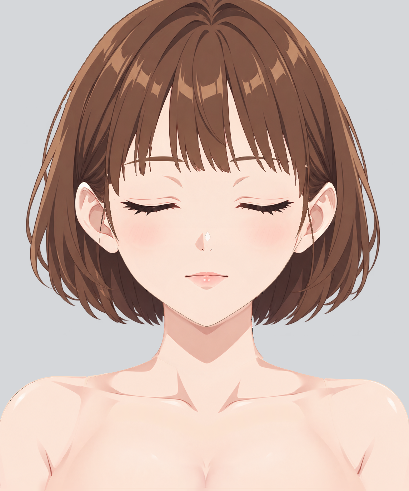

# Step01 分层人物绘画报告

当前状态：review-01.md 的R1–R15均已逐项处理并通过本轮原尺寸自检；完整后发独显额外发现的旧头盖接带也已修顺。KRA已保存重开，默认闭眼闭嘴、21个原生蒙版启用，PNG已更新。这里记录的是本轮自检结果。

## 当前工程与历史

- [character-depth.kra](character-depth.kra)：1145 × 1374，37 个逻辑 part、41 个普通绘画层、21 个启用的原生透明度蒙版。
- [character-depth.png](character-depth.png)：由当前保存重开的 KRA 在默认闭眼、闭嘴及蒙版启用状态导出。
- [本轮返修报告暂存](repair-01.md.tmp) 的结论为“已修复”，逐项结果及证据完整。
- 返修前成果保存在 [历史 KRA](history/pre-repair-01/character-depth.kra)、[历史 PNG](../pre-repair-01/character-depth.png) 及 `history/pre-repair-01/report.md`。review-01.md 及其证据保持原样。
- 固定参考为 [base-subject.png](../../../../part-layering/references/base-subject.png)，standard.png、simplified-subject.png 仅辅助画风。未移动或缩放参考内容；对照均为同坐标裁切。

## 本轮逐项处理

| 编号 | 本轮状态 | 实际处理与复核结果 | 图证 |
| --- | --- | --- | --- |
| R1 | 已处理，自检通过 | 恢复刘海可见分叉、尖束和露额间隙，清理眉线交叉位置的像素归属；保留160及顶部余量。 | [对照](../../repair-01-evidence/issues/R1-comparison.png) · [独显](../../repair-01-evidence/issues/R1-solo.png) · [隐藏上层](../../repair-01-evidence/issues/R1-upper-hidden.png) |
| R2 | 已处理，自检通过 | 已按参考修回外弧、边带、间隙，并将约x245–360/y760–906同一弯束及两枚完整尖梢归回21侧发后区；根部小尖角已收顺。6/21/151身份保持，后发新增被遮区使用专用生成的本件材质，未保留侧发参考像素。 | [对照](../../repair-01-evidence/issues/R2-comparison.png) · [独显](../../repair-01-evidence/issues/R2-solo.png) · [隐藏上层](../../repair-01-evidence/issues/R2-upper-hidden.png) |
| R3 | 已处理，自检通过 | 按本侧参考恢复右外弧、内弯尖梢和合理间隙，保留5/20/150及本侧非对称走势。 | [对照](../../repair-01-evidence/issues/R3-comparison.png) · [独显](../../repair-01-evidence/issues/R3-solo.png) · [隐藏上层](../../repair-01-evidence/issues/R3-upper-hidden.png) |
| R4 | 已处理，自检通过 | 在原图层按本眉自身调色重接完整眉弓曲线与渐变，去除平顶矩形、垂直台阶和混入的发色；未镜像另一眉。 | [对照](../../repair-01-evidence/issues/R4-comparison.png) · [独显](../../repair-01-evidence/issues/R4-solo.png) · [隐藏上层](../../repair-01-evidence/issues/R4-upper-hidden.png) |
| R5 | 已处理，自检通过 | 恢复画面左上睑自己的暖边、亮缘及睫毛体量，恢复独立褶线内容；未露出眼白/虹膜/眼内高光。 | [对照](../../repair-01-evidence/issues/R5-comparison.png) · [独显](../../repair-01-evidence/issues/R5-solo.png) · [隐藏上层](../../repair-01-evidence/issues/R5-upper-hidden.png) |
| R6 | 已处理，自检通过 | 独立按画面右侧参考恢复闭睑亮缘、暖边、尖簇和褶线，保留本侧弧度，未镜像R5。 | [对照](../../repair-01-evidence/issues/R6-comparison.png) · [独显](../../repair-01-evidence/issues/R6-solo.png) · [隐藏上层](../../repair-01-evidence/issues/R6-upper-hidden.png) |
| R7 | 已处理，自检通过 | 在画面左腮红原层以低透明度粉色色素画回斜线，保持独立透明晕染，无基础肤色椭圆。 | [对照](../../repair-01-evidence/issues/R7-comparison.png) · [独显](../../repair-01-evidence/issues/R7-solo.png) · [隐藏上层](../../repair-01-evidence/issues/R7-upper-hidden.png) |
| R8 | 已处理，自检通过 | 在画面右腮红原层独立补回方向、疏密和长度相近的淡斜线，保留本侧差异。 | [对照](../../repair-01-evidence/issues/R8-comparison.png) · [独显](../../repair-01-evidence/issues/R8-solo.png) · [隐藏上层](../../repair-01-evidence/issues/R8-upper-hidden.png) |
| R9 | 已处理，自检通过 | 恢复上唇所属的圆润深色嘴角与闭缝粗细；下唇保留双点高光、粉色唇面和自身明暗，未重复深缝或露出口内。 | [对照](../../repair-01-evidence/issues/R9-comparison.png) · [独显](../../repair-01-evidence/issues/R9-solo.png) · [隐藏上层](../../repair-01-evidence/issues/R9-upper-hidden.png) |
| R10 | 已处理，自检通过 | 左颈根：将torso蒙版淡出限制在颈部真实重叠的可靠实底内，保留完整底纹并以本体肤色接色；灰/白/暗底下不再有三角透底。 | [对照](../../repair-01-evidence/issues/R10-comparison.png) · [独显](../../repair-01-evidence/issues/R10-solo.png) · [隐藏上层](../../repair-01-evidence/issues/R10-upper-hidden.png) |
| R11 | 已处理，自检通过 | 右颈根独立校正覆盖与淡出终点，消除内部灰楔；没有添加AO或投影遮缝。 | [对照](../../repair-01-evidence/issues/R11-comparison.png) · [独显](../../repair-01-evidence/issues/R11-solo.png) · [隐藏上层](../../repair-01-evidence/issues/R11-upper-hidden.png) |
| R12 | 已处理，自检通过 | 保留左耳下后发承接形体，按真实外露发面作红区重新生成隐藏纹理，配准色阶并在同层接续发流；未复制耳、脸或侧发。 | [对照](../../repair-01-evidence/issues/R12-comparison.png) · [独显](../../repair-01-evidence/issues/R12-solo.png) · [隐藏上层](../../repair-01-evidence/issues/R12-upper-hidden.png) |
| R13 | 已处理，自检通过 | 右耳下M形硬缝与粗带已重接，约x940–950/y620–700短横纹、硬色块已用连续本件发色和顺向原生笔触修净；完整承接形体、长发线和单深度10保持。 | [对照](../../repair-01-evidence/issues/R13-comparison.png) · [独显](../../repair-01-evidence/issues/R13-solo.png) · [隐藏上层](../../repair-01-evidence/issues/R13-upper-hidden.png) |
| R14 | 已处理，自检通过 | 左腋侧：torso蒙版在上臂实底结束处停止淡出，恢复向画布底边的连续覆盖；原始上臂/躯干纹理均保留，无衣料复制。 | [对照](../../repair-01-evidence/issues/R14-comparison.png) · [独显](../../repair-01-evidence/issues/R14-solo.png) · [隐藏上层](../../repair-01-evidence/issues/R14-upper-hidden.png) |
| R15 | 已处理，自检通过 | 右腋侧独立处理同类覆盖不足，默认蒙版启用时不再出现宽三角透底，保留本侧腋部形体与独立层。 | [对照](../../repair-01-evidence/issues/R15-comparison.png) · [独显](../../repair-01-evidence/issues/R15-solo.png) · [隐藏上层](../../repair-01-evidence/issues/R15-upper-hidden.png) |

R12/R13 的对照为修复前后同一后发独显，不把原图中耳、脸或侧发当作隐藏补绘的像素目标。R10/R11/R14/R15 的带服装参考只负责定位，本体没有复制衣料、肩带或衣边。

## 续修与额外自检

- R2：[末梢前后独显](../../repair-01-evidence/checks/R2-tail-final-comparison.png)、[完整同part](../../repair-01-evidence/layers/hair-side_hair_right-complete-gray.png)。旧边界切过同一物理弯束，本次将连续表面及两枚尖梢完整归回侧发21；原顶根6、耳前151不动。根部额外小尖角也已接顺。对应形体扩展已记录在SVG和分组说明，不能再按旧y885/910笼统界线把同一束切断。
- R13：[局部前后独显](../../repair-01-evidence/checks/R13-stripe-final-comparison.png)。短硬色块已去除，接成连续束面；没有用宽平涂带或新阴影覆盖。
- S1（本次独显新发现）：[后发头盖接带前后](../../repair-01-evidence/checks/S1-cap-final-comparison.png)。在同一后发层只修y470–590旧接区，使用专用黄色控制生图、流线配准、接区局部透明度衔接与Krita原生逐束接色，去除横向断带。完整alpha、已修耳下材质和其他part保持。

R2新增侧发后方的完整back_hair底纹由专用RGB控制生图重建，再在同层修画；没有把上方侧发、耳、脸或服装的参考像素留在后发里。实际形体/归属相对旧色块的差异就是上述R2完整弯束扩展；另有此前记录的四件发轮廓拟合及耳下承接，均已同步有效上游输入。深度、ID和图层UUID没有改变。

零星抗锯齿、极低透明柔边及鼻尖细边按原范围留第二步；本轮反馈的缺口、错位、粗边带与明显材质接缝已处理。

## 素材、像素归属与实际绘画

原有33件独立生成素材及4件对称隐藏右眼复用来源保留在初始 [generation-manifest.json](evidence/generation-manifest.json)。本轮后发共5次生成调用：耳下补面首版材质未通过、第二版采用；R2新增隐藏长带首版漏画黄色目标而弃用，重生版采用；S1头盖接区专用稿采用。全部实际提示词、模型产物、采用/弃用理由在 [generation-attempts.json](repair-01-evidence/generation-attempts.json)，使用内置image_gen工具。采用稿都经过原尺寸检查、配准及Krita原生修画。

第二版控制图按后发本件的真实外露发面保留红区，隐藏补面为黄色，其他区域绿色；黄色及外部先在输入中抹为中性灰。[编辑输入](../../repair-01-evidence/back-input-v2.png)、[RGB控制](../../repair-01-evidence/back-control-v2.png)、[本轮生成稿](../../repair-01-evidence/back-generated-v2.png) 均保留。生成稿只用于对应隐藏区域，经过局部配准和本件红区色阶校准，未用遮挡物替代补全。

可见参考覆盖始终限制在本件归属中：刘海与眉分离、闭眼亮缘归上睑、闭缝和嘴角归上唇、腮红只含低透明色素。头发外轮廓按实际参考alpha及人工界定的部件边界修形；隐藏纹理保留在各自原层。原生 Basic-5 Size、Basic-5 Size Opacity、Airbrush Soft 画笔用于眉弓、腮红斜线、皮肤接色、后发纹理和接区修画，没有新增AO或投影层，没有用全层模糊或颜色阈值填色代替绘画。

R2专用素材：[灰底输入](../../repair-01-evidence/r2-back-edit-input.png)、[RGB控制](../../repair-01-evidence/r2-back-edit-control.png)、[采用的生成稿](../../repair-01-evidence/r2-back-generated-v2.png)。S1：[灰底输入](../../repair-01-evidence/back-cap-input.png)、[RGB控制](../../repair-01-evidence/back-cap-control.png)、[采用的生成稿](../../repair-01-evidence/back-cap-generated.png)。黄色及绿色先清空；素材未含遮挡物。各生成原图只作为素材，最终内容以保存重开的KRA及逐层导出为准。

实际alpha合成到灰/白/暗底后检查，不把透明PNG中不可见RGB当作可见画面。

## 结构与当前上游

先保存了 `hair/bangs.svg`、两侧侧发SVG、`hair/back_hair.svg` 的当前完整轮廓，并同步父组 `hair.svg` 为完整发件并集；修改前文件在 `workspace/repair-01/upstream-before/`。SVG轮廓导出只记录已绘制几何，不代替补画。

随后通过 `edit_groups` 与 `edit_occlusion` 保存完整树和深度表，均校验通过。逻辑ID、原有深度数值、普通绘画层数量和UUID不变：左侧发5/20/150，右侧发6/21/151，后发10，刘海160。没有重启上游或推进后续步骤。

R2/R13续修依据及本轮自检结果已通过edit_groups/edit_occlusion更新完整数据，37个终止part与41个深度区域均校验通过；当前metadata不再标待修。结构校验只确认引用和层序，绘画结论另依据逐层看图。[形体同步](repair-01-evidence/checks/shape-sync.json)、[预览更新](repair-01-evidence/checks/preview-update.json)、[分组预览](../../../../part-layering/preview.svg)、[深度预览](../../../../part-layering/occlusion/preview.svg)。

## 当前实际图层与复用

全部41个图层UUID保持。27层原始纹理逐字节未变，修改限定于反馈相关14个绘画层；颈、双臂、完整隐藏眼口等已合格内容保留。完整记录见 [retained-content.json](repair-01-evidence/checks/retained-content.json)。

| 深度 | part ID | 实际KRA图层 | UUID | 本轮像素 / 复用来源 | 原尺寸独显 |
| --- | --- | --- | --- | --- | --- |
| 5 | `hair/side_hair_left` | `0005 hair/side_hair_left__hidden_root` | `{ba109cee-df06-4530-9f49-95bf6d283203}` | 保持原纹理；同part深度分片 | [查看](../../repair-01-evidence/layers/0005-hair-side_hair_left__hidden_root-gray-crop.png) |
| 6 | `hair/side_hair_right` | `0006 hair/side_hair_right__hidden_root` | `{0d681884-b1c3-4e8b-86b0-fbea47ec59ba}` | 保持原纹理；同part深度分片 | [查看](../../repair-01-evidence/layers/0006-hair-side_hair_right__hidden_root-gray-crop.png) |
| 10 | `hair/back_hair` | `0010 hair/back_hair` | `{828fce76-68bd-44a5-95a5-1c9cc25c322e}` | 反馈范围内修画 | [查看](../../repair-01-evidence/layers/0010-hair-back_hair-gray-crop.png) |
| 20 | `hair/side_hair_left` | `0020 hair/side_hair_left__rear` | `{cbfc3f39-64b2-4eab-bd15-0769e040dd4b}` | 反馈范围内修画；同part深度分片 | [查看](../../repair-01-evidence/layers/0020-hair-side_hair_left__rear-gray-crop.png) |
| 21 | `hair/side_hair_right` | `0021 hair/side_hair_right__rear` | `{7156ca97-323f-4615-b4bd-f1d623ff542d}` | 反馈范围内修画；同part深度分片 | [查看](../../repair-01-evidence/layers/0021-hair-side_hair_right__rear-gray-crop.png) |
| 30 | `arms/arm_left` | `0030 arms/arm_left` | `{e971b32b-a4d5-44f6-9a0a-2a3701928f09}` | 保持原纹理 | [查看](../../repair-01-evidence/layers/0030-arms-arm_left-gray-crop.png) |
| 31 | `arms/arm_right` | `0031 arms/arm_right` | `{299f5cdb-52eb-40e4-94b8-3a2f028c95b9}` | 保持原纹理 | [查看](../../repair-01-evidence/layers/0031-arms-arm_right-gray-crop.png) |
| 35 | `neck` | `0035 neck` | `{28285caf-fec2-47a1-8607-58813906b82d}` | 保持原纹理 | [查看](../../repair-01-evidence/layers/0035-neck-gray-crop.png) |
| 40 | `body/torso` | `0040 body/torso` | `{90c56c5d-2d89-4563-a1e9-2918f8f05207}` | 反馈范围内修画 | [查看](../../repair-01-evidence/layers/0040-body-torso-gray-crop.png) |
| 50 | `body/breast` | `0050 body/breast` | `{8c772161-d068-47e6-adcf-44ee74724c9e}` | 保持原纹理 | [查看](../../repair-01-evidence/layers/0050-body-breast-gray-crop.png) |
| 60 | `face/ear_left` | `0060 face/ear_left` | `{ce7e5ed3-0d26-4f64-8397-2012ccc093af}` | 保持原纹理 | [查看](../../repair-01-evidence/layers/0060-face-ear_left-gray-crop.png) |
| 61 | `face/ear_right` | `0061 face/ear_right` | `{7a70b6b4-fc54-43b3-ac55-84ba99b2de3c}` | 保持原纹理 | [查看](../../repair-01-evidence/layers/0061-face-ear_right-gray-crop.png) |
| 70 | `face/face_base` | `0070 face/face_base` | `{aef3e0d1-b12b-49b3-a99f-f18141a36488}` | 保持原纹理 | [查看](../../repair-01-evidence/layers/0070-face-face_base-gray-crop.png) |
| 72 | `face/blush_left` | `0072 face/blush_left` | `{6b47a8a3-9eef-4fa1-8a67-09805094edb6}` | 反馈范围内修画 | [查看](../../repair-01-evidence/layers/0072-face-blush_left-gray-crop.png) |
| 73 | `face/blush_right` | `0073 face/blush_right` | `{ca46a4b0-fc0d-47b8-9ece-c28387534b69}` | 反馈范围内修画 | [查看](../../repair-01-evidence/layers/0073-face-blush_right-gray-crop.png) |
| 74 | `face/nose/volume_shadow` | `0074 face/nose/volume_shadow` | `{ca51f878-5c67-4b62-a57e-ee69ff47fa4f}` | 保持原纹理 | [查看](../../repair-01-evidence/layers/0074-face-nose-volume_shadow-gray-crop.png) |
| 75 | `face/nose/tip_highlight` | `0075 face/nose/tip_highlight` | `{03708806-48b7-4a96-bf78-69a9c31f0676}` | 保持原纹理 | [查看](../../repair-01-evidence/layers/0075-face-nose-tip_highlight-gray-crop.png) |
| 76 | `face/nose/tip_mark` | `0076 face/nose/tip_mark` | `{e2e57431-6b4e-482a-9cc6-f51aa6363f6b}` | 保持原纹理 | [查看](../../repair-01-evidence/layers/0076-face-nose-tip_mark-gray-crop.png) |
| 80 | `face/mouth/mouth_interior` | `0080 face/mouth/mouth_interior` | `{a6714c71-ef89-4ea5-8912-8b63190b0bda}` | 保持原纹理 | [查看](../../repair-01-evidence/layers/0080-face-mouth-mouth_interior-gray-crop.png) |
| 81 | `face/mouth/tongue` | `0081 face/mouth/tongue` | `{58c28208-a656-45cb-8a62-77d12d3cc400}` | 保持原纹理 | [查看](../../repair-01-evidence/layers/0081-face-mouth-tongue-gray-crop.png) |
| 82 | `face/mouth/lower_teeth` | `0082 face/mouth/lower_teeth` | `{3016c5b5-1c3b-46f2-a582-4e76f1cbb2cf}` | 保持原纹理 | [查看](../../repair-01-evidence/layers/0082-face-mouth-lower_teeth-gray-crop.png) |
| 83 | `face/mouth/upper_teeth` | `0083 face/mouth/upper_teeth` | `{e09b96ee-1087-4dd6-906c-c3f9c2db68e3}` | 保持原纹理 | [查看](../../repair-01-evidence/layers/0083-face-mouth-upper_teeth-gray-crop.png) |
| 84 | `face/mouth/lower_lip` | `0084 face/mouth/lower_lip` | `{887a247f-0a52-4009-8bdb-1b88877d4557}` | 反馈范围内修画 | [查看](../../repair-01-evidence/layers/0084-face-mouth-lower_lip-gray-crop.png) |
| 85 | `face/mouth/upper_lip` | `0085 face/mouth/upper_lip` | `{ce791675-e46f-4c63-860b-eea06d5dc610}` | 反馈范围内修画 | [查看](../../repair-01-evidence/layers/0085-face-mouth-upper_lip-gray-crop.png) |
| 90 | `face/eye_left/sclera` | `0090 face/eye_left/sclera` | `{ec25b6cd-3e6b-496a-b42b-3ceb934dfc6f}` | 保持原纹理 | [查看](../../repair-01-evidence/layers/0090-face-eye_left-sclera-gray-crop.png) |
| 91 | `face/eye_right/sclera` | `0091 face/eye_right/sclera` | `{94f8669c-1049-42fa-ac3e-2e99b1993caa}` | 保持原纹理；原生镜像来源 face/eye_left/sclera，x右=1157−x左，y不变 | [查看](../../repair-01-evidence/layers/0091-face-eye_right-sclera-gray-crop.png) |
| 92 | `face/eye_left/iris` | `0092 face/eye_left/iris` | `{77cfdad5-814b-412f-8662-9f7e1fa1d524}` | 保持原纹理 | [查看](../../repair-01-evidence/layers/0092-face-eye_left-iris-gray-crop.png) |
| 93 | `face/eye_right/iris` | `0093 face/eye_right/iris` | `{27ebce59-aae6-458b-942f-32c6b34be388}` | 保持原纹理；原生镜像来源 face/eye_left/iris，x右=1157−x左，y不变 | [查看](../../repair-01-evidence/layers/0093-face-eye_right-iris-gray-crop.png) |
| 94 | `face/eye_left/highlight` | `0094 face/eye_left/highlight` | `{9c9556bd-359d-4b20-b838-eeb8e5773c68}` | 保持原纹理 | [查看](../../repair-01-evidence/layers/0094-face-eye_left-highlight-gray-crop.png) |
| 95 | `face/eye_right/highlight` | `0095 face/eye_right/highlight` | `{37ec8df4-7543-4092-b33c-c16987262f4a}` | 保持原纹理；原生镜像来源 face/eye_left/highlight，x右=1157−x左，y不变 | [查看](../../repair-01-evidence/layers/0095-face-eye_right-highlight-gray-crop.png) |
| 96 | `face/eye_left/eyelid_crease` | `0096 face/eye_left/eyelid_crease` | `{13e413d1-bebd-4556-aef2-74dfcc6cb30b}` | 反馈范围内修画 | [查看](../../repair-01-evidence/layers/0096-face-eye_left-eyelid_crease-gray-crop.png) |
| 97 | `face/eye_right/eyelid_crease` | `0097 face/eye_right/eyelid_crease` | `{99b3cf10-413f-4da7-b9fa-bb688ed51b87}` | 反馈范围内修画 | [查看](../../repair-01-evidence/layers/0097-face-eye_right-eyelid_crease-gray-crop.png) |
| 98 | `face/eye_left/lower_eyelid` | `0098 face/eye_left/lower_eyelid` | `{58739c35-1b04-4e02-a7c1-105293d2a0fe}` | 保持原纹理 | [查看](../../repair-01-evidence/layers/0098-face-eye_left-lower_eyelid-gray-crop.png) |
| 99 | `face/eye_right/lower_eyelid` | `0099 face/eye_right/lower_eyelid` | `{755fbc9e-690c-4e31-9fba-f0cfc3eca24e}` | 保持原纹理；原生镜像来源 face/eye_left/lower_eyelid，x右=1157−x左，y不变 | [查看](../../repair-01-evidence/layers/0099-face-eye_right-lower_eyelid-gray-crop.png) |
| 100 | `face/eye_left/upper_eyelid` | `0100 face/eye_left/upper_eyelid` | `{59562826-f0d7-42b7-83f9-b1d5e81fb643}` | 反馈范围内修画 | [查看](../../repair-01-evidence/layers/0100-face-eye_left-upper_eyelid-gray-crop.png) |
| 101 | `face/eye_right/upper_eyelid` | `0101 face/eye_right/upper_eyelid` | `{57d1cce4-8056-4486-ada7-d60560aad693}` | 反馈范围内修画 | [查看](../../repair-01-evidence/layers/0101-face-eye_right-upper_eyelid-gray-crop.png) |
| 102 | `face/eyebrow_left` | `0102 face/eyebrow_left` | `{69d20734-2629-4e46-a76f-675535f2e685}` | 保持原纹理 | [查看](../../repair-01-evidence/layers/0102-face-eyebrow_left-gray-crop.png) |
| 103 | `face/eyebrow_right` | `0103 face/eyebrow_right` | `{2dd08a5b-aa4d-4e8b-b164-90d579dd5021}` | 反馈范围内修画 | [查看](../../repair-01-evidence/layers/0103-face-eyebrow_right-gray-crop.png) |
| 150 | `hair/side_hair_left` | `0150 hair/side_hair_left__front` | `{f0fcb119-ffaa-4167-bd8a-d2bfbead549a}` | 保持原纹理；同part深度分片 | [查看](../../repair-01-evidence/layers/0150-hair-side_hair_left__front-gray-crop.png) |
| 151 | `hair/side_hair_right` | `0151 hair/side_hair_right__front` | `{83cd096a-f7f1-4950-a041-10a058bf7ead}` | 保持原纹理；同part深度分片 | [查看](../../repair-01-evidence/layers/0151-hair-side_hair_right__front-gray-crop.png) |
| 160 | `hair/bangs` | `0160 hair/bangs` | `{d848dc1b-56e6-4e7d-ad60-6e51e8ad4df6}` | 反馈范围内修画 | [查看](../../repair-01-evidence/layers/0160-hair-bangs-gray-crop.png) |

左右隐藏眼采用一致暖棕虹膜、暖白眼白/高光；闭眼参考没有异色证据。4件右眼复用保持独立part、图层与蒙版。本轮没有重新镜像上睑、眉、耳或双臂。

## 原生蒙版与控制区域

21个蒙版UUID与归属保持，20个蒙版数据不变；唯一数据变更为torso接色蒙版。眼内六件共用各侧上下眼睑内缘确定的闭合开口；完整眼白裁切与开口显隐分别处理。下睑接触由上睑控制，口内开口由上下唇控制；默认开口为空，所有蒙版保持启用。

| 所属层 | 蒙版 | UUID | 控制区域 / 目标 | 默认 |
| --- | --- | --- | --- | --- |
| `0040 body/torso` | blend • neck and shoulder roots • controller neck + arms | `{079b4443-1b3c-422c-8135-d402a78ccf44}` | `neck + arms/arm_left + arms/arm_right；只在可靠实底内部重叠淡出` | 启用 |
| `0050 body/breast` | blend • upper surface into torso • controller body/torso | `{8527e030-0762-4e7f-9168-50c3d5a884bf}` | `body/torso；胸前上缘与侧边局部混合，完整原纹理保留` | 启用 |
| `0080 face/mouth/mouth_interior` | aperture • mouth • upper_lip + lower_lip • CLOSED | `{43af3811-c18a-48f3-8152-6031b79153e4}` | `face/mouth/upper_lip + face/mouth/lower_lip` | 启用 |
| `0081 face/mouth/tongue` | clip • full mouth_interior | `{48e12ed9-bee4-408d-bbd6-9140e359c43f}` | `face/mouth/mouth_interior` | 启用 |
| `0081 face/mouth/tongue` | aperture • mouth • upper_lip + lower_lip • CLOSED | `{155871c1-abfe-41f3-8a51-140a1d16ec6f}` | `face/mouth/upper_lip + face/mouth/lower_lip` | 启用 |
| `0082 face/mouth/lower_teeth` | clip • full mouth_interior | `{11b527ac-a02f-4002-871d-88f90e83e405}` | `face/mouth/mouth_interior` | 启用 |
| `0082 face/mouth/lower_teeth` | aperture • mouth • upper_lip + lower_lip • CLOSED | `{57e3410e-65ef-4d48-9e77-9c04c50498f3}` | `face/mouth/upper_lip + face/mouth/lower_lip` | 启用 |
| `0083 face/mouth/upper_teeth` | clip • full mouth_interior | `{150b821c-c16e-4fc5-bcbd-7969fedc53b3}` | `face/mouth/mouth_interior` | 启用 |
| `0083 face/mouth/upper_teeth` | aperture • mouth • upper_lip + lower_lip • CLOSED | `{e6509547-793f-45f6-86ac-2045c99cc2da}` | `face/mouth/upper_lip + face/mouth/lower_lip` | 启用 |
| `0090 face/eye_left/sclera` | aperture • eye_left • upper_eyelid + lower_eyelid • CLOSED | `{fa38857b-eef9-42d7-8b1b-8350489e4668}` | `face/eye_left/upper_eyelid + face/eye_left/lower_eyelid` | 启用 |
| `0091 face/eye_right/sclera` | aperture • eye_right • upper_eyelid + lower_eyelid • CLOSED | `{82ff287e-f5be-435c-9f6b-4f19df2c99a5}` | `face/eye_right/upper_eyelid + face/eye_right/lower_eyelid` | 启用 |
| `0092 face/eye_left/iris` | clip • full eye_left sclera | `{700765c5-e08d-4c9a-9c83-39600d60ce1c}` | `face/eye_left/sclera` | 启用 |
| `0092 face/eye_left/iris` | aperture • eye_left • upper_eyelid + lower_eyelid • CLOSED | `{423cd416-4126-4c5f-a275-96596c184644}` | `face/eye_left/upper_eyelid + face/eye_left/lower_eyelid` | 启用 |
| `0093 face/eye_right/iris` | clip • full eye_right sclera | `{27d5394b-2a8b-47a5-990d-1ab30faebd6a}` | `face/eye_right/sclera` | 启用 |
| `0093 face/eye_right/iris` | aperture • eye_right • upper_eyelid + lower_eyelid • CLOSED | `{b3421a72-604f-400e-9d74-4e44ed5760fd}` | `face/eye_right/upper_eyelid + face/eye_right/lower_eyelid` | 启用 |
| `0094 face/eye_left/highlight` | clip • full eye_left sclera | `{ea3e662d-80d1-4d03-bdb7-b8c4103bd6b9}` | `face/eye_left/sclera` | 启用 |
| `0094 face/eye_left/highlight` | aperture • eye_left • upper_eyelid + lower_eyelid • CLOSED | `{a0d9020c-8b1f-460e-89de-3891fef95b53}` | `face/eye_left/upper_eyelid + face/eye_left/lower_eyelid` | 启用 |
| `0095 face/eye_right/highlight` | clip • full eye_right sclera | `{b4f6f33f-c77c-4c20-9220-9006abf26183}` | `face/eye_right/sclera` | 启用 |
| `0095 face/eye_right/highlight` | aperture • eye_right • upper_eyelid + lower_eyelid • CLOSED | `{c5b2d787-8707-4189-a9e5-6ad44a284e9c}` | `face/eye_right/upper_eyelid + face/eye_right/lower_eyelid` | 启用 |
| `0098 face/eye_left/lower_eyelid` | closed contact • upper_eyelid occludes lower_eyelid | `{f5d68f91-380a-4775-9969-2f5f49835984}` | `face/eye_left/upper_eyelid` | 启用 |
| `0099 face/eye_right/lower_eyelid` | closed contact • upper_eyelid occludes lower_eyelid | `{c8c844c7-ee6c-47af-8cfd-15d86445163e}` | `face/eye_right/upper_eyelid` | 启用 |

已在实际Krita中逐件启用/临时停用蒙版，保存完整纹理和默认状态的对照，结束后恢复所有显隐。

| part ID | 原生启用 / 临时停用证据 |
| --- | --- |
| `body/torso` | [查看](../../repair-01-evidence/mask-checks/body-torso.png) |
| `body/breast` | [查看](../../repair-01-evidence/mask-checks/body-breast.png) |
| `face/mouth/mouth_interior` | [查看](../../repair-01-evidence/mask-checks/face-mouth-mouth_interior.png) |
| `face/mouth/tongue` | [查看](../../repair-01-evidence/mask-checks/face-mouth-tongue.png) |
| `face/mouth/lower_teeth` | [查看](../../repair-01-evidence/mask-checks/face-mouth-lower_teeth.png) |
| `face/mouth/upper_teeth` | [查看](../../repair-01-evidence/mask-checks/face-mouth-upper_teeth.png) |
| `face/eye_left/sclera` | [查看](../../repair-01-evidence/mask-checks/face-eye_left-sclera.png) |
| `face/eye_right/sclera` | [查看](../../repair-01-evidence/mask-checks/face-eye_right-sclera.png) |
| `face/eye_left/iris` | [查看](../../repair-01-evidence/mask-checks/face-eye_left-iris.png) |
| `face/eye_right/iris` | [查看](../../repair-01-evidence/mask-checks/face-eye_right-iris.png) |
| `face/eye_left/highlight` | [查看](../../repair-01-evidence/mask-checks/face-eye_left-highlight.png) |
| `face/eye_right/highlight` | [查看](../../repair-01-evidence/mask-checks/face-eye_right-highlight.png) |
| `face/eye_left/lower_eyelid` | [查看](../../repair-01-evidence/mask-checks/face-eye_left-lower_eyelid.png) |
| `face/eye_right/lower_eyelid` | [查看](../../repair-01-evidence/mask-checks/face-eye_right-lower_eyelid.png) |

[蒙版机读记录](repair-01-evidence/mask-audit.json)；[临时停用开口](../../repair-01-evidence/checks/apertures-disabled.png)；[隐藏眼口前层后的完整底纹](../../repair-01-evidence/checks/hidden-eye-mouth-revealed.png)；[隐藏上层脸底](../../repair-01-evidence/checks/face-base-upper-hidden.png)；[隐藏胸前层](../../repair-01-evidence/checks/torso-under-front.png)。隐藏眼口12件原始纹理保持，未为了默认闭合删除内容。

## 保存重开与当前结论

当前工作KRA已保存、关闭并重新打开。41绘画层、21原生蒙版的名称、UUID、顺序、归属、启用状态、像素/蒙版数据，以及默认合成前后保持一致；PNG在重开后从蒙版启用状态导出。[reopen-check.json](repair-01-evidence/checks/reopen-check.json) 仅证明保存保持性，不代替看图。

四处原内部透底另在不同背景核对：[R10](../../repair-01-evidence/issues/R10-background-check.png)、[R11](../../repair-01-evidence/issues/R11-background-check.png)、[R14](../../repair-01-evidence/issues/R14-background-check.png)、[R15](../../repair-01-evidence/issues/R15-background-check.png)。

批处理已改用写完后原子提交到已验证Krita bridge，避免轮询读取未写完的脚本。私有环境、另一工程和调度文件未改动。

本轮R1–R15及S1额外接带自检均通过。41个普通绘画层逐层检查，25个小部件另以[原尺寸排列](../../repair-01-evidence/checks/small-parts-original-size.png)留证；完整脸底、后发、同part侧发及隐藏眼口内容均已独显检查。默认合成对照固定参考，未移动参考或用错误归属覆盖缩小差异。
