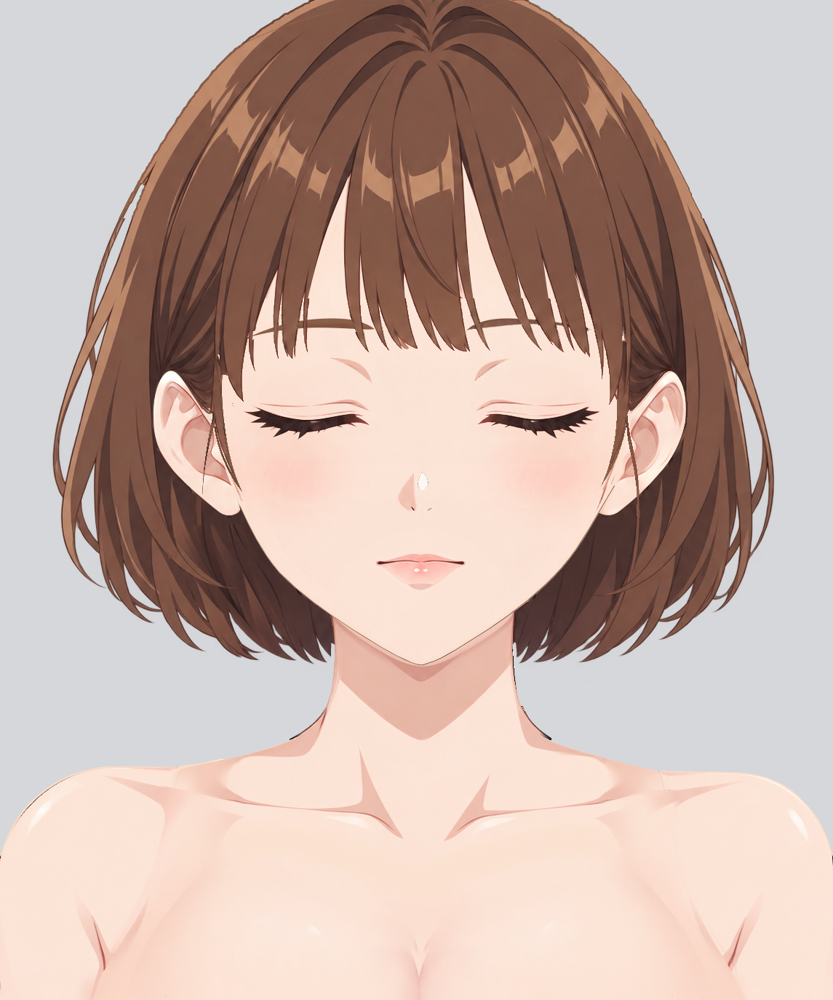

# Step01 当前分层人物绘画报告

当前状态：review-02.md 的六项反馈已逐项修复，并通过本轮原尺寸自检。当前KRA为37个逻辑part、41个普通绘画层、22个启用的原生透明度蒙版；已保存重开并更新默认闭眼闭嘴PNG。本结论是本轮自检，未代替后续独立review。

[KRA](character-depth.kra) · [PNG](character-depth.png) · [返修暂存报告](repair-02.md.tmp) · [上一轮绘画报告](history/pre-repair-02/report.md) · [返修前KRA](history/pre-repair-02/character-depth.kra)。review-01、repair-01、review-02及各自证据均保留。

固定参考为[base-subject.png](../../part-layering/references/base-subject.png)，未平移、缩放或换参考；standard.png、simplified-subject.png仅辅助隐藏设计与画风。R6参考中的临时背心只作位置上下文，不作为皮肤像素目标。

## Review02逐项处理

| 编号 | 处理结果（本轮自检通过） | 证据 |
| --- | --- | --- |
| R1 | 画面左眉线处逐束接回刘海本体alpha、侧缘及细丝，保留真实露额缝；眉103完整留在160后，未削眉、抬眉或贴入眉/肤色。 | [同坐标对照](repair-02-evidence/issues/R1-comparison.png) · [默认](repair-02-evidence/issues/R1-default.png) · [隐藏上层](repair-02-evidence/issues/R1-upper-hidden.png) · [刘海独显](repair-02-evidence/checks/R1-bangs-only.png) · [隐藏眉](repair-02-evidence/checks/R1-without-brows.png) |
| R2 | 画面右侧按本侧发流独立接回同高缺口与台阶，保留各束长短、内部真实分叉及间隙；眉102、刘海层序和位置不改，未镜像。 | [同坐标对照](repair-02-evidence/issues/R2-comparison.png) · [默认](repair-02-evidence/issues/R2-default.png) · [隐藏上层](repair-02-evidence/issues/R2-upper-hidden.png) · [刘海独显](repair-02-evidence/checks/R2-bangs-only.png) · [隐藏眉](repair-02-evidence/checks/R2-without-brows.png) |
| R3 | 左颈肩补齐原内缩的数像素可见外弧，收住颈底预留尖片；在实际归属内恢复颈侧/肩根皮肤并原生接色，消除斜向拼接。完整颈底和胸廓保留，原内部实底不退回。 | [同坐标对照](repair-02-evidence/issues/R3-comparison.png) · [默认](repair-02-evidence/issues/R3-default.png) · [隐藏上层](repair-02-evidence/issues/R3-upper-hidden.png) · [两件合看](repair-02-evidence/checks/R3-joint-only.png) · [多底色](repair-02-evidence/issues/R3-background-check.png) |
| R4 | 右侧独立修正外弧、预留显隐及颈侧体积接续，去掉外挑回折和亮碎接痕；保持本侧明暗、不对称及颈35/torso40职责，未以AO或投影盖缝。 | [同坐标对照](repair-02-evidence/issues/R4-comparison.png) · [默认](repair-02-evidence/issues/R4-default.png) · [隐藏上层](repair-02-evidence/issues/R4-upper-hidden.png) · [两件合看](repair-02-evidence/checks/R4-joint-only.png) · [多底色](repair-02-evidence/issues/R4-background-check.png) |
| R5 | 只在0010重新生成并配准连续后发宽面，修净浅金碎片、短折笔及横向游离侧发样残影。同步原生独显与节点投影确认长弧连续；0021真实弯束和两枚末梢原像素保持，完整后发alpha、耳下承接与深度10不变。 | [同坐标对照](repair-02-evidence/issues/R5-comparison.png) · [默认](repair-02-evidence/issues/R5-default.png) · [隐藏上层](repair-02-evidence/issues/R5-upper-hidden.png) · [后发独显](repair-02-evidence/checks/R5-back-only.png) · [保留的侧发](repair-02-evidence/checks/R5-side-only.png) |
| R6 | 0050同层以本件已有生成曲面素材局部延展并用原生画笔接色，将渐变及中央本体明暗续至y1374，去除底部横带；不增画画外形体，不把本件明暗转入torso，不复制衣料。 | [同坐标对照](repair-02-evidence/issues/R6-comparison.png) · [默认](repair-02-evidence/issues/R6-default.png) · [隐藏上层](repair-02-evidence/issues/R6-upper-hidden.png) · [本层独显](repair-02-evidence/issues/R6-solo.png) |

## 像素归属、补全与实际修画

刘海只恢复它自身的可见发面；逐束以损坏区上下可靠轮廓接续，保留真实露额缝和叉缝，边色从本束内部取色后原生修接。双眉像素、位置、UUID和层序保持。

颈侧与肩根按当前实际可见职责互斥覆盖参考皮肤，隐藏余量保留各自生成材质；[两件覆盖与完整性记录](repair-02-evidence/checks/ownership-and-completeness.json)及[颈可见源范围](repair-02-evidence/neck-own-reference-mask.png)、[torso可见源范围](repair-02-evidence/torso-own-reference-mask.png)可核对。新增颈部原生透明度蒙版将预留量控制在连续颈肩外弧内；torso接色蒙版藏起覆盖到颈侧的AA预留，肩根仍有连续实底。完整neck和torso原alpha支持未删除，局部只增加实际缺失外弧。原生画笔处理各自接区，没有加入AO、投影或遮缝阴影。

R5使用本步骤内置image_gen生成一版专用后发素材：[灰底编辑输入](repair-02-evidence/back-input.png)、[RGB控制](repair-02-evidence/back-control.png)、[生成稿](repair-02-evidence/back-generated.png)、[实际提示词和保存记录](repair-02-evidence/generation.json)。黄色缺失面及绿色外部先清为灰底，输入没有耳、脸或上方侧发；黄色完整恢复为本件纵向宽面，不再出现游离细弯束。生成稿只用于该黄色范围，经过几何配准、邻接本件色阶校准和Krita原生局部接色，保留完整后发alpha。没有把0021的像素复制回后发，0021本轮逐字节未改。

R6使用本件既有生成曲面像素作短距离材质延展，再在Krita同层接续肤色和中央明暗至画布裁切边；完整alpha及本层蒙版数据保持。当前底部只有本件皮肤和体积，无衣料、肩带或torso重复乳沟。

Basic-5 Size与Airbrush Soft等原生画笔用于发束边、接色及曲面接续；未用全层模糊或颜色阈值填色代替修画。原尺寸独显、隐藏上层和默认叠加分别检查；细微抗锯齿、低透明柔边及零星鼻尖细边按review-02原定范围留第二步。

## 当前有效结构与形状偏差记录

保存了hair/bangs.svg、neck.svg、body/torso.svg的实际完整轮廓，并同步hair.svg、body.svg父轮廓。相对上轮色块的变化限于刘海交叉处缺口补回、颈侧和肩根缺失窄弧补齐；R5及R6只改本件纹理，alpha不变。修改前SVG保存在workspace/repair-02/upstream-before。随后通过edit_groups与edit_occlusion保存完整树和深度说明，37个终止part、41个深度区域校验通过。

逻辑ID、普通绘画层UUID、层序和深度数值均保持。两侧发仍为5/20/150与6/21/151，同part共同运动；后发10、neck35、torso40、breast50、刘海160不变。本轮没有新拆分逻辑部件或绘画深度，没有重启上游。

[形体同步记录](repair-02-evidence/checks/shape-sync.json) · [预览记录](repair-02-evidence/checks/preview-update.json) · [分组预览](../../part-layering/preview.svg) · [深度预览](../../part-layering/occlusion/preview.svg)。深度预览按实际普通层和启用蒙版投影更新，隐藏眼口保持默认关闭。

## 逻辑part与实际KRA绘画层

41个绘画层UUID全部保持；本轮修改5层，另外36层原始像素逐字节保持。全部原尺寸逐层导出在下表，重点复核本轮5个受影响层和同part侧发组合；未变内容保留review-02逐层认可状态。[保留内容记录](repair-02-evidence/checks/retained-content.json)。

| 深度 | part ID / 实际图层 | UUID | 本轮 / 原尺寸独显 |
| --- | --- | --- | --- |
| 5 | `hair/side_hair_left` / `0005 hair/side_hair_left__hidden_root` | `{ba109cee-df06-4530-9f49-95bf6d283203}` | 原像素保持；同part深度分片 · [独显](repair-02-evidence/layers/0005-hair-side_hair_left__hidden_root-gray-crop.png) |
| 6 | `hair/side_hair_right` / `0006 hair/side_hair_right__hidden_root` | `{0d681884-b1c3-4e8b-86b0-fbea47ec59ba}` | 原像素保持；同part深度分片 · [独显](repair-02-evidence/layers/0006-hair-side_hair_right__hidden_root-gray-crop.png) |
| 10 | `hair/back_hair` / `0010 hair/back_hair` | `{828fce76-68bd-44a5-95a5-1c9cc25c322e}` | 本轮局部修复 · [独显](repair-02-evidence/layers/0010-hair-back_hair-gray-crop.png) |
| 20 | `hair/side_hair_left` / `0020 hair/side_hair_left__rear` | `{cbfc3f39-64b2-4eab-bd15-0769e040dd4b}` | 原像素保持；同part深度分片 · [独显](repair-02-evidence/layers/0020-hair-side_hair_left__rear-gray-crop.png) |
| 21 | `hair/side_hair_right` / `0021 hair/side_hair_right__rear` | `{7156ca97-323f-4615-b4bd-f1d623ff542d}` | 原像素保持；同part深度分片 · [独显](repair-02-evidence/layers/0021-hair-side_hair_right__rear-gray-crop.png) |
| 30 | `arms/arm_left` / `0030 arms/arm_left` | `{e971b32b-a4d5-44f6-9a0a-2a3701928f09}` | 原像素保持 · [独显](repair-02-evidence/layers/0030-arms-arm_left-gray-crop.png) |
| 31 | `arms/arm_right` / `0031 arms/arm_right` | `{299f5cdb-52eb-40e4-94b8-3a2f028c95b9}` | 原像素保持 · [独显](repair-02-evidence/layers/0031-arms-arm_right-gray-crop.png) |
| 35 | `neck` / `0035 neck` | `{28285caf-fec2-47a1-8607-58813906b82d}` | 本轮局部修复 · [独显](repair-02-evidence/layers/0035-neck-gray-crop.png) |
| 40 | `body/torso` / `0040 body/torso` | `{90c56c5d-2d89-4563-a1e9-2918f8f05207}` | 本轮局部修复 · [独显](repair-02-evidence/layers/0040-body-torso-gray-crop.png) |
| 50 | `body/breast` / `0050 body/breast` | `{8c772161-d068-47e6-adcf-44ee74724c9e}` | 本轮局部修复 · [独显](repair-02-evidence/layers/0050-body-breast-gray-crop.png) |
| 60 | `face/ear_left` / `0060 face/ear_left` | `{ce7e5ed3-0d26-4f64-8397-2012ccc093af}` | 原像素保持 · [独显](repair-02-evidence/layers/0060-face-ear_left-gray-crop.png) |
| 61 | `face/ear_right` / `0061 face/ear_right` | `{7a70b6b4-fc54-43b3-ac55-84ba99b2de3c}` | 原像素保持 · [独显](repair-02-evidence/layers/0061-face-ear_right-gray-crop.png) |
| 70 | `face/face_base` / `0070 face/face_base` | `{aef3e0d1-b12b-49b3-a99f-f18141a36488}` | 原像素保持 · [独显](repair-02-evidence/layers/0070-face-face_base-gray-crop.png) |
| 72 | `face/blush_left` / `0072 face/blush_left` | `{6b47a8a3-9eef-4fa1-8a67-09805094edb6}` | 原像素保持 · [独显](repair-02-evidence/layers/0072-face-blush_left-gray-crop.png) |
| 73 | `face/blush_right` / `0073 face/blush_right` | `{ca46a4b0-fc0d-47b8-9ece-c28387534b69}` | 原像素保持 · [独显](repair-02-evidence/layers/0073-face-blush_right-gray-crop.png) |
| 74 | `face/nose/volume_shadow` / `0074 face/nose/volume_shadow` | `{ca51f878-5c67-4b62-a57e-ee69ff47fa4f}` | 原像素保持 · [独显](repair-02-evidence/layers/0074-face-nose-volume_shadow-gray-crop.png) |
| 75 | `face/nose/tip_highlight` / `0075 face/nose/tip_highlight` | `{03708806-48b7-4a96-bf78-69a9c31f0676}` | 原像素保持 · [独显](repair-02-evidence/layers/0075-face-nose-tip_highlight-gray-crop.png) |
| 76 | `face/nose/tip_mark` / `0076 face/nose/tip_mark` | `{e2e57431-6b4e-482a-9cc6-f51aa6363f6b}` | 原像素保持 · [独显](repair-02-evidence/layers/0076-face-nose-tip_mark-gray-crop.png) |
| 80 | `face/mouth/mouth_interior` / `0080 face/mouth/mouth_interior` | `{a6714c71-ef89-4ea5-8912-8b63190b0bda}` | 原像素保持 · [独显](repair-02-evidence/layers/0080-face-mouth-mouth_interior-gray-crop.png) |
| 81 | `face/mouth/tongue` / `0081 face/mouth/tongue` | `{58c28208-a656-45cb-8a62-77d12d3cc400}` | 原像素保持 · [独显](repair-02-evidence/layers/0081-face-mouth-tongue-gray-crop.png) |
| 82 | `face/mouth/lower_teeth` / `0082 face/mouth/lower_teeth` | `{3016c5b5-1c3b-46f2-a582-4e76f1cbb2cf}` | 原像素保持 · [独显](repair-02-evidence/layers/0082-face-mouth-lower_teeth-gray-crop.png) |
| 83 | `face/mouth/upper_teeth` / `0083 face/mouth/upper_teeth` | `{e09b96ee-1087-4dd6-906c-c3f9c2db68e3}` | 原像素保持 · [独显](repair-02-evidence/layers/0083-face-mouth-upper_teeth-gray-crop.png) |
| 84 | `face/mouth/lower_lip` / `0084 face/mouth/lower_lip` | `{887a247f-0a52-4009-8bdb-1b88877d4557}` | 原像素保持 · [独显](repair-02-evidence/layers/0084-face-mouth-lower_lip-gray-crop.png) |
| 85 | `face/mouth/upper_lip` / `0085 face/mouth/upper_lip` | `{ce791675-e46f-4c63-860b-eea06d5dc610}` | 原像素保持 · [独显](repair-02-evidence/layers/0085-face-mouth-upper_lip-gray-crop.png) |
| 90 | `face/eye_left/sclera` / `0090 face/eye_left/sclera` | `{ec25b6cd-3e6b-496a-b42b-3ceb934dfc6f}` | 原像素保持 · [独显](repair-02-evidence/layers/0090-face-eye_left-sclera-gray-crop.png) |
| 91 | `face/eye_right/sclera` / `0091 face/eye_right/sclera` | `{94f8669c-1049-42fa-ac3e-2e99b1993caa}` | 原像素保持；既有复用来源 face/eye_left/sclera，x右=1157−x左，y不变 · [独显](repair-02-evidence/layers/0091-face-eye_right-sclera-gray-crop.png) |
| 92 | `face/eye_left/iris` / `0092 face/eye_left/iris` | `{77cfdad5-814b-412f-8662-9f7e1fa1d524}` | 原像素保持 · [独显](repair-02-evidence/layers/0092-face-eye_left-iris-gray-crop.png) |
| 93 | `face/eye_right/iris` / `0093 face/eye_right/iris` | `{27ebce59-aae6-458b-942f-32c6b34be388}` | 原像素保持；既有复用来源 face/eye_left/iris，x右=1157−x左，y不变 · [独显](repair-02-evidence/layers/0093-face-eye_right-iris-gray-crop.png) |
| 94 | `face/eye_left/highlight` / `0094 face/eye_left/highlight` | `{9c9556bd-359d-4b20-b838-eeb8e5773c68}` | 原像素保持 · [独显](repair-02-evidence/layers/0094-face-eye_left-highlight-gray-crop.png) |
| 95 | `face/eye_right/highlight` / `0095 face/eye_right/highlight` | `{37ec8df4-7543-4092-b33c-c16987262f4a}` | 原像素保持；既有复用来源 face/eye_left/highlight，x右=1157−x左，y不变 · [独显](repair-02-evidence/layers/0095-face-eye_right-highlight-gray-crop.png) |
| 96 | `face/eye_left/eyelid_crease` / `0096 face/eye_left/eyelid_crease` | `{13e413d1-bebd-4556-aef2-74dfcc6cb30b}` | 原像素保持 · [独显](repair-02-evidence/layers/0096-face-eye_left-eyelid_crease-gray-crop.png) |
| 97 | `face/eye_right/eyelid_crease` / `0097 face/eye_right/eyelid_crease` | `{99b3cf10-413f-4da7-b9fa-bb688ed51b87}` | 原像素保持 · [独显](repair-02-evidence/layers/0097-face-eye_right-eyelid_crease-gray-crop.png) |
| 98 | `face/eye_left/lower_eyelid` / `0098 face/eye_left/lower_eyelid` | `{58739c35-1b04-4e02-a7c1-105293d2a0fe}` | 原像素保持 · [独显](repair-02-evidence/layers/0098-face-eye_left-lower_eyelid-gray-crop.png) |
| 99 | `face/eye_right/lower_eyelid` / `0099 face/eye_right/lower_eyelid` | `{755fbc9e-690c-4e31-9fba-f0cfc3eca24e}` | 原像素保持；既有复用来源 face/eye_left/lower_eyelid，x右=1157−x左，y不变 · [独显](repair-02-evidence/layers/0099-face-eye_right-lower_eyelid-gray-crop.png) |
| 100 | `face/eye_left/upper_eyelid` / `0100 face/eye_left/upper_eyelid` | `{59562826-f0d7-42b7-83f9-b1d5e81fb643}` | 原像素保持 · [独显](repair-02-evidence/layers/0100-face-eye_left-upper_eyelid-gray-crop.png) |
| 101 | `face/eye_right/upper_eyelid` / `0101 face/eye_right/upper_eyelid` | `{57d1cce4-8056-4486-ada7-d60560aad693}` | 原像素保持 · [独显](repair-02-evidence/layers/0101-face-eye_right-upper_eyelid-gray-crop.png) |
| 102 | `face/eyebrow_left` / `0102 face/eyebrow_left` | `{69d20734-2629-4e46-a76f-675535f2e685}` | 原像素保持 · [独显](repair-02-evidence/layers/0102-face-eyebrow_left-gray-crop.png) |
| 103 | `face/eyebrow_right` / `0103 face/eyebrow_right` | `{2dd08a5b-aa4d-4e8b-b164-90d579dd5021}` | 原像素保持 · [独显](repair-02-evidence/layers/0103-face-eyebrow_right-gray-crop.png) |
| 150 | `hair/side_hair_left` / `0150 hair/side_hair_left__front` | `{f0fcb119-ffaa-4167-bd8a-d2bfbead549a}` | 原像素保持；同part深度分片 · [独显](repair-02-evidence/layers/0150-hair-side_hair_left__front-gray-crop.png) |
| 151 | `hair/side_hair_right` / `0151 hair/side_hair_right__front` | `{83cd096a-f7f1-4950-a041-10a058bf7ead}` | 原像素保持；同part深度分片 · [独显](repair-02-evidence/layers/0151-hair-side_hair_right__front-gray-crop.png) |
| 160 | `hair/bangs` / `0160 hair/bangs` | `{d848dc1b-56e6-4e7d-ad60-6e51e8ad4df6}` | 本轮局部修复 · [独显](repair-02-evidence/layers/0160-hair-bangs-gray-crop.png) |

最初33件生成素材及4件隐藏右眼镜像复用仍见[初始素材清单](evidence/generation-manifest.json)。左右隐藏眼协调为暖棕虹膜、暖白眼白与简洁高光；闭眼参考无异色依据。本轮未重画已合格的眼、口、眉、腮红、鼻、耳或双臂。

## 原生显隐与裁切控制

原有21个蒙版UUID与归属保持，其中20个数据不变，torso接色蒙版只调整R3/R4局部。新增1个附着neck普通层的joint contour透明度蒙版，控制者为body/torso肩根外弧，默认启用。当前22个蒙版全部启用；15个蒙版所属part均已临时停用检查完整底纹并恢复。

眼内三件共享本侧上下眼睑内缘确定的闭合开口，虹膜/高光另受完整眼白裁切；下睑由上睑接触显隐控制。口内四件由上下唇开口控制，牙舌另受完整口内裁切。默认闭眼闭嘴开口为空，隐藏12件原始纹理全部保持。

| 所属层 | 蒙版 / UUID | 控制区域或目标 | 默认 |
| --- | --- | --- | --- |
| `0035 neck` | joint contour • neck/shoulder outer arc • controller body/torso / `{055ca177-6772-4dca-994a-5091bf664d2a}` | `body/torso；R3/R4共享颈肩外弧，只控制预留默认外露，保留完整颈底` | 启用 |
| `0040 body/torso` | blend • neck and shoulder roots • controller neck + arms / `{079b4443-1b3c-422c-8135-d402a78ccf44}` | `neck + arms；R3/R4颈侧预留显隐和肩根可靠覆盖，原腋侧控制保留` | 启用 |
| `0050 body/breast` | blend • upper surface into torso • controller body/torso / `{8527e030-0762-4e7f-9168-50c3d5a884bf}` | `body/torso；胸前上缘及两侧混合，本轮数据不变` | 启用 |
| `0080 face/mouth/mouth_interior` | aperture • mouth • upper_lip + lower_lip • CLOSED / `{43af3811-c18a-48f3-8152-6031b79153e4}` | `face/mouth/upper_lip + face/mouth/lower_lip` | 启用 |
| `0081 face/mouth/tongue` | clip • full mouth_interior / `{48e12ed9-bee4-408d-bbd6-9140e359c43f}` | `face/mouth/mouth_interior` | 启用 |
| `0081 face/mouth/tongue` | aperture • mouth • upper_lip + lower_lip • CLOSED / `{155871c1-abfe-41f3-8a51-140a1d16ec6f}` | `face/mouth/upper_lip + face/mouth/lower_lip` | 启用 |
| `0082 face/mouth/lower_teeth` | clip • full mouth_interior / `{11b527ac-a02f-4002-871d-88f90e83e405}` | `face/mouth/mouth_interior` | 启用 |
| `0082 face/mouth/lower_teeth` | aperture • mouth • upper_lip + lower_lip • CLOSED / `{57e3410e-65ef-4d48-9e77-9c04c50498f3}` | `face/mouth/upper_lip + face/mouth/lower_lip` | 启用 |
| `0083 face/mouth/upper_teeth` | clip • full mouth_interior / `{150b821c-c16e-4fc5-bcbd-7969fedc53b3}` | `face/mouth/mouth_interior` | 启用 |
| `0083 face/mouth/upper_teeth` | aperture • mouth • upper_lip + lower_lip • CLOSED / `{e6509547-793f-45f6-86ac-2045c99cc2da}` | `face/mouth/upper_lip + face/mouth/lower_lip` | 启用 |
| `0090 face/eye_left/sclera` | aperture • eye_left • upper_eyelid + lower_eyelid • CLOSED / `{fa38857b-eef9-42d7-8b1b-8350489e4668}` | `face/eye_left/upper_eyelid + face/eye_left/lower_eyelid` | 启用 |
| `0091 face/eye_right/sclera` | aperture • eye_right • upper_eyelid + lower_eyelid • CLOSED / `{82ff287e-f5be-435c-9f6b-4f19df2c99a5}` | `face/eye_right/upper_eyelid + face/eye_right/lower_eyelid` | 启用 |
| `0092 face/eye_left/iris` | clip • full eye_left sclera / `{700765c5-e08d-4c9a-9c83-39600d60ce1c}` | `face/eye_left/sclera` | 启用 |
| `0092 face/eye_left/iris` | aperture • eye_left • upper_eyelid + lower_eyelid • CLOSED / `{423cd416-4126-4c5f-a275-96596c184644}` | `face/eye_left/upper_eyelid + face/eye_left/lower_eyelid` | 启用 |
| `0093 face/eye_right/iris` | clip • full eye_right sclera / `{27d5394b-2a8b-47a5-990d-1ab30faebd6a}` | `face/eye_right/sclera` | 启用 |
| `0093 face/eye_right/iris` | aperture • eye_right • upper_eyelid + lower_eyelid • CLOSED / `{b3421a72-604f-400e-9d74-4e44ed5760fd}` | `face/eye_right/upper_eyelid + face/eye_right/lower_eyelid` | 启用 |
| `0094 face/eye_left/highlight` | clip • full eye_left sclera / `{ea3e662d-80d1-4d03-bdb7-b8c4103bd6b9}` | `face/eye_left/sclera` | 启用 |
| `0094 face/eye_left/highlight` | aperture • eye_left • upper_eyelid + lower_eyelid • CLOSED / `{a0d9020c-8b1f-460e-89de-3891fef95b53}` | `face/eye_left/upper_eyelid + face/eye_left/lower_eyelid` | 启用 |
| `0095 face/eye_right/highlight` | clip • full eye_right sclera / `{b4f6f33f-c77c-4c20-9220-9006abf26183}` | `face/eye_right/sclera` | 启用 |
| `0095 face/eye_right/highlight` | aperture • eye_right • upper_eyelid + lower_eyelid • CLOSED / `{c5b2d787-8707-4189-a9e5-6ad44a284e9c}` | `face/eye_right/upper_eyelid + face/eye_right/lower_eyelid` | 启用 |
| `0098 face/eye_left/lower_eyelid` | closed contact • upper_eyelid occludes lower_eyelid / `{f5d68f91-380a-4775-9969-2f5f49835984}` | `face/eye_left/upper_eyelid` | 启用 |
| `0099 face/eye_right/lower_eyelid` | closed contact • upper_eyelid occludes lower_eyelid / `{c8c844c7-ee6c-47af-8cfd-15d86445163e}` | `face/eye_right/upper_eyelid` | 启用 |

| part | 启用 / 临时停用原生证据 |
| --- | --- |
| `neck` | [对照](repair-02-evidence/mask-checks/neck.png) |
| `body/torso` | [对照](repair-02-evidence/mask-checks/body-torso.png) |
| `body/breast` | [对照](repair-02-evidence/mask-checks/body-breast.png) |
| `face/mouth/mouth_interior` | [对照](repair-02-evidence/mask-checks/face-mouth-mouth_interior.png) |
| `face/mouth/tongue` | [对照](repair-02-evidence/mask-checks/face-mouth-tongue.png) |
| `face/mouth/lower_teeth` | [对照](repair-02-evidence/mask-checks/face-mouth-lower_teeth.png) |
| `face/mouth/upper_teeth` | [对照](repair-02-evidence/mask-checks/face-mouth-upper_teeth.png) |
| `face/eye_left/sclera` | [对照](repair-02-evidence/mask-checks/face-eye_left-sclera.png) |
| `face/eye_right/sclera` | [对照](repair-02-evidence/mask-checks/face-eye_right-sclera.png) |
| `face/eye_left/iris` | [对照](repair-02-evidence/mask-checks/face-eye_left-iris.png) |
| `face/eye_right/iris` | [对照](repair-02-evidence/mask-checks/face-eye_right-iris.png) |
| `face/eye_left/highlight` | [对照](repair-02-evidence/mask-checks/face-eye_left-highlight.png) |
| `face/eye_right/highlight` | [对照](repair-02-evidence/mask-checks/face-eye_right-highlight.png) |
| `face/eye_left/lower_eyelid` | [对照](repair-02-evidence/mask-checks/face-eye_left-lower_eyelid.png) |
| `face/eye_right/lower_eyelid` | [对照](repair-02-evidence/mask-checks/face-eye_right-lower_eyelid.png) |

[原生蒙版记录](repair-02-evidence/mask-audit.json) · [开口临时停用组合](repair-02-evidence/checks/apertures-disabled.png) · [隐藏睑唇后的完整内容](repair-02-evidence/checks/hidden-eye-mouth-revealed.png) · [完整脸底](repair-02-evidence/checks/face-base-upper-hidden.png) · [隐藏胸前层的torso](repair-02-evidence/checks/torso-under-front.png)。

## 保存重开与最终核对

在当前同一工程每批修改后保存；最终保存、关闭并重开。41个绘画层和22个原生蒙版的名称、UUID、顺序、归属、启用状态、像素/蒙版数据与默认合成全部保持。PNG为1145×1374，由重开后的蒙版启用状态导出。[重开记录](repair-02-evidence/checks/reopen-check.json)。

临时显隐检查发现原生投影有事件刷新延迟后，已显式等待绘制事件队列再重导全部本轮独显、隐藏上层及蒙版状态图；后发原生独显与其节点投影/原始像素一致，没有把仍显示的上层当作底纹。所有临时状态结束后恢复并再次保存重开。哈希和结构校验只核实保留性；绘画结论另依据同坐标看图。

R1–R6均通过本轮自检，未确认本步未修项。前序成果、review及历史报告保留，本轮repair报告只写repair-02.md.tmp，未自行推进后续步骤。

补充放大观察（原坐标裁切后300%，不改变参考配准）：[左刘海独显](repair-02-evidence/checks/R1-bangs-only-300.png) · [右刘海独显](repair-02-evidence/checks/R2-bangs-only-300.png) · [后发本层独显](repair-02-evidence/checks/R5-back-only-300.png)。
