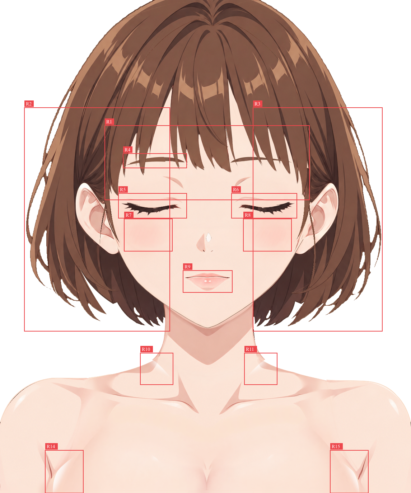

结论：需要修复

已完成全部 37 个逻辑 part、41 个普通绘画层及 21 个原生透明度蒙版的独立视觉检查。确认 15 处需要本步修复的位置，详见 R1–R15。优先修复 R10、R11、R14、R15 的内部透底，以及 R1–R3 的头发轮廓偏差；随后补回五官和腮红绘画内容、修顺后发补全面的材质接缝。当前分层完整存在，整体能组合成闭眼闭嘴人物，但局部内容和衔接仍影响还原度及完成度。

**输入、参考和审查状态**

- 实际打开并检查：[character-depth.kra](character-depth.kra)，画布 1145 × 1374。没有修改或保存工程。
- 固定配准参考沿用 [report.md](report.md) 指定的 [base-subject.png](../../part-layering/references/base-subject.png)。[standard.png](../../part-layering/references/standard.png)、[simplified-subject.png](../../part-layering/references/simplified-subject.png) 只辅助判断补绘画风；可见内容始终以 base-subject 为准，没有替换参考标准、移动图像内容或重新缩放配准。
- 已读取有效的 [groups.json](../../part-layering/groups.json)、[occlusion.json](../../part-layering/occlusion.json)、相关 parts SVG 和本步报告中的实际层名、深度、复用及蒙版映射。本步目录内没有已发布的正式 review / repair Markdown；report.md 中的自检和修画记录已阅读，workspace 暂存文件未作为“已修好”的依据。
- Krita 5.3.4.1，复用当前已验证的 Python bridge 和显示会话。先检查原尺寸默认合成，再在实际 Krita 中逐层独显至 200% / 300%，并对疑点作 300% 局部对照。检查包含蒙版启用、临时停用、隐藏上层、单片与同逻辑 part 合看。检查完已恢复默认显隐、活动层和原视图比例。
- [只读核验](review-01-evidence/checks/readonly-verification.json)：41 层原始像素、默认合成及全部显隐恢复一致，文档未修改；[输入文件哈希](review-01-evidence/checks/input-file-hashes.json) 与审查开始时的 KRA / groups / occlusion 相同。哈希仅核实只读与状态恢复，不用于绘画评分。

**定位与证据读法**

[默认合成原尺寸导出](review-01-evidence/default.png)；[灰底合成](review-01-evidence/checks/default-on-gray.png) 用于看清内部半透明缺口。

[默认框选坐标及图层](review-01-evidence/marks-default/regions.json)。R12、R13 主要是后发被遮挡补全区的问题，另标于 [后发独显框选图](review-01-evidence/marks-back-solo/marked.png)，对应 [坐标及图层](review-01-evidence/marks-back-solo/regions.json)。所有框均为原画布 `[x,y,width,height]`，编号由 reviewer 看图确认后交给框选工具记录。普通对照均左参考、右当前、同坐标裁切；放大图只为观察，不改变配准。

R12、R13 的三联图左栏是原图遮挡环境，中栏是有效补全 SVG 的形状提示，右栏为当前后发独显。原图左栏里的耳、脸或侧发不是后发补全的像素目标；这里依据本件 SVG、邻接后发材质及发流连续性判断。

**确定的问题与执行要求**

**R1 · 刘海下缘束形简化、露额间隙变化（形体 / 还原度）**

- 图层与位置：`0160 hair/bangs`；框 `[292,350,570,207]`，重点为眉线上方至额角的各束末端。
- 当前 / 依据 / 影响：同坐标对照中，原图若干纤细分叉与短尖被合成较宽、较钝的单片，束尾长短和露额缝开度改变。刘海独显仍是这些形状，确认来自本件轮廓和绘画内容，不是下方眉毛或脸底遮挡造成。整图因此显得发束较板、额前节奏不同；超过少量抗锯齿差异。
- 修复与保留：沿固定参考逐束修回可见端部的长短、细分叉和间隙，接续内部发线；保留刘海自身高光、发流、顶部隐藏余量和深度 160。只能取属于刘海的可见参考像素，不能把露额肤色或眉毛填进刘海层，也不要把合理的头发间隙全部填实。
- 证据：[工具同坐标对照](review-01-evidence/marks-default/R1-comparison.png)、[局部对照](review-01-evidence/comparisons/bangs-compare.png)、[本件独显](review-01-evidence/layers/0160-hair-bangs-gray-crop.png)。

**R2 · 画面左侧外弧与下部发梢偏形、浅棕边带过重（形体 / 画风）**

- 图层与位置：主要为 `0021 hair/side_hair_right__rear`、`0010 hair/back_hair`；同侧 `0006 ...__hidden_root` / `0151 ...__front` 一并核对。框 `[68,300,405,623]`，重点为外缘游离弧束、约 y650–850 的转折和 y790–910 的下缘尖束。
- 当前 / 依据 / 影响：参考是细而顺的游离弧束与清晰内弯尖梢；当前外缘有宽浅棕色带、局部连桥及不规则缺刻，下部若干发梢的外露宽度、收尖走势和束间空隙改变。默认合成、侧发三片合看和后发独显均已核对，不能把整段差异只归为锯齿。原图中自然留白应保留，但当前额外连桥和偏形使侧面轮廓较粗硬。
- 修复与保留：按各自可见归属修侧发和后发的外弧、束端及中等宽度边带，恢复内弯发流；修色带时用本件发色和画笔接回纹理。保留原有短波波体积、合理发丝间隙、耳前细丝与耳廓露出。保留同侧 6 / 21 / 151 三片身份和前后关系，不能把宽发帘整体抬到耳前或用另一发件的像素覆盖错误轮廓。
- 证据：[工具对照](review-01-evidence/marks-default/R2-comparison.png)、[耳下及发梢局部](review-01-evidence/comparisons/hair-left-compare.png)、[同侧三片合看](review-01-evidence/side-right-complete-gray.png)。

**R3 · 画面右侧外弧与下部发梢偏形、边带和缺口突兀（形体 / 画风）**

- 图层与位置：主要为 `0020 hair/side_hair_left__rear`、`0010 hair/back_hair`；同时核对 `0005 ...__hidden_root` / `0150 ...__front`。框 `[705,300,360,623]`。
- 当前 / 依据 / 影响：外缘约 x1000–1060 的弧束和下部 x710–980 / y790–910 的尖梢，在固定参考对照中出现不一致的粗浅棕边带、连接块及扩大缺口。若干内弯尖梢被削薄或改变相邻空隙；整图右侧轮廓因此比参考破碎、僵硬。独显核对后确认是分件自身内容，而非耳层遮挡错误。
- 修复与保留：按本侧参考分别修回外弧和束端形状、发面宽度，接顺边带的色阶及发纹；保留本侧实际不对称走势、原有游离弧束和合理留白。仍保持 5 / 20 / 150 三片、耳后宽帘与耳前窄束的职责，不要求合层或镜像成另一侧。
- 证据：[工具对照](review-01-evidence/marks-default/R3-comparison.png)、[耳下及发梢局部](review-01-evidence/comparisons/hair-right-compare.png)、[同侧三片合看](review-01-evidence/side-left-complete-gray.png)。

**R4 · 画面左眉存在平顶矩形补丁和台阶（接缝 / 画风）**

- 图层与位置：`0103 face/eyebrow_right`；框 `[343,428,177,40]`，可见眉弓中段约 x400–460 / y437–451。
- 当前 / 依据 / 影响：当前眉弓中段是一块平顶棕色带，接向右侧有明显垂直截面和色阶跳变；参考是连续弧形、自然变化的眉厚与色阶。独显仍存在该补丁，不能靠调整刘海遮住。report.md 提到的右眉方形残痕修画没有完全解决当前可见段。
- 修复与保留：用本眉颜色和笔触接顺整段弧度、上下缘及色阶，补足刘海后仍连续的眉体；保留眉尾位置、左右眉本来的形状差异及独立图层，不复制周围脸皮或另一侧眉来遮盖。
- 证据：[工具对照](review-01-evidence/marks-default/R4-comparison.png)、[300% 对照](review-01-evidence/comparisons/brow-compare-300.png)、[本层独显](review-01-evidence/layers/0103-face-eyebrow_right-gray-crop.png)。

**R5 · 画面左闭眼丢失贴睑亮缘，睫毛体量被削薄（内容 / 画风）**

- 图层与位置：`0101 face/eye_right/upper_eyelid`、`0097 face/eye_right/eyelid_crease`；框 `[330,539,190,69]`。
- 当前 / 依据 / 影响：参考在深睫毛带上方有明确连续的暖色贴睑细边与亮缘，褶线有自然粗细变化；当前主要剩下较窄的深色睫毛条和偏细淡的褶线，原来的贴睑绘画内容没有保留，部分睫毛尖簇也被缩减。单层确认上睑只保留主要睫毛和上方局部皮肤明暗，并非完整亮缘被蒙版藏住。这改变闭眼造型和上色质感，不只是柔边待精修。
- 修复与保留：在所属上睑层补回贴睑暖边、亮缘和参考中的睫毛体量，在 crease 层恢复本侧褶线的粗细节奏。保留闭眼位置、眉下局部皮肤明暗和独立层控制。亮缘属于眼睑自身，不能通过露出隐藏眼白或眼内高光来代替；眼内开口继续保持闭合。
- 证据：[工具对照](review-01-evidence/marks-default/R5-comparison.png)、[300% 对照](review-01-evidence/comparisons/eye-left-compare-300.png)、[上睑独显](review-01-evidence/layers/0101-face-eye_right-upper_eyelid-gray-crop.png)。

**R6 · 画面右闭眼同样缺少贴睑亮缘与原睫毛厚度（内容 / 画风）**

- 图层与位置：`0100 face/eye_left/upper_eyelid`、`0096 face/eye_left/eyelid_crease`；框 `[645,539,182,69]`。
- 当前 / 依据 / 影响：本侧参考的贴睑亮缘、暖色细边及深色尖簇层次被简化，当前闭眼带更薄、更平，褶线也较细淡。已独显并确认默认蒙版只隐藏眼内内容，没有错误裁掉本层，因此应修绘画内容。
- 修复与保留：依据本侧原图补回睑缘及睫毛厚度、尖簇与褶线节奏，保留本侧眼角和上睑弧度，不能直接强行镜像 R5；继续保持闭眼及眼内层默认全隐藏，不改眼白/虹膜的完整底纹。
- 证据：[工具对照](review-01-evidence/marks-default/R6-comparison.png)、[300% 对照](review-01-evidence/comparisons/eye-right-compare-300.png)、[本层独显](review-01-evidence/layers/0100-face-eye_left-upper_eyelid-gray-crop.png)。

**R7 · 画面左颊腮红斜线内容缺失（内容完整性）**

- 图层与位置：`0073 face/blush_right`；框 `[346,610,134,90]`。
- 当前 / 依据 / 影响：参考有成组淡粉斜线叠在晕染上，当前只剩平滑粉色晕染；默认、独显及脸底隐藏检查确认斜线没有保留到其他正确图层。该组斜线是参考中的绘画内容，不能作为抗锯齿或阴影效果省略。
- 修复与保留：在本层补回本侧方向、疏密及长度相近的低透明度斜线，并接入现有晕染；保留透明色素职责和独立强度，不带基础肤色、眼睫或头发，不把腮红做成不透明椭圆。
- 证据：[工具对照](review-01-evidence/marks-default/R7-comparison.png)、[300% 对照](review-01-evidence/comparisons/blush-left-compare-300.png)、[本层独显](review-01-evidence/layers/0073-face-blush_right-gray-crop.png)。

**R8 · 画面右颊腮红斜线内容缺失（内容完整性）**

- 图层与位置：`0072 face/blush_left`；框 `[678,610,134,90]`。
- 当前 / 依据 / 影响：与 R7 相同，本侧原图可辨认的成组斜线没有保留，当前只见平滑晕染，面颊绘画质感因此变平。独显确认是缺绘，不是上层遮挡。
- 修复与保留：按本侧原图补回淡线与晕染关系，保留左右实际疏密差异、原有柔和颜色及低透明度；不将原图整块脸皮贴进本层。
- 证据：[工具对照](review-01-evidence/marks-default/R8-comparison.png)、[300% 对照](review-01-evidence/comparisons/blush-right-compare-300.png)、[本层独显](review-01-evidence/layers/0072-face-blush_left-gray-crop.png)。

**R9 · 闭唇嘴角收笔丢失，唇形绘画较几何化（内容 / 还原度）**

- 图层与位置：`0085 face/mouth/upper_lip`、`0084 face/mouth/lower_lip`；框 `[510,754,137,61]`。
- 当前 / 依据 / 影响：原图两端有明确深褐色圆润嘴角，唇缝深浅、粗细有变化；当前两端被削成尖细线，唇面与闭缝贴边更硬、更几何化。上下唇独显与组合均确认，口内蒙版不是原因。缺少嘴角收笔改变闭唇表情的辨识；此项要求恢复造型内容，不要求本步完成亚像素描边精修。
- 修复与保留：由上唇层恢复两端嘴角和闭唇深线的自然粗细、中央断续关系；下唇层修顺唇面与上唇搭接。保留原有双点高光、粉色唇面、贴附下唇的局部明暗及闭嘴形状。不要在下唇重复画第二条深色唇缝，也不要露出口内来补深线。
- 证据：[工具对照](review-01-evidence/marks-default/R9-comparison.png)、[300% 对照](review-01-evidence/comparisons/mouth-compare-300.png)、上下唇逐层证据见后表。

**R10 · 画面左颈根有内部半透明三角缺口（覆盖 / 衔接，优先）**

- 图层与位置：`0035 neck`、`0040 body/torso` 及后者的 `blend • neck and shoulder roots • controller neck + arms`；框 `[391,984,91,88]`。
- 当前 / 依据 / 影响：默认蒙版启用时，从颈根斜向锁骨上方出现可透背景的三角接区，换灰底后呈灰楔；Alpha 证据也显示内部覆盖衰减。原图这里是连续颈肩皮肤。独显底纹、隐藏上层及停用躯干接色蒙版已核对，完整底层有内容，当前局部淡出超过有效重叠，露出背景。这是接区缺口，不是外轮廓的半透明柔边，也不是缺少投影。
- 修复与保留：在颈与 torso 的真实重叠范围内重设局部蒙版，让交接处始终有至少一层连续实底，再用画笔将接色修自然；必要时仅在本件结构职责内补足余量。保留完整底纹、独立颈/躯干层、锁骨形体及本身明暗，不靠额外阴影遮缝。
- 证据：[工具参考/当前对照](review-01-evidence/marks-default/R10-comparison.png)、[颈根 Alpha](review-01-evidence/checks/neck-alpha-300.png)、[Krita 200% 默认](review-01-evidence/native/krita-neck-200.png)。

**R11 · 画面右颈根有对应的半透明缺口（覆盖 / 衔接，优先）**

- 图层与位置：同 R10 的 `0035 neck`、`0040 body/torso` 及局部接色蒙版；框 `[681,984,91,88]`。
- 当前 / 依据 / 影响：右侧亦出现斜直浅带 / 灰楔，Alpha 证明实际透底；与原图的连续皮肤过渡不符。完整底层存在，默认蒙版开启后缺口可见，影响整体颈肩连接感。
- 修复与保留：独立校正右侧的重叠覆盖、蒙版淡出终点和画笔接色，不简单照搬左侧数值；保留本侧颈肩比例、锁骨线、原有色阶及分层职责，不增加 AO 或投影。
- 证据：[工具对照](review-01-evidence/marks-default/R11-comparison.png)、[颈根 Alpha](review-01-evidence/checks/neck-alpha-300.png)、[完整颈肩参考/当前](review-01-evidence/comparisons/neck-shoulders-compare.png)。

**R12 · 后发画面左耳下补全面有粗边带、发纹断接（补全 / 画风）**

- 图层与位置：`0010 hair/back_hair`；框 `[195,565,200,280]`。主要检查隐藏耳下承接面与主体相接的外弧及内部发束。
- 当前 / 依据 / 影响：新增承接面的外弧出现较宽的平涂棕带，与邻接后发的细线、渐变发束差异明显；接区内纹理和明暗有突然转折及截断。Krita 独显 300% 可直接确认。形体补入职责合理，问题是同件材质没有自然接成一体；上层遮住时不显著，作为完整后发底纹仍未完成。
- 修复与保留：保留有效 SVG 已落实的承接形体、连续底面和深度 10；用同层画笔延续邻接发流、线条与色阶，消除补片边带及截断感。不要删除补面来恢复透底，也不能贴入原图这里的耳、脸或侧发来伪装完成。
- 证据：[工具独显框与局部](review-01-evidence/marks-back-solo/R12-current.png)、[遮挡环境 / 有效 SVG / 当前独显](review-01-evidence/comparisons/R12-context-svg-current.png)、[200% 局部](review-01-evidence/comparisons/back-left-completion-200.png)、[Krita 300%](review-01-evidence/native/krita-0010-left-solo-300.png)。本项不把原图遮挡物作为补绘像素目标。

**R13 · 后发画面右耳下补全面有对应的材质断层（补全 / 画风）**

- 图层与位置：`0010 hair/back_hair`；框 `[775,565,190,280]`。
- 当前 / 依据 / 影响：右耳下承接面也有宽平涂边带、粗硬转折及与主体细线不连续的接区，独显 300% 确认。依据是本件有效补形和邻接后发的画风、发流；不是要求隐藏区长得像原图耳朵或侧发。
- 修复与保留：保留右侧承接范围、独立后发职责和原层序，在本层重新接续发束线纹和色阶；保留本侧真实非对称流向。与 R12 一并修成完整一致的后发材质，不通过移动上层或错误归属覆盖隐藏接缝。
- 证据：[工具独显局部](review-01-evidence/marks-back-solo/R13-current.png)、[遮挡环境 / SVG / 当前独显](review-01-evidence/comparisons/R13-context-svg-current.png)、[200% 局部](review-01-evidence/comparisons/back-right-completion-200.png)、[Krita 300%](review-01-evidence/native/krita-0010-right-solo-300.png)。

**R14 · 画面左腋部至底边存在宽三角透底（覆盖 / 衔接，优先）**

- 图层与位置：`0031 arms/arm_right`、`0040 body/torso` 及 torso 接色蒙版；框 `[126,1255,106,119]`。
- 当前 / 依据 / 影响：灰底下可见一块从腋侧向画布底边扩展的半透明楔形接缝。临时停用 torso 接色蒙版后，该楔形缺口消失，确认原始躯干纹理存在，当前蒙版在上臂已不提供实底的位置仍继续淡出。有效 torso / arm 职责要求完整身体衔接，这种内部透底不能以第二步柔边范围解释。原参考这里部分有临时背心，衣服只作位置背景，不要求补成衣服。
- 修复与保留：调整 torso 蒙版及必要的自身重叠余量，使上臂内缘结束之后 torso 仍为连续实底；在有有效底层覆盖的区域再渐变，用画笔接顺肤色。保留腋侧本体形状与明暗、上臂归属、身体下缘裁切及独立层，不复制衣料、肩带或衣边。
- 证据：[工具参考/当前定位](review-01-evidence/marks-default/R14-comparison.png)、[默认 / 仅停用 torso 蒙版](review-01-evidence/checks/armpit-left-mask-compare-200.png)、[身体 Alpha](review-01-evidence/checks/body-alpha.png)、[Krita 默认 300%](review-01-evidence/native/krita-left-armpit-default-300.png) / [停用蒙版 300%](review-01-evidence/native/krita-left-armpit-mask-disabled-300.png)。

**R15 · 画面右腋部至底边存在对应透底（覆盖 / 衔接，优先）**

- 图层与位置：`0030 arms/arm_left`、`0040 body/torso` 及 torso 接色蒙版；框 `[920,1255,106,119]`。
- 当前 / 依据 / 影响：右腋侧同样有向底边扩展的宽半透明接区；停用同一 torso 蒙版后即由完整皮肤填实。确认是默认混合覆盖不足，非合理的实质性人体留白，也不是原图服装应该保留。
- 修复与保留：独立重设本侧接区蒙版与自身余量，让肩臂 / torso 衔接有连续实底，再用画笔接色；保留本侧腋部形体、左右真实差异和原深度，不把 torso 体积转移到手臂层，不增加投影掩盖。
- 证据：[工具对照](review-01-evidence/marks-default/R15-comparison.png)、[默认 / 仅停用 torso 蒙版](review-01-evidence/checks/armpit-right-mask-compare-200.png)、[身体 Alpha](review-01-evidence/checks/body-alpha.png)、[Krita 默认 300%](review-01-evidence/native/krita-right-armpit-default-300.png)。

**已核对并应保留的结构与内容**

- 37 个逻辑 part 与当前 41 个普通绘画深度片对应完整；层序与有效 occlusion 记录一致。两侧发的隐藏根 / 耳后宽面 / 耳前窄束按三片分别独显并合看，保留共同归属。当前没有证据要求合层、退回拆组或整体抬升侧发深度。耳廓主体外露、窄鬓发在耳前、宽发帘在耳后，关系成立。
- 完整脸底无眼口洞，耳根、额头、面颊及下颌补全存在；隐藏五官及头发后检查了完整底面。未发现需要列为本步返修的脸底内容缺项或其他部件大块像素误归属。鼻部三件存在且分工成立，细小高光 / 边缘差异不在本次问题清单内。
- 完全隐藏的 12 件均检查了默认蒙版启用和临时停用后的底纹，并参照其补全 SVG。两眼各有完整眼白、圆形虹膜 / 瞳孔、独立高光及完整下睑；右侧四件镜像复用保持独立身份，尺寸、纵向配准和暖棕颜色协调，闭眼参考没有需保留的异色设计证据。口内底、舌、上下牙均有连续内容，组合与裁切关系成立。
- 眼内三件共享同侧闭合开口，虹膜 / 高光另限于完整眼白；下睑由单独接触显隐控制。口内四件受闭唇开口控制，牙舌另限于完整口内。默认闭眼闭嘴时这些内容不漏出，蒙版没有作用到整张脸或误裁外部上睑 / 唇面。临时停用开口后的组合只是底纹检查，不当作已完成的睁眼 / 张嘴姿态。眼口蒙版与独立层应完整保留。
- 肩臂、torso、breast 的完整原始皮肤绘画存在，未把白色临时背心作为身体保留；身体与参考服装不同是既定补全职责。胸前层遮挡下的 torso 连续底形存在。这里确认的缺口落在默认蒙版交接，不能通过删除完整底纹或重新贴回衣服解决。
- 本次没有要求制作阴影、AO、投影；原部件本身已有、承担形体的绘画明暗仍应保留。零星亚像素锯齿、发丝混色细边、鼻尖柔边、轻微描边精修以及低对比细小边缘痕迹留给第二步。R1–R15 分别涉及可见造型、缺失绘画内容、成片内部透底或明显补面材质断层，不能仅以阶段限制推迟。

独立检查状态证据：[隐藏侧发 / 刘海后的合成](review-01-evidence/checks/without-bangs-and-sidehair-gray.png)、[隐藏所有上层后的脸底](review-01-evidence/checks/face-base-with-upper-hidden.png)、[隐藏胸前层后的 torso](review-01-evidence/checks/without-breast-gray.png)、[临时停用开口蒙版](review-01-evidence/checks/apertures-disabled-gray.png)、[隐藏睑线与唇后的眼口底纹组合](review-01-evidence/checks/hidden-eye-mouth-assembled-gray.png)。保留裁切的虹膜检查：[左眼](review-01-evidence/checks/0092-clip-only-400.png)、[右眼](review-01-evidence/checks/0093-clip-only-400.png)；[舌的口内裁切](review-01-evidence/checks/0081-clip-only-400.png)。

实际 Krita 对照：[原尺寸默认视图](review-01-evidence/native/krita-default-100.png)、[当前脸部 200%](review-01-evidence/native/krita-face-200.png)、[原参考脸部 200%](review-01-evidence/native/krita-reference-face-200.png)、[头顶](review-01-evidence/native/krita-crown-200.png)、[左侧头发](review-01-evidence/native/krita-left-hair-200.png)、[右侧头发](review-01-evidence/native/krita-right-hair-200.png)、[嘴 / 下颌](review-01-evidence/native/krita-mouth-jaw-200.png)、[颈肩](review-01-evidence/native/krita-neck-200.png)、[左肩臂](review-01-evidence/native/krita-left-shoulder-200.png)、[右肩臂](review-01-evidence/native/krita-right-shoulder-200.png)、[胸前](review-01-evidence/native/krita-chest-200.png)。

**逐层覆盖记录**

下表按实际由后至前排列，覆盖全部 41 个绘画层。原始纹理为当前 KRA 的本层像素；“灰底”仅裁去空白、未缩放；“Krita”是在实际文档中临时停用本层蒙版后的 200% / 300% 独显截图。带蒙版层另给出默认独显，便于核对隐藏内容和完整底纹。大层的区域检查另见上文整体局部及专项证据。完整机读记录见 [图层审查](review-01-evidence/checks/layer-audit-with-bounds.json) 与 [原生独显记录](review-01-evidence/checks/native-solo-index.json)。

| 实际绘画层（同 part 多片保留） | 视觉核对结果 | 当前证据 |
| --- | --- | --- |
| `0005 hair/side_hair_left__hidden_root` | 隐藏根部有材质；与同侧另两片合看，保留当前深度。 | [灰底](review-01-evidence/layers/0005-hair-side_hair_left__hidden_root-gray-crop.png) · [原纹理](review-01-evidence/layers/0005-hair-side_hair_left__hidden_root-raw.png) · [Krita](review-01-evidence/native-solos/0005-hair-side_hair_left__hidden_root.png) |
| `0006 hair/side_hair_right__hidden_root` | 隐藏根部有材质；与同侧另两片合看，保留当前深度。 | [灰底](review-01-evidence/layers/0006-hair-side_hair_right__hidden_root-gray-crop.png) · [原纹理](review-01-evidence/layers/0006-hair-side_hair_right__hidden_root-raw.png) · [Krita](review-01-evidence/native-solos/0006-hair-side_hair_right__hidden_root.png) |
| `0010 hair/back_hair` | 完整后发存在；R2、R3 轮廓及 R12、R13 补面材质需修。 | [灰底](review-01-evidence/layers/0010-hair-back_hair-gray-crop.png) · [原纹理](review-01-evidence/layers/0010-hair-back_hair-raw.png) · [Krita](review-01-evidence/native-solos/0010-hair-back_hair.png) |
| `0020 hair/side_hair_left__rear` | 画面右宽侧发完整；R3 需修，保留耳后深度。 | [灰底](review-01-evidence/layers/0020-hair-side_hair_left__rear-gray-crop.png) · [原纹理](review-01-evidence/layers/0020-hair-side_hair_left__rear-raw.png) · [Krita](review-01-evidence/native-solos/0020-hair-side_hair_left__rear.png) |
| `0021 hair/side_hair_right__rear` | 画面左宽侧发完整；R2 需修，保留耳后深度。 | [灰底](review-01-evidence/layers/0021-hair-side_hair_right__rear-gray-crop.png) · [原纹理](review-01-evidence/layers/0021-hair-side_hair_right__rear-raw.png) · [Krita](review-01-evidence/native-solos/0021-hair-side_hair_right__rear.png) |
| `0030 arms/arm_left` | 完整肩臂存在、无衣料；R15 默认与 torso 交接透底。 | [灰底](review-01-evidence/layers/0030-arms-arm_left-gray-crop.png) · [原纹理](review-01-evidence/layers/0030-arms-arm_left-raw.png) · [Krita](review-01-evidence/native-solos/0030-arms-arm_left.png) |
| `0031 arms/arm_right` | 完整肩臂存在、无衣料；R14 默认与 torso 交接透底。 | [灰底](review-01-evidence/layers/0031-arms-arm_right-gray-crop.png) · [原纹理](review-01-evidence/layers/0031-arms-arm_right-raw.png) · [Krita](review-01-evidence/native-solos/0031-arms-arm_right.png) |
| `0035 neck` | 颈部底纹完整；R10、R11 默认交接透底。 | [灰底](review-01-evidence/layers/0035-neck-gray-crop.png) · [原纹理](review-01-evidence/layers/0035-neck-raw.png) · [Krita](review-01-evidence/native-solos/0035-neck.png) |
| `0040 body/torso` | 连续胸廓 / 躯干底纹存在；R10、R11、R14、R15 蒙版交接需修。 | [灰底](review-01-evidence/layers/0040-body-torso-gray-crop.png) · [原纹理](review-01-evidence/layers/0040-body-torso-raw.png) · [Krita](review-01-evidence/native-solos/0040-body-torso.png) · [默认蒙版](review-01-evidence/layers/0040-body-torso-masked.png) |
| `0050 body/breast` | 胸前完整曲面存在；原始 / 默认蒙版、隐藏检查未新增确定问题。 | [灰底](review-01-evidence/layers/0050-body-breast-gray-crop.png) · [原纹理](review-01-evidence/layers/0050-body-breast-raw.png) · [Krita](review-01-evidence/native-solos/0050-body-breast.png) · [默认蒙版](review-01-evidence/layers/0050-body-breast-masked.png) |
| `0060 face/ear_left` | 耳轮、耳甲、耳垂和耳根存在；前后关系成立。 | [灰底](review-01-evidence/layers/0060-face-ear_left-gray-crop.png) · [原纹理](review-01-evidence/layers/0060-face-ear_left-raw.png) · [Krita](review-01-evidence/native-solos/0060-face-ear_left.png) |
| `0061 face/ear_right` | 耳轮、耳甲、耳垂和耳根存在；前后关系成立。 | [灰底](review-01-evidence/layers/0061-face-ear_right-gray-crop.png) · [原纹理](review-01-evidence/layers/0061-face-ear_right-raw.png) · [Krita](review-01-evidence/native-solos/0061-face-ear_right.png) |
| `0070 face/face_base` | 完整脸底、无眼口洞；隐藏上层后连续。 | [灰底](review-01-evidence/layers/0070-face-face_base-gray-crop.png) · [原纹理](review-01-evidence/layers/0070-face-face_base-raw.png) · [Krita](review-01-evidence/native-solos/0070-face-face_base.png) |
| `0072 face/blush_left` | R8：晕染存在，参考斜线内容需补。 | [灰底](review-01-evidence/layers/0072-face-blush_left-gray-crop.png) · [原纹理](review-01-evidence/layers/0072-face-blush_left-raw.png) · [Krita](review-01-evidence/native-solos/0072-face-blush_left.png) |
| `0073 face/blush_right` | R7：晕染存在，参考斜线内容需补。 | [灰底](review-01-evidence/layers/0073-face-blush_right-gray-crop.png) · [原纹理](review-01-evidence/layers/0073-face-blush_right-raw.png) · [Krita](review-01-evidence/native-solos/0073-face-blush_right.png) |
| `0074 face/nose/volume_shadow` | 所属鼻部内容存在、位置协调；细边留第二步。 | [灰底](review-01-evidence/layers/0074-face-nose-volume_shadow-gray-crop.png) · [原纹理](review-01-evidence/layers/0074-face-nose-volume_shadow-raw.png) · [Krita](review-01-evidence/native-solos/0074-face-nose-volume_shadow.png) |
| `0075 face/nose/tip_highlight` | 所属鼻部内容存在、位置协调；细边留第二步。 | [灰底](review-01-evidence/layers/0075-face-nose-tip_highlight-gray-crop.png) · [原纹理](review-01-evidence/layers/0075-face-nose-tip_highlight-raw.png) · [Krita](review-01-evidence/native-solos/0075-face-nose-tip_highlight.png) |
| `0076 face/nose/tip_mark` | 所属鼻部内容存在、位置协调；细边留第二步。 | [灰底](review-01-evidence/layers/0076-face-nose-tip_mark-gray-crop.png) · [原纹理](review-01-evidence/layers/0076-face-nose-tip_mark-raw.png) · [Krita](review-01-evidence/native-solos/0076-face-nose-tip_mark.png) |
| `0080 face/mouth/mouth_interior` | 完整口内件存在；口内裁切成立，默认闭口隐藏。 | [灰底](review-01-evidence/layers/0080-face-mouth-mouth_interior-gray-crop.png) · [原纹理](review-01-evidence/layers/0080-face-mouth-mouth_interior-raw.png) · [Krita](review-01-evidence/native-solos/0080-face-mouth-mouth_interior.png) · [默认蒙版](review-01-evidence/layers/0080-face-mouth-mouth_interior-masked.png) |
| `0081 face/mouth/tongue` | 完整口内件存在；口内裁切成立，默认闭口隐藏。 | [灰底](review-01-evidence/layers/0081-face-mouth-tongue-gray-crop.png) · [原纹理](review-01-evidence/layers/0081-face-mouth-tongue-raw.png) · [Krita](review-01-evidence/native-solos/0081-face-mouth-tongue.png) · [默认蒙版](review-01-evidence/layers/0081-face-mouth-tongue-masked.png) |
| `0082 face/mouth/lower_teeth` | 完整口内件存在；口内裁切成立，默认闭口隐藏。 | [灰底](review-01-evidence/layers/0082-face-mouth-lower_teeth-gray-crop.png) · [原纹理](review-01-evidence/layers/0082-face-mouth-lower_teeth-raw.png) · [Krita](review-01-evidence/native-solos/0082-face-mouth-lower_teeth.png) · [默认蒙版](review-01-evidence/layers/0082-face-mouth-lower_teeth-masked.png) |
| `0083 face/mouth/upper_teeth` | 完整口内件存在；口内裁切成立，默认闭口隐藏。 | [灰底](review-01-evidence/layers/0083-face-mouth-upper_teeth-gray-crop.png) · [原纹理](review-01-evidence/layers/0083-face-mouth-upper_teeth-raw.png) · [Krita](review-01-evidence/native-solos/0083-face-mouth-upper_teeth.png) · [默认蒙版](review-01-evidence/layers/0083-face-mouth-upper_teeth-masked.png) |
| `0084 face/mouth/lower_lip` | R9：唇面 / 高光存在，嘴角及闭缝造型需恢复。 | [灰底](review-01-evidence/layers/0084-face-mouth-lower_lip-gray-crop.png) · [原纹理](review-01-evidence/layers/0084-face-mouth-lower_lip-raw.png) · [Krita](review-01-evidence/native-solos/0084-face-mouth-lower_lip.png) |
| `0085 face/mouth/upper_lip` | R9：唇面 / 高光存在，嘴角及闭缝造型需恢复。 | [灰底](review-01-evidence/layers/0085-face-mouth-upper_lip-gray-crop.png) · [原纹理](review-01-evidence/layers/0085-face-mouth-upper_lip-raw.png) · [Krita](review-01-evidence/native-solos/0085-face-mouth-upper_lip.png) |
| `0090 face/eye_left/sclera` | 完整隐藏眼部件存在；左右协调，默认闭眼隐藏。 | [灰底](review-01-evidence/layers/0090-face-eye_left-sclera-gray-crop.png) · [原纹理](review-01-evidence/layers/0090-face-eye_left-sclera-raw.png) · [Krita](review-01-evidence/native-solos/0090-face-eye_left-sclera.png) · [默认蒙版](review-01-evidence/layers/0090-face-eye_left-sclera-masked.png) |
| `0091 face/eye_right/sclera` | 完整隐藏眼部件存在；左右协调，默认闭眼隐藏。 | [灰底](review-01-evidence/layers/0091-face-eye_right-sclera-gray-crop.png) · [原纹理](review-01-evidence/layers/0091-face-eye_right-sclera-raw.png) · [Krita](review-01-evidence/native-solos/0091-face-eye_right-sclera.png) · [默认蒙版](review-01-evidence/layers/0091-face-eye_right-sclera-masked.png) |
| `0092 face/eye_left/iris` | 完整隐藏眼部件存在；左右协调，默认闭眼隐藏。 | [灰底](review-01-evidence/layers/0092-face-eye_left-iris-gray-crop.png) · [原纹理](review-01-evidence/layers/0092-face-eye_left-iris-raw.png) · [Krita](review-01-evidence/native-solos/0092-face-eye_left-iris.png) · [默认蒙版](review-01-evidence/layers/0092-face-eye_left-iris-masked.png) |
| `0093 face/eye_right/iris` | 完整隐藏眼部件存在；左右协调，默认闭眼隐藏。 | [灰底](review-01-evidence/layers/0093-face-eye_right-iris-gray-crop.png) · [原纹理](review-01-evidence/layers/0093-face-eye_right-iris-raw.png) · [Krita](review-01-evidence/native-solos/0093-face-eye_right-iris.png) · [默认蒙版](review-01-evidence/layers/0093-face-eye_right-iris-masked.png) |
| `0094 face/eye_left/highlight` | 完整隐藏眼部件存在；左右协调，默认闭眼隐藏。 | [灰底](review-01-evidence/layers/0094-face-eye_left-highlight-gray-crop.png) · [原纹理](review-01-evidence/layers/0094-face-eye_left-highlight-raw.png) · [Krita](review-01-evidence/native-solos/0094-face-eye_left-highlight.png) · [默认蒙版](review-01-evidence/layers/0094-face-eye_left-highlight-masked.png) |
| `0095 face/eye_right/highlight` | 完整隐藏眼部件存在；左右协调，默认闭眼隐藏。 | [灰底](review-01-evidence/layers/0095-face-eye_right-highlight-gray-crop.png) · [原纹理](review-01-evidence/layers/0095-face-eye_right-highlight-raw.png) · [Krita](review-01-evidence/native-solos/0095-face-eye_right-highlight.png) · [默认蒙版](review-01-evidence/layers/0095-face-eye_right-highlight-masked.png) |
| `0096 face/eye_left/eyelid_crease` | R6：恢复本侧闭眼贴睑绘画、睫毛 / 褶线内容。 | [灰底](review-01-evidence/layers/0096-face-eye_left-eyelid_crease-gray-crop.png) · [原纹理](review-01-evidence/layers/0096-face-eye_left-eyelid_crease-raw.png) · [Krita](review-01-evidence/native-solos/0096-face-eye_left-eyelid_crease.png) |
| `0097 face/eye_right/eyelid_crease` | R5：恢复本侧闭眼贴睑绘画、睫毛 / 褶线内容。 | [灰底](review-01-evidence/layers/0097-face-eye_right-eyelid_crease-gray-crop.png) · [原纹理](review-01-evidence/layers/0097-face-eye_right-eyelid_crease-raw.png) · [Krita](review-01-evidence/native-solos/0097-face-eye_right-eyelid_crease.png) |
| `0098 face/eye_left/lower_eyelid` | 完整隐藏眼部件存在；左右协调，默认闭眼隐藏。 | [灰底](review-01-evidence/layers/0098-face-eye_left-lower_eyelid-gray-crop.png) · [原纹理](review-01-evidence/layers/0098-face-eye_left-lower_eyelid-raw.png) · [Krita](review-01-evidence/native-solos/0098-face-eye_left-lower_eyelid.png) · [默认蒙版](review-01-evidence/layers/0098-face-eye_left-lower_eyelid-masked.png) |
| `0099 face/eye_right/lower_eyelid` | 完整隐藏眼部件存在；左右协调，默认闭眼隐藏。 | [灰底](review-01-evidence/layers/0099-face-eye_right-lower_eyelid-gray-crop.png) · [原纹理](review-01-evidence/layers/0099-face-eye_right-lower_eyelid-raw.png) · [Krita](review-01-evidence/native-solos/0099-face-eye_right-lower_eyelid.png) · [默认蒙版](review-01-evidence/layers/0099-face-eye_right-lower_eyelid-masked.png) |
| `0100 face/eye_left/upper_eyelid` | R6：恢复本侧闭眼贴睑绘画、睫毛 / 褶线内容。 | [灰底](review-01-evidence/layers/0100-face-eye_left-upper_eyelid-gray-crop.png) · [原纹理](review-01-evidence/layers/0100-face-eye_left-upper_eyelid-raw.png) · [Krita](review-01-evidence/native-solos/0100-face-eye_left-upper_eyelid.png) |
| `0101 face/eye_right/upper_eyelid` | R5：恢复本侧闭眼贴睑绘画、睫毛 / 褶线内容。 | [灰底](review-01-evidence/layers/0101-face-eye_right-upper_eyelid-gray-crop.png) · [原纹理](review-01-evidence/layers/0101-face-eye_right-upper_eyelid-raw.png) · [Krita](review-01-evidence/native-solos/0101-face-eye_right-upper_eyelid.png) |
| `0102 face/eyebrow_left` | 眉体完整，未确认本步需修问题；保留本侧形状。 | [灰底](review-01-evidence/layers/0102-face-eyebrow_left-gray-crop.png) · [原纹理](review-01-evidence/layers/0102-face-eyebrow_left-raw.png) · [Krita](review-01-evidence/native-solos/0102-face-eyebrow_left.png) |
| `0103 face/eyebrow_right` | R4：当前可见眉弓仍有矩形补丁 / 台阶。 | [灰底](review-01-evidence/layers/0103-face-eyebrow_right-gray-crop.png) · [原纹理](review-01-evidence/layers/0103-face-eyebrow_right-raw.png) · [Krita](review-01-evidence/native-solos/0103-face-eyebrow_right.png) |
| `0150 hair/side_hair_left__front` | 耳前窄束及细丝存在；与同侧另两片合看，保留耳前深度。 | [灰底](review-01-evidence/layers/0150-hair-side_hair_left__front-gray-crop.png) · [原纹理](review-01-evidence/layers/0150-hair-side_hair_left__front-raw.png) · [Krita](review-01-evidence/native-solos/0150-hair-side_hair_left__front.png) |
| `0151 hair/side_hair_right__front` | 耳前窄束及细丝存在；与同侧另两片合看，保留耳前深度。 | [灰底](review-01-evidence/layers/0151-hair-side_hair_right__front-gray-crop.png) · [原纹理](review-01-evidence/layers/0151-hair-side_hair_right__front-raw.png) · [Krita](review-01-evidence/native-solos/0151-hair-side_hair_right__front.png) |
| `0160 hair/bangs` | R1：刘海主体存在，束端与间隙需按参考修形。 | [灰底](review-01-evidence/layers/0160-hair-bangs-gray-crop.png) · [原纹理](review-01-evidence/layers/0160-hair-bangs-raw.png) · [Krita](review-01-evidence/native-solos/0160-hair-bangs.png) |

**返修后的复核要求**

先让四处内部接区在默认蒙版启用状态下不透背景，再检查头发轮廓及内容还原。逐项修复后重新导出同坐标对照，独显核对各件归属及隐藏纹理，确认同侧发三片拼回连续；在灰 / 白底检查颈根和腋侧，不能仅用相近肤色背景掩盖透明缺口。保留所有有效深度分片、12 件隐藏眼口底纹及其闭合 / 裁切控制，不新增整图覆盖层。只有这些已确认问题完成复核，才能进入本步通过判断。

本报告是独立检查与反馈，未执行绘画返修；工程、parts、groups、occlusion 及调度状态均未写入。
