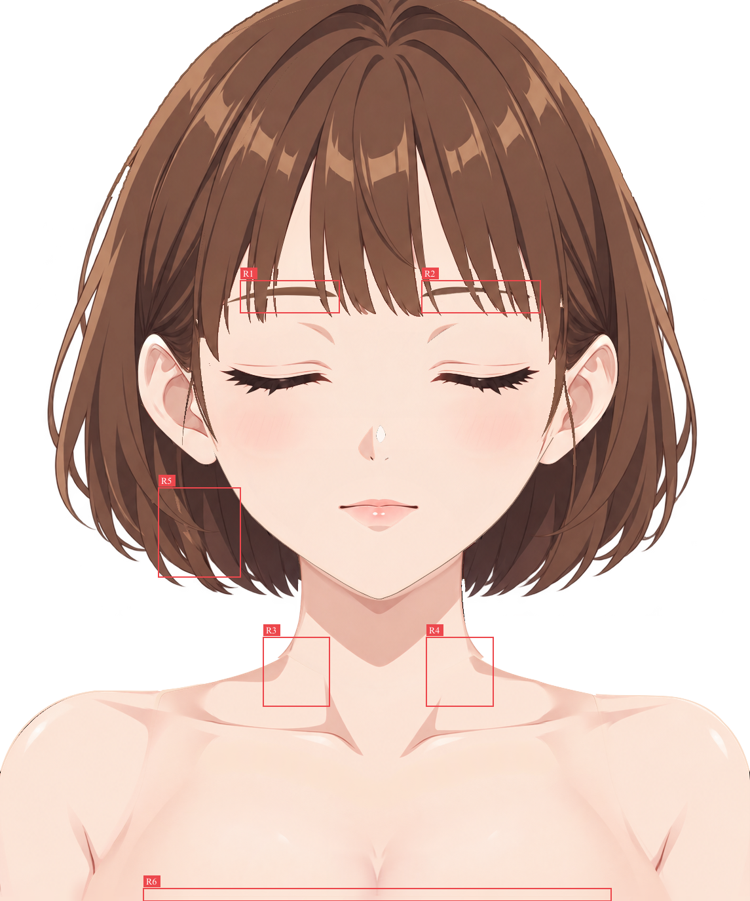

结论：需要修复

已完成当前保存工程的全部 37 个逻辑 part、41 个普通绘画层和 21 个原生透明度蒙版检查。确认 6 处仍需第一步处理的问题：两侧眉线处刘海断口、两侧颈根外弧及接色不连续、左下后发补绘痕与侧发轮廓残影、胸前层底边横向色带。上一轮多数修复已有效，但目前尚不能通过。

**审查输入与方法**

- 实际检查 [character-depth.kra](character-depth.kra)，1145 × 1374。在现有 Krita 5.3.4.1 会话中另开该路径的已保存文档进行审查；未操作原会话的工作文档，未保存工程。
- 固定参考严格沿用 [report.md](report.md) 指定的 [base-subject.png](../../part-layering/references/base-subject.png)。[standard.png](../../part-layering/references/standard.png) 与 [simplified-subject.png](../../part-layering/references/simplified-subject.png) 仅作隐藏补全的画风辅助。没有平移、缩放参考内容或更换配准标准。
- 已阅读正式 [review-01.md](review-01.md)、[repair-01.md](repair-01.md)、当前绘画报告，以及有效 [groups.json](../../part-layering/groups.json)、[occlusion.json](../../part-layering/occlusion.json) 的归属、分片与控制说明。修复记录作为线索，结论另依据当前 KRA 看图；未将 workspace 暂存文件当作已完成证明。
- 先在 Krita 按 100% 检查默认合成，再以 200% 覆盖头顶、刘海、脸、左右头发、颈肩、双臂和胸前；41 层逐层独显为 200% 或 300%，关键部位再查 300%–400%。检查了全部叠加、单片、同 part 三片合看、隐藏上层、蒙版启用及临时停用。完全隐藏的眼口 12 件另与有效补全 SVG 同坐标核对。检查完成后恢复全部显隐、蒙版与视图，关闭本次另开的审查文档，保留原会话。
- [逐层像素／蒙版与状态核验](review-02-evidence/checks/readonly-check.json)、[全部输入文件只读核验](review-02-evidence/checks/input-readonly-check.json) 均通过。哈希只核实未改输入及状态恢复，不用于质量评分。41 个深度片与当前 occlusion 的深度／part 映射一致，未发现需要更改层序或合层的问题。

[当前 KRA 默认导出](review-02-evidence/default.png) · [同尺寸灰底观察图](review-02-evidence/default-gray.png) · [Krita 100%](review-02-evidence/native/default-100.png) · [原参考在 Krita 100%](review-02-evidence/native/reference-100.png)。

**编号定位与证据读法**

[默认合成框选记录](review-02-evidence/marks-default/regions.json)；R5 另见 [后发独显框选](review-02-evidence/marks-back-solo/marked.png) 与 [独显框选记录](review-02-evidence/marks-back-solo/regions.json)。框选工具仅记录本次看图已确认的判断。坐标均为原画布 `[x,y,width,height]`。

工具局部对照为左参考、右当前；放大及状态图保留同坐标，只放大观察。R5 只用原图中后发实际可见的表面核对还原度，隐藏区依据本件结构、邻接发流及独显连续性判断。R6 所在原图为衣服，参考局部只负责位置上下文，不能把衣料当作皮肤补全目标。

**R1 · 画面左眉高度的刘海缺刻及细束断裂**

- 图层／位置：`0160 hair/bangs`，邻接 `0103 face/eyebrow_right`；框 `[367,428,151,49]`。重点是约 x390–420 的发束侧缘与细束，以及朝鼻侧的另一束穿过眉线处。
- 当前表现：刘海边缘在眉线高度出现平直矩形切口，约 x414 附近的细发束有一段被截掉；默认合成中眉色从切口处露出，使眉弧像穿入发束。隐藏眉层后缺刻仍在，刘海独显同样可见；刘海无透明度蒙版，问题在本件绘画内容／alpha，并非眉层排到了刘海前。
- 参考与影响：固定参考中这些束边及细丝在眉线前连续，眉被头发自然遮挡，原有束间露额缝另有明确边界。当前改变了发束完整性及前后遮挡，属于实际缺口，不是微小抗锯齿。
- 修复方向：在刘海层接回被切掉的发色、线纹和 alpha，恢复每束连续的侧缘及细丝。维持刘海 160 在眉 103 前，眉体仍保持完整在发后；不要靠削眉、抬眉或在刘海里贴眉色／肤色掩盖。保留既有束尾、内部高光与真实露额缝，勿把自然间隙填实。
- 证据：[同坐标参考／当前](review-02-evidence/marks-default/R1-comparison.png)、[默认／刘海独显 300%](review-02-evidence/comparisons/bangs-brow-left-states.png)、[隐藏眉／刘海独显 400%](review-02-evidence/comparisons/left-brow-without.png)、[Krita 隐藏眉检查 300%](review-02-evidence/native/without-brows-bangs-300.png)。

**R2 · 画面右眉高度的刘海同高台阶与缺口**

- 图层／位置：`0160 hair/bangs`，邻接 `0102 face/eyebrow_left`；框 `[644,428,181,49]`，重点为数枚窄尖束穿过 y438–455 眉弧的位置。
- 当前表现：多束轮廓在同一高度突然横向内缩，随后又回到原宽度，形成小矩形台阶；缺口处露出下方眉体。刘海独显仍见这些台阶，隐藏眉后的合成也未消失，确认与 R1 同属刘海自身缺绘。
- 参考与影响：本侧参考的各束轮廓沿发流自然收尖，没有沿眉线齐切的几何缺刻。重复的切口破坏发束连贯性，并改变眉发交叉关系。
- 修复方向：按本侧参考逐束补回缺口内属于刘海的表面和轮廓，使眉在完整发束后自然被遮住；保持 160／102 的层序。不镜像另一侧，不削掉完整眉体，不移动参考或整体扩大刘海。保留本侧真实尖束长短、发纹与束间间隙。
- 证据：[同坐标参考／当前](review-02-evidence/marks-default/R2-comparison.png)、[默认／刘海独显 300%](review-02-evidence/comparisons/bangs-brow-right-states.png)、[Krita 默认 200%](review-02-evidence/native/bangs-200.png)、[完整刘海独显](review-02-evidence/layers/0160-hair-bangs-gray.png)。

**R3 · 画面左颈根尖角外露，斜向拼接色界未接顺**

- 图层／位置：`0035 neck`、`0040 body/torso` 及后者 `blend • neck and shoulder roots • controller neck + arms`；框 `[402,972,101,105]`。
- 当前表现：颈底接形在约 x425–440／y995–1006 向外挑出小尖片，随后回折到肩部轮廓；从该点向内还有一条斜向肤色色界。独显 neck 与 torso 可辨认各自的接形边，二者合看仍有尖角和色界。原来的内部三角透底已填实，但轮廓和绘画过渡仍未连续。
- 参考与影响：参考此处是从颈侧平顺展开到肩根的连续外弧，肤色及本体明暗自然延续。当前小尖角形成多余折点，内部斜界暴露分件拼接，整图颈肩显得拼装。
- 修复方向：调整默认接形／局部覆盖，使颈底预留量收在正确颈肩外弧内；在有可靠实底的交接范围用画笔接顺肤色及局部明暗，消除人为斜界。保留完整 neck 底纹、torso 胸廓及锁骨职责、独立图层和已恢复的内部不透底覆盖；隐藏余量可保留在正确控制下，不能为修尖角砍掉整个补全区。不要新增 AO／投影遮缝。
- 证据：[同坐标参考／当前](review-02-evidence/marks-default/R3-comparison.png)、[默认／neck 原纹理／torso 默认蒙版](review-02-evidence/comparisons/neck-left-states.png)、[Krita 二件合看 300%](review-02-evidence/native/neck-torso-left-300.png)、[仅停用 torso 接色蒙版的合看](review-02-evidence/checks/neck-torso-mask-disabled.png)。

**R4 · 画面右颈根外挑尖片与接缝**

- 图层／位置：`0035 neck`、`0040 body/torso` 及同一接色蒙版；框 `[651,972,102,105]`。
- 当前表现：约 x722–739／y995–1006 有向外伸出的尖片，接到肩根时出现回折台阶；内侧仍能辨认向锁骨方向的斜向拼接色界。默认、二件合看及原纹理检查均确认，并非背景色或投影造成。
- 参考与影响：本侧参考同样是连续颈肩弧线，颈根自身明暗跟随表面延续，没有这一尖片／斜缝。该处破坏外轮廓，且与 R3 一起使整段颈肩不自然。
- 修复方向：独立按本侧修正默认外弧与接形，将不应外露的颈底余量藏妥，在真实重叠内重接肤色；保留左右参考的不对称、本侧颈侧明暗、锁骨形体及现有完整底纹。保持颈 35／torso 40 的职责和层序，不能用镜像、重贴衣料或阴影盖住接缝；继续维持内部实底。
- 证据：[同坐标参考／当前](review-02-evidence/marks-default/R4-comparison.png)、[默认／neck 原纹理／torso 默认蒙版](review-02-evidence/comparisons/neck-right-states.png)、[Krita 二件合看 300%](review-02-evidence/native/neck-torso-right-300.png)、[颈肩整体对照](review-02-evidence/comparisons/neck.png)。

**R5 · 画面左下后发的浅色碎片、断续笔带和侧发轮廓残影**

- 图层／位置：主要为 `0010 hair/back_hair`；对照上方 `0021 hair/side_hair_right__rear`。框 `[242,744,125,136]`，重点约 x265–315／y770–850。
- 当前表现：后发出现锯齿状浅金棕片、孤立亮条和突兀深色折笔，接到周围长弧发流时有明显材质跳变。默认合成仍露出部分浅色碎片。隐藏侧发后，后发底纹还留有一条向右收尖的细弯束样条影；与同坐标 0021 独显对照，可见它对应上方侧发游离细弯束的位置／走势，底面出现了重复轮廓。这里的问题是当前可见绘画与底纹职责，不依据生成记录推断制作方式。
- 参考与影响：原图本件实际外露区域是较平顺的深棕束面与连续长发线，当前浅色碎片改变了局部质感。被侧发遮挡的区段虽不必匹配遮挡物像素，仍应是连续的后发表面；保留上方侧发样轮廓残影会在侧发运动时露出不合理的第二套形状。
- 修复方向：在 0010 内用本后发的颜色、束宽和长弧发流重新接顺此段，去掉无承接的浅色碎片／短折笔，并重画游离侧发细弯束残影下的连续后发表面。0021 的真实细弯束和已归回该层的两枚完整末梢应保留；不要删侧发、把侧发像素复制回后发，或靠扩大侧发遮住问题。完整后发 alpha、耳下承接和更靠颈旁的内后短梢保持，10 与 6／21／151 的身份、深度不变。只允许使用后发自身实际可见的参考像素；隐藏面依据自身结构补绘，不取耳、脸或侧发作底纹。
- 证据：[默认参考／当前](review-02-evidence/marks-default/R5-comparison.png)、[默认／后发／侧发同坐标 300%](review-02-evidence/comparisons/back-left-lower-states.png)、[后发与侧发细弯束同坐标 400%](review-02-evidence/comparisons/back-side-same-coordinate.png)、[后发独显框选局部](review-02-evidence/marks-back-solo/R5-current.png)、[Krita 后发独显 300%](review-02-evidence/native/back-left-lower-300.png)。

**R6 · 胸前层底边有横向平直色带，曲面明暗被截断**

- 图层／位置：`0050 body/breast`；框 `[219,1355,714,19]`，重点约 y1366 至画布底边。
- 当前表现：本层宽度内出现一条与画布平行的浅色色带，上方肤色渐变及中央乳沟的本体明暗在横界处突然截断，下面变成近乎平直的条带。默认、breast 原始像素及停用本层蒙版后的独显均有，torso 原纹理没有这一横带，因此不能靠 torso 蒙版修复。
- 依据与影响：此处参考被临时背心遮挡，应依据完整胸前曲面向画布裁切处自然延续验收；不要求复制原图衣料或恢复服装。当前长横界暴露纹理拼接，并截断本件自身形体明暗，属于补全连续性问题，不是外缘抗锯齿。
- 修复方向：在 0050 同层把局部肤色渐变及中央形体明暗自然续画到 y1374 的裁切边，去掉平直色带及横向接界。保留本件体积、现有上部高光、独立控制和画布尺寸；不向画外推造完整形体，不把乳沟画到 torso，不复制衣料或添加投影遮缝。
- 证据：[参考／当前位置上下文](review-02-evidence/marks-default/R6-comparison.png)、[默认／原纹理／蒙版状态／torso 对照](review-02-evidence/comparisons/bottom-states.png)、[全宽状态对照](review-02-evidence/comparisons/bottom-wide-states.png)、[Krita 停用本层蒙版独显 400%](review-02-evidence/native/bottom-breast-unmasked-400.png)。

**上一轮修复的独立复核**

| 原编号 | 本次实际观察 |
| --- | --- |
| 原 R1 | 刘海束尾与露额节奏已明显恢复；眉线穿过发束处仍有本次 R1／R2 的切口，不能将整件视为完全修好。 |
| 原 R2／R3 | 外弧、内弯尖梢及两侧外露范围已明显改善；R2 的连续弯束／两枚末梢已在 0021，按当前有效归属保留，不退回旧截断边界。左下后发材质与底纹职责仍见本次 R5。 |
| 原 R4 | 原平顶眉补丁与垂直台阶已去除；本次不要求再次改眉弓。 |
| 原 R5／R6 | 两侧贴睑暖边、亮缘、睫毛体量与独立褶线已恢复；默认闭眼不漏眼白／虹膜。 |
| 原 R7／R8 | 双颊淡斜线已回到各自透明腮红层，与晕染同在；没有基础肤色椭圆。 |
| 原 R9 | 深色嘴角与闭缝粗细已恢复，下唇双点高光保留，口内没有漏出。 |
| 原 R10／R11 | 内部灰楔／三角透底已填实；当前仍有本次 R3／R4 的外挑尖角及色界，需继续接顺。 |
| 原 R12／R13 | 原耳下硬接带与 M 形粗缝已有明显改善；右侧未确认同等强度的剩余接带问题。左下后发新局部见 R5，不将整层的修复记录替代独显判断。 |
| 原 R14／R15 | 双侧腋部至底边的宽半透明透底已消除，肩臂／躯干连续实底保留。 |
| Repair S1 | 头盖至下部原横向接带已明显接顺，本次未将其再次列为确定问题。 |

对应本次对照：[双眼](review-02-evidence/comparisons/eyes.png)、[双颊／鼻](review-02-evidence/comparisons/cheeks-nose.png)、[嘴部](review-02-evidence/comparisons/mouth.png)、[左侧头发](review-02-evidence/comparisons/hair-left.png)、[右侧头发](review-02-evidence/comparisons/hair-right.png)、[左肩臂／腋侧](review-02-evidence/comparisons/shoulder-left.png)、[右肩臂／腋侧](review-02-evidence/comparisons/shoulder-right.png)、[后发头盖独显 200%](review-02-evidence/native/back-cap-200.png)。

**完整性、归属与控制关系核对**

- 37 个逻辑 part 均有对应绘画内容。侧发仍是同一 part 的 5／20／150 与 6／21／151 三片，分别检查并 [左侧合看](review-02-evidence/checks/hair-side_hair_left-complete.png)、[右侧合看](review-02-evidence/checks/hair-side_hair_right-complete.png)。根部在头盖后、宽帘在耳后、窄鬓发在耳前的既定层序成立，未因多层判作重复，也未要求合层或退回拆组。R5 指纹理中的具体重复轮廓，不是同 part 多深度本身有错。
- 完整脸底的额头、双颊、下颌连续，无眼口洞；双耳主体、耳根和内部结构存在。隐藏上方五官／头发后检查了 [脸底](review-02-evidence/checks/face-base-upper-hidden.png) 及 [无头发组合](review-02-evidence/checks/without-hair.png)。鼻部三件的职责与内容存在；零星鼻尖细边留第二步。
- 完全隐藏的 12 件均看过原纹理及有效补全 SVG：眼白完整不挖虹膜洞、虹膜／瞳孔近圆完整、独立反光及完整下睑存在；口内底、舌、上下牙均有连续实体。SVG／当前原纹理同坐标对照：[口内／舌／下牙](review-02-evidence/checks/hidden-design-check-0.png)、[上牙／双眼白](review-02-evidence/checks/hidden-design-check-1.png)、[双虹膜／左反光](review-02-evidence/checks/hidden-design-check-2.png)、[右反光／双下睑](review-02-evidence/checks/hidden-design-check-3.png)。右眼四件沿既定 `x右 = 1157 − x左，y不变` 镜像复用，完整尺寸及暖棕色协调；闭眼参考无异色依据，不要求另造异色或强制改变可见不对称设计。
- 默认 21 个蒙版均启用。眼内三件共享本侧上下睑控制的闭合开口；虹膜／眼内反光另受完整眼白裁切。双下睑由独立闭眼接触显隐控制，未以眼内开口误裁上睑或褶线。口内四件受上下唇共同闭口控制，牙舌另受完整口内裁切。默认闭眼闭嘴全部隐藏；临时停用开口后看过 [组合](review-02-evidence/checks/apertures-disabled.png) 及 [隐藏睑／唇后的底纹](review-02-evidence/checks/hidden-eye-mouth-revealed.png)。这些只是底纹／裁切检查状态，不作为睁眼张嘴完成姿态验收。原生蒙版名称、UUID、所属层及启用状态见 [层索引](review-02-evidence/checks/layer-index.json)。
- neck、双臂、torso 和 breast 原始肤色绘画均完整存在；[隐藏胸前层后](review-02-evidence/checks/without-breast.png) torso 连续，无乳沟重复到底形。未把原图临时背心、肩带、衣领当作应保留人体内容。R3／R4 为接形和接色，R6 为本层内部纹理延续，均不要求恢复衣服。
- 其余小部件逐层独显没有确认新的本步缺项或大块其他部件像素污染。细微发丝混色边、低透明柔边、零星锯齿与描边精修留第二步。本次六项涉及实际发束断口、外形折点、成片纹理／归属问题或长横向接缝，不因阶段限制推迟。未把未制作的阴影、AO 或投影列为缺失；本件已有形体明暗只要求连续保留。

**逐层检查覆盖**

下表按由后至前列出全部 41 层。灰底图只裁空白，不缩放；“原纹理”为实际 KRA 本层像素，“Krita”为当前文档临时独显、停用本层蒙版后的 200%／300% 检查截图。带蒙版层另给默认投影，完整机读记录见 [层索引](review-02-evidence/checks/layer-index.json) 与 [原生独显索引](review-02-evidence/checks/native-index.json)。大件另以上述分区域视图检查全范围。

| 实际绘画层 | 本次观察 | 证据 |
| --- | --- | --- |
| `0005 hair/side_hair_left__hidden_root` | 隐藏根有材质；与同 part 另两片合看，保留后置根部。 | [灰底](review-02-evidence/layers/0005-hair-side_hair_left__hidden_root-gray.png) · [原纹理](review-02-evidence/layers/0005-hair-side_hair_left__hidden_root-raw.png) · [Krita](review-02-evidence/native/0005-hair-side_hair_left__hidden_root-solo.png) |
| `0006 hair/side_hair_right__hidden_root` | 隐藏根有材质；与同 part 另两片合看，保留后置根部。 | [灰底](review-02-evidence/layers/0006-hair-side_hair_right__hidden_root-gray.png) · [原纹理](review-02-evidence/layers/0006-hair-side_hair_right__hidden_root-raw.png) · [Krita](review-02-evidence/native/0006-hair-side_hair_right__hidden_root-solo.png) |
| `0010 hair/back_hair` | 完整头盖、后脑和耳下承接存在；左下材质／残影见 R5。 | [灰底](review-02-evidence/layers/0010-hair-back_hair-gray.png) · [原纹理](review-02-evidence/layers/0010-hair-back_hair-raw.png) · [Krita](review-02-evidence/native/0010-hair-back_hair-solo.png) |
| `0020 hair/side_hair_left__rear` | 耳后宽帘／外弧／末梢完整；21 的完整细弯束保留，参见 R5 归属核对。 | [灰底](review-02-evidence/layers/0020-hair-side_hair_left__rear-gray.png) · [原纹理](review-02-evidence/layers/0020-hair-side_hair_left__rear-raw.png) · [Krita](review-02-evidence/native/0020-hair-side_hair_left__rear-solo.png) |
| `0021 hair/side_hair_right__rear` | 耳后宽帘／外弧／末梢完整；21 的完整细弯束保留，参见 R5 归属核对。 | [灰底](review-02-evidence/layers/0021-hair-side_hair_right__rear-gray.png) · [原纹理](review-02-evidence/layers/0021-hair-side_hair_right__rear-raw.png) · [Krita](review-02-evidence/native/0021-hair-side_hair_right__rear-solo.png) |
| `0030 arms/arm_left` | 完整肩臂及内延余量存在，无衣料；默认腋侧不再宽幅透底。 | [灰底](review-02-evidence/layers/0030-arms-arm_left-gray.png) · [原纹理](review-02-evidence/layers/0030-arms-arm_left-raw.png) · [Krita](review-02-evidence/native/0030-arms-arm_left-solo.png) |
| `0031 arms/arm_right` | 完整肩臂及内延余量存在，无衣料；默认腋侧不再宽幅透底。 | [灰底](review-02-evidence/layers/0031-arms-arm_right-gray.png) · [原纹理](review-02-evidence/layers/0031-arms-arm_right-raw.png) · [Krita](review-02-evidence/native/0031-arms-arm_right-solo.png) |
| `0035 neck` | 完整颈部底纹存在；默认外弧／接色见 R3、R4。 | [灰底](review-02-evidence/layers/0035-neck-gray.png) · [原纹理](review-02-evidence/layers/0035-neck-raw.png) · [Krita](review-02-evidence/native/0035-neck-solo.png) |
| `0040 body/torso` | 连续胸廓底形、锁骨存在；R3、R4 交接仍需修顺。 | [灰底](review-02-evidence/layers/0040-body-torso-gray.png) · [原纹理](review-02-evidence/layers/0040-body-torso-raw.png) · [Krita](review-02-evidence/native/0040-body-torso-solo.png) · [默认蒙版](review-02-evidence/layers/0040-body-torso-masked.png) |
| `0050 body/breast` | 成对胸前曲面及自身明暗存在；底边横带见 R6。 | [灰底](review-02-evidence/layers/0050-body-breast-gray.png) · [原纹理](review-02-evidence/layers/0050-body-breast-raw.png) · [Krita](review-02-evidence/native/0050-body-breast-solo.png) · [默认蒙版](review-02-evidence/layers/0050-body-breast-masked.png) |
| `0060 face/ear_left` | 耳轮、耳甲、耳垂和耳根内容存在；耳前／耳后关系成立。 | [灰底](review-02-evidence/layers/0060-face-ear_left-gray.png) · [原纹理](review-02-evidence/layers/0060-face-ear_left-raw.png) · [Krita](review-02-evidence/native/0060-face-ear_left-solo.png) |
| `0061 face/ear_right` | 耳轮、耳甲、耳垂和耳根内容存在；耳前／耳后关系成立。 | [灰底](review-02-evidence/layers/0061-face-ear_right-gray.png) · [原纹理](review-02-evidence/layers/0061-face-ear_right-raw.png) · [Krita](review-02-evidence/native/0061-face-ear_right-solo.png) |
| `0070 face/face_base` | 完整脸底无眼口洞；额头、太阳穴、面颊、下颌连续。 | [灰底](review-02-evidence/layers/0070-face-face_base-gray.png) · [原纹理](review-02-evidence/layers/0070-face-face_base-raw.png) · [Krita](review-02-evidence/native/0070-face-face_base-solo.png) |
| `0072 face/blush_left` | 透明晕染与淡斜线均在本层；不含基础肤色椭圆。 | [灰底](review-02-evidence/layers/0072-face-blush_left-gray.png) · [原纹理](review-02-evidence/layers/0072-face-blush_left-raw.png) · [Krita](review-02-evidence/native/0072-face-blush_left-solo.png) |
| `0073 face/blush_right` | 透明晕染与淡斜线均在本层；不含基础肤色椭圆。 | [灰底](review-02-evidence/layers/0073-face-blush_right-gray.png) · [原纹理](review-02-evidence/layers/0073-face-blush_right-raw.png) · [Krita](review-02-evidence/native/0073-face-blush_right-solo.png) |
| `0074 face/nose/volume_shadow` | 鼻部自身绘画内容存在，三件分工成立；细边留第二步。 | [灰底](review-02-evidence/layers/0074-face-nose-volume_shadow-gray.png) · [原纹理](review-02-evidence/layers/0074-face-nose-volume_shadow-raw.png) · [Krita](review-02-evidence/native/0074-face-nose-volume_shadow-solo.png) |
| `0075 face/nose/tip_highlight` | 鼻部自身绘画内容存在，三件分工成立；细边留第二步。 | [灰底](review-02-evidence/layers/0075-face-nose-tip_highlight-gray.png) · [原纹理](review-02-evidence/layers/0075-face-nose-tip_highlight-raw.png) · [Krita](review-02-evidence/native/0075-face-nose-tip_highlight-solo.png) |
| `0076 face/nose/tip_mark` | 鼻部自身绘画内容存在，三件分工成立；细边留第二步。 | [灰底](review-02-evidence/layers/0076-face-nose-tip_mark-gray.png) · [原纹理](review-02-evidence/layers/0076-face-nose-tip_mark-raw.png) · [Krita](review-02-evidence/native/0076-face-nose-tip_mark-solo.png) |
| `0080 face/mouth/mouth_interior` | 完整隐藏口内实体存在；闭口隐藏，牙舌受内腔裁切。 | [灰底](review-02-evidence/layers/0080-face-mouth-mouth_interior-gray.png) · [原纹理](review-02-evidence/layers/0080-face-mouth-mouth_interior-raw.png) · [Krita](review-02-evidence/native/0080-face-mouth-mouth_interior-solo.png) · [默认蒙版](review-02-evidence/layers/0080-face-mouth-mouth_interior-masked.png) |
| `0081 face/mouth/tongue` | 完整隐藏口内实体存在；闭口隐藏，牙舌受内腔裁切。 | [灰底](review-02-evidence/layers/0081-face-mouth-tongue-gray.png) · [原纹理](review-02-evidence/layers/0081-face-mouth-tongue-raw.png) · [Krita](review-02-evidence/native/0081-face-mouth-tongue-solo.png) · [默认蒙版](review-02-evidence/layers/0081-face-mouth-tongue-masked.png) |
| `0082 face/mouth/lower_teeth` | 完整隐藏口内实体存在；闭口隐藏，牙舌受内腔裁切。 | [灰底](review-02-evidence/layers/0082-face-mouth-lower_teeth-gray.png) · [原纹理](review-02-evidence/layers/0082-face-mouth-lower_teeth-raw.png) · [Krita](review-02-evidence/native/0082-face-mouth-lower_teeth-solo.png) · [默认蒙版](review-02-evidence/layers/0082-face-mouth-lower_teeth-masked.png) |
| `0083 face/mouth/upper_teeth` | 完整隐藏口内实体存在；闭口隐藏，牙舌受内腔裁切。 | [灰底](review-02-evidence/layers/0083-face-mouth-upper_teeth-gray.png) · [原纹理](review-02-evidence/layers/0083-face-mouth-upper_teeth-raw.png) · [Krita](review-02-evidence/native/0083-face-mouth-upper_teeth-solo.png) · [默认蒙版](review-02-evidence/layers/0083-face-mouth-upper_teeth-masked.png) |
| `0084 face/mouth/lower_lip` | 粉色下唇、高光和本体明暗完整；无重复深唇缝。 | [灰底](review-02-evidence/layers/0084-face-mouth-lower_lip-gray.png) · [原纹理](review-02-evidence/layers/0084-face-mouth-lower_lip-raw.png) · [Krita](review-02-evidence/native/0084-face-mouth-lower_lip-solo.png) |
| `0085 face/mouth/upper_lip` | 上唇、深色闭缝和两端嘴角完整；默认闭嘴。 | [灰底](review-02-evidence/layers/0085-face-mouth-upper_lip-gray.png) · [原纹理](review-02-evidence/layers/0085-face-mouth-upper_lip-raw.png) · [Krita](review-02-evidence/native/0085-face-mouth-upper_lip-solo.png) |
| `0090 face/eye_left/sclera` | 完整杏仁眼白，不挖中洞；闭眼隐藏。 | [灰底](review-02-evidence/layers/0090-face-eye_left-sclera-gray.png) · [原纹理](review-02-evidence/layers/0090-face-eye_left-sclera-raw.png) · [Krita](review-02-evidence/native/0090-face-eye_left-sclera-solo.png) · [默认蒙版](review-02-evidence/layers/0090-face-eye_left-sclera-masked.png) |
| `0091 face/eye_right/sclera` | 完整杏仁眼白，不挖中洞；闭眼隐藏。 | [灰底](review-02-evidence/layers/0091-face-eye_right-sclera-gray.png) · [原纹理](review-02-evidence/layers/0091-face-eye_right-sclera-raw.png) · [Krita](review-02-evidence/native/0091-face-eye_right-sclera-solo.png) · [默认蒙版](review-02-evidence/layers/0091-face-eye_right-sclera-masked.png) |
| `0092 face/eye_left/iris` | 完整暖棕虹膜／瞳孔，左右协调；眼白裁切及闭眼隐藏成立。 | [灰底](review-02-evidence/layers/0092-face-eye_left-iris-gray.png) · [原纹理](review-02-evidence/layers/0092-face-eye_left-iris-raw.png) · [Krita](review-02-evidence/native/0092-face-eye_left-iris-solo.png) · [默认蒙版](review-02-evidence/layers/0092-face-eye_left-iris-masked.png) |
| `0093 face/eye_right/iris` | 完整暖棕虹膜／瞳孔，左右协调；眼白裁切及闭眼隐藏成立。 | [灰底](review-02-evidence/layers/0093-face-eye_right-iris-gray.png) · [原纹理](review-02-evidence/layers/0093-face-eye_right-iris-raw.png) · [Krita](review-02-evidence/native/0093-face-eye_right-iris-solo.png) · [默认蒙版](review-02-evidence/layers/0093-face-eye_right-iris-masked.png) |
| `0094 face/eye_left/highlight` | 独立简洁眼内反光存在；眼白裁切及闭眼隐藏成立。 | [灰底](review-02-evidence/layers/0094-face-eye_left-highlight-gray.png) · [原纹理](review-02-evidence/layers/0094-face-eye_left-highlight-raw.png) · [Krita](review-02-evidence/native/0094-face-eye_left-highlight-solo.png) · [默认蒙版](review-02-evidence/layers/0094-face-eye_left-highlight-masked.png) |
| `0095 face/eye_right/highlight` | 独立简洁眼内反光存在；眼白裁切及闭眼隐藏成立。 | [灰底](review-02-evidence/layers/0095-face-eye_right-highlight-gray.png) · [原纹理](review-02-evidence/layers/0095-face-eye_right-highlight-raw.png) · [Krita](review-02-evidence/native/0095-face-eye_right-highlight-solo.png) · [默认蒙版](review-02-evidence/layers/0095-face-eye_right-highlight-masked.png) |
| `0096 face/eye_left/eyelid_crease` | 独立暖桃褶线存在、默认显示；未受眼内开口误裁。 | [灰底](review-02-evidence/layers/0096-face-eye_left-eyelid_crease-gray.png) · [原纹理](review-02-evidence/layers/0096-face-eye_left-eyelid_crease-raw.png) · [Krita](review-02-evidence/native/0096-face-eye_left-eyelid_crease-solo.png) |
| `0097 face/eye_right/eyelid_crease` | 独立暖桃褶线存在、默认显示；未受眼内开口误裁。 | [灰底](review-02-evidence/layers/0097-face-eye_right-eyelid_crease-gray.png) · [原纹理](review-02-evidence/layers/0097-face-eye_right-eyelid_crease-raw.png) · [Krita](review-02-evidence/native/0097-face-eye_right-eyelid_crease-solo.png) |
| `0098 face/eye_left/lower_eyelid` | 完整下睑细缘存在；默认接触显隐隐藏补设计下缘。 | [灰底](review-02-evidence/layers/0098-face-eye_left-lower_eyelid-gray.png) · [原纹理](review-02-evidence/layers/0098-face-eye_left-lower_eyelid-raw.png) · [Krita](review-02-evidence/native/0098-face-eye_left-lower_eyelid-solo.png) · [默认蒙版](review-02-evidence/layers/0098-face-eye_left-lower_eyelid-masked.png) |
| `0099 face/eye_right/lower_eyelid` | 完整下睑细缘存在；默认接触显隐隐藏补设计下缘。 | [灰底](review-02-evidence/layers/0099-face-eye_right-lower_eyelid-gray.png) · [原纹理](review-02-evidence/layers/0099-face-eye_right-lower_eyelid-raw.png) · [Krita](review-02-evidence/native/0099-face-eye_right-lower_eyelid-solo.png) · [默认蒙版](review-02-evidence/layers/0099-face-eye_right-lower_eyelid-masked.png) |
| `0100 face/eye_left/upper_eyelid` | 闭睑暖边、亮缘、深带与尖簇完整，局部上睑明暗保留。 | [灰底](review-02-evidence/layers/0100-face-eye_left-upper_eyelid-gray.png) · [原纹理](review-02-evidence/layers/0100-face-eye_left-upper_eyelid-raw.png) · [Krita](review-02-evidence/native/0100-face-eye_left-upper_eyelid-solo.png) |
| `0101 face/eye_right/upper_eyelid` | 闭睑暖边、亮缘、深带与尖簇完整，局部上睑明暗保留。 | [灰底](review-02-evidence/layers/0101-face-eye_right-upper_eyelid-gray.png) · [原纹理](review-02-evidence/layers/0101-face-eye_right-upper_eyelid-raw.png) · [Krita](review-02-evidence/native/0101-face-eye_right-upper_eyelid-solo.png) |
| `0102 face/eyebrow_left` | 完整眉弓在发后，原矩形补丁已修；邻接刘海见 R1、R2。 | [灰底](review-02-evidence/layers/0102-face-eyebrow_left-gray.png) · [原纹理](review-02-evidence/layers/0102-face-eyebrow_left-raw.png) · [Krita](review-02-evidence/native/0102-face-eyebrow_left-solo.png) |
| `0103 face/eyebrow_right` | 完整眉弓在发后，原矩形补丁已修；邻接刘海见 R1、R2。 | [灰底](review-02-evidence/layers/0103-face-eyebrow_right-gray.png) · [原纹理](review-02-evidence/layers/0103-face-eyebrow_right-raw.png) · [Krita](review-02-evidence/native/0103-face-eyebrow_right-solo.png) |
| `0150 hair/side_hair_left__front` | 耳前窄束／跨耳细丝存在；与后区合看，不抬升耳后宽帘。 | [灰底](review-02-evidence/layers/0150-hair-side_hair_left__front-gray.png) · [原纹理](review-02-evidence/layers/0150-hair-side_hair_left__front-raw.png) · [Krita](review-02-evidence/native/0150-hair-side_hair_left__front-solo.png) |
| `0151 hair/side_hair_right__front` | 耳前窄束／跨耳细丝存在；与后区合看，不抬升耳后宽帘。 | [灰底](review-02-evidence/layers/0151-hair-side_hair_right__front-gray.png) · [原纹理](review-02-evidence/layers/0151-hair-side_hair_right__front-raw.png) · [Krita](review-02-evidence/native/0151-hair-side_hair_right__front-solo.png) |
| `0160 hair/bangs` | 完整扇面与束尾存在；眉线处本件断口见 R1、R2。 | [灰底](review-02-evidence/layers/0160-hair-bangs-gray.png) · [原纹理](review-02-evidence/layers/0160-hair-bangs-raw.png) · [Krita](review-02-evidence/native/0160-hair-bangs-solo.png) |

**返修后复核要求**

先修刘海本体断口与颈根轮廓／接色，再修后发底纹和胸前底边。逐项在默认合成、所属层独显及隐藏上方部件状态复核；保留完整隐藏纹理、既定分片和蒙版控制，不以额外参考覆盖掩盖归属错误。六项修复完成后应再次核对全图的眉发遮挡、颈肩外弧和发流连续性。

本报告仅反馈，未修改 KRA、PNG 正式产物、上游分组、深度表或 SVG；检查证据均为本次导出。当前结论为需要修复。
