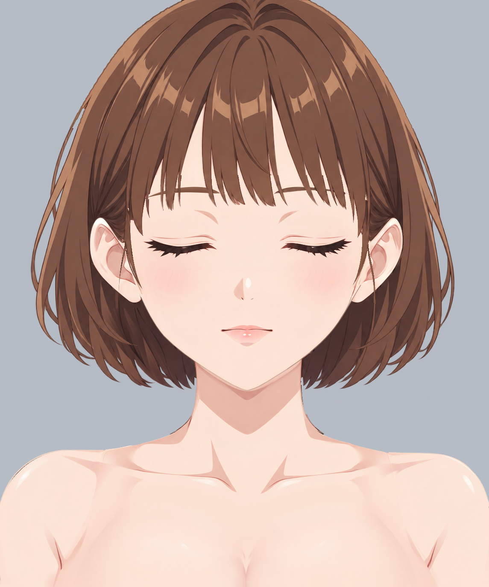

# Step02 边缘柔化与去锯齿报告

结论：已完成本轮局部精修、逐层显隐检查及保存重开核对。41个普通绘画层中实际修改37层；22个原生透明度蒙版数据、UUID、归属及默认启用状态保持。

[KRA](character-soft-edges.kra) · [透明PNG](character-soft-edges.png) · [重开核对](evidence/reopen-check.json) · [实际像素改动记录](evidence/changes.json)

## 实际输入与参考

- 输入 KRA：`/Users/wutian/Desktop/coding/AstraLayering/.run/closed-face-full-20261026/raster-layering/step01/character-depth.kra`。首次另存工作工程到本步 workspace，未覆盖第一步工程。
- 第一步报告：`/Users/wutian/Desktop/coding/AstraLayering/.run/closed-face-full-20261026/raster-layering/step01/report.md`。沿用其37个逻辑part、41个深度区域及已确认补全。
- 实际像素参考：`../../part-layering/references/base-subject.png`。同画布同坐标对照，没有换参考、平移或缩放。
- 结构依据：`/Users/wutian/Desktop/coding/AstraLayering/.run/closed-face-full-20261026/part-layering/groups.json`、`/Users/wutian/Desktop/coding/AstraLayering/.run/closed-face-full-20261026/part-layering/occlusion.json` 和该目录的 `parts/`，均只读。

## 处理与检查方法

先用 locate_pixel_differences 全图候选框定位，再核对原图同一区域并扩展到逐层检查。大面积胸前色差对应既有皮肤补全与参考背心的差别，刘海宽面的色差含第一步的既有补绘；没有按差异阈值自动覆盖或改形。候选仅作检查入口，不以差异数量或PSNR验收。

绘画经现有 Krita Python bridge 调用原生笔刷，按观察后手工指定的局部笔迹操作。Airbrush Soft / Basic-5 Size 用于同层取色接续和残点清理，Filter Blur 只沿已定位的窄缘运行；笔刷直径约2.5–5px，实际半透明过渡随原有边缘及局部笔迹变化。没有全层模糊、统一全局羽化、阈值生成修复、引用原图像素贴补，也没有新增阴影、AO或投影。

试用 Blender Blur 后发现睫毛外浮点，已撤回试修并从该层步骤基线恢复，最终改用不带出颜色的 Filter Blur。颈肩一笔偏离外缘的暖棕试修也完整撤回；用原坐标网格重新定位后，只处理实际外缘。最终KRA没有保留这些试修。每批实际修改均保存。

逐层检查包括：原始绘画层独显、保留蒙版时的独显、隐藏上方绘画层后的实际原生合成；带蒙版层另临时停用本层蒙版核对完整纹理。所有检查后恢复默认状态。两侧发各按5/20/150、6/21/151独显并同part合看，未合层、改名或改变归属。内部深度分片的互斥切口按同part连续性判断，不当作人物外轮廓扩张。

## 逐层验收记录

下表“独显”为默认蒙版状态；闭眼闭嘴内容空白是既定默认显隐，“底纹”为不受该显隐遮挡的完整绘画像素。各层均检查外缘、残色及隐藏上层后的连续性；未发现本轮新增穿插、硬接缝或纹理丢失。

| 实际绘画层（后→前） | 修改及验收 | 原尺寸证据 |
| --- | --- | --- |
| `0005 hair/side_hair_left__hidden_root` | 已修改；隐藏根部弧缘局部柔化；保留深度5分片与完整纹理。 独显/上层隐藏复查通过。 | [独显](evidence/solo/0005-hair-side_hair_left__hidden_root.png) · [底纹](evidence/raw/0005-hair-side_hair_left__hidden_root.png) · [上层隐藏](evidence/under/0005-hair-side_hair_left__hidden_root.png) |
| `0006 hair/side_hair_right__hidden_root` | 已修改；另一侧隐藏根部独立顺弧柔化，不镜像。 独显/上层隐藏复查通过。 | [独显](evidence/solo/0006-hair-side_hair_right__hidden_root.png) · [底纹](evidence/raw/0006-hair-side_hair_right__hidden_root.png) · [上层隐藏](evidence/under/0006-hair-side_hair_right__hidden_root.png) |
| `0010 hair/back_hair` | 已修改；头盖局部边、两侧外露短梢窄带柔化；隐藏宽面不重画。 独显/上层隐藏复查通过。 | [独显](evidence/solo/0010-hair-back_hair.png) · [底纹](evidence/raw/0010-hair-back_hair.png) · [上层隐藏](evidence/under/0010-hair-back_hair.png) |
| `0020 hair/side_hair_left__rear` | 已修改；本侧长外弧、游离弧束及卷梢分别柔化；根部与前片分界保留。 独显/上层隐藏复查通过。 | [独显](evidence/solo/0020-hair-side_hair_left__rear.png) · [底纹](evidence/raw/0020-hair-side_hair_left__rear.png) · [上层隐藏](evidence/under/0020-hair-side_hair_left__rear.png) |
| `0021 hair/side_hair_right__rear` | 已修改；本侧非对称外弧和两枚末梢分别柔化。 独显/上层隐藏复查通过。 | [独显](evidence/solo/0021-hair-side_hair_right__rear.png) · [底纹](evidence/raw/0021-hair-side_hair_right__rear.png) · [上层隐藏](evidence/under/0021-hair-side_hair_right__rear.png) |
| `0030 arms/arm_left` | 已修改；肩外弧局部去台阶；贴画布右边的黑残点用本层邻近肤色重绘。 独显/上层隐藏复查通过。 | [独显](evidence/solo/0030-arms-arm_left.png) · [底纹](evidence/raw/0030-arms-arm_left.png) · [上层隐藏](evidence/under/0030-arms-arm_left.png) |
| `0031 arms/arm_right` | 已修改；另一侧肩外弧局部去台阶；贴画布左边的黑残点用本层肤色重绘。 独显/上层隐藏复查通过。 | [独显](evidence/solo/0031-arms-arm_right.png) · [底纹](evidence/raw/0031-arms-arm_right.png) · [上层隐藏](evidence/under/0031-arms-arm_right.png) |
| `0035 neck` | 已修改；颈外缘窄带柔化；右侧杂色点同层接色，预留颈底不删。 独显/上层隐藏复查通过。 | [独显](evidence/solo/0035-neck.png) · [底纹](evidence/raw/0035-neck.png) · [上层隐藏](evidence/under/0035-neck.png) |
| `0040 body/torso` | 已修改；只在准确肩根外缘收柔偏黑描边末端；原蒙版及底纹保留。 独显/上层隐藏复查通过。 | [独显](evidence/solo/0040-body-torso.png) · [底纹](evidence/raw/0040-body-torso.png) · [上层隐藏](evidence/under/0040-body-torso.png) |
| `0050 body/breast` | 已修改；上接区两段轻柔化；画布底部两侧黑残点用本层邻近肤色清理。 独显/上层隐藏复查通过。 | [独显](evidence/solo/0050-body-breast.png) · [底纹](evidence/raw/0050-body-breast.png) · [上层隐藏](evidence/under/0050-body-breast.png) |
| `0060 face/ear_left` | 已修改；耳上缘、外廓及耳垂短弧局部柔化。 独显/上层隐藏复查通过。 | [独显](evidence/solo/0060-face-ear_left.png) · [底纹](evidence/raw/0060-face-ear_left.png) · [上层隐藏](evidence/under/0060-face-ear_left.png) |
| `0061 face/ear_right` | 已修改；另一侧耳缘独立顺弧柔化。 独显/上层隐藏复查通过。 | [独显](evidence/solo/0061-face-ear_right.png) · [底纹](evidence/raw/0061-face-ear_right.png) · [上层隐藏](evidence/under/0061-face-ear_right.png) |
| `0070 face/face_base` | 已修改；下颌细线用暖棕窄笔接续并局部柔化，完整脸底不挖孔。 独显/上层隐藏复查通过。 | [独显](evidence/solo/0070-face-face_base.png) · [底纹](evidence/raw/0070-face-face_base.png) · [上层隐藏](evidence/under/0070-face-face_base.png) |
| `0072 face/blush_left` | 原像素保持；既有腮红渐隐自然，检查后保留原像素。 独显/上层隐藏复查通过。 | [独显](evidence/solo/0072-face-blush_left.png) · [底纹](evidence/raw/0072-face-blush_left.png) · [上层隐藏](evidence/under/0072-face-blush_left.png) |
| `0073 face/blush_right` | 原像素保持；既有腮红渐隐自然，检查后保留原像素。 独显/上层隐藏复查通过。 | [独显](evidence/solo/0073-face-blush_right.png) · [底纹](evidence/raw/0073-face-blush_right.png) · [上层隐藏](evidence/under/0073-face-blush_right.png) |
| `0074 face/nose/volume_shadow` | 已修改；只柔化鼻部既有体积边缘；没有增画阴影。 独显/上层隐藏复查通过。 | [独显](evidence/solo/0074-face-nose-volume_shadow.png) · [底纹](evidence/raw/0074-face-nose-volume_shadow.png) · [上层隐藏](evidence/under/0074-face-nose-volume_shadow.png) |
| `0075 face/nose/tip_highlight` | 已修改；深色碎边以本件暖白色在原alpha内修净，再沿缘轻柔化。 独显/上层隐藏复查通过。 | [独显](evidence/solo/0075-face-nose-tip_highlight.png) · [底纹](evidence/raw/0075-face-nose-tip_highlight.png) · [上层隐藏](evidence/under/0075-face-nose-tip_highlight.png) |
| `0076 face/nose/tip_mark` | 已修改；鼻尖两处细标记局部柔化。 独显/上层隐藏复查通过。 | [独显](evidence/solo/0076-face-nose-tip_mark.png) · [底纹](evidence/raw/0076-face-nose-tip_mark.png) · [上层隐藏](evidence/under/0076-face-nose-tip_mark.png) |
| `0080 face/mouth/mouth_interior` | 已修改；完整口内外缘局部柔化；闭口蒙版保持。 独显/上层隐藏复查通过。 | [独显](evidence/solo/0080-face-mouth-mouth_interior.png) · [底纹](evidence/raw/0080-face-mouth-mouth_interior.png) · [上层隐藏](evidence/under/0080-face-mouth-mouth_interior.png) |
| `0081 face/mouth/tongue` | 原像素保持；舌面渐变及边缘已柔和，完整底纹保留。 独显/上层隐藏复查通过。 | [独显](evidence/solo/0081-face-mouth-tongue.png) · [底纹](evidence/raw/0081-face-mouth-tongue.png) · [上层隐藏](evidence/under/0081-face-mouth-tongue.png) |
| `0082 face/mouth/lower_teeth` | 原像素保持；下牙边缘自然渐隐，保留原像素。 独显/上层隐藏复查通过。 | [独显](evidence/solo/0082-face-mouth-lower_teeth.png) · [底纹](evidence/raw/0082-face-mouth-lower_teeth.png) · [上层隐藏](evidence/under/0082-face-mouth-lower_teeth.png) |
| `0083 face/mouth/upper_teeth` | 已修改；上牙局部细边轻柔化，牙面纹理保留。 独显/上层隐藏复查通过。 | [独显](evidence/solo/0083-face-mouth-upper_teeth.png) · [底纹](evidence/raw/0083-face-mouth-upper_teeth.png) · [上层隐藏](evidence/under/0083-face-mouth-upper_teeth.png) |
| `0084 face/mouth/lower_lip` | 已修改；下唇两侧及底缘轻柔化，原唇面明暗保留。 独显/上层隐藏复查通过。 | [独显](evidence/solo/0084-face-mouth-lower_lip.png) · [底纹](evidence/raw/0084-face-mouth-lower_lip.png) · [上层隐藏](evidence/under/0084-face-mouth-lower_lip.png) |
| `0085 face/mouth/upper_lip` | 已修改；唇角与主线两段轻柔化，不拓宽唇形。 独显/上层隐藏复查通过。 | [独显](evidence/solo/0085-face-mouth-upper_lip.png) · [底纹](evidence/raw/0085-face-mouth-upper_lip.png) · [上层隐藏](evidence/under/0085-face-mouth-upper_lip.png) |
| `0090 face/eye_left/sclera` | 已修改；完整眼白边缘窄带柔化；默认闭眼仍全隐藏。 独显/上层隐藏复查通过。 | [独显](evidence/solo/0090-face-eye_left-sclera.png) · [底纹](evidence/raw/0090-face-eye_left-sclera.png) · [上层隐藏](evidence/under/0090-face-eye_left-sclera.png) |
| `0091 face/eye_right/sclera` | 已修改；另一侧完整眼白窄带柔化；既有位置不改。 独显/上层隐藏复查通过。 | [独显](evidence/solo/0091-face-eye_right-sclera.png) · [底纹](evidence/raw/0091-face-eye_right-sclera.png) · [上层隐藏](evidence/under/0091-face-eye_right-sclera.png) |
| `0092 face/eye_left/iris` | 已修改；虹膜外环窄带柔化，中心瞳孔和纹理保持。 独显/上层隐藏复查通过。 | [独显](evidence/solo/0092-face-eye_left-iris.png) · [底纹](evidence/raw/0092-face-eye_left-iris.png) · [上层隐藏](evidence/under/0092-face-eye_left-iris.png) |
| `0093 face/eye_right/iris` | 已修改；另一侧虹膜外环独立柔化。 独显/上层隐藏复查通过。 | [独显](evidence/solo/0093-face-eye_right-iris.png) · [底纹](evidence/raw/0093-face-eye_right-iris.png) · [上层隐藏](evidence/under/0093-face-eye_right-iris.png) |
| `0094 face/eye_left/highlight` | 已修改；主高光椭圆边缘轻柔化，小亮点保留。 独显/上层隐藏复查通过。 | [独显](evidence/solo/0094-face-eye_left-highlight.png) · [底纹](evidence/raw/0094-face-eye_left-highlight.png) · [上层隐藏](evidence/under/0094-face-eye_left-highlight.png) |
| `0095 face/eye_right/highlight` | 已修改；另一侧主高光椭圆边缘轻柔化。 独显/上层隐藏复查通过。 | [独显](evidence/solo/0095-face-eye_right-highlight.png) · [底纹](evidence/raw/0095-face-eye_right-highlight.png) · [上层隐藏](evidence/under/0095-face-eye_right-highlight.png) |
| `0096 face/eye_left/eyelid_crease` | 已修改；褶线弧段局部柔化，保留原浓淡。 独显/上层隐藏复查通过。 | [独显](evidence/solo/0096-face-eye_left-eyelid_crease.png) · [底纹](evidence/raw/0096-face-eye_left-eyelid_crease.png) · [上层隐藏](evidence/under/0096-face-eye_left-eyelid_crease.png) |
| `0097 face/eye_right/eyelid_crease` | 已修改；另一侧褶线局部柔化。 独显/上层隐藏复查通过。 | [独显](evidence/solo/0097-face-eye_right-eyelid_crease.png) · [底纹](evidence/raw/0097-face-eye_right-eyelid_crease.png) · [上层隐藏](evidence/under/0097-face-eye_right-eyelid_crease.png) |
| `0098 face/eye_left/lower_eyelid` | 已修改；完整下睑局部柔化，闭眼接触蒙版保持。 独显/上层隐藏复查通过。 | [独显](evidence/solo/0098-face-eye_left-lower_eyelid.png) · [底纹](evidence/raw/0098-face-eye_left-lower_eyelid.png) · [上层隐藏](evidence/under/0098-face-eye_left-lower_eyelid.png) |
| `0099 face/eye_right/lower_eyelid` | 已修改；另一侧完整下睑局部柔化，闭眼接触蒙版保持。 独显/上层隐藏复查通过。 | [独显](evidence/solo/0099-face-eye_right-lower_eyelid.png) · [底纹](evidence/raw/0099-face-eye_right-lower_eyelid.png) · [上层隐藏](evidence/under/0099-face-eye_right-lower_eyelid.png) |
| `0100 face/eye_left/upper_eyelid` | 已修改；上睑主线、睫毛边缘和皮肤新月局部柔化；皮肤细碎偏色边同层接色。 独显/上层隐藏复查通过。 | [独显](evidence/solo/0100-face-eye_left-upper_eyelid.png) · [底纹](evidence/raw/0100-face-eye_left-upper_eyelid.png) · [上层隐藏](evidence/under/0100-face-eye_left-upper_eyelid.png) |
| `0101 face/eye_right/upper_eyelid` | 已修改；另一侧上睑及睫毛边缘局部柔化，不改尖簇疏密。 独显/上层隐藏复查通过。 | [独显](evidence/solo/0101-face-eye_right-upper_eyelid.png) · [底纹](evidence/raw/0101-face-eye_right-upper_eyelid.png) · [上层隐藏](evidence/under/0101-face-eye_right-upper_eyelid.png) |
| `0102 face/eyebrow_left` | 已修改；眉弧与眉尾局部柔化，不移动眉。 独显/上层隐藏复查通过。 | [独显](evidence/solo/0102-face-eyebrow_left.png) · [底纹](evidence/raw/0102-face-eyebrow_left.png) · [上层隐藏](evidence/under/0102-face-eyebrow_left.png) |
| `0103 face/eyebrow_right` | 已修改；另一侧眉弧独立柔化。 独显/上层隐藏复查通过。 | [独显](evidence/solo/0103-face-eyebrow_right.png) · [底纹](evidence/raw/0103-face-eyebrow_right.png) · [上层隐藏](evidence/under/0103-face-eyebrow_right.png) |
| `0150 hair/side_hair_left__front` | 已修改；耳前细丝外缘局部柔化；保留后片/前片深度切分。 独显/上层隐藏复查通过。 | [独显](evidence/solo/0150-hair-side_hair_left__front.png) · [底纹](evidence/raw/0150-hair-side_hair_left__front.png) · [上层隐藏](evidence/under/0150-hair-side_hair_left__front.png) |
| `0151 hair/side_hair_right__front` | 已修改；另一侧耳前细丝局部柔化。 独显/上层隐藏复查通过。 | [独显](evidence/solo/0151-hair-side_hair_right__front.png) · [底纹](evidence/raw/0151-hair-side_hair_right__front.png) · [上层隐藏](evidence/under/0151-hair-side_hair_right__front.png) |
| `0160 hair/bangs` | 已修改；逐束处理发尖、侧缘和硬细线；清除左侧发尖下方两枚旧浮点。 独显/上层隐藏复查通过。 | [独显](evidence/solo/0160-hair-bangs.png) · [底纹](evidence/raw/0160-hair-bangs.png) · [上层隐藏](evidence/under/0160-hair-bangs.png) |

[左侧发三片合看](evidence/parts/hair-side_hair_left.png) · [右侧发三片合看](evidence/parts/hair-side_hair_right.png)

## 放大与整体复核

以下为原坐标裁切后300%对照，左原参考、中第一步、右第二步。背景灰色仅用于报告查看，没有写入KRA或透明PNG。

- [鼻尖残色与柔边](evidence/nose-300.png)
- [画面左刘海](evidence/bangs-left-300.png)
- [画面右刘海](evidence/bangs-right-300.png)
- [下颌描边](evidence/jaw-300.png)
- [左颈肩](evidence/neck-left-300.png)
- [右颈肩](evidence/neck-right-300.png)
- [画面右闭眼线](evidence/eye-left-300.png)
- [画面左闭眼线](evidence/eye-right-300.png)
- [左卷梢](evidence/curl-left-300.png)
- [右卷梢](evidence/curl-right-300.png)

300%逐层边缘抽查图：[1](evidence/edge-atlas-0.jpg) · [2](evidence/edge-atlas-1.jpg) · [3](evidence/edge-atlas-2.jpg) · [4](evidence/edge-atlas-3.jpg) · [5](evidence/edge-atlas-4.jpg) · [6](evidence/edge-atlas-5.jpg)。这些是诊断取景，没有参与生成修复。

## 保存重开核对

最终工程保存、关闭后重新打开；核对41个绘画层和22个蒙版的名称、顺序、UUID、父子关系、默认显隐、alpha继承及完整像素/蒙版数据与保存前一致。逐层显隐检查完成后恢复默认状态，再保存并重开，重复核对一致。最终PNG来自最后重开的KRA原生投影，尺寸1145×1374，RGBA透明背景，不铺底、不缩放。

最后一轮API关闭/重开留下未就绪的旧视图（root为空），已关闭该已保存视图，经Krita原生文件对话框重新打开正式路径；重开的41层及22个蒙版与保存前逐项一致，随后从该文档重新导出PNG。恢复详情已写入核对记录，没有跳过重开验收。

详见 [reopen-check.json](evidence/reopen-check.json)、[final-inventory.json](evidence/final-inventory.json)。哈希只核对保留性，绘画判断依据实际看图。

## 保留差异与未解决事项

没有已确认而尚未修复的本步局部缺陷。第一步既有隐藏头发的发流/材质、补全面明暗与原图可见部分的设计差异继续保留，未在本步改形或换画风。闭眼参考不提供开眼/开口状态的逐像素目标，隐藏眼口按已批准的补全内容检查边缘与完整性；这不是新增的开眼、开口动态验证。图层内已有体积明暗均保留，本步未制作后续阴影。

源文件校验：

- 输入 KRA SHA256：`777f8b7874366a785ab10879127d1b4f3751d4b5096cfeefbac4294c0852430c`。
- 输出 KRA SHA256：`850b39ac95edcf406e05cc5bd1866674eea9fa44922c900b79c7af3b2e9f911c`。

候选定位记录：[初始全图](evidence/initial-candidates.json) · [修画中刘海/鼻部范围](evidence/hair-nose-candidates.json)。后者用于局部检查入口，非最后一次清理后的通过指标。

[源/输出原生结构属性对照](evidence/structure-check.json)。
