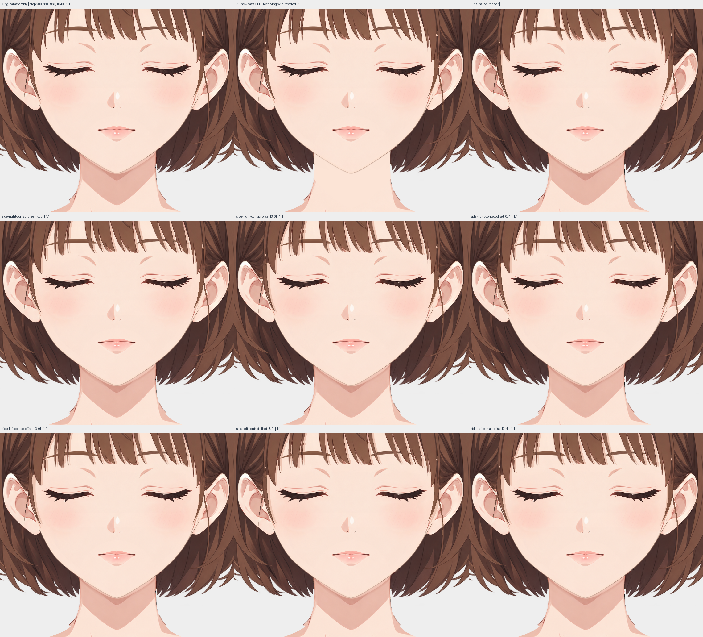
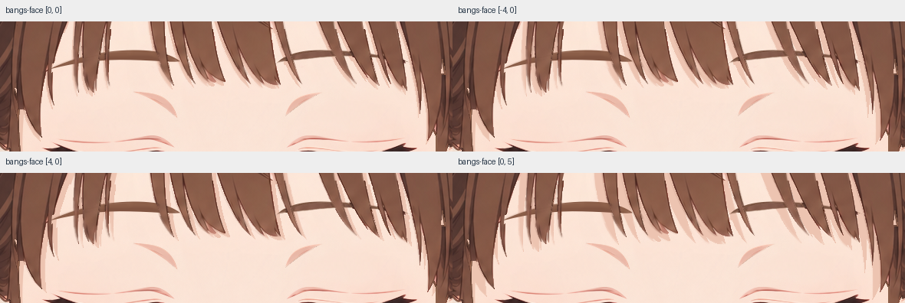
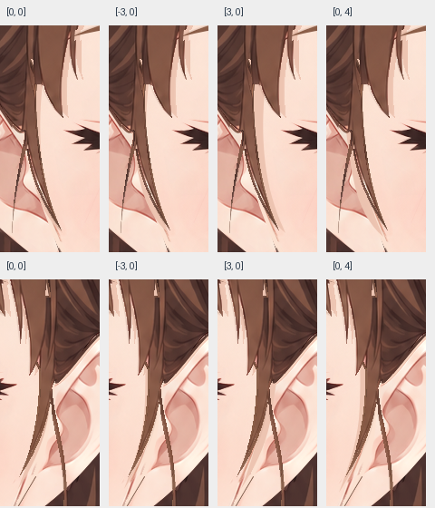
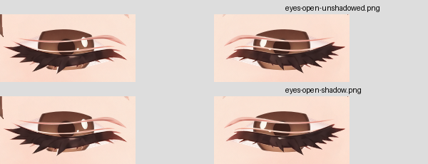
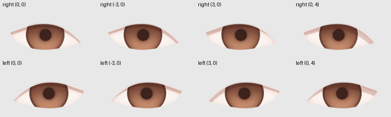
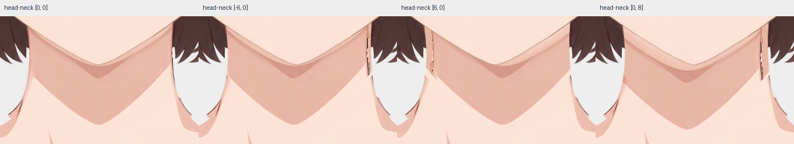

# 投影蒙版制作记录

Krita 5.3.4.1 内制作，未调用生图。原尺寸 1145×1374，透明背景；六个独立影层均在隔离组内使用原生透明度继承。

## 脸周候选

- **刘海**：依据 simplified 的上前方柔光与贴脸下缘，以实际 alpha 保留完整根部和遮挡区；基准左2、下5px。暖桃 `#edc4b1`、正常不透明，重叠不叠黑。同一 part 的内线不另造影线。
- **两侧耳前束**：各自单独成层，仅内缘贴肤束、耳根衔接有依据；联合裁切到脸底及双耳。完整隐藏根部保留，颜色同刘海。细丝未为显影加深。
- **外伸细丝、耳外游丝与外弧**：无明确落脸依据，未向脸内搬轮廓，未补左右对称线。
- **耳后宽帘、下部卷尾、后发**：在脸后或脸外，未画跨颊投影。保留发面材质、线稿、固有阴影及高光。

## 双眼与颈部

左右上睑/睫毛各补完整隐藏阴影片，随各自 `upper_eyelid`，不随虹膜。暖棕灰 `#cfafa4`、叠底140/255，向上留到y505；眼球底组内虹膜继承眼白alpha，原clip和CLOSED蒙版保留。闭眼静帧中两片均隐藏；临时开启隐藏眼球检查上缘轻影及偏移后恢复。虹膜原着色、瞳孔、眼线与独立高光保留；未重复加深固有虹膜顶部色阶。

颈层原下颌投影局部去除，以邻近未受影肤色约RGB(252,228,214)补回接收底色，原颜色与浓淡移到独立叠底因子，主体约 `#ebcdc4`；清除旧影下缘残边。原alpha、颈侧轮廓、原蒙版和区域外明暗保留，隐藏影形上延y705并超出颈面两侧。

## 关系、余量与验收

`shadows.json` v2保存实际UUID、裁切底组、选色和偏移。输入索引将侧发前片误匹配为hair父组；为兼容检查器，两条侧发关系用真实 `character:hair` 作为 `casterPartId`，另以 `sourcePartId` 记录准确的左右侧发part，前片UUID各自唯一定位独立运动来源。其他关系直接记录对应真实part。`follow`仅记录来源，无deformer、物理或光向关键形。

刘海偏移：复位、横向±4、下5px；两侧发束及双眼：复位、横向±3、下4px；头颈：复位、横向±6、下8px。范围取自贴肤间距与现有搭接，未按深度推距离。完整影层保留裁切外形状；各偏移下未见断裂、越出接收alpha或叠黑，五官仍清晰。双眼开启隐藏区域后另查8张素材偏移，眼白下部与虹膜保持可读。

本角色无裙腿；T恤袖口接触区在裁切外，褶皱、缝线、内返壁保留为本体明暗；领圈无明确独立落影带。其余不适用说明记于 `excluded`。

最终原生检查通过、无警告。已逐图查看原尺寸脸部、六处完整影层/接收面、全部24张声明偏移、去影对照及眼球素材。原82个图层/蒙版UUID均保留；原蒙版归属、启用、坐标与模式核对一致。保存KRA合成与PNG逐像素一致。

[原生检查记录](inspection.json) · [检查总览](inspection/overview.png)
