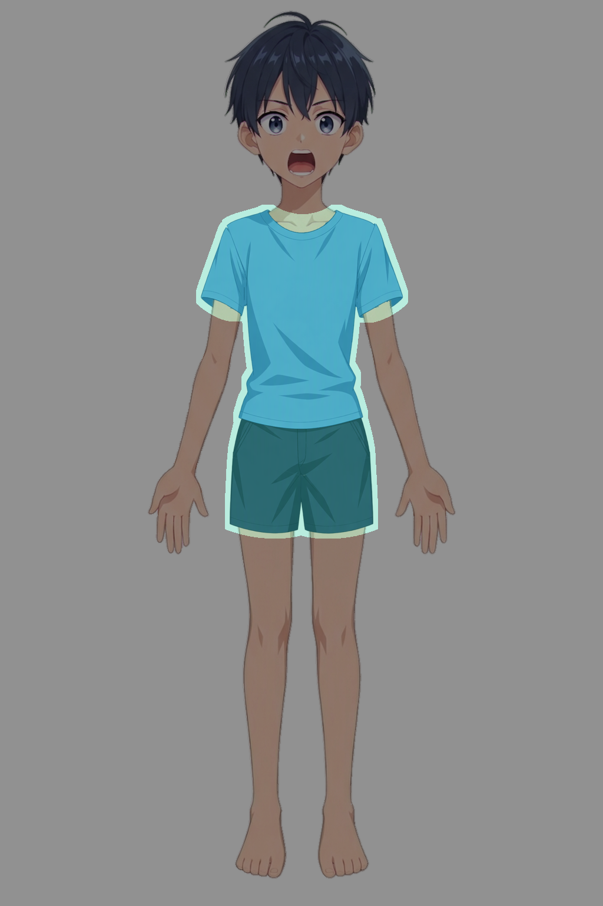
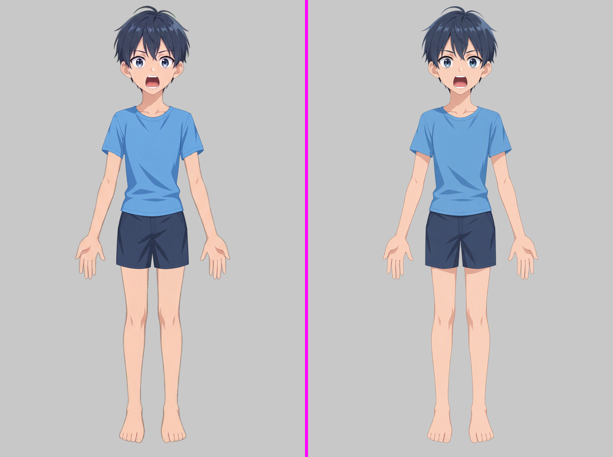

# Character assembly report (step01) - clothed-man

## Deliverables (this directory)

- `character-assembled.kra` - new project, 1024x1536 (same canvas as the reference). 68 paint layers (54 character + 14 clothing) + 3 face groups + 7 native transparency masks (3 pre-existing `opening_*` masks + 4 new assembly masks). Both input KRAs were only read from workspace copies and are untouched.
- `character-assembled.png` - transparent-background composite exported by Krita from the saved and reopened KRA (corner alpha = 0).
- `report-assets/` - tool outputs and local comparison images linked below. `workspace/` - scripts (`workspace/scripts/`), Krita exports of every iteration (`workspace/exp/`), tool runs (`workspace/pixel-review/`).

Image conventions: `local_*.png`, `full_current_vs_reference.png` and `*_comparison.png` all put the **current composite on the left and the reference (`../../part-layering/references/simplified-subject.png`) on the right**. The reference was never moved or scaled and no reference pixel was pasted into any layer.

## 1. Registration (clothing KRA -> canvas)

The clothing KRA was not in canvas coordinates. All 14 clothing layers keep their original names and content; only resampling (Krita `scaleImage`, Bicubic, resampled once from the untouched source) and placement were applied. Nothing was split, merged, flattened or painted.

1. Uniform step for the whole outfit: scale S0 = 662/1024 = 331/512 = 0.6465 (outfit 662x993 px), translation (180, 175). This fixed the collar, waist line, cuff positions and hem height as one body.
2. Local fit of existing parts (per group, same transform for all pieces of a group so no seam opens between front/back/overlap pieces of one garment part):

| Group | Layers | Size (px) | Offset (x, y) | Fitted to |
|---|---|---|---|---|
| F - shirt front | `160 t_shirt/body::front`, `60 t_shirt/body::back_collar` | 644 x 1021 | (188, 165) | collar opening, shirt side edges, shirt hem |
| L - right sleeve (viewer left) | `150 right_sleeve::outer`, `40 right_sleeve::inner_cuff` | 582 x 1018 | (206, 168) | shoulder seam, sleeve cuff, armpit |
| R - left sleeve (viewer right) | `140 left_sleeve::outer`, `50 left_sleeve::inner_cuff` | 633 x 1071 | (197, 151) | shoulder seam, sleeve cuff, armpit |
| SH - shorts (shared transform) | `130 waist_crotch::front`, `30 waist_crotch::side_back_return`, `110/120 pant_leg::front`, `70/80 pant_leg::front_overlap`, `10/20 pant_leg::back_return` | 634 x 998 | (194, 175) | waistband, fly, crotch, side seams, hem |

The first attempt (independent fits for each shorts piece) opened a visible seam between the waist piece and the leg pieces, so one shared transform is used for all shorts layers.

## 2. Layering / interleaving (top to bottom, node names unchanged)

The original names (including their leading depth numbers) are kept. Because the character and the clothing both number their layers from 00, depth numbers repeat (e.g. `20 shorts/...back_return` and `20 arms/arm_right/forearm`); the part path after the number is what identifies a layer, and the stack order below is authoritative.

```
53..27  hair/bangs, side hair, face (eyebrows, eyes + interiors, nose, mouth + interior, face_base, ears)   (unchanged)
160 t_shirt/body::front
150 t_shirt/right_sleeve::outer
140 t_shirt/left_sleeve::outer
130 shorts/waist_crotch::front
120 shorts/left_pant_leg::front
110 shorts/right_pant_leg::front
 80 shorts/left_pant_leg::front_overlap
 70 shorts/right_pant_leg::front_overlap
 26 body                       <- mask: body edge beyond shirt hidden
 25 pelvis                     <- mask: body edge beyond shirt hidden
 24 neck
 23 arms/arm_left/upper_arm
 22 arms/arm_right/upper_arm
 60 t_shirt/body::back_collar  (behind the neck, in front of forearms)
 50 t_shirt/left_sleeve::inner_cuff
 40 t_shirt/right_sleeve::inner_cuff
 21..08 forearms, palms, fingers
 07, 06 feet
 05 legs/leg_left/leg          <- mask: thigh edge beside shorts hidden
 04 legs/leg_right/leg         <- mask: thigh edge beside shorts hidden
 30 shorts/waist_crotch::side_back_return
 20 shorts/left_pant_leg::back_return
 10 shorts/right_pant_leg::back_return
 03 hair/back_hair, 02/01 root side hair, 00 ahoge
```

Why this order (front/back interleaving):
- Shirt front (160) is above the shorts waist (130): the shirt hem hangs over the waistband as in the reference.
- Sleeve outers (140/150) are above the upper arms; the inner cuff pieces (40/50) sit behind the upper arms so the arm emerges from the sleeve opening, and the back collar (60) sits behind the neck so the neck/collarbone shows through the collar opening.
- Shorts front-overlap (70/80) and front (110/120) are above the thighs (the thigh enters the leg opening from behind); the back-return pieces (10/20/30) are behind the legs and pelvis (inner side of the shorts seen between the thighs).
- Hair, face and the three face groups are untouched.

## 3. Transparency masks (body/limb content showing beyond opaque cloth)

All four assembly masks are native Krita transparency masks (child nodes of the layer, toggleable). The hidden content stays in the layer: after reopening the final KRA every hidden pixel still has layer alpha > 0 (1180/1180, 1086/1086, 177/177, 288/288) and the layer pixels were not edited.

Cause isolation: with the clothing in place, solo-display of the body layers and toggling the masks (`exp/final/maskoff.png` vs `maskon_after_toggle.png`, both exported from the reopened KRA) showed that (a) the torso and pelvis outline/skin strip is wider than the shirt flanks by 1-3 px along the waist and hips, and (b) the upper thigh layers are wider than the shorts leg-openings beside the waist/hip. Mask on/off differs in 2341 px, all inside x 397-629, y 516-910, i.e. only at these seams.

| Mask | Layer | Hidden px | Rule |
|---|---|---|---|
| `mask: body edge beyond shirt hidden` | `26 body` | 1180 | two flank zones beside the shirt sides: x 588-616 and x 408-432, y 510-640. Hide layer pixels where the reference is transparent or the shirt+shorts cover < 0.9, then 1 px dilation limited to the layer alpha and the zone |
| `mask: body edge beyond shirt hidden` | `25 pelvis` | 1086 | same rule; zones x 594-626 / x 396-432, y 620-730 (beside the shirt hem / shorts waist) |
| `mask: thigh edge beside shorts hidden` | `04 legs/leg_right/leg` | 177 | same rule, zone x 396-440, y 700-884 (above the shorts hem only) |
| `mask: thigh edge beside shorts hidden` | `05 legs/leg_left/leg` | 288 | same rule, zone x 598-642, y 700-884 |

Pre-existing `opening_eye_left`, `opening_eye_right`, `opening_mouth` masks (face groups) were preserved as they are. The mask zones deliberately end at the shorts hem and at the sleeve openings, so legitimate exposed skin (neck, collarbone, upper arms below the sleeves, forearms, hands, thighs below the hem, calves, feet) and the hair tips are untouched. A solo/composite recheck of the full picture is `report-assets/full_current_vs_reference.png`; mask on/off detail: `report-assets/mask_off_vs_on.png` (left = masks off, right = masks on).

## 4. Part-scoped detection runs (final KRA, reopened)

Final PNG and ORA were re-exported from the reopened `character-assembled.kra` (the PNG is pixel-identical to the pre-save work export). Reference = `simplified-subject.png`; current = `character-assembled.png`; layers = `workspace/exp/final/layers.ora`.

| Run | Parts | missing / extra / color px | Regions | Images |
|---|---|---|---|---|
| Clothing | `clothing:t_shirt`, `clothing:shorts` | 435 / 1653 / 3810 | 17 | [scope](report-assets/cloth_scope-preview.png) · [marked](report-assets/cloth_marked.png) · [comparison](report-assets/cloth_comparison.png) · [heatmap](report-assets/cloth_heatmap.png) · [json](report-assets/cloth_differences.json) |
| Connected body | `character:body`, `neck`, `pelvis`, `legs`, `arms` | 988 / 4421 / 5565 | 26 | [scope](report-assets/body_scope-preview.png) · [marked](report-assets/body_marked.png) · [comparison](report-assets/body_comparison.png) · [heatmap](report-assets/body_heatmap.png) · [json](report-assets/body_differences.json) |

Scope preview (clothing run), then the full-picture check (current left, reference right):





Counts are not used as acceptance; each candidate was inspected and classified below.

## 5. Candidate review

| Candidate (canvas box [x,y,w,h]) | Kind | Origin | Decision |
|---|---|---|---|
| [410,708,188,20] shirt hem / shorts waist | color | occlusion: the reference has a darker hem shadow band at the waist; the base clothing has a slightly lighter band | kept (source shading; registration of hem and waistline checked on [`local_waist_hem.png`](report-assets/local_waist_hem.png)) |
| [610,509,54,36] and [363,510,49,34] sleeve cuffs | color | the reference has a cast shadow on the upper arm under each cuff; the base arm layers have flat skin | kept (upstream appearance: base lacks the shadow; painting it would be new content). Cuff position, shape and arm entry match: [left](report-assets/local_cuff_left.png), [right](report-assets/local_cuff_right.png) |
| [663,503,21,31] / [341,503,21,22] cuff outer corner | extra | the cuff outline and corner coincide with the reference; the extra pixels are the brown outer outline of the base upper arm just under the cuff, 1-2 px wider than the reference ([left](report-assets/local_cuff_left_corner.png), [right](report-assets/local_cuff_right_corner.png)) | kept (upstream arm outline; cuff placement is correct) |
| [453,358,87,38] and [544,359,28,27] collar / neck | color | neck/collarbone shading and the reference's darker collar stroke differ; base neck has a lighter shade and rougher outline | kept (upstream tone). Collar opening and back collar placement fixed and checked: [`local_collar_neck.png`](report-assets/local_collar_neck.png) |
| [519,884,76,36], [441,894,64,51] hem shadow | color | the reference has a cast shadow on the thighs under the hem; not present in the base thigh layers | kept (upstream; hem line itself matches, see [`local_hem_thigh.png`](report-assets/local_hem_thigh.png)) |
| [598,893,22,135], [406,894,20,127], [600,895,20,191], [405,895,20,135] thigh outer edge | color/extra | the base thighs are 5-8 px wider on the outer side than the reference from the hem down to y~1086 | kept: the extra width is the thigh's own outline stroke; masking it would delete the outline and create a visible hard edge. Only the part beside the waist/hem (above y 884) was fixed with the thigh mask |
| [500,810,26,91] crotch gap | extra | the crotch opening in the source shorts starts about 40 px lower than in the reference and has a few source specks at the fly bottom ([`local_crotch_fly.png`](report-assets/local_crotch_fly.png)) | kept (source garment shape; back-return layer is visible through the gap, which is correct interleaving) |
| [390,788,5,101] and [630,811,4,78] shorts outer flare | extra | shorts leg outer edges flare 2-3 px beyond the reference, a taper/shear difference that scale and translation cannot remove | kept (fit residual; chose waist and hem alignment over the 2-3 px side flare) |
| [418,521,12,132] shirt left edge | extra | shirt left side is ~2 px wider below the armpit | kept (fit residual: moving the shirt +1 px would harm the collar match) |
| [593,520,14,101] right side | missing | shirt right side short by 0-2 px | kept (same residual in the opposite direction; the body skin is not exposed there because of the body/pelvis masks) |
| [330,593,65,252], [311,615,31,120], [252,829,13,40] right arm, forearm, hand edges | extra/color | rough/brown arm outline and 1-2 px edge differences of the base arms | kept (upstream stroke difference; arm layers were not modified) |
| [597,1156,15,151], [595,1310,10,98], [408,1380,19,65], [493,1004,3,58], [548,1361,5,39] lower legs/feet | extra/color | base leg outline is wider/browner than the reference | kept (upstream shape/colour; far from the clothing seams) |

Fixed at the seams (not shown as candidates any more or only as thin colour residue): shoulder/sleeve/cuff placement, armpit overlap, collar opening, shirt hem over the waistband, waistline, shorts waist/hips (skin slivers beside the cloth), upper-thigh slivers beside the shorts, back-return pieces behind the legs.

## 6. Retained upstream differences (not repaired on purpose)

- Cast shadows on the thighs under the shorts hem and on the upper arms under the sleeves exist in the reference but not in the base character.
- Neck/collarbone shade, arm and leg outline colour/width and 1-2 px hand/finger edge differences come from the character base.
- Shorts crotch gap shape and the specks at the fly bottom come from the clothing source; shirt/shorts shading strokes and fabric folds are kept as drawn.
- Hair (colour, strands, fringe, ahoge), eyes, mouth, face are untouched.
- Residual 0-2 px edge mismatch at the shirt sides and 2-3 px flare of the shorts outer edge from the uniform + group fit.

## 7. Verification of the saved file

- Reopened `character-assembled.kra`: 78 nodes = 68 paint layers + 3 groups + 7 transparency masks; layer order as in section 2; the 4 new masks and the 3 `opening_*` masks are present and visible.
- Mask toggle test on the reopened file (masks off -> content returns in the seam strips; masks on -> composite identical to `character-assembled.png`, 0 px difference).
- Final PNG vs the pre-save work export: 0 px difference; transparent background (alpha 0 at corners).
- Visual check of the whole picture: [`full_current_vs_reference.png`](report-assets/full_current_vs_reference.png).

## 8. Notes

- Layer names were not renamed; depth numbers repeat between character and clothing (see section 2). The tool's part matching (`clothing:t_shirt`, `clothing:shorts`, `character:body/neck/pelvis/legs/arms`) resolved all 14 clothing and 23 character layers correctly in both runs.
- The workspace (`workspace/`) contains the intermediate KRAs/exports; the deliverables are only the three files at the top.
