# clothing raster step01 报告

## 交付

- KRA：`/data/home/lockliu/workspaces/AstraLayering-merged-workspace-deploy-20261026/demos/clothed-man-20261028/clothing-raster-layering/step01/clothing-depth.kra`
  - 画布 1024×1536，RGBA 8 位。
  - 根节点下 14 个普通绘画层，全部可见、不透明度 255、混合模式 normal，没有子节点和蒙版。
  - 图层按深度从后到前排列（10 → 160），层名为“深度 完整部件ID::区域”。
- 上游结构：`clothing-part-layering/occlusion.json` 已通过 `edit_occlusion` 更新，校验通过：
  - version 3、back-to-front，sourceHash 沿用 6d8b499c1a91…；
  - 6 个终止部件、14 个深度区域。
- `groups.json` 未改动：没有拆分、合并或改名，不需要调用 `edit_groups`，也没有新增 SVG。

## 输入使用

| 输入 | 用途 |
|---|---|
| `clothing-part-layering/parts/*.svg` | 形状标准：完整轮廓、红/黄控制区，以及越界检查 |
| `clothing-part-layering/groups.json` | 归属与控制关系（shorts / t_shirt 两组，6 个 part） |
| `clothing-part-layering/occlusion.json` | 后到前深度和多深度 `levels`，本步按其切片 |
| `../../clothing-part-layering/references/clothing.png` | 绘制与复原参考：可见像素原样叠回；颜色迁移的目标也取自这里 |
| `../../part-layering/references/simplified-subject.png` | 只用来判断穿插（颈部从圆领穿入、上臂从袖口出来、大腿位置），不取任何纹理 |

## 图层映射

- 6 个逻辑 part 都在 occlusion.json 中预先标好了多深度 `levels`，本步只按这些 levels 切片，没有新增拆分。
- 下表中，“本片可见”指参考中属于本片、未被遮住的像素，这部分原样叠回。
- “隐藏补全”指本片在上层下面需要补全的像素。

| 原 part ID | KRA 图层名 | UUID | 区域 | 深度 | 范围 bbox (x0,y0–x1,y1) | 像素 | 本片可见 / 隐藏补全 | 补全来源 |
|---|---|---|---|---|---|---|---|---|
| shorts/right_pant_leg | `10 shorts/right_pant_leg::back_return` | {70cfe488-da3a-4745-bbd3-4df4c124c61a} | 右裤腿内、外侧后返续料 | 10 | 318,906–513,1112 | 5372 | 0 / 5372 | 全部 Krita 笔刷 |
| shorts/left_pant_leg | `20 shorts/left_pant_leg::back_return` | {e347dbb5-a359-49e6-b5e2-a2575af705a1} | 左裤腿内、外侧后返续料 | 20 | 511,904–708,1112 | 5398 | 0 / 5398 | 全部 Krita 笔刷 |
| shorts/waist_crotch | `30 shorts/waist_crotch::side_back_return` | {265ea428-0634-41c4-9542-506c7599e9f9} | 腰髋两侧后返续料 | 30 | 327,813–699,923 | 3503 | 0 / 3503 | 全部 Krita 笔刷 |
| t_shirt/right_sleeve | `40 t_shirt/right_sleeve::inner_cuff` | {bf99a1a0-85c1-4893-b1ff-e0946ff24a54} | 右袖口深色内侧与后口沿 | 40 | 239,500–359,556 | 3187 | 参考内侧原像素 + 8 px 隐藏延伸 | 延伸用 Krita 笔刷 |
| t_shirt/left_sleeve | `50 t_shirt/left_sleeve::inner_cuff` | {c75f0b2b-fa4d-45c8-a3a3-ead33e9d1b99} | 左袖口深色内侧与后口沿 | 50 | 668,499–787,556 | 2901 | 参考内侧原像素 + 8 px 隐藏延伸 | 延伸用 Krita 笔刷 |
| t_shirt/body | `60 t_shirt/body::back_collar` | {fa2343df-d831-463d-8a49-c65c04fdbd41} | 后领上弧与后领内侧 | 60 | 424,286–608,352 | 6240 | 参考后领原像素 + 8 px 隐藏延伸 | 延伸用 Krita 笔刷 |
| shorts/right_pant_leg | `70 shorts/right_pant_leg::front_overlap` | {70d5618e-1b42-4f24-a2d8-aadaf67a56f4} | 前侧上根补全带 + 内裆补全舌 | 70 | 328,906–518,1038 | 2962 | 0 / 2962 | 根带取自 imagegen；舌部笔刷重绘 |
| shorts/left_pant_leg | `80 shorts/left_pant_leg::front_overlap` | {59787079-0559-481c-8f2a-e8c5fd0eb9b0} | 前侧上根补全带 + 内裆补全舌 | 80 | 506,904–699,1039 | 4440 | 0 / 4440 | 根带取自 imagegen，顶缘笔刷补齐；舌部笔刷重绘 |
| shorts/right_pant_leg | `110 shorts/right_pant_leg::front` | {a886141d-1449-4243-b2b9-78e8c588c705} | 右腿筒正面（含裤口折边） | 110 | 316,920–513,1122 | 33897 | 32620 / 1277 | 根部隐藏条取自 imagegen，暗边笔刷修 |
| shorts/left_pant_leg | `120 shorts/left_pant_leg::front` | {c9471532-4b7c-4674-8eca-d4766908043d} | 左腿筒正面（含裤口折边） | 120 | 510,918–710,1122 | 32976 | 32916 / 60 | 根部隐藏边角取自 imagegen |
| shorts/waist_crotch | `130 shorts/waist_crotch::front` | {d7ceccfb-7fc8-419d-bf67-9339bbfd18f4} | 前腰、髋部、腰裆正面 + 下摆内上腰补全 | 130 | 324,792–702,971 | 49151 | 40530 / 8621 | 上腰补全取自 imagegen |
| t_shirt/left_sleeve | `140 t_shirt/left_sleeve::outer` | {6067f44d-6bf8-42f1-aba4-cfb201c0a38d} | 左袖外侧袖面、折边、前口沿 + 袖根补全 | 140 | 654,326–788,554 | 17058 | 15335 / 1723 | 袖根取自 imagegen，按行用笔刷重绘 |
| t_shirt/right_sleeve | `150 t_shirt/right_sleeve::outer` | {50e7bc7d-855e-4799-b13c-11320579285b} | 右袖外侧袖面、折边、前口沿 + 袖根补全 | 150 | 237,327–378,554 | 18056 | 15726 / 2330 | 袖根取自 imagegen，按行用笔刷重绘 |
| t_shirt/body | `160 t_shirt/body::front` | {caf2e03d-d774-4113-a92b-1c70e65f6fbc} | 前领包边、肩、胸腹、下摆 | 160 | 313,286–714,845 | 161869 | 161869 / 0 | —（最前层，无被遮部分） |

### 各 part 的切分理由

切分依据是 occlusion.json 中各 part 已有的 `levels`，逻辑 part 不变。

- **右、左裤腿（10/70/110、20/80/120）**
  - 10/20 是侧缘转到大腿后、被大腿挡住的续料。
  - 70/80 是前侧的隐藏搭接：上根带藏在腰裆 130 下，内裆舌藏在另一条腿前布下。
  - 110/120 是可见前布。
  - 70/80 必须低于双方的 110/120，否则补全舌会压到对侧裤腿正面。
  - 70/80 的切法：取 SVG 补全路径中不属于原轮廓、也不属于参考可见的像素（`comp >= outline & ~red`）。
- **腰裆（30/130）**
  - 30 只承担腰侧后返布。
  - 130 承担完整前腰，包括衣身下摆下的上腰补全。
- **袖子（40/150、50/140）**
  - 分界是参考里前口沿内缘的连续弧线：线以下的深色内侧放 40/50，前口沿线本身留在 150/140。
  - 分界点：
    - 右袖约 x240 y509、x300 y521、x350 y546；
    - 左袖约 x780 y507、x730 y522、x670 y555。
- **衣身（60/160）**
  - 分界是前领内缘线：线以上的后领上弧和内侧放 60，前领包边留在 160。
  - 分界点约 x430 y301、x510 y345、x600 y304。

## imagegen 记录

| 项目 | 内容 |
|---|---|
| 工具与模型 | `mcp__layering__imagegen`，model `gpt-image-2.5-sunburst` |
| 背景 | background `transparent`，5 次返回都是 hasAlpha true |
| 次数 | 每个 part 只调用一次 v1，没有失败，也没有重试 |
| 输入 1 | 只保留该片可见像素，其余为中性灰：`workspace/gen_inputs/<part>__in1.png` |
| 输入 2 | 同框对齐的控制图：红 = 可见，黄 = 需补全的隐藏部分，绿 = 不是本片、必须透明：`workspace/gen_inputs/<part>__in2.png` |
| 局部放大 | 为提高细节，输入是局部裁切放大后的图（允许），输出按裁切框缩放回原画布 |
| 配准 | `workspace/scripts/register.py` 在 scale/dx/dy 上搜索；结果保存在 `workspace/reg/*_v1.png/json` |

| part | 裁切框 (x0,y0,x1,y1) | 生成尺寸 | 原始输出 | 配准 scale / dx / dy | IoU | 颜色误差 |
|---|---|---|---|---|---|---|
| shorts/waist_crotch | 288,732,738,1032 | 1536x1024 | [waist_crotch_v1](gen/waist_crotch_v1.png) | 0.9975 / 0.5 / 1.5 | 0.972 | 3.93 |
| shorts/right_pant_leg | 282,879,552,1149 | 1024x1024 | [right_pant_leg_v1](gen/right_pant_leg_v1.png) | 0.98 / −2 / −1.5 | 0.967 | 3.08 |
| shorts/left_pant_leg | 473,879,743,1149 | 1024x1024 | [left_pant_leg_v1](gen/left_pant_leg_v1.png) | 0.995 / −3.5 / 2 | 0.965 | 2.13 |
| t_shirt/right_sleeve | 208,291,408,591 | 1024x1536 | [right_sleeve_v1](gen/right_sleeve_v1.png) | 0.995 / −0.5 / 0.5 | 0.947 | 5.42 |
| t_shirt/left_sleeve | 621,291,821,591 | 1024x1536 | [left_sleeve_v1](gen/left_sleeve_v1.png) | 0.9575 / −3.5 / 4 | 0.938 | 8.48 |

### 提示词要点

5 条提示词都是英文，结构相同：

1. 说明 image 1 和 image 2 的角色。
2. RED：忠实复现 image 1，保持颜色、平涂阴影、线稿和外轮廓。
3. YELLOW：同一片布料自然延续，不画其他衣物、皮肤或人体，只在黄区外缘保留细轮廓线。
4. GREEN：完全透明。
5. 保持红+黄的位置、比例和轮廓；输出只含这一片的透明 PNG。

各 part 的补充要求：

- 腰裆：上腰延续到平整的腰口边，斜袋口线和门襟线向上延续；不画 T 恤下摆或它的投影。
- 裤腿：腿间空隙保持透明。
- 袖子：不画衣身、不画缝线。

### 生成结果怎么用

- 结果都已按原尺寸检查。
- 只取黄色补全区；可见区一律用参考自己的像素覆盖，从不用生成的可见像素。
- 生成颜色经最小二乘颜色迁移（在可见区内腐蚀 3 px 后拟合）对齐参考色。
- 剪除规则：
  - 参考外部（A<8）清空；
  - 参考抗锯齿边缘（A<250）下不放隐藏内容，避免把轮廓加粗；
  - 例外：后返带 10/20/30 放宽到 A≥245，因为这些带本身贴着外轮廓，对合成的影响 ≤4。
- 生成在 SVG 边缘留下的 ≤3 px 抗锯齿细缝，用相邻颜色填平，透明度取 SVG 的 alpha。

### 其他

- **t_shirt/body 没有生成。** 它的前片 160 是最前层，没有被遮部分。60 后领只需延伸 8 px，藏在前领包边下，直接用笔刷绘制。
- **镜像：** 没有用镜像。两袖、两腿各自生成，因为左右形状和褶皱并不对称。
- **原像素：** 没有用原像素顶替任何必须补全的区域。补全部分来自生成结果或 Krita 笔刷；原像素只出现在本片可见区。

## Krita 绘制与修整批次

- 所有修画都在 Krita 5.3.4.1 中进行，通过 Python 桥接：
  - 笔刷预设 `b) Basic-1`，用 `paintLine` 绘制；
  - 删除用选区 + Edit>Clear；
  - 每批之后 `doc.save()`，并导出 `workspace/kexp_b*` 用于检查。
- 构建时先用 `k_build.py` 生成 14 个层并保存，然后：

| 批次 | 图层 | 内容 |
|---|---|---|
| 1 | 10/20/30 | 用笔刷画后返带：先填色，再勾外轮廓线 |
| 2 | 40/50/60 | 沿分界画 8 px 隐藏延伸（内侧布色） |
| 2.5 | 40→150、50→140、60→160 | 分界上与前口沿线、前领线混色的像素移到前层（分别为 30、30、94 px），下面补画干净的内侧色 |
| 3a | 110/120 | 去掉生成结果在腰带下根部条上留下的 1 px 暗边，改成腿布色 |
| 3b | 150/140 | 袖根隐藏条重绘，补外轮廓 |
| 3c | 70/80 | 内裆舌用统一的裆部暗色重绘，并截止在开口尖端之前（y1038/y1039） |
| 4 | 全部 | 清除参考 A<250 边缘下的隐藏内容；补齐 80 根带顶缘的缺口 |
| 5 | 150/140 | 袖根条按行取相邻袖面色调（3 行高斯）重绘，补外轮廓和装袖缝线 |
| 6 | 140 | 恢复 y461–508 缝区的色调，把 1 px 缝线改成中间色 (44,86,147)，去掉暗条 |
| 7 | 10/20/30 | 后返带 v2：取 alpha-128 轮廓外推 2 px 并平滑，宽 15 px，选区与完整 SVG 相交；暗色 (49,60,85)，轮廓 (30,37,56)；去掉锯齿和斑点 |
| 8 | 40/50/60 | 延伸远端去阶梯：抗锯齿填充 + Edit>Clear，最大位移 1.55/1.64/3.11 px |

## 蒙版

- KRA 中**没有透明度蒙版、选区蒙版或剪贴组**。
- 原因：
  - 6 个 part 都不是 `hiddenInReference`，也没有 `allowOutsideParent`；
  - 所有隐藏补全（后返带、搭接带、袖根、上腰、后领延伸）都藏在更高深度的图层之下，仅靠层序就能实现默认显隐；
  - 按要求不能用整层关闭或蒙版代替前后切片。
- 因此“蒙版开/关”检查不适用。代替它的是“上层开/关”检查，见下节：
  - 隐藏上层时，补全部分可见且完整；
  - 打开上层后，补全部分被完全覆盖。

## 验证

### 重开检查

- 方法：用 `workspace/scripts/k_reopen.py` 关闭文档后重新打开 `clothing-depth.kra`，`waitForDone` 后 rootNode 不为 None。
- 图层结构：14 层的名称、UUID、类型、可见性、不透明度和混合模式都与上表一致。
  - 结构记录：`workspace/kexp_reopen/layers.json`。
- 像素：逐层导出（`workspace/kexp_reopen/*.png`），与最后一批的导出逐字节一致。

### 逐 part 数值检查

结果见 `workspace/kexp_reopen/verify.json`：

| part | 可见像素 | 可见缺失 | 颜色不符 | 越出完整 SVG | 画外非零 | 内部空洞 |
|---|---|---|---|---|---|---|
| shorts/right_pant_leg | 32620 | 0 | 0 | 0 | 0 | 0 |
| shorts/left_pant_leg | 32916 | 0 | 0 | 0 | 0 | 0 |
| shorts/waist_crotch | 40530 | 0 | 0 | 0 | 0 | 0 |
| t_shirt/right_sleeve | 17887 | 0 | 0 | 0 | 0 | 0 |
| t_shirt/left_sleeve | 17231 | 0 | 0 | 0 | 0 | 0 |
| t_shirt/body | 166461 | 0 | 0 | 0 | 0 | 105（见偏差 1） |

### 合成检查

- 14 层合成与参考按预乘颜色比较：最大差 6.09，均值 1.10；差 >8 的像素为 0，差 >4 的为 99。这 99 px 全部是参考最外圈 A=6–8 的极淡边缘：按 A<8 规则清成了透明，最大差 6.09 就来自这里。内部 alpha 253→255 归一造成的差 ≤2。

### 遮挡覆盖

“完全遮住”指被上层覆盖率 ≥0.99 的像素。

| 图层 | 完全遮住 | 合成中外露 |
|---|---|---|
| 10 | 5177 | 仅 A 245–249 的边缘有微量贡献 |
| 20 | 5147 | 仅 A 245–249 的边缘有微量贡献 |
| 30 | 3272 | 仅 A 245–249 的边缘有微量贡献 |
| 70 | 2957（另 5 px 覆盖率 >98%） | 0 |
| 80 | 4438 | 0 |
| 130 上腰补全 | 8619 | 0 |
| 140 袖根 | 1721 | 0 |
| 150 袖根 | 2329 | 0 |
| 40 延伸 | 1023 | 0（其余 2159 px 是参考可见的内侧） |
| 50 延伸 | 1000 | 0（其余 1896 px 是参考可见的内侧） |
| 60 延伸 | 1648 | 0（其余 4592 px 是参考可见的后领） |

### 目视检查

每层单独显示、隐藏上层的累积、整体合成三种视图都已检查。结论：

- 轮廓没有缺口，没有错位；
- 补全区的色调、线宽与原画风格一致；
- 后返带平滑；
- 袖根与上腰补全过渡自然；
- 内裆舌不进入腿间空隙。

## 证据图

- 合成对比（参考 / KRA 合成 / 差 ×16）：
  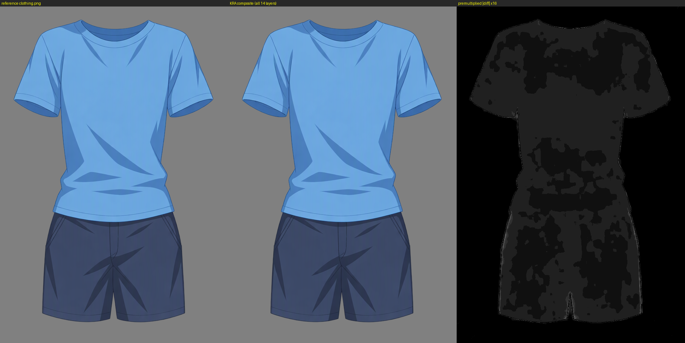
- 每层单独显示：
  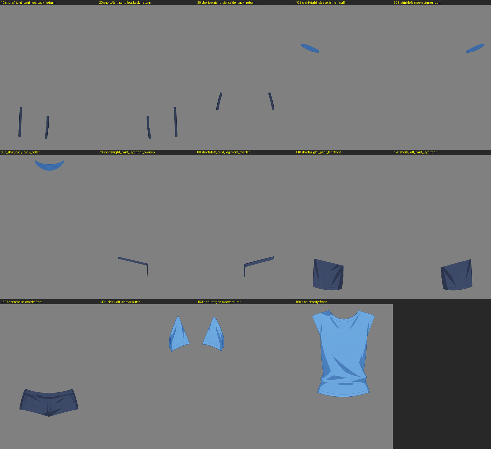
- 隐藏上层的累积（逐层叠加到该深度为止）：
  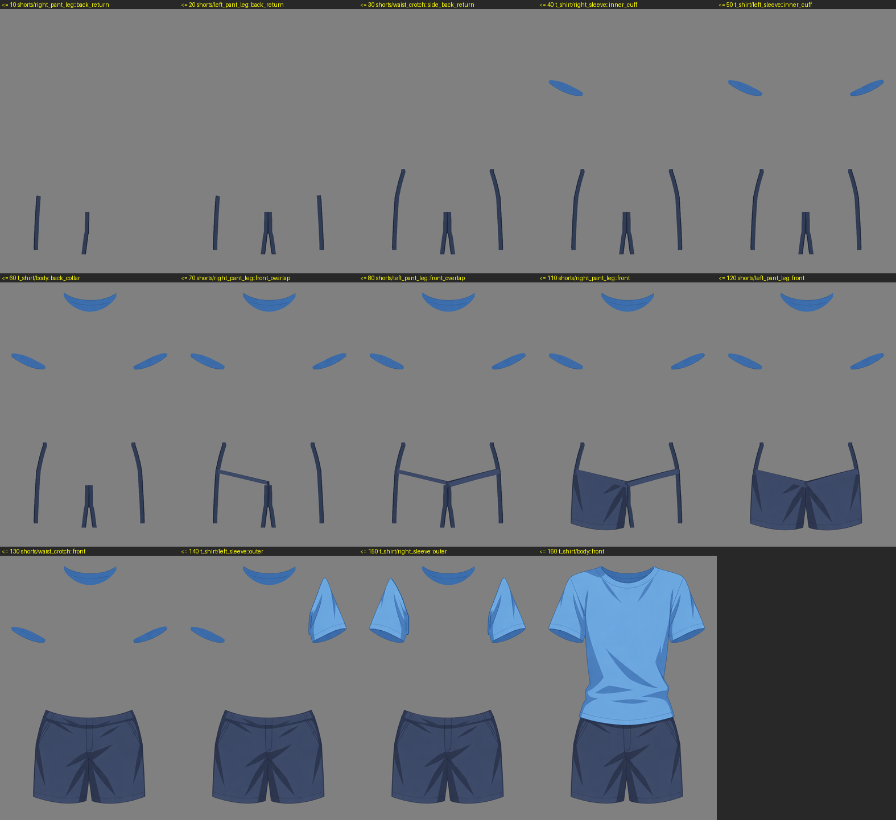
- 后返带 10/20/30 放大：
  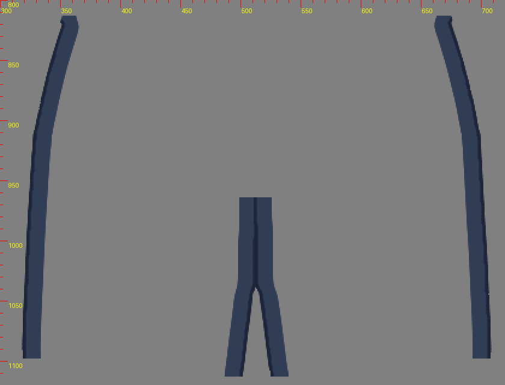
- 袖口内侧 40 / 50 放大（分界、8 px 延伸、打开前层前后）：
  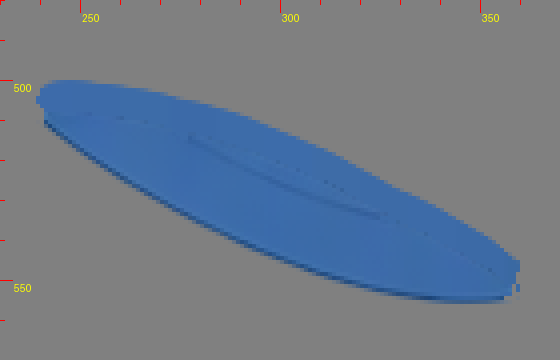
  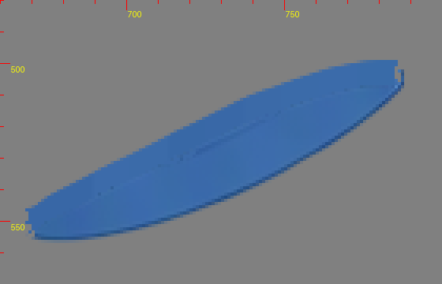
- 后领 60 放大：
  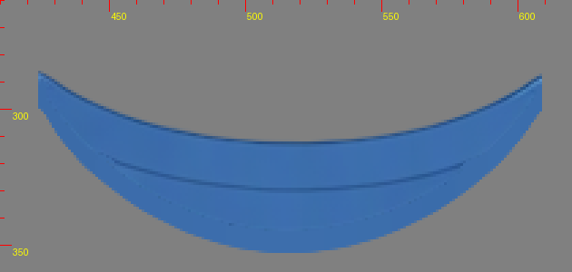
- 袖根隐藏条 150 / 140 放大（隐藏 160）：
  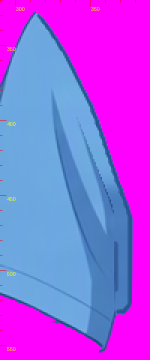
  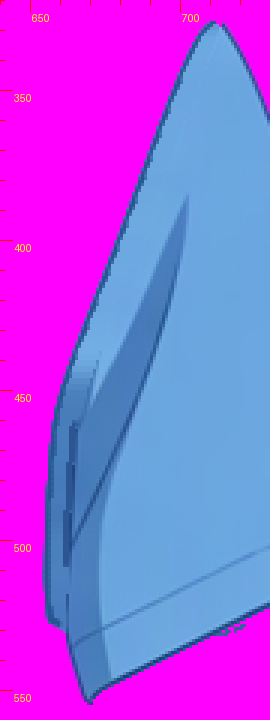
- 前侧搭接 70/80 放大：
  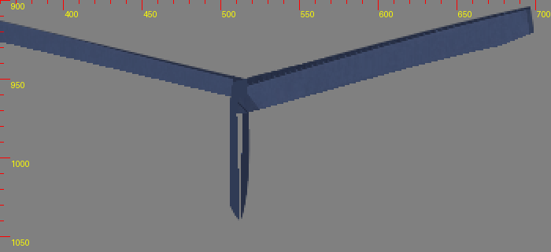
- 叠加到 120、腰裆隐藏，检查裤腿根部：
  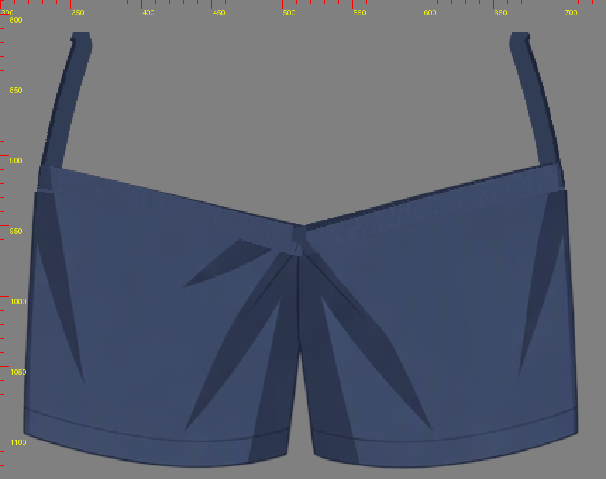
- 叠加到 150、衣身隐藏，检查袖根：
  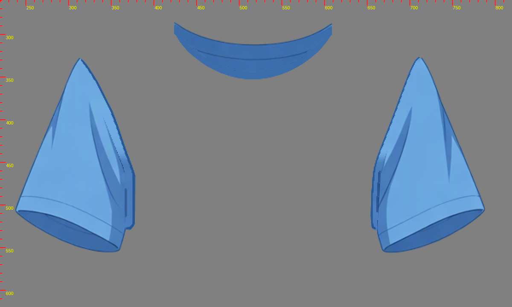
- 叠加到 130、T 恤隐藏，检查上腰补全：
  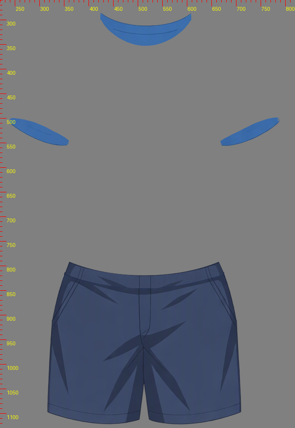

## 偏差与次要事项

### 主要偏差

1. **衣身 SVG 下缘有 105 px 属于腰裆。**
   - 位置：下摆下缘约 x586–659、y823–840 的一条细边。
   - 情况：衣身 SVG 覆盖这些像素，但按颜色（B−R<57）它们是裤腰布，因此留在 130；160 在这里透明。
   - 影响：合成中没有空洞，也没有颜色错误。
   - 同一交界处还按颜色重新划分了归属：
     - 185 px 从衣身划给腰裆；
     - 15 px 从腰裆划回衣身。

### 次要事项（合成中均不可见）

2. **150/140 单独显示时有 1 px 小点。** 位置在前口沿下，是批次 2.5 从 40/50 移入的分界像素；打开 40/50 后看不到。
3. **70/80 根带顶部保留生成的暗线。** 根带全部藏在 130 下。
4. **70/110、80/120 的接缝是硬切。** 两层按 SVG 补全路径互补切分，同色相接，合成上无缝。
5. **110/120 在腰带下有几个微小的生成边角点。** 全部在 130 下。
6. **50 内端尖角有个小缺口。** 那里的边缘像素归 140 所有，缺口被 140 盖住。
7. **150 装袖缝颜色保留批次 5 的结果。** 中间色 85/92，边界为 86，两者接近。
8. **alpha 归一与外缘清除。** 参考内部 alpha 为 253，叠回时统一归一为 255（×255/253），合成差 ≤2；参考最外圈 A<8 的极淡边缘清成透明，合成差 ≤6.09（共 99 px 差 >4）。
9. **后返带的边缘规则放宽。** 10/20/30 允许在参考 A≥245 的边缘下放内容，合成差 ≤4；其他层一律 A≥250。

## 结构文件更新

- occlusion.json 用 `edit_occlusion` 提交了完整 layers 表：
  - 原有的 region、note、check 文字都保留；
  - 每个区域追加 `【raster step01实绘】`，记录实际层名、UUID、bbox、像素数、来源和覆盖统计；
  - 每个 part 的 note 追加 `【raster step01】`，说明切成普通绘画层、不是 hiddenInReference、未使用蒙版或剪贴、逻辑 part 不变；
  - check note 追加 `【raster step01复核】`，记录重开逐字节一致，以及单层、累积、合成检查结果；
  - 区域 check note 追加 `【raster】`。
- 修改前的副本：`workspace/occ_before.json`。
- 深度值没有改变：
  - 右腿 10/70/110，左腿 20/80/120；
  - 腰裆 30/130；
  - 右袖 40/150，左袖 50/140；
  - 衣身 60/160。
- 未调用 `edit_groups`：没有拆分或改名，SVG 不变。

## 工作区

- 脚本在 `workspace/scripts/`：
  - 遮罩与控制图：`masks.py`、`control.py`
  - 配准：`register.py`
  - 切片：`build_slices.py`
  - 各批次计划：`plan*.py`
  - Krita 操作：`k_build.py`、`k_paint.py`、`k_move.py`、`k_clear.py`、`k_export.py`、`k_reopen.py`
  - 校验与证据：`verify.py`、`evidence.py`
- 其他中间文件：
  - 切片：`workspace/slices/`
  - 绘制选区：`workspace/paint/`
  - 各批导出：`workspace/kexp_b1`…`kexp_b8`
- Krita 保存时生成的自动备份 `clothing-depth.kra~` 已从输出目录移到 `workspace/tmp/clothing-depth.kra.krita-backup`。
