结论：通过

# clothing raster step01 独立视觉审查

被审对象：`clothing-raster-layering/step01/clothing-depth.kra`（sha256 以 `eb853108128c1f28` 开头，与 `review-baseline.json` 一致，审查期间未被改动）。
参考：`../../clothing-part-layering/references/clothing.png`。结构依据：`groups.json`、`occlusion.json`（version 3，后到前）、`parts/**/*.svg`。

本次审查没有发现需要返修的明确问题，因此不标注问题框（未调用 `annotate_review_regions`）。下面先列检查范围，再列不阻塞的观察项。

## 检查范围

所有检查项均已完成，没有未检查区域被当作通过。

| 检查项 | 做法 | 结果 |
|---|---|---|
| KRA 结构 | 用 Krita 重新打开，读取全部节点属性 | 根节点下 14 个普通绘画层，全部可见、不透明度 255、normal；无蒙版、无剪贴组、无子节点；层序为 10→20→30→40→50→60→70→80→110→120→130→140→150→160，与 `occlusion.json` 的深度一一对应 |
| 整体还原 | Krita 投影与参考逐像素比较（预乘颜色）；另用 PIL 自行叠层，与 Krita 投影互相验证 | 最大差 6.09，仅 99 px 差 >4，没有差 >8 的像素；PIL 叠层与 Krita 投影最大差 1。没有缺失像素，没有多出像素 |
| 真实开口 | 查看领口、两袖口、腿间空隙、T 恤下摆与腰带之间 | 全部保留；腿间空隙透明，没有被 70/80 内裆舌占用 |
| 归属与分层 | 按 SVG 分区和颜色逐层核对；每层单独显示 | 衣身、袖、腰裆、左右裤腿互不混入；没有身体或相邻衣物像素；没有游离碎块。左右袖、左右腿各自独立成层，前后片分开 |
| 深度切片 | 对照 `occlusion.json`，统计每层对合成的实际贡献 | 10/20/30/70/80 在合成中贡献为 0（只有 A 245–249 边缘的亚像素量级）；40/50/60 只在参考本就可见的内侧、后领处外露；110–160 为可见前布。切片与记录一致 |
| 隐藏补全连贯性 | 隐藏上层逐层查看；并模拟位移：袖向外 14 px、衣身上移 26 px、双腿下移 18 px 或外移 10 px | 袖根、上腰、裤腿根部、内裆舌、后领延伸移开后仍是连续、同色调的布料；没有露出空洞、身体、背景或相邻衣物 |
| 绘制风格 | 对比隐藏区与可见区的色调、线宽、轮廓线 | 与原画平涂风格一致，线条颜色一致；没有要求补阴影或 AO |
| 隐藏/可见交界 | 在各交界处放大查看 | 可见侧全部是参考原像素；隐藏侧同色相接，合成中无接缝 |

## 不阻塞的观察项

下面几项都只出现在被上层覆盖的隐藏内容里，或只是亚像素级别的边缘差异。它们不改变合成结果，也没有形成会误导下一步的错误，所以不判定为问题。后续若要大幅移动对应部件，可以顺手打磨。

1. **袖根延伸条（140/150）的接缝线是断续的，边缘有台阶。** 位置：被 160 盖住的延伸区，左袖 140 约 x654–712、y327–530，右袖 150 约 x314–378、y329–529（证据：[右袖根](review-02-evidence/rroot_detail.png)、[左袖根](review-02-evidence/lroot_detail.png)、[袖外移模拟](review-02-evidence/sim_sleeves.png)）。袖子外移后能看到这条延伸条：它延续了袖面色调，有一条暗色竖向接缝线，底端是方头。作为袖口根部的装袖缝来说是合理的，缝线的断续只在放大时可见。
2. **袖口内侧 40/50 的尖端与前口沿边缘有细小齿口。** 证据：[右袖口](review-02-evidence/cuffR.png)、[左袖口](review-02-evidence/cuffL.png)。这些齿口位于参考本就存在的边缘一侧，缺口被 140/150 盖住，合成中不可见。
3. **70/80 根带顶端保留着生成的暗线，纹理略有颗粒。** 证据：[70/80](review-02-evidence/s7080.png)、[隐藏的短裤层](review-02-evidence/solo_shorts_hidden.png)。根带整体藏在 130 下，下移腿部的模拟（[腿部模拟](review-02-evidence/sim_legs.png)）里看起来连贯。
4. **腰部隐藏/可见交界是硬切。** 证据：[左腰](review-02-evidence/waist_L.png)、[右腰](review-02-evidence/waist_R.png)。同色相接，合成中无缝。
5. **极少量单像素问题。** 约 (351,818) 处有一个偏亮的孤立点；140 内有 4 个 1 px 的封闭小孔（约 (744,516)、(718,528)、(719,528)、(714,530)），160 内有 1 个（约 (449,319)），合成中均不可见；160 的下摆边缘没有抗锯齿（[下摆](review-02-evidence/hem_RR.png)、[下摆单层](review-02-evidence/hem_RR_solo.png)）。合成与参考的差异都在上面给出的数值范围内。
6. **130 上的下摆投影带来自参考原像素。** 它是参考画面本身烘进腰裆的一条深色带，不是补全错误，不属于本步需要处理的内容。

## 与报告的核对

`report.md` 的说法与我的独立测量一致：层名与顺序、无蒙版、合成差 6.09、99 px 超 4 的统计、各层遮挡覆盖情况都对得上；“主要偏差”里的 105 px 衣身下缘归属也与我看到的一致，且合成中没有空洞。

## 证据（路径相对于本报告）

- 整体对比（左参考，右 KRA 合成）：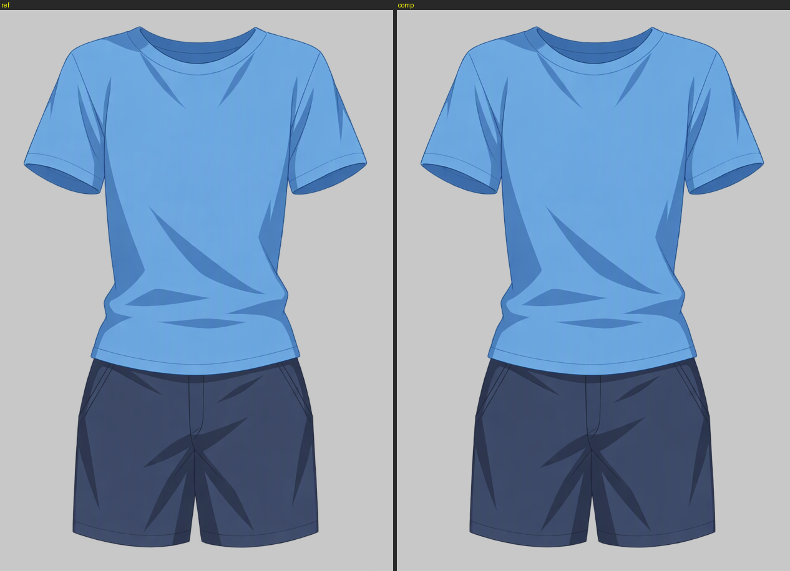
- 合成与参考之差 ×16：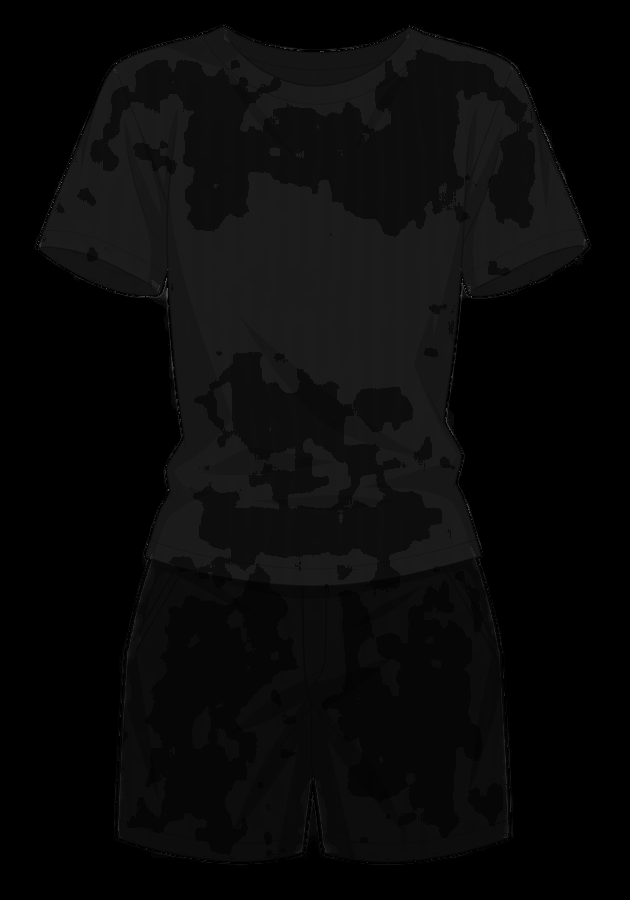
- 单层隐藏内容：
  - 短裤 10/20/30/70/80：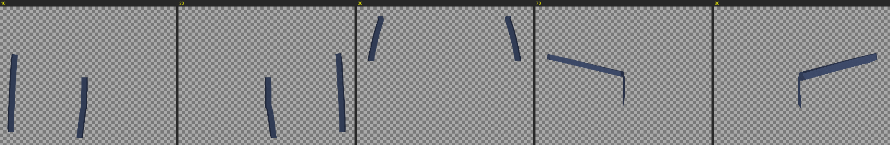
  - T 恤 40/50/60：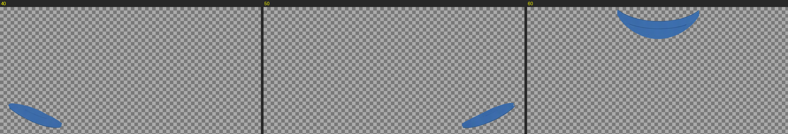
  - 袖 140/150：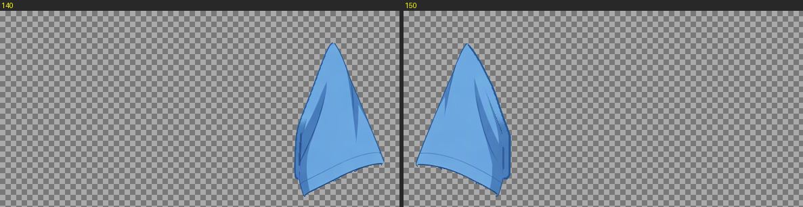
  - 衣身 160：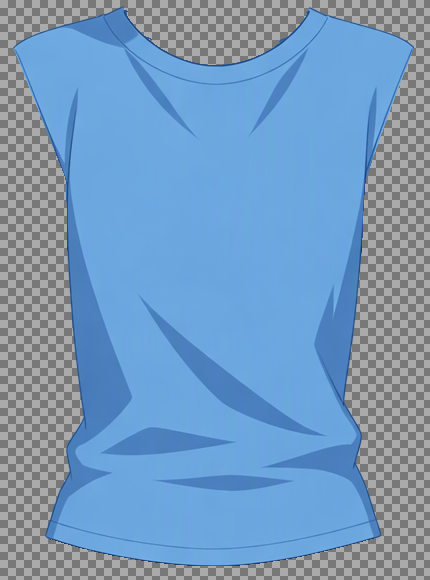
- 位移模拟：
  - 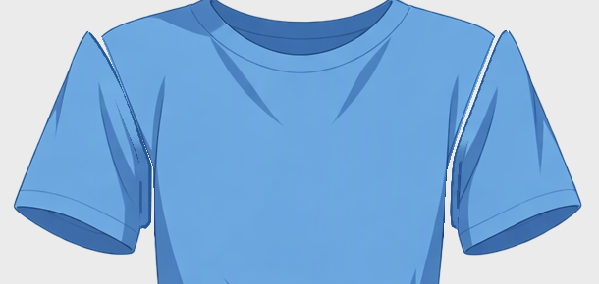
  - 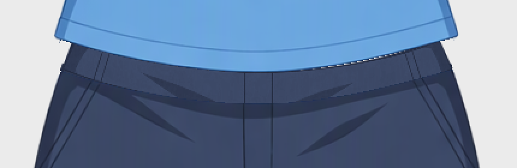
  - 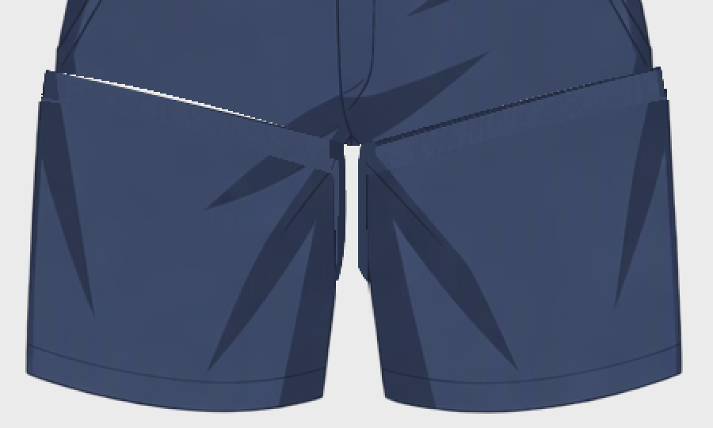
- 局部：
  - 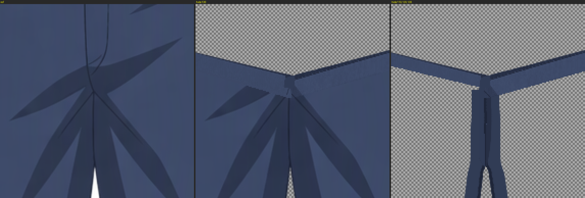
  - 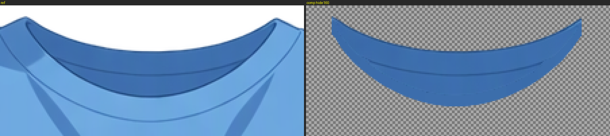
  - 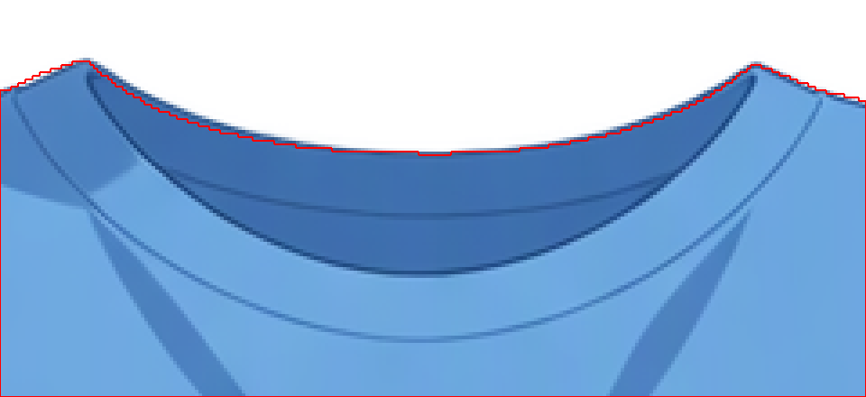
