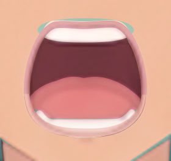
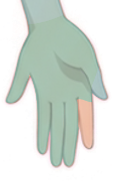
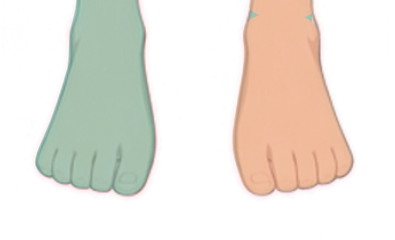
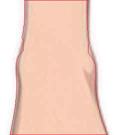

# 遮挡层级检查记录

已通过 `submit_occlusion` 提交全部 52 个终止绘画部件，逐件检查全部通过；左右侧发各两个区域也分别完成检查。完整表使用 v3、`back-to-front`，包含 54 个唯一深度值（0–53）。终止节点 `neck`、`body`、`pelvis` 虽标为 group，仍各自拥有绘画深度。原 `groups.json` 和所有输入 SVG 保持不变。

正式层级表为 [occlusion.json](../occlusion.json)，由运行器从已接受提交写出；正式深度预览为 [preview.svg](preview.svg)。该预览仍把每个完整 SVG 放在其最靠后的深度，尚未制作多深度切片或应用显隐蒙版。它支持位置、邻接和规划依据的核对；真实穿插及默认显隐在 raster step01 的 KRA 中验证。

| 项目 | 检查结果 |
| --- | --- |
| 终止 ID 覆盖 | 与原树全部 52 个终止节点一致，无遗漏或重复 |
| 单深度部件 | 50 件，使用 `level` |
| 多深度部件 | 2 件，使用 `levels`，4 个区域均已分别检查 |
| 深度数轴 | 全部跨组部件共用 0–53，数值越大越靠前 |
| 工具提交 | `completed: true, parts: 52` |

左右 `hair/side_hair_right`、`hair/side_hair_left` 保留同一逻辑 part。内侧补全根区分别位于 1、2，藏在头盖和刘海后；可见宽前侧发面分别位于 51、52，在脸、耳、眉及眼部前，在刘海后。分界沿原去重轮廓内侧自然分束边，收在发下并连续搭接。两区域共同运动，共享整件默认开启的显隐控制。候选中的宽发面暂被脸及后发盖住是整件置于最低深度的预览表现，不表示需要关闭或删除该区域。

每眼的 `sclera`、`iris`、`highlight` 在数轴上连续排列，组成眼内组合。由对应眼的完整 `upper_eyelid`、`lower_eyelid` 及两端眼角联合生成动态开口蒙版，仅附着眼内组合；虹膜和高光再受完整眼白范围剪贴限制。默认睁眼且开口内可见，闭眼三件共同全隐。睑缘、褶线和眉毛保持自身显隐，不随眼内蒙版裁掉。全部控制 ID、范围及默认状态已写入各行 `note`。

`face/mouth/mouth_interior`、`face/mouth/tongue`、`face/mouth/upper_teeth`、`face/mouth/lower_teeth` 连续组成口内组合。上下唇及嘴角联合生成开口蒙版，只裁口内四件，两唇继续可见。默认张口内可见，闭口四件全隐。牙、口腔和唇的 `allowOutsideParent` 完整余量保留；不按静态父开口裁掉形体。脸底连续，不挖眼口孔。

身体及四肢的局部接合依次为：脸盖颈上端，躯干盖颈根、肩根与骨盆腰端，骨盆盖腿根，上臂盖前臂肘根，前臂盖掌腕端，掌部盖五指根，足部盖同侧腿段踝端。各实体默认开启，以绘画层自然覆盖隐藏连接余量。双手不剪贴到掌轮廓，避免裁掉指身；真实虎口和末端指缝保留开放。

## raster step01 待修与验证

- 左踝约 x553–602、y1358–1365 的两侧有少量连接余量外露；完整腿段及足部 edge 已分别核对。保持 `legs/leg_left/foot` 在 `legs/leg_left/leg` 前，在 KRA 中精修局部覆盖边及线色，消除余量外露并保持踝足连续。
- 双手画面左侧掌缘短指状突出按已有 palm 归属保留；左手约 x672–696、y843–875 为明确记录的轮廓歧义。复核掌形和纹理，不增加第六指、不改本次参考姿势。左食指桃色主体已通过独显和 edge 确认完整存在，青绿部分只是补根。
- 候选上牙补全余量暂露在上唇外。KRA 应用动态口内蒙版后验证其隐藏，并检查张口、闭口及嘴角连续性。
- 分别检查两眼睁闭时眼内三件的交集裁切，侧发四个深度区域的穿插及共用显隐，以及发根、眼角、嘴角和各关节搭接。候选尚未实现这些蒙版与像素切片。

嘴部候选叠加：上牙余量外露需由口内开口蒙版隐藏。

左手候选叠加：掌部只盖指根，既有掌缘歧义保留待复核。

双踝候选叠加及左踝轮廓：右侧画面裸足对应角色自身左足，踝侧小余量记录为接缝待修。

