# raster step01 报告：分层人物 KRA（character-depth.kra）

## 1. 交付与结论

| 项目 | 内容 |
|---|---|
| KRA | `character-depth.kra`（1024×1536，RGBA 8bit，8828614 字节，md5 `f9e399efa8eb3795b853476aa0e6f015`） |
| 结构 | 54 张绘画图层（52 个逻辑终止部件，其中 2 个按预标注拆成 2 片）+ 3 个组 + 3 个透明蒙版 |
| 图层命名 | `NN pid[ [region]]`，NN 为 occlusion.json 中的深度 level（两位数），pid 为 groups.json 中的终止部件 ID，多深度切片带 `[root]` / `[main]` 区域名；KRA 自下而上按 level 0→53 排列 |
| 深度表 | `part-layering/occlusion.json` 已用 `edit_occlusion` 更新（52 行、54 个深度区域，工具校验通过）；只把每行备注追加了 raster step01 的 KRA 图层名、补全来源、笔刷批次和保留边界说明，level / levels / region 未改 |
| 分组树 | `part-layering/groups.json` 未改（无新拆分、无 ID 变化、无归属变化） |
| 复开检查 | 保存后关闭，用 Krita 重新打开 `character-depth.kra`：节点树、名称、UUID、level 顺序、inheritAlpha、3 个蒙版及其默认开启状态与保存前一致；从复开文档导出各层与整图（`kexp/b5`）后再做本报告的全部统计 |
| 合成图 | 蒙版开启下的整图导出：[character-depth_composite.png](report_assets/character-depth_composite.png)；复开投影：[projection_reopen.png](report_assets/projection_reopen.png) |

结论：每个终止部件都是单独一张（或两张预标注切片）完整、连续的图层。完整形状按上游 SVG 填满：形状内补全缺口共 1 px（见 §8），形状外新增像素 0。蒙版开启时的整图与参考基本一致：双方都不透明的 243559 px 中，通道差 >16 的只有 48 px，平均绝对差 0.016。

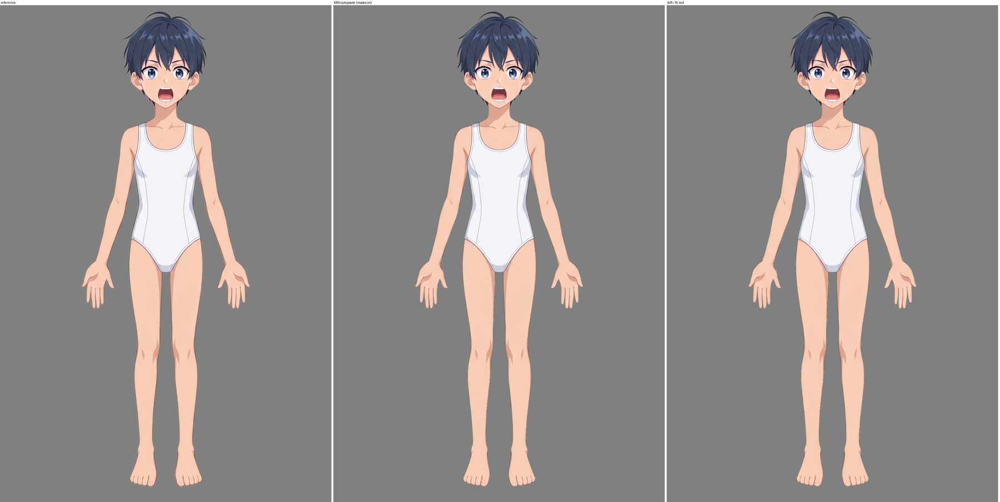

上图三栏依次为：参考 / KRA 合成（蒙版开）/ 差值 >16 标红。下面两张是头部与双手的局部：

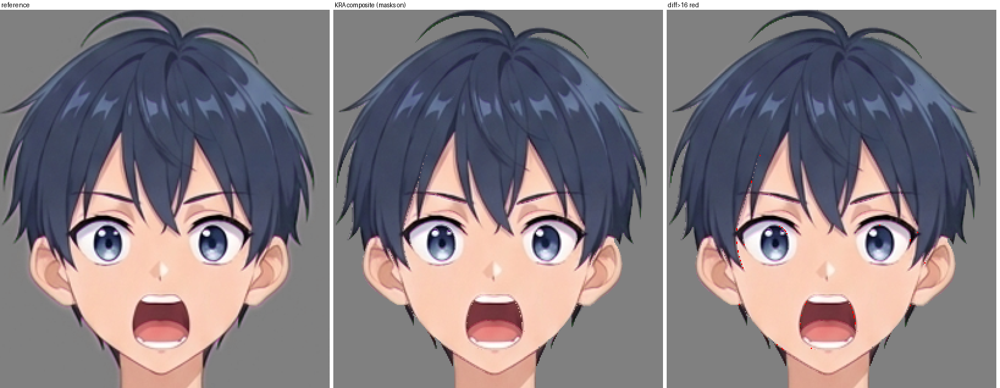
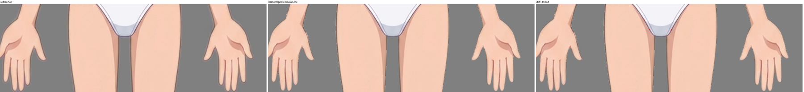

## 2. 方法

1. **控制图**（`scripts/control.py`）。对每个逻辑部件，用上游 owner 归属与 SVG 完整形状 F 做三色图：
   - 红：本部件在参考中自己的可见像素（owner 属于本部件且 alpha>0）；
   - 黄：F 减去红，即隐藏的补全区；
   - 绿：形状外。

   输入 1 用参考图，把黄、绿位置置为中性灰（128），只留本部件的可见像素。两张图按部件包围盒外扩 12% 裁局部，放大到 1024×1024 / 1024×1536 / 1536×1024 再送生图。放大倍率在 1.73（腿）到 10.67（五官、手指）之间，记录在 `workspace/masks/control_info.json`。
2. **生成**：全部用 `mcp__layering__imagegen`，每次两张输入（灰化输入图 + 控制图），共 54 次调用（见 §6）。透明背景请求 53 次；`hair__side_hair_left_v3` 为 auto 背景（绿底），入层时只用 SVG 完整形状裁 alpha，没有按颜色抠图。每张结果都在原尺寸下查看，失败的重生成或弃用。**没有使用镜像**：左右部件都各自生成或取自整组生成。
3. **配准与合成**：
   - **几何**（`register.py`）：等比缩放 + 平移，使生成剪影与本部件 SVG 完整形状的 IoU 最大，再用红区颜色一致度微调。
   - **颜色**（`compose.py`）：在生成与参考重叠的可见像素上拟合一个全图统一的颜色变换。重叠 ≥300 px 用 3×4 仿射，30–300 px 只做平均偏移，更少则不调色。这是对整张生成图的一次线性调色，不是逐像素填色。
   - **裁切与覆盖**：生成 alpha 用本部件 SVG 完整形状裁切（`min(gen_alpha, F)`）。最后把本部件自己的红区参考像素原样覆盖回去，不引入其他部件或遮挡物的像素。
4. **入 KRA**：`k_build.py` 在 Krita 中按 level 建层、写入像素、建组；`k_masks.py` 加透明蒙版。`build_slices.py` 切多深度部件：
   - 主片 alpha × (O/F)，根片 alpha × (1−O/F)，O 是 SVG 中预标注主面的可见轮廓；
   - 两片 alpha 相加等于整件，互不重叠、拼合无缝。
5. **笔刷修补**（`k_paint.py`，共 5 批 45 项、1814 笔，见 §7）：
   - **笔刷**：Krita 预设 “b) Basic-1”，用 `node.paintLine(QPoint, QPoint, 1.0, 1.0)` 逐段画，尺寸 2–5 px。
   - **颜色**：每段从本层自己已完成的最近像素取中位色（第 3–5 批的取色源是从 KRA 导出的该层本身）。
   - **选区**：只取本部件补全区（F 且非红），不覆盖本部件的参考可见像素；第 3–5 批另开 alphaLock，只改已有像素的颜色、不扩形状。
   - **范围**：笔刷只用于两类区域。
     - 生成未覆盖的余量：发下、领下、掌下、腕端等；
     - 生成带入的错误线条或色块：耳根发影、下颌 V 线延续、肩带线、口内短横等。
   - 每批完成后保存主 KRA 并单层查看；第 3–5 批开始前另存备份（`workspace/tmp/character-depth_before_b{3,4,5}.kra`）。
6. **未使用的手段**：
   - 没有按颜色阈值、原图或周边颜色逐像素填充；
   - 没有批量重算像素归属；
   - 没有用原图像素冒充补全；
   - 没有把头发、衣服、描边等别的部件像素放进本层；
   - 边缘逐像素收边与半透明过渡留给第二步。

## 3. 图层表（KRA 图层名 ↔ 逻辑 part）

列定义（统计来自复开 KRA 的单层导出；切片层只统计本切片；F = SVG 完整形状 >127 的像素）：

| 列 | 含义 |
|---|---|
| F | 形状内像素数 |
| 可见 | 参考中本部件可见像素（红） |
| 补全 | F 中非红的部分（黄） |
| 不透明 | 图层 alpha ≥128 的像素数 |
| 缺口 | 补全区内 alpha <128 的像素数 |
| F外 | 形状外（且非红）alpha>0 的像素数 |
| 软边超出 | SVG 软边带（0<F≤127）内 alpha 比 F 高 32 以上的像素数，属于生成或笔刷边缘的轻微外溢，留第二步收边 |

| level | KRA 图层名 | UUID | part ID | 区域 | 父节点 | 继承透明度 | F | 可见 | 补全 | 不透明 | 缺口 | F外 | 软边超出 |
|---|---|---|---|---|---|---|---|---|---|---|---|---|---|
| 0 | `00 hair/ahoge` | `{917f0e98-f9ce-48aa-8a53-40dfc99994b9}` | hair/ahoge | — | （根） | 否 | 1099 | 762 | 337 | 1036 | 0 | 0 | 19 |
| 1 | `01 hair/side_hair_right [root]` | `{0516b3e3-b7fb-4bf4-b1fd-3340380eade0}` | hair/side_hair_right | root | （根） | 否 | 1943 | 0 | 1943 | 1974 | 0 | 0 | 46 |
| 2 | `02 hair/side_hair_left [root]` | `{c41225f9-41ec-40be-86cf-124fa59667c0}` | hair/side_hair_left | root | （根） | 否 | 692 | 0 | 692 | 700 | 0 | 0 | 14 |
| 3 | `03 hair/back_hair` | `{edb29bf3-c74d-4bf1-b9b0-28350380ea05}` | hair/back_hair | — | （根） | 否 | 50759 | 7798 | 42961 | 50430 | 0 | 0 | 113 |
| 4 | `04 legs/leg_right/leg` | `{37f38491-2d69-4cf3-88e3-df7086665a0c}` | legs/leg_right/leg | — | （根） | 否 | 53691 | 44792 | 8899 | 53409 | 0 | 0 | 31 |
| 5 | `05 legs/leg_left/leg` | `{3d972d87-3d4a-4a5a-b6ac-c2c44b464083}` | legs/leg_left/leg | — | （根） | 否 | 51585 | 44424 | 7161 | 51407 | 0 | 0 | 43 |
| 6 | `06 legs/leg_right/foot` | `{483022f6-7802-46f2-b903-30a7383b4282}` | legs/leg_right/foot | — | （根） | 否 | 7642 | 7642 | 0 | 7576 | 0 | 0 | 0 |
| 7 | `07 legs/leg_left/foot` | `{5d8a819e-686b-40ec-bd8a-6d55c713d347}` | legs/leg_left/foot | — | （根） | 否 | 7986 | 7986 | 0 | 7938 | 0 | 0 | 0 |
| 8 | `08 arms/arm_right/hand/little_finger` | `{9dab23a6-c98f-40ed-9fb0-624a7bc12788}` | arms/arm_right/hand/little_finger | — | （根） | 否 | 732 | 562 | 170 | 727 | 0 | 0 | 7 |
| 9 | `09 arms/arm_right/hand/ring_finger` | `{281ae580-8f4d-42ab-8ecd-1d663b6a10f5}` | arms/arm_right/hand/ring_finger | — | （根） | 否 | 1058 | 775 | 283 | 1060 | 0 | 0 | 9 |
| 10 | `10 arms/arm_right/hand/middle_finger` | `{44787932-44c0-48dc-b0e4-c3c8127b6049}` | arms/arm_right/hand/middle_finger | — | （根） | 否 | 1053 | 766 | 287 | 1056 | 0 | 0 | 9 |
| 11 | `11 arms/arm_right/hand/index_finger` | `{e419b82a-bead-4db0-8762-a68f8e367537}` | arms/arm_right/hand/index_finger | — | （根） | 否 | 859 | 576 | 283 | 868 | 0 | 0 | 18 |
| 12 | `12 arms/arm_right/hand/thumb` | `{4986b384-9852-40a1-8a73-a7f36a2fbf47}` | arms/arm_right/hand/thumb | — | （根） | 否 | 1215 | 550 | 665 | 1205 | 0 | 0 | 15 |
| 13 | `13 arms/arm_left/hand/little_finger` | `{9b2e5b44-d5ff-4317-8978-274d08798d06}` | arms/arm_left/hand/little_finger | — | （根） | 否 | 791 | 583 | 208 | 800 | 0 | 0 | 14 |
| 14 | `14 arms/arm_left/hand/ring_finger` | `{bf2c1207-17a6-4357-ac2c-f30812e4470c}` | arms/arm_left/hand/ring_finger | — | （根） | 否 | 967 | 752 | 215 | 970 | 0 | 0 | 9 |
| 15 | `15 arms/arm_left/hand/middle_finger` | `{2253736c-d152-42d6-ba7c-3b36c9e9d48e}` | arms/arm_left/hand/middle_finger | — | （根） | 否 | 1123 | 826 | 297 | 1127 | 0 | 0 | 6 |
| 16 | `16 arms/arm_left/hand/index_finger` | `{6f4b49c9-7f1b-481c-95e1-db1dec019f38}` | arms/arm_left/hand/index_finger | — | （根） | 否 | 803 | 582 | 221 | 809 | 0 | 0 | 12 |
| 17 | `17 arms/arm_left/hand/thumb` | `{aa659952-f1bc-4505-ba2b-189da76c5251}` | arms/arm_left/hand/thumb | — | （根） | 否 | 928 | 257 | 671 | 931 | 0 | 0 | 11 |
| 18 | `18 arms/arm_right/hand/palm` | `{a0225a7e-bdd1-4513-b1f6-3f6397d4a073}` | arms/arm_right/hand/palm | — | （根） | 否 | 6532 | 5643 | 889 | 6501 | 0 | 0 | 21 |
| 19 | `19 arms/arm_left/hand/palm` | `{24b9fafe-a13e-4619-9611-747c605be117}` | arms/arm_left/hand/palm | — | （根） | 否 | 6115 | 5545 | 570 | 6114 | 0 | 0 | 8 |
| 20 | `20 arms/arm_right/forearm` | `{41ab9231-2cd4-4b92-b479-509a1613d3b2}` | arms/arm_right/forearm | — | （根） | 否 | 9220 | 7855 | 1365 | 9227 | 0 | 0 | 12 |
| 21 | `21 arms/arm_left/forearm` | `{8c352fa6-84b7-4a84-a6c4-25d78cbf8e0e}` | arms/arm_left/forearm | — | （根） | 否 | 9133 | 7662 | 1471 | 9126 | 0 | 0 | 0 |
| 22 | `22 arms/arm_right/upper_arm` | `{53116491-14c9-40b5-9bc1-f66691751c7d}` | arms/arm_right/upper_arm | — | （根） | 否 | 13601 | 11729 | 1872 | 13606 | 0 | 0 | 55 |
| 23 | `23 arms/arm_left/upper_arm` | `{55ede203-d518-4205-b965-ea8c8153e904}` | arms/arm_left/upper_arm | — | （根） | 否 | 13758 | 11807 | 1951 | 13768 | 0 | 0 | 25 |
| 24 | `24 neck` | `{00cce5f6-6220-484f-ab55-8c6b02a95d5b}` | neck | — | （根） | 否 | 7420 | 3681 | 3739 | 7428 | 0 | 0 | 10 |
| 25 | `25 pelvis` | `{cb66fc0f-ef41-4399-b257-5920925296f1}` | pelvis | — | （根） | 否 | 31483 | 25024 | 6459 | 31483 | 0 | 0 | 23 |
| 26 | `26 body` | `{eee7009e-7cfd-437d-8b52-9d48830c23a2}` | body | — | （根） | 否 | 51263 | 51263 | 0 | 51140 | 0 | 0 | 0 |
| 27 | `27 face/ear_right` | `{9b8598df-871a-474d-9dbb-3c5af811a048}` | face/ear_right | — | （根） | 否 | 2215 | 1180 | 1035 | 2208 | 0 | 0 | 26 |
| 28 | `28 face/ear_left` | `{91ba2ac4-089f-486d-a1bf-fb44ad7e9d7f}` | face/ear_left | — | （根） | 否 | 1536 | 1144 | 392 | 1533 | 0 | 0 | 33 |
| 29 | `29 face/face_base` | `{26d27294-638a-42dd-ba24-31307ba69d4e}` | face/face_base | — | （根） | 否 | 24278 | 13402 | 10876 | 24286 | 0 | 0 | 12 |
| 30 | `30 face/mouth/mouth_interior` | `{e5acc810-c626-4776-bec6-f6a346bfcd30}` | face/mouth/mouth_interior | — | face/mouth interior | 否 | 2016 | 726 | 1290 | 2025 | 0 | 0 | 9 |
| 31 | `31 face/mouth/tongue` | `{7d79dbb3-ddc2-4d83-9156-c1454891acd0}` | face/mouth/tongue | — | face/mouth interior | 否 | 766 | 627 | 139 | 766 | 0 | 0 | 0 |
| 32 | `32 face/mouth/upper_teeth` | `{71776c89-ed0a-4395-9367-56133977a8fa}` | face/mouth/upper_teeth | — | face/mouth interior | 否 | 313 | 203 | 110 | 313 | 0 | 0 | 0 |
| 33 | `33 face/mouth/lower_teeth` | `{25795de6-16e3-47df-88fd-fb45d10a48b4}` | face/mouth/lower_teeth | — | face/mouth interior | 否 | 251 | 119 | 132 | 257 | 0 | 0 | 12 |
| 34 | `34 face/mouth/lower_lip` | `{af62c586-6b13-4762-9374-f0c6dd972a49}` | face/mouth/lower_lip | — | （根） | 否 | 276 | 181 | 95 | 305 | 0 | 0 | 38 |
| 35 | `35 face/mouth/upper_lip` | `{84f8f07d-0856-4fb2-aca2-4e59905f575c}` | face/mouth/upper_lip | — | （根） | 否 | 235 | 235 | 0 | 235 | 0 | 0 | 0 |
| 36 | `36 face/nose` | `{2dfbad0b-8ffd-45e1-8b14-d1cdb852352e}` | face/nose | — | （根） | 否 | 160 | 160 | 0 | 160 | 0 | 0 | 0 |
| 37 | `37 face/eye_right/sclera` | `{a4bf562d-e45e-4750-a16c-1b2726103411}` | face/eye_right/sclera | — | face/eye_right interior | 否 | 1306 | 616 | 690 | 1320 | 0 | 0 | 17 |
| 38 | `38 face/eye_right/iris` | `{4b1748b8-f6f2-406d-98a4-02921be6e911}` | face/eye_right/iris | — | face/eye_right interior | 是 | 552 | 511 | 41 | 552 | 0 | 0 | 0 |
| 39 | `39 face/eye_right/highlight` | `{23b65da9-f9ff-43fb-8374-911872e937b9}` | face/eye_right/highlight | — | face/eye_right interior | 是 | 41 | 41 | 0 | 37 | 0 | 0 | 0 |
| 40 | `40 face/eye_right/lower_eyelid` | `{c3a41517-0bb1-47db-8595-0ee91a3769d9}` | face/eye_right/lower_eyelid | — | （根） | 否 | 97 | 91 | 6 | 100 | 0 | 0 | 7 |
| 41 | `41 face/eye_right/upper_eyelid` | `{b0fb39ac-3181-46a1-9c60-8566dab5c29b}` | face/eye_right/upper_eyelid | — | （根） | 否 | 282 | 271 | 11 | 285 | 0 | 0 | 4 |
| 42 | `42 face/eye_right/eyelid_crease` | `{e26e0e73-0e09-4bb8-a136-e7e2ed82219d}` | face/eye_right/eyelid_crease | — | （根） | 否 | 32 | 32 | 0 | 32 | 0 | 0 | 0 |
| 43 | `43 face/eye_left/sclera` | `{ff5bff41-b053-4df7-b3bf-0b7503905395}` | face/eye_left/sclera | — | face/eye_left interior | 否 | 1324 | 645 | 679 | 1332 | 0 | 0 | 15 |
| 44 | `44 face/eye_left/iris` | `{54a00d0e-2f5d-42ed-afc0-f68ee365c89d}` | face/eye_left/iris | — | face/eye_left interior | 是 | 556 | 531 | 25 | 554 | 0 | 0 | 0 |
| 45 | `45 face/eye_left/highlight` | `{1a1a49fa-64c3-4cfe-81c3-f2db1270da49}` | face/eye_left/highlight | — | face/eye_left interior | 是 | 25 | 25 | 0 | 25 | 0 | 0 | 0 |
| 46 | `46 face/eye_left/lower_eyelid` | `{5190170e-5ba0-4938-9ab4-77d5ab6dc93a}` | face/eye_left/lower_eyelid | — | （根） | 否 | 85 | 85 | 0 | 85 | 0 | 0 | 0 |
| 47 | `47 face/eye_left/upper_eyelid` | `{514d174b-40b1-42bb-8507-cd402e10693b}` | face/eye_left/upper_eyelid | — | （根） | 否 | 256 | 250 | 6 | 258 | 0 | 0 | 3 |
| 48 | `48 face/eye_left/eyelid_crease` | `{beee4655-039d-4ce0-a448-fbad35fb18d5}` | face/eye_left/eyelid_crease | — | （根） | 否 | 49 | 49 | 0 | 49 | 0 | 0 | 0 |
| 49 | `49 face/eyebrow_right` | `{1f356dd8-9e90-41dc-aafc-2fef6505b694}` | face/eyebrow_right | — | （根） | 否 | 105 | 82 | 23 | 108 | 0 | 0 | 4 |
| 50 | `50 face/eyebrow_left` | `{e718726f-0c81-41cc-b4bf-a0115497efdd}` | face/eyebrow_left | — | （根） | 否 | 114 | 98 | 16 | 115 | 0 | 0 | 1 |
| 51 | `51 hair/side_hair_right [main]` | `{9be73590-d94c-4a1b-bddb-6f9a136d0f8e}` | hair/side_hair_right | main | （根） | 否 | 6226 | 6225 | 1 | 6224 | 1 | 0 | 0 |
| 52 | `52 hair/side_hair_left [main]` | `{c8eccce2-4151-4cb7-9e0f-05a368781f55}` | hair/side_hair_left | main | （根） | 否 | 8914 | 6544 | 2370 | 8918 | 0 | 0 | 6 |
| 53 | `53 hair/bangs` | `{be1c79fb-27a6-447f-b1db-57757aca504f}` | hair/bangs | — | （根） | 否 | 9457 | 9457 | 0 | 9457 | 0 | 0 | 0 |

合计：F 394918 px；可见 293372 px；补全 101546 px；不透明 393955 px。

## 4. 组与蒙版

| 组（KRA） | 组 UUID | 组内图层 | 透明蒙版 | 蒙版 UUID | 蒙版所属控制层（根级，组外） |
|---|---|---|---|---|---|
| `face/mouth interior` | `{0c860679-97f7-4181-b37b-ed8d6f2f3587}` | 30 mouth_interior、31 tongue、32 upper_teeth、33 lower_teeth | `opening_mouth` | `{1193e46d-827d-450f-b3bb-d304c47f8f9e}` | 35 face/mouth/upper_lip、34 face/mouth/lower_lip |
| `face/eye_right interior` | `{da1dc079-553c-41e0-83f0-97c4e2e2610a}` | 37 sclera、38 iris、39 highlight | `opening_eye_right` | `{94e5062e-5301-47a3-b19c-4c2f1bb9a3bd}` | 41 face/eye_right/upper_eyelid、40 face/eye_right/lower_eyelid |
| `face/eye_left interior` | `{bfca2c1c-5845-4f66-b6cf-8a2ee7bb8950}` | 43 sclera、44 iris、45 highlight | `opening_eye_left` | `{6247cd1e-42e7-4ad7-8405-007130c2895e}` | 47 face/eye_left/upper_eyelid、46 face/eye_left/lower_eyelid |

**蒙版构造**（`scripts/control.py`，掩膜文件 `workspace/masks/opening_*.png`）：
- **眼**：开口 = fill_holes(dilate(眼白|虹膜|高光的参考可见像素, 2) & (这些可见像素 | 上睑 F | 下睑 F))。即沿上下睑内缘围出眼睛开口，眼内三件共用这一张。
- **口**：同法，用口腔/舌/牙的可见像素和上下唇 F 围出唇开口。

**裁切关系**：
- 虹膜（38、44）与高光（39、45）开启继承透明度，裁在本眼眼白层之内。
- 眼内组在上下睑之后、开口蒙版之内。
- 口内组被唇开口裁切，上下唇是组外的根级层。
- 眉毛、鼻子、眼褶（42、48）不受蒙版控制。

**开关测试**：`scripts/k_check.py` 在 Krita 中逐项切换，导出整图，在眼、口两块区域计数通道差 >8 的像素。

| 测试 | 眼区差异 px | 口区差异 px | 说明 |
|---|---|---|---|
| 默认：蒙版开 vs 关 | 6 | 44 | 默认姿态下眼内/口内补全已藏在睑、唇之后，开关只改开口边缘 |
| 视线：虹膜+高光右移 9 px，蒙版开 vs 关 | 7 | 44 | 虹膜已被眼白继承透明度裁住，蒙版影响小 |
| 视线：蒙版开 vs 蒙版关且继承透明度关 | 154 | 44 | 关掉两层控制后虹膜溢出眼白，证明裁切生效 |
| 位移：眼内/口内图层下移 7 px，蒙版开 vs 关 | 524 | 380 | 蒙版开时内容被开口裁住，蒙版关时露出睑外/唇外 |

测试后恢复全部位置与开关，重新导出整图，与测试前默认开启状态逐像素比较，差异为 0。恢复后再保存 KRA。证据图（参考 / 蒙版开 / 蒙版关的眼、口放大）：

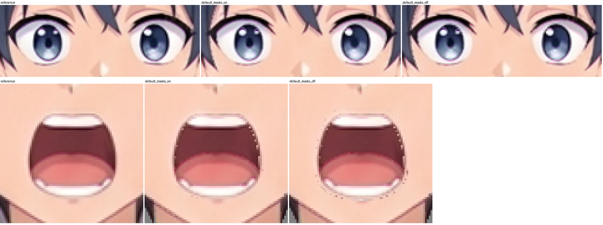
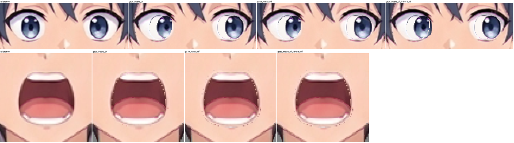
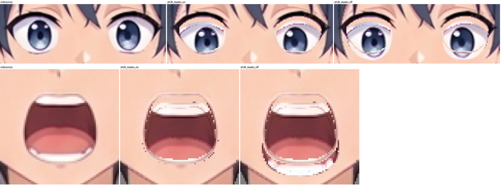

统计原文：[mask_stats.json](report_assets/mask_stats.json)

## 5. 拆分

| 部件 | 来源 | KRA 图层 | 深度 | 区域 |
|---|---|---|---|---|
| hair/side_hair_right | 上游预标注 | `01 hair/side_hair_right [root]` `{0516b3e3-b7fb-4bf4-b1fd-3340380eade0}` | 1 | 向中央发旋补入的隐藏根区，在 back_hair 头盖和 bangs 后 |
| | | `51 hair/side_hair_right [main]` `{9be73590-d94c-4a1b-bddb-6f9a136d0f8e}` | 51 | 原可见宽侧发主面，在脸、耳、右眼、右眉前，bangs 后 |
| hair/side_hair_left | 上游预标注 | `02 hair/side_hair_left [root]` `{c41225f9-41ec-40be-86cf-124fa59667c0}` | 2 | 隐藏根区，在 back_hair 和 bangs 后 |
| | | `52 hair/side_hair_left [main]` `{c8eccce2-4151-4cb7-9e0f-05a368781f55}` | 52 | 宽侧发主面，在脸、耳、左眼、左眉前，bangs 后 |

**切分方式**：
- 规则：主片 = 整件 × O/F，根片 = 整件 × (1−O/F)。
- 软边：外轮廓的软边全部归主片。
- 分界：沿原可见主面内侧分束边，藏在头盖、刘海之下。
- 显隐：两片默认都开启，根片靠上方覆盖隐藏，不是靠关闭根片。

51 [main] 统计到的 1 px 补全，在切分分界的软边上，由两片叠合补齐（§8）。

**本步新发现的拆分：无**。没有新增拆分、合并、改 ID 或改归属。其余 50 个部件均为单深度一张图层。

## 6. 生成来源与重试

54 次生图调用（模型 gpt-image-2.5-sunburst）：
- 53 次记在 `workspace/tmp/imagegen_log.json`；
- 另有 1 次 `legs__leg_right__leg_r1`（右腿补画轮）未写入该日志，但生成文件 `gen/legs__leg_right__leg_r1.png` 存在并已使用。

被内容审核拒绝（HTTP 400）共 9 次，都改用中性措辞或改为整组/整臂生成后取得结果，没有用原图像素代替：

| 部件 | 被拒调用 | 处理 |
|---|---|---|
| 右上臂 | upper_arm_R v1 / v2 / v3 | 中性措辞整臂（肩到腕）生成 `arm_right_ua_fa_v1`，按本件 SVG 取用 |
| 左上臂 | upper_arm_L v1 | 中性措辞 v2 |
| 左前臂 | forearm_L v1 | 中性措辞 v2 |
| 右拇指 | thumb_R v1 | 整组五指生成 `fingers_right_v1` |
| 左食指、中指、无名指 | 各 v1 | 整组四指生成 `fingers_left_v1` |

**各部件补全来源**：

| part | 采用 | 弃用及原因 | 笔刷 |
|---|---|---|---|
| face/face_base | face_base_v1（仿射调色） | — | 第 1 批 额顶/脸缘发下 |
| hair/back_hair | back_hair_v1 + 补画轮 r1 | r2 只出下半且带白块 | 第 2 批 |
| hair/side_hair_right | side_hair_right_v1 | — | 第 2 批 根区 |
| hair/side_hair_left | side_hair_left_v3（auto 背景，SVG 裁 alpha） | v1、v2 未补内侧根区 | 第 2 批 根区、主片发下 |
| hair/ahoge | ahoge_v2 | v1 缺共同短根 | 第 2 批 |
| hair/bangs、body、两只 foot、nose、upper_lip、两只 highlight、两条 eyelid_crease、left lower_eyelid | 全为参考可见像素，无补全区 | — | — |
| neck | neck_v3 | v1 外扩成领口；v2 未补下颌后颈上段 | 第 1 批；第 3 批重画下颌 V 线延续 |
| pelvis | 补画轮 pelvis_r1 | v1 未入层 | 第 1 批 两侧窄缝 |
| legs/leg_right/leg | leg_R_v1 + 补画轮 r1 | — | 第 1 批 |
| legs/leg_left/leg | leg_L_v1 | — | 第 1 批 |
| arms/arm_right/upper_arm | arm_right_ua_fa_v1（整臂） | 单件 3 次被拒 | 第 1 批；第 4 批重画肩带边线 |
| arms/arm_left/upper_arm | upper_arm_L_v2 | v1 被拒 | 第 1 批 |
| arms/arm_right/forearm | forearm_R_v1 | — | 第 1 批 肘端 |
| arms/arm_left/forearm | forearm_L_v2 | v1 被拒 | — |
| 两只 palm | palm_R_v1 / palm_L_v1 | — | 第 1 批 腕端；左掌重画横向细折线 |
| 右手五指 | fingers_right_v1 整组按各指 SVG 取用 | 右拇指单件被拒 | 第 1 批 指根 |
| 左拇指 | thumb_L_v1 | — | 第 1 批 |
| 左食指 / 中指 / 无名指 | fingers_left_v1 整组 | 单件被拒 | 第 1 批 |
| 左小指 | fingers_left_v1 + little_finger_v1 余量 | — | 第 1 批 含弧形暗线重画 |
| face/ear_right | ear_R_v2 | v1 未补耳根；r1、r2 补画形状偏离 | 第 1 批；第 3 批重画发影块与暗线 |
| face/ear_left | ear_L_v2 | v1 未补耳根 | 第 1 批；第 4 批重画棕色发影 |
| mouth_interior / tongue / upper_teeth / lower_teeth / lower_lip | 各自 v1 | — | 口腔、下牙、下唇第 2 批；口腔第 5 批重画两段深色短横 |
| 两只 sclera / iris | 各自 v1 | — | 眼白第 2 批 |
| 两条 eyebrow | 各自 v1 | — | 第 2 批 |
| 右上/下睑、左上睑 | 补全区 6–11 px，未生成 | — | 第 2 批 |

**复核图**（弃用候选与重试）：
- [review_rj_shl.png](report_assets/review_rj_shl.png)：左侧发 v1/v2/v3
- [review_rj_ear.png](report_assets/review_rj_ear.png)：耳 v1/v2
- [review_rj_neck.png](report_assets/review_rj_neck.png)：颈 v1/v2/v3
- [review_rj_refill.png](report_assets/review_rj_refill.png)：耳 r1/r2、后发 r2/r1
- [review_rj_pel.png](report_assets/review_rj_pel.png)：骨盆候选
- [review_rj_ah.png](report_assets/review_rj_ah.png)：翘发 v1/v2
- [review_b6.png](report_assets/review_b6.png)：手指组、后发、耳、臂

## 7. 笔刷批次

笔刷预设都是 “b) Basic-1”，选区都只覆盖补全区，没有覆盖可见像素。笔数后括号内是笔刷尺寸（px）。

| 批次 | alphaLock | 图层与笔数 |
|---|---|---|
| 1 | 否 | face_base 39（3）、neck 19（3）、pelvis 48（4）、leg R 64（4）、leg L 78（4）、upper_arm R 112（4）、upper_arm L 40（4）、forearm R 22（3）、palm R 45（3）、palm L 8+41（3）、右手 thumb/index/middle/ring/little 46/34/30/24/19（2）、左手 thumb/index/middle/ring/little 23/20/11/15/4+26（2）、ear_right 108（3）、ear_left 66（3） |
| 2 | 否 | back_hair 256（5）、01 [root] 70（3）、52 [main] 17（3）、02 [root] 18（3）、ahoge 38（2）、mouth_interior 26（3）、lower_teeth 22（2）、lower_lip 37（2）、sclera R/L 31/25（2）、上睑 R 6、下睑 R 7、上睑 L 4、眉 R 10、眉 L 5 |
| 3 | 是（2 px） | ear_right 110（阶梯状发影块）+70（斜向发丝/轮廓暗线）；neck 54（补全区里加粗延续的下颌 V 线，参考可见的下颌线不动） |
| 4 | 是（2 px） | ear_left 24（块状棕色发影）；upper_arm R 8（补全窄条里的肩带边线） |
| 5 | 是（2 px） | mouth_interior 34（补全区两段深色短横） |

合计 45 项 1814 笔。第 3–5 批的选区与可见像素的交集均为 0。

预览：
- [review_pv3.png](report_assets/review_pv3.png)
- [review_pv3_er2.png](report_assets/review_pv3_er2.png)
- [review_pv4.png](report_assets/review_pv4.png)
- [review_pv5.png](report_assets/review_pv5.png)

计划原文：[paint_plan.json](report_assets/paint_plan.json)

## 8. SVG 偏差与留给第二步的事项

**归属与形状**：
- 没有改变任何像素的部件归属。
- 没有把其他部件的像素并入本层。
- 没有越出 SVG 完整形状：F外 全表为 0。

以下是与 SVG 或参考的已知差异：

1. **保留的上游边界像素**：下列像素在上游 owner 中属于本部件（红区），按要求原样保留、未改归属，由第二步收边：
   - face_base 上的刘海描边和眼、口周围线圈；
   - neck 上的下颌 V 线；
   - 两耳内可见的侧发发丝边；
   - 眼白上的虹膜外圈与睫毛线；
   - 两上臂的肩带/连体服描边；
   - 两腿的连体服/腿口描边；
   - back_hair 下缘贴下颌/颈侧的淡紫光晕。
2. **软边超出**：全表 717 px，SVG 软边带内比 F 更不透明，最多一层 113 px（back_hair），都是 1–2 px 的边缘外溢。
3. **可见像素半透明**：形状内可见像素 alpha<128 的共 1451 px，其中 1450 px 在参考中本来就是 alpha<128（半透明边缘），按参考原样保留。整图上可见像素合成后 alpha<128 的为 1426 px。
4. **剪影细缝**：参考 alpha≥128 而合成 alpha=0 的 1144 px，全部在某个部件 F 的 2 px 内，是上游 SVG 剪影与参考之间的细缝，留第二步。
5. **参考外围光晕**：参考 alpha>0 而合成为 0 的共 142375 px，都是参考自带的大片低 alpha 光晕，落在任何部件 F 内的为 0。合成 alpha>0 而参考 alpha=0 的为 0。
6. **补全缺口**：全表 1 px。是 51 [main] 在 (501,45) 的 1 px，位于外侧根缘软边（F=179）、O/F 切分分界上：主片 α113，根片 01 同位置 α66，两片叠合 α≈150，拼合后不缺。
7. **细线断点**：以下细线在 α≥128 下不连通，但与 SVG 轮廓一致：
   - 39 右眼高光是两点（31+10 px）；
   - 40 右下睑内眼角有 9+2 px 的 1 px 细段；
   - 48 左眼褶末端有 2 px 断点；
   - 03 back_hair 有一段 1 px 发丝，在 α≥128 下孤立，在 α≥1 下与主体相连。
8. **掌缘突出**：两只 palm 外缘的短突出，例如左掌约 x672–696、y843–875。经单层与参考对照，与参考一致，按既有 palm 归属保留，不是第六指。

## 9. 单层验收

每张图层都单独导出查看，叠加青色 SVG 轮廓：

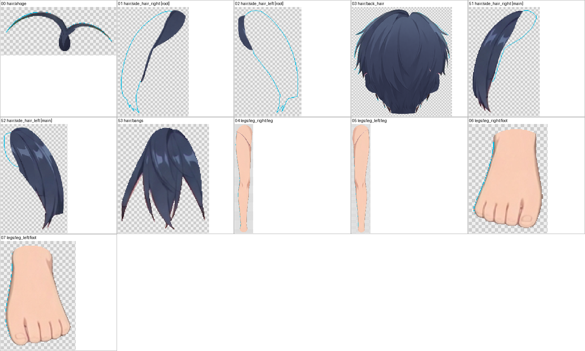
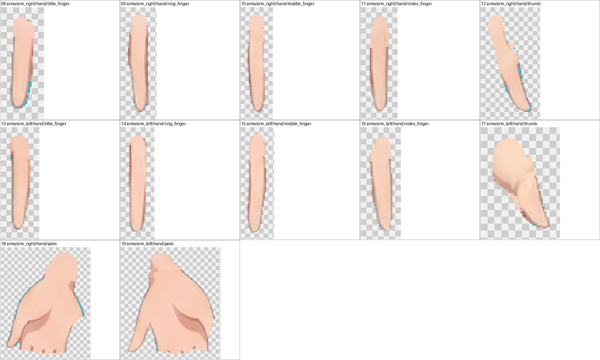
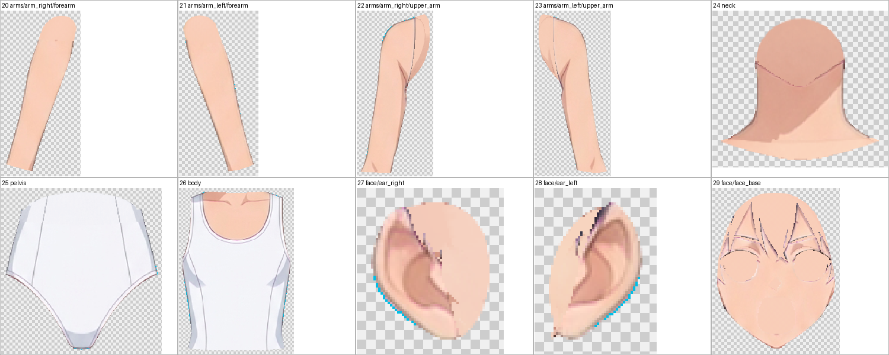
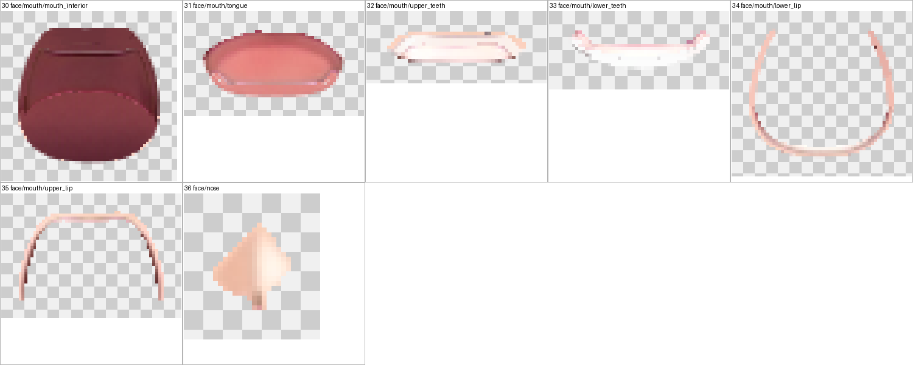
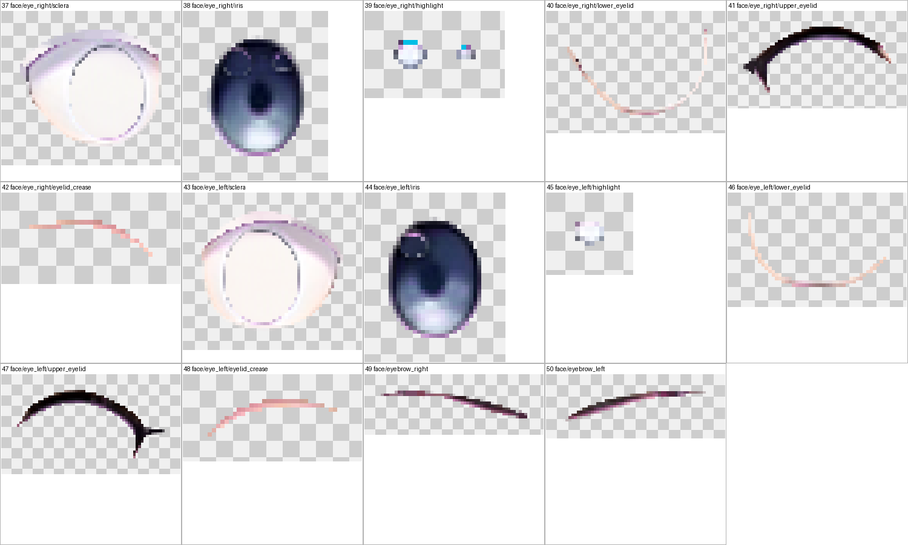

逐层确认以下几点：
- 每层都是一块连续完整的整体，形状与 SVG 一致；
- 没有别的部件的头发、衣服、饰品或描边；
- 补全区里没有生成带入的杂线；第 3–5 批已把查到的杂线重画。

整图对比数据：[composite_stats.json](report_assets/composite_stats.json)。逐层统计：[layer_stats.json](report_assets/layer_stats.json)。

## 10. 其他

- **自动备份**：Krita 保存时在 step01 目录生成的自动备份 `character-depth.kra~`（与正式文件相同大小）不属于交付物，已移到 `workspace/tmp/character-depth.kra~`。
- **草稿位置**：脚本、生成输入/输出、配准结果、蒙版、切片和证据都在 `workspace/` 下：
  - `scripts/`、`gen_inputs/`、`refill_inputs/`、`gen/`、`reg/`、`parts_rgba/`、`slices/`、`masks/`、`paint/`、`kexp/`、`evidence/`；
  - 写入深度表的备注草稿是 `notes/occlusion_payload.json`；最终保存时把蒙版测试的措辞改得更准确，以 occlusion.json 为准。
- **未触碰的文件**：没有改写 run.json、prompt.md、attempts.jsonl、events.jsonl 等调度器文件，也没有改写输入文件，没有推进后续步骤。
