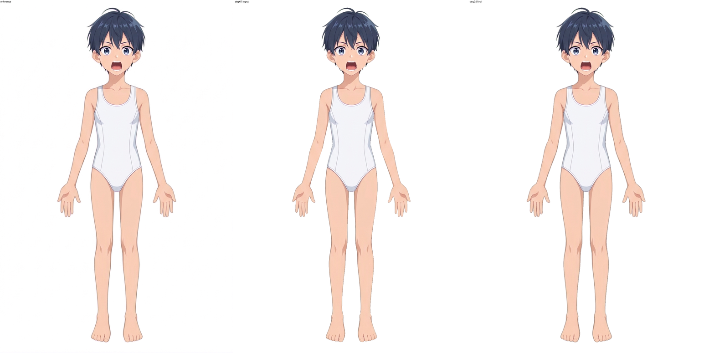

# raster step02 报告：边缘柔化与去锯齿（character-soft-edges.kra）

## 1. 输入、交付与结论

| 项目 | 内容 |
|---|---|
| 输入 KRA | `/data/home/lockliu/workspaces/AstraLayering-merged-workspace-deploy-20261026/demos/clothed-man-20261028/raster-layering/step01/character-depth.kra`（step01 产物，未改动；只在 `workspace/` 里拷贝后加工） |
| 参考图 | `../../part-layering/references/base-subject.png`（1024×1536，RGBA） |
| 输出 KRA | [character-soft-edges.kra](character-soft-edges.kra)（8877482 字节，md5 `49f78b8370ab1ab45c56e19be370f3ac`；60 个节点：54 张绘画图层 + 3 个组 + 3 个透明蒙版） |
| 输出合成图 | [character-soft-edges.png](character-soft-edges.png)（1024×1536，RGBA，透明背景；**从保存后重新打开的最终 KRA** 导出） |
| 报告配图 | [report-images/](report-images/)（11 张，见下文各节引用） |

结论：

- 每个部件的外缘与线条都用 Krita 笔刷在本层上逐笔处理：补回 step01 丢失的最外 1 px 描边环、给最外缘加一圈两级半透明软边、用 Filter Blur 笔刷磨平骨盆与身体上两段噪点轮廓，最后对检出的 76 个孤立锯齿/缺口/串珠像素做单像素笔刷点修。所有笔触都在对应部件自己的图层里，图层顺序、名称、归属、组、蒙版与 clip 关系保持不变。
- 与参考的整图差异（合成后叠白底，取通道最大绝对差）：差 >80 的像素 **2745 → 32**，差 >40 的像素 **6531 → 804**；参考不透明而我方几乎透明的"缺边"像素 **1633 → 11**。`locate_pixel_differences` 在全图及 hair / legs / arms / neck+pelvis+body / face 各分区默认阈值下都是 **0 个候选区域**。
- 刻意保留的差异主要是参考自带的粉白色 matte 光晕（见 §7）。它是参考抠图时烘焙进去的背景残边，不属于人物本体，不复制。

## 2. 方法与约束遵守情况

1. **只改边缘带，不改形体。** a1、b1 每层一个选区蒙版，r1、s1–s3 每笔带逐笔像素选区（单像素或 ≤10 px 的骨架段），选区外不会落笔；笔刷预设 `b) Basic-1`（尺寸 0.5–3 px）、`x) Filter Blur`（骨盆/身体，尺寸 2.5）；`node.paintPolygon` 只负责把笔迹落到指定图层，不做批量像素运算。
2. **颜色来源**：
   - b1 是模糊笔刷，不带颜色；r1 取最近的强不透明**合成像素**提亮 25%；s1/s2/s3 取本层相邻不透明像素的平均色（最暗 2 个邻点作描边色，或最亮邻点作肤色）。这几批的笔触位置与颜色都不读取参考图像素。
   - **例外是 a1（补回最外 1 px 描边环）**：笔触位置由"参考 α 与当前合成 α 的比较"定位（`plan_sliver.py`），每一笔的颜色是该笔所覆盖的约 14 个骨架像素处**参考 RGB 的 α 加权平均**，不是逐像素复制，而是一笔一个平均色，相当于画师对参考吸管取色后沿轮廓描一笔。这一点在 §9 单独标出，供复核判断是否符合"不得用参考图重染"的约束。
   - 没有做阈值逐像素重染，也没有整层模糊/全局羽化。
3. **没有画阴影、环境光遮蔽或投影。**
4. **形体改动被限制在边缘带 0.x–2 px**：a1 补回的是 step01 丢失的最外 1 px 描边环，r1 是 1–2 px 的低不透明度软边（α≈0.2 / 0.05 的两级）。合成后 α≥128 的像素数由 291997 变为 294578（参考 294571），说明外形等价恢复，没有放大或缩小人物；α>0 的覆盖由 296365 变为 313770，增加的都是软边的半透明像素。
5. **图层结构不变。** 复开后对 60 个节点比对 名称、顺序、UUID、类型、可见性、不透明度、混合模式、inheritAlpha、父组、深度、alphaLock，0 处差异；3 个蒙版像素与 step01 完全相同；3 个组保持原位。
6. 每批画完都保存 KRA 并导出各层与合成图复核；有两批（b2/c1/c2 整轮廓模糊、e1 Eraser Soft）指标变差，直接丢弃重来（§6）。
7. 没有触碰调度文件（run.json、.running、.completed、prompt.md、attempts.jsonl、events.jsonl、result.json、error.txt）。

## 3. 逐层检查覆盖

检查方式：对 54 张绘画图层逐层独显（其余隐藏）与参考、当前合成并排做接触表（`workspace/tmp/v/sh_*.png`：30–36、37–42、43–48、49–53、0–7、8–17、18–23、24–29 各一张），再对高风险边缘（手指、掌缘、发梢与阿霍毛、耳—发缝、身体—手臂接缝、骨盆—腿开口、脚、面部五官、口内）做 4–8 倍放大对照；另用脚本统计每层的孤立连通域、半透明像素数与改动像素数（只用于定位，不用于填色）。组与蒙版逐个核对了结构与像素。

"改动像素"＝最终 KRA 导出该层与 step01 导出该层相比有变化的像素数。"半透明"＝0<α<255 的像素数，step01 → step02。

| 层 | 名称 | 改动像素 | 半透明 | 检查结论 |
|---|---|---:|---|---|
| 00 | hair/ahoge | 722 | 1037→1634 | 呆毛细尖处外缘缺描边；补环+软边，见[图 05](report-images/05_ahoge.png) |
| 01 | hair/side_hair_right [root] | 0 | 1934→1934 | 被前层完全盖住的根片，外缘不可见，未改 |
| 02 | hair/side_hair_left [root] | 0 | 127→127 | 同上，未改 |
| 03 | hair/back_hair | 2055 | 4353→5885 | 左侧发缘缺环、发梢有 1–2 px 洞（点修 10 px 平均色填充）；见[图 04](report-images/04_hair_left_edge.png) |
| 04 | legs/leg_right/leg | 3539 | 8553→11325 | 外缘补环+软边；点修 1 px（404,721） |
| 05 | legs/leg_left/leg | 3488 | 12445→15155 | 同上 |
| 06 | legs/leg_right/foot | 837 | 1226→1993 | 脚趾边缘补环+软边；点修 1 px（417,1479）；见[图 09](report-images/09_foot_right.png) |
| 07 | legs/leg_left/foot | 937 | 1314→2166 | 同上 |
| 08 | arms/arm_right/hand/little_finger | 182 | 440→597 | 指缘补环+软边；见[图 02](report-images/02_hand_right_fingers.png) |
| 09 | …/ring_finger | 127 | 669→770 | 同上 |
| 10 | …/middle_finger | 85 | 605→675 | 同上 |
| 11 | …/index_finger | 185 | 610→764 | 同上 |
| 12 | …/thumb | 215 | 922→1095 | 同上；点修 1 px（329,849） |
| 13 | arms/arm_left/hand/little_finger | 212 | 380→573 | 补环+软边 |
| 14 | …/ring_finger | 121 | 593→687 | 同上 |
| 15 | …/middle_finger | 159 | 706→837 | 同上 |
| 16 | …/index_finger | 211 | 510→702 | 同上 |
| 17 | …/thumb | 151 | 862→980 | 同上 |
| 18 | arms/arm_right/hand/palm | 473 | 1848→2228 | 掌缘补环+软边；点修 1 px（333,793）；见[图 03](report-images/03_palm_right.png) |
| 19 | arms/arm_left/hand/palm | 680 | 1451→1978 | 同上 |
| 20 | arms/arm_right/forearm | 1216 | 2667→3701 | 外缘（含 step01 缺失最多的臂外轮廓）补环+软边 |
| 21 | arms/arm_left/forearm | 1149 | 2878→3790 | 同上；点修 1 px（709,713） |
| 22 | arms/arm_right/upper_arm | 1120 | 3067→3930 | 同上 |
| 23 | arms/arm_left/upper_arm | 1402 | 3412→4521 | 同上；身体—手臂接缝 5 px 点修，见[图 07](report-images/07_body_arm_seam.png) |
| 24 | neck | 383 | 4432→4703 | 补环+软边 |
| 25 | pelvis | 983 | 8612→9154 | 暴露的腿开口轮廓有噪点，用 Filter Blur 笔刷磨平 10 笔，再补环+软边；见[图 08](report-images/08_pelvis_leg_opening.png)、[图 11](report-images/11_body_pelvis_side.png) |
| 26 | body | 1331 | 4315→5102 | 同上，Blur 16 笔 |
| 27 | face/ear_right | 160 | 1155→1282 | 补环+软边；孤立像素点修（438,263）；耳—发交界的深蓝碎块属 step01 归属，隐于侧发之下，保留 |
| 28 | face/ear_left | 181 | 760→900 | 同上；点修 1 px（613,214）；耳—发缝见[图 06](report-images/06_ear_hair_gap.png) |
| 29 | face/face_base | 115 | 13259→13327 | 外缘（下颌、耳前）补环；脸内部无改动；见[图 10](report-images/10_face_eyes_mouth.png) |
| 组 | face/mouth interior（含 30–33 + 蒙版 opening_mouth） | 0 | — | 结构、蒙版像素与 step01 一致 |
| 30 | face/mouth/mouth_interior | 0 | 1409→1409 | 口内由蒙版裁切，边缘已是自然半透明，未改 |
| 31 | face/mouth/tongue | 0 | 379→379 | 同上，未改 |
| 32 | face/mouth/upper_teeth | 0 | 175→175 | 未改 |
| 33 | face/mouth/lower_teeth | 0 | 153→153 | 未改 |
| 34 | face/mouth/lower_lip | 14 | 183→169 | 下唇外缘有 14 个粉色孤点，用橡皮擦笔逐点擦去（s1、s2 各 7 点）；其余边缘保留 |
| 35 | face/mouth/upper_lip | 0 | 72→72 | 未改 |
| 36 | face/nose | 0 | 9→9 | 160 px 小线条，只有自然阶梯边，未改 |
| 组 | face/eye_right interior（含 37–39 + 蒙版 opening_eye_right） | 0 | — | 结构与蒙版一致 |
| 37 | face/eye_right/sclera | 0 | 890→890 | 未改 |
| 38 | face/eye_right/iris | 0 | 383→383 | 未改 |
| 39 | face/eye_right/highlight | 0 | 22→22 | 未改 |
| 40 | face/eye_right/lower_eyelid | 0 | 51→51 | 存在 step01 带入的 2 px 与 9 px 细碎片（x=485,y≈201–213），是下眼睑线端，单 px 宽，保留 |
| 41 | face/eye_right/upper_eyelid | 0 | 136→136 | 睫毛线是 1–2 px 宽硬线，与参考同为硬边，未改 |
| 42 | face/eye_right/eyelid_crease | 0 | 26→26 | 未改 |
| 组 | face/eye_left interior（含 43–45 + 蒙版 opening_eye_left） | 0 | — | 结构与蒙版一致 |
| 43 | face/eye_left/sclera | 0 | 914→914 | 未改 |
| 44 | face/eye_left/iris | 0 | 369→369 | 未改 |
| 45 | face/eye_left/highlight | 0 | 13→13 | 未改 |
| 46 | face/eye_left/lower_eyelid | 0 | 35→35 | 未改 |
| 47 | face/eye_left/upper_eyelid | 0 | 128→128 | 未改 |
| 48 | face/eye_left/eyelid_crease | 0 | 47→47 | 含 2 px 端点碎片（562,186），保留 |
| 49 | face/eyebrow_right | 0 | 92→92 | 未改 |
| 50 | face/eyebrow_left | 0 | 110→110 | 未改 |
| 51 | hair/side_hair_right [main] | 9 | 1166→1157 | 发缘处有 9 px 半透明缝（α127–206），下层较亮的肤色透出；用笔刷补成 α255 闭合缝隙 |
| 52 | hair/side_hair_left [main] | 0 | 985→985 | 发缘已由上层覆盖/自然，未改 |
| 53 | hair/bangs | 0 | 1605→1605 | 未改 |

要点：

- **30–53 层（五官、口内、眼睛、眉、前发）** 逐层独显后边缘都是 1 px 阶梯式的自然半透明，没有缺口、残留或描边缺失；只有 34 层（14 px）与 51 层（9 px）做了点修。这些层本身是极小的线条/色块，加软边会糊掉线条，所以特意不动。
- **孤立块审计**：独显统计 03 层最终为单一连通域；40、48 层各有 step01 就有的 1–2 个极小线端碎片（见表），属于部件自身线条，保留。
- **半透明像素数在轮廓层上变多**是软边与补环的预期结果，不是新增的杂色。

## 4. 像素框跟进（`locate_pixel_differences`）

参考统一使用 `../../part-layering/references/base-subject.png`。全图候选的当前图为各阶段 KRA 导出的合成 PNG，分区候选把保存后的 KRA 导出为 `.ora`（保留各层蒙版/位移后的实际像素）并传入 `current_kra`。每次的 `differences.json`、`marked.png`、`heatmap.png`、`comparison.png` 在 `workspace/pixel-review/<运行 ID>/`。

| 阶段 | 范围 / 参数 | 运行 ID | 结果 |
|---|---|---|---|
| step01 输入（s0） | 全图，默认阈值 | [7e7205b3…](pixel-review/7e7205b3-cd96-40a7-a7c8-618160294d03/marked.png) | missing 1998 / extra 102 / color 35；3 个 missing 区域：[659,489,37,159]、[342,631,46,131]、[639,638,29,80]，都是前臂/上臂外轮廓丢了最外一圈描边 |
| step01 输入（s0） | 全图，color 40 / alpha 64 / min 20 | [e634f010…](pixel-review/e634f010-0fa4-4124-9489-8e09a268bdf3/marked.png) | missing 2354 / extra 429 / color 185；34 个区域，绝大多数是 missing 轮廓带（臂、腿、发缘），少数 extra：[534,192,45,11]、[443,192,35,11]、[532,170,31,9]（睫毛/眼睑线）、[336,818,8,17]（手缘） |
| a1+b1（s2） | 全图，默认阈值 | [72dde171…](pixel-review/72dde171-298d-4f51-801f-1ceabc8987ed/marked.png) | **0 区域**；missing 103 / extra 117 / color 85 |
| a1+b1（s2） | 全图，color 50 / min 12 / gap 2 | [6ba3aee7…](pixel-review/6ba3aee7-c0a8-4aae-a2fd-a37f79a4a2c3/marked.png) | 10 小区域；用来确定下一步做 r1 软边和点修 |
| r1（s6） | 全图，color 50 / min 12 | [cc9b1cf4…](pixel-review/cc9b1cf4-77f2-42db-b6ff-e52ff7542f6c/marked.png) | 10 小区域（6–35 px），missing 88 / extra 117 / color 579；多为轮廓色相与参考 matte 光晕不同，其余转入 s1/s2 点修 |
| s8（s1+s2 点修后） | hair | [128482b2…](pixel-review/128482b2-067e-427b-aa53-9be1c6bdada4/marked.png) | 0 区域（25 / 40 / 9） |
| s8 | legs | [a5157dc5…](pixel-review/a5157dc5-ad74-4043-869d-756f7e79e377/marked.png) | 0 区域（6 / 8 / 10） |
| s8 | arms/arm_right | [1f4a67ce…](pixel-review/1f4a67ce-bb4f-4794-81b1-1c0b618bdf3a/marked.png) | 0 区域（4 / 46 / 10） |
| s8 | arms/arm_left | [155ae8c8…](pixel-review/155ae8c8-4776-49bb-85ca-61d0f223a8b4/marked.png) | 0 区域（12 / 22 / 2） |
| s8 | neck + pelvis + body | [7df3d96a…](pixel-review/7df3d96a-b6a9-452c-8b9c-330dc42475e3/marked.png) | 0 区域（11 / 33 / 52） |
| s8 | face | [52e5dd91…](pixel-review/52e5dd91-c201-45e5-8c38-43cb3404774a/marked.png) | 0 区域（16 / 40 / 9） |
| s8 | neck/pelvis/body，min 3 / gap 2 | [9f26285a…](pixel-review/9f26285a-3751-4afa-8a3f-77ae2a4b46a3/marked.png) | 11 个小区域，逐个核对见下 |
| s9（最终） | 全图，min 6 / gap 2 | [8d5c1aff…](pixel-review/8d5c1aff-4fcb-4be3-910c-9da457682d3c/marked.png) | 10 个小区域（6–26 px），逐个核对见下；missing 42 / extra 121 / color 76 |

（分区运行是在 s8 上做的；最终 s9 比 s8 仅多 s3 批在第 23 层的 5 个像素，随后又做了上表最后一行的全图复查。）

**逐个核对（低阈值与最终全图候选）与处理：**

| 区域（[x,y,w,h]） | 类别 | 核对结果 | 处理 |
|---|---|---|---|
| [610,481,2,9] | missing | 身体—左上臂接缝处 5 个像素合成 α 只有 56–154，露出背景缝；是真缺陷 | **s3 批：第 23 层 5 笔点修，α 90/96/56/154/152 → 230/231/225/239/255**（见 §5） |
| [336,818,7,17] | extra | 右手缘：我方软边是中性灰，参考是粉白 matte 光晕 | 保留 |
| [587,366,10,5]、[429,366,9,4]、[567,359,5,2]、[508,827,9,1] | extra | 外缘软边对应参考光晕里的几个亮点，我方更淡、色相中性 | 保留 |
| [462,171,13,4] 及 [530,171,27,9] | extra / color | 睫毛、眼睑折痕的色相，来自 step01 的眼部线条，不是边缘问题 | 保留，不碰线条 |
| [610,208,4,6] | missing | 耳—发之间在参考里就有一条真实的背景缝 | 保留（[图 06](report-images/06_ear_hair_gap.png)） |
| [596,604,1,11]、[421,634,5,17]、[600,637,4,14]、[415,664,3,11]、[409,684,4,14] | color | 骨盆/身体侧的深色线：参考是 1 px 极暗线，我方是 2 px 中暗线（step01 形体），只是线宽/明暗差 | 保留（见 §7） |
| [601,1039,1,16]（腿缝） | color | 1 px 宽的单列差异，在腿缝内 | 保留 |

## 5. 实际编辑（全部为 Krita 笔刷落笔）

所有批次的笔触计划在 `workspace/paint/plan_*.json`，脚本在 `workspace/scripts/`；每批后保存 KRA 并导出复核。批次检查点：`workspace/character-soft-edges.{base,a1,b1,r1,s1,s2,s3}.kra`（base 为 step01 原样拷贝；s3 与最终文件内容一致）。

| 批 | 内容 | 笔数 | 涉及图层 |
|---|---|---:|---|
| a1 | **补回最外 1 px 描边环**。step01 的部件外缘比参考少了最外一圈暗描边。用 `b) Basic-1`（尺寸 0.5 px 300 笔、1 px 69 笔、2 px 11 笔，不透明度 0.15–1.0，其中 0.3–0.6 占绝大多数；每笔由其覆盖的缺口深度决定）顺着轮廓逐段补，每笔 2–17 个路径点；每笔颜色为该笔覆盖的参考像素的 α 加权平均色（见 §2 第 2 条与 §9 的说明）；每层一个选区蒙版（`workspace/masks/a1_NN.png`）限制笔触只能落在缺失环的像素上。同批对 51 层 9 px 半透明缝补成 α255 | 380（29 项） | 00、03–29、51 |
| b1 | **磨平噪点轮廓**。骨盆、身体暴露在腿开口/腰侧的外缘边缘不光顺，用 `x) Filter Blur`（2.5 px）沿边缘窄带涂抹；其他层的整轮廓模糊被否决（§6） | 26（骨盆 10 + 身体 16） | 25、26 |
| r1 | **两级外缘软边**。1 px 环用 `b) Basic-1` 不透明度 0.2、尺寸 2；2 px 环不透明度 0.05、尺寸 3；沿轮廓骨架每 10 px 一段，每笔带单独像素选区；颜色取最近的强不透明合成像素并提亮 25%，落到拥有该处轮廓的最上层（01、02 不画）。参数经模拟比较，更强或更淡都更差 | 1457（56 项） | 所有轮廓层（00、03–29） |
| s1 | **孤点修补**（12 项）：① 第 34 层 7 个下唇孤点用橡皮擦逐点擦除：(529,260)、(531,264)、(532,267)、(533,270)、(534,276)、(534,277)、(534,278)；② 第 3 层发缘 10 个小洞用相邻像素按 α 加权平均色填（444,267)、(445,268)、(445,269)、(446,269)、(445,270)、(446,270)、(446,271)、(445,271)、(401,198)、(401,199)；③ 12 个轮廓缺口按同层最暗的 2 个邻像素平均色补描边（不透明度 0.55）：23:(611,488)、23:(611,489)、21:(709,713)、4:(404,721)、5:(619,721)、12:(329,849)、6:(417,1479)、25:(423,640)、25:(423,641)、18:(333,793)、27:(438,263)、28:(613,214) | 29 | 3、4、5、6、12、18、21、23、25、27、28、34 |
| s2 | **残余孤点**（9 项）：第 34 层再擦 7 点 (489,276)、(493,261)、(494,259)、(530,262)、(533,271)、(534,279)、(534,280)；检出 39 个合成 α<170 的浅色缺口像素，首轮试验中 (400,199)、(406,216)、(466,291)、(424,1376) 四点反而变差而排除，其余 35 点逐点用 `b) Basic-1`（1 px，不透明度 1.0）填补，颜色为本层上下左右不透明邻点里最亮那几个的平均色。最终 40 点改善、2 点略差 | 42（擦 7 + 填 35） | 7（2 px）、8（1）、18（2）、20（2）、21（6）、23（15）、28（3）、29（4）、34（7） |
| s3 | **身体—左上臂接缝**：第 23 层 5 个像素。(610,481)、(611,486)、(611,487) 取中间肤色 (172,130,123)/(176,136,129)/(178,139,132)，不透明度 0.85；(611,488) 取描边色 (133,102,107) 0.85；(611,489) 同色 1.0。合成 α：90→230、96→231、56→225、154→239、152→255 | 5 | 23 |

合计约 1939 笔。按层的改动像素数见 §3 表（"改动像素"）。

### 指标（参考叠白底 vs 当前合成叠白底，`workspace/scripts/metric.py`、`rough.py`）

| 版本 | diff>40 | diff>80 | 差值总和 | missing（参考 α≥128 且当前 α<30） | 参考 α≥40 且当前 α<30 | α 粗糙度（参考 11.41） | 亮度粗糙度 |
|---|---:|---:|---:|---:|---:|---:|---:|
| step01 输入 s0 | 6531 | 2745 | 1011593 | 1633 | 9613 | 21.42 | 15.10 |
| a1（s1 导出） | 1375 | 114 | 665968 | 58 | 5064 | 17.86 | 14.40 |
| a1+b1（s2 导出） | 1337 | 101 | 668944 | 49 | 5032 | 18.08 | 14.39 |
| +r1（s6） | 863 | 58 | 605846 | 14 | 577 | 13.63 | 12.24 |
| +s1（s7） | 843 | 32 | 603559 | 12 | 573 | — | — |
| +s2（s8） | 808 | 32 | 601938 | 11 | 572 | 13.57 | 12.21 |
| **最终 s3（s9 = 复开导出）** | **804** | **32** | **601728** | **11** | **572** | **13.57** | **12.21** |

"粗糙度"是轮廓带（距参考边缘 ≤3 px）内与 σ=1 高斯平滑图的平均绝对差，越小越光顺；α 粗糙度 21.42 → 13.57，已接近参考自身的 11.41。

### 对比图

| 区域 | 图 |
|---|---|
| 整体（参考 / 输入 / 最终） | [01_overview.png](report-images/01_overview.png) |
| 右手手指 | [02_hand_right_fingers.png](report-images/02_hand_right_fingers.png) |
| 右掌缘 | [03_palm_right.png](report-images/03_palm_right.png) |
| 左侧发缘 | [04_hair_left_edge.png](report-images/04_hair_left_edge.png) |
| 呆毛 | [05_ahoge.png](report-images/05_ahoge.png) |
| 耳—发缝 | [06_ear_hair_gap.png](report-images/06_ear_hair_gap.png) |
| 身体—手臂接缝（参考 / s3 前 / 最终） | [07_body_arm_seam.png](report-images/07_body_arm_seam.png) |
| 骨盆—腿开口 | [08_pelvis_leg_opening.png](report-images/08_pelvis_leg_opening.png) |
| 右脚 | [09_foot_right.png](report-images/09_foot_right.png) |
| 面部五官/口 | [10_face_eyes_mouth.png](report-images/10_face_eyes_mouth.png) |
| 身体/骨盆侧缘 | [11_body_pelvis_side.png](report-images/11_body_pelvis_side.png) |

除 07 外，每张均为"参考 | step01 输入 | step02 最终"三联。

## 6. 试过并否决的做法

- **整轮廓 Filter Blur**（b2 / c1 / c2）：边缘变糊、描边变灰，diff 指标与粗糙度都变差，`character-soft-edges.b2_bad.kra` 保留作证据，未并入最终。Filter Blur 只留在骨盆/身体（b1），因为那里是暴露的噪点轮廓而不是描边线。
- **Eraser Soft 软化轮廓**（e1）：把外缘擦成半透明，反而制造缺口，指标变差，丢弃。
- **更强/更淡的软边参数**：用 `simrim.py` 模拟比较，r1 所用的两级 0.2/0.05 最接近参考的斜坡；其他组合更差。
- **宽泛的缺口检测一次性填补**：模拟结果 改善 68 / 变差 1020，丢弃；只保留合成 α<170 的缺口，并逐点复核。
- **notch 用"中间色/描边色"通填**：部分像素反而变差，改为逐点判断（s2 的排除集合）。

## 7. 保留的差异

- **参考的粉白 matte 光晕**。参考外缘有一圈 RGB≈(207,139,156)、α 40–130 的粉白半透明残边（`ref≥40&comp<30` 仍有 572 px 主要来自它），这是抠图时烘进参考的背景残边，不属于人物。按任务约束不复制参考像素，我方软边是中性灰、更淡更窄（如 (319..330, 660..760)、(700..711, 667..721) 一带；以及 [587,366,10,5]、[429,366,9,4]、[567,359,5,2]、[508,827,9,1]、手缘 [336,818,7,17] 的候选框）。
- **发梢与发缘 α 差异**（约 y=19–312）：参考发梢是烘焙斜坡，我方是补环+两级软边，差异在 α<80 的范围。
- **睫毛与眼睑折痕色相** [530,171,27,9]、[462,171,13,4]：属 step01 的线条，不是边缘锯齿。
- **个别偏蓝紫的发丝像素** (572,170)、(538,177)、(534,178)、(534,202)：线条颜色，不是边缘问题。
- **骨盆/身体侧的深色线**：参考是 1 px 极暗线，我方是 step01 形体的 2 px 中暗线，区域 [596,604,1,11]、[421,634,5,17]、[600,637,4,14]、[415,664,3,11]、[409,684,4,14]；改线宽属于形体调整，不在本步范围。
- **耳—发缝** (610..615, 208..218)：参考里就有真实背景缝，保留。
- **(446,270)** 一个略偏粉紫的小点（第 3 层）、**腿缝** [601,1039,1,16]：差异小于一个像素宽，保留。
- **耳层 27/28 的深蓝发色碎块**：位于侧发之下看不到，是 step01 归属，不属于边缘缺陷，保留。
- **"硬边"计数**：骨盆的硬边像素计数由 136 升到 174，目测腿开口轮廓比 step01 更接近参考（[图 08](report-images/08_pelvis_leg_opening.png)），属统计口径造成，不是退化。

## 8. 复开验证

1. 从 `workspace/` 中的 s3 拷贝另存为 `character-soft-edges.kra`，关闭文档，再用 Krita 重新打开。
2. **结构**：60 个节点的 名称、顺序、UUID、类型、可见性、不透明度、混合模式、inheritAlpha、父组、深度、alphaLock 与 step01 逐项比对，**0 处差异**；3 个组与 3 个透明蒙版保持原位。
3. **像素**：从复开文档导出各层与 3 个蒙版（`workspace/kexp/final/`），与保存前（s9）的导出逐像素比较，**0 处差异**；蒙版与 step01 相同。
4. **合成**：从复开文档导出的整图与 `character-soft-edges.png`、保存前合成**逐像素相同**（md5 `71416d35c8fb8079b20b7eedbc83f1fa`），尺寸 1024×1536，四角 α=0。
5. 指标、分区候选检查与 §3 的逐层结论都基于上述复开导出或其等价副本。

## 9. 未解决问题

- **a1 的颜色与定位来源（需要复核）**：a1 是本步改动最大的一批（380 笔）。它的笔触位置来自参考与合成的 α 比较，笔触颜色是参考像素的逐笔平均色（不是逐像素复制，也没有粘贴参考像素），笔触仍是限制在缺失环像素上的真实笔刷笔迹（不透明度 0.15–1.0）。如果复核认为"吸管取参考色再描边"仍属于不允许的参考重染，则 a1 需要改为取本层相邻描边色重做，b1 之后的批次（r1、s1–s3）也要在新 a1 基础上重新生成。其余各批（b1、r1、s1、s2、s3）的笔触位置与颜色都只依据当前层/合成，不读取参考图像素；点修的目标像素是用 `locate_pixel_differences` 与逐层放大查看发现的。
- 参考自带的粉白 matte 光晕未复制，所以外缘软边的色相与宽度和参考图不是一一对应；如果下游需要与参考同色的光晕，需要在合成阶段另行生成，而不是在本步分层里补。
- 骨盆/身体侧的深线线宽、睫毛/折痕色相、发丝偏色属于形体或线稿层面，留给后续步骤判断。
- 40、48 两层各有 step01 带入的 1–2 px 的极小线端碎片，未处理，因为视觉上与线条连成一体。
- 软边基于最近的强不透明像素提亮 25% 作色，在极少数强对比处（手—背景、发梢）可能略偏灰，目测可接受，未再追加调整。
