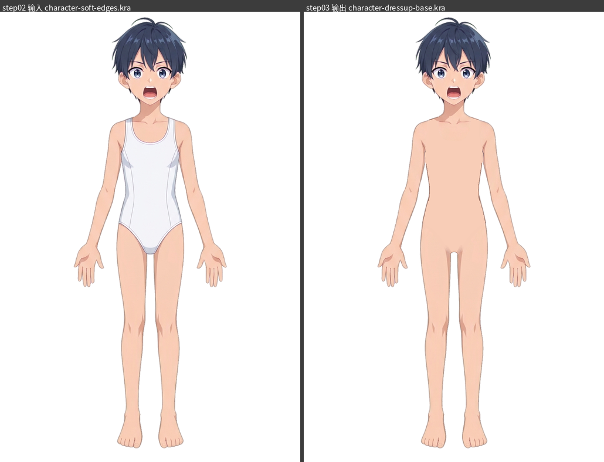

# raster step03 报告：移除临时连体服并补出换装用肤色底（character-dressup-base.kra）

## 1. 输入、交付与结论

| 项目 | 内容 |
|---|---|
| 输入 KRA | `/data/home/lockliu/workspaces/AstraLayering-merged-workspace-deploy-20261026/demos/clothed-man-20261028/raster-layering/step02/character-soft-edges.kra`（step02 产物，只读，md5 `49f78b8370ab1ab45c56e19be370f3ac`，复核时未变；只在 `workspace/` 里拷贝后加工） |
| 输出 KRA | [character-dressup-base.kra](character-dressup-base.kra)（8650629 字节，md5 `ffa38681ddf8f411e498766005dc0303`；60 个节点：54 张绘画图层 + 3 个组 + 3 个透明蒙版） |
| 输出合成图 | [character-dressup-base.png](character-dressup-base.png)（1024×1536，RGBA，透明背景，四角 α=0，422307 字节，md5 `e1cfb164d98fc571d76d35b834fab1bc`；**从保存后重新打开的最终 KRA** 导出） |
| 报告配图 | [report-images/](report-images/)（30 张，见各节引用） |
| 过程文件 | `workspace/`：各批笔触计划 `paint/*.json`、选区蒙版 `masks/`、脚本 `scripts/`、各批后的 KRA 备份 `backups/after_*.kra`、各批导出 `exp/<批>/`、对照用视图 `views/` |

结论：

- 连体服已经从 `26 body`、`25 pelvis`、`04 leg_right`、`05 leg_left`、`22 upper_arm(右)`、`23 upper_arm(左)` 这 6 个部件里移除，其余 48 张绘画图层、3 个蒙版逐像素没有变化。移除范围内改画成"低细节、与周围裸露皮肤连续"的肤色底，躯干和骨盆是平涂肤色，没有加任何阴影以外的细节，也**没有添加乳头、生殖器或其他内衣以下的解剖细节**。人物保持非写实动漫男孩的资产形态。
- 保留了原来就裸露的好画面：颈部层整层未动（0 像素），颈根阴影、锁骨线、肩部与上臂的明暗、腋下阴影楔、手臂外轮廓、大腿外侧与内侧的阴影条都保留。
- 肩带、领口白环、腰侧缝线与灰蓝侧面阴影、裤口白边与线、裆部灰蓝阴影都已清除，没有留下斜向带、亮边、暗沟或沿旧领口/肩带/腰线/裤口的线条（残留的极淡台阶和原有像素见 §10）。
- 新的外轮廓是 2 px 褐色线（约 (138,96,84)），与原来手臂/腿的棕色轮廓同色；内部图层边界（身体/骨盆/腿、身体/手臂）没有画成外轮廓。原来的连体服在腿根处形成的 V 形"裤口"被改成大腿与骨盆连续的肤色，裆部开出一个带 2 px 轮廓的圆拱腿缝。
- 全程只用 Krita 原生笔刷笔触（`b) Basic-1` 2587 笔、`b) Airbrush Soft` 40 笔，共 278 项、2627 笔，由 Python 驱动落笔），没有用 NumPy/Pillow/QPainter 往 KRA 里写任何像素，最终结果里没有用到 Filter Blur。

## 2. 方法与约束遵守情况

1. **只用 Krita 笔刷改像素。** 每批的笔触计划是 JSON（`paint/<批>.json`），由 `scripts/k_paint.py` 在 Krita 里逐项执行：设置笔刷预设、尺寸、不透明度、流量、前景色、混合模式（普通/擦除）、是否锁 α，然后对目标图层 `node.paintLine` 落笔。Python 只负责：定位目标像素、从现有裸露皮肤采样颜色、生成选区蒙版（每项一个灰度 PNG，经 `Selection.setPixelData` 变成选区，笔触只能落在选区内）、切换图层可见性、导出对照图、检查文件。没有 `setPixelData` 写图层，没有公式色场、高斯渐变、最近邻传播或阈值填充。
2. **零长度笔触不会落墨**，所以单像素的修补用两点笔触 `[[x,y],[x+1,y]]` + 单像素选区实现。
3. **颜色来源**：全部取自这个角色已有的裸露皮肤和轮廓像素（躯干/骨盆底色 (248,205,183)；腿 (247,204,182)；右上臂 (249,205,184)；颈部阴影 (224,166,147)；轮廓褐色 (138,96,84)/(124,79,70)；邻近明暗取邻点色，例如 (244,201,180)、(246,203,181)）。没有读取参考图或别的图像。
4. **范围控制**：每批的选区限定在旧连体服区域及其接缝过渡带内；锁 α 的笔触只改色不改形，需要提高 α 时才用不锁 α 的笔触。最终合成里改动像素只落在 x 402–622、y 355–829，这个框之外（含头、手、脚、其余手臂）完全未变。
5. **没有整层平涂或全局模糊**：`26 body` 在 step02 里有 52050 个非透明像素，改动 44267 个，其余为颈根阴影、肩部皮肤与手臂交界等原有裸露画面；颈部层 0 改动。躯干内部是平涂肤色（σ≈0.5 个色阶），这是对"低细节底层"的有意取舍，不是对整层的平涂：外轮廓、阴影楔、肩线、腋下仍是原画/逐笔处理。
6. **图层结构不变**：画布 1024×1536；60 个节点的名称、顺序、UUID、类型、可见性、不透明度、混合模式、channelflags、inheritAlpha/alphaLock 标志、父组与深度与 step02 逐项一致（`maindoc.xml` 仅"当前选中图层"标记和属性书写顺序不同，见 §9）；3 个组、3 个透明蒙版（默认可见性）和 inheritAlpha 裁剪关系保持不变；单深度部件仍是一张绘画图层，多深度部件的切片原样。
7. **每批保存、从保存结果检查**：每个实际编辑批次后保存 KRA、备份到 `backups/after_<批>.kra`，再把各层与合成导出到 `exp/<批>/` 检查。
8. 没有触碰调度文件（run.json、.running、.completed、prompt.md、attempts.jsonl、events.jsonl、result.json、error.txt），没有推进后续步骤，没有提交 git。

## 3. 逐层检查覆盖

"改动像素"＝最终 KRA 导出的该层与 step02 导出的该层相比任一通道不同的像素数（`exp/s0` 对 `exp/final`）。"半透明"＝0<α<255 的像素数，step02 → step03。

| 层 | 名称 | 改动像素 | 其中只改色 / α 升 / α 降 | 半透明 | 改动框 x / y | 处理 |
|---|---|---:|---|---|---|---|
| 26 | body | 44267 | 40850 / 3390 / 27 | 5102→1784 | 413–611 / 355–649 | 去除肩带、领口、胸腹、腰侧缝线与阴影；整片重铺肤色底到腋下折痕；重画体侧外轮廓；保留颈根阴影楔与肩线外形 |
| 25 | pelvis | 32390 | 24993 / 7211 / 186 | 9154→1853 | 402–622 / 604–829 | 整层原是连体服裤型，改成肤色底；裤口软边变为与大腿连续的不透明皮肤；重画髋外轮廓；开出裆部圆拱 |
| 04 | legs/leg_right/leg | 1538 | 1309 / 229 / 0 | 11325→11096 | 404–505 / 722–827 | 去除裤口阴影带、裤口线、残影；补半透明缝；髋腿衔接 |
| 05 | legs/leg_left/leg | 1542 | 1332 / 210 / 0 | 15155→14945 | 520–620 / 722–827 | 同上 |
| 22 | arms/arm_right/upper_arm | 847 | 833 / 14 / 0 | 3930→3916 | 414–432 / 367–474 | 去除肩带线残迹、肩带下的描边，腋下轮廓改回褐色；闭合缝 |
| 23 | arms/arm_left/upper_arm | 877 | 875 / 2 / 0 | 4521→4519 | 593–611 / 369–506 | 同上 |
| 24 | neck | 0 | — | 4703→4703 | — | 原样保留 |
| 00–03、06–21、27–53 | 头发、脚、前臂、手与指、脸与五官、口内、眼睛、眉 | 0 | — | 不变 | — | 与连体服无关，逐像素未动（加上 24 neck，54 张绘画图层里除 04、05、22、23、25、26 外的 48 张全部为 0 差异像素） |
| 组 ×3 + 蒙版 ×3 | mouth / eye_right / eye_left 组及 opening_* 蒙版 | 0 | — | — | — | 结构与蒙版像素与 step02 完全相同 |

合成图层面（`exp/s0/_composite.png` 对 `exp/final/_composite.png`）：

- 合成结果改变的像素共 **73503**，全部在 x 402–622、y 355–829 内。
- 以"不透明且 R−B<38 的白/灰蓝/浅紫（连体服色）"为判据，step02 在 y 330–870 内有 **68212** 个这类像素，最终 **72** 个（见下）。这类像素里 68150 个被改动，另有 5353 个非连体服色的像素也被改动（过渡带、轮廓重画、α 调整）。
- 剩余 72 个都是原来就有的暗灰紫/褐色轮廓像素，不是白色布料：右腋 (412–414,476–510) 25 个、左腋 (609–612,474–499) 36 个（原手臂轮廓像素，未动），领口肩线 4 个、右髋外缘 (404–406,721–723) 5 个，以及躯干窗口以外左右手部各 1 个（(771,868)、(253,869)，不在改动范围）；其中 62 个在 step02 里就是同样的像素。

## 4. 去除范围、过渡范围与诊断方法

本步没有使用 `locate_pixel_differences`：step02 用的参考 `base-subject.png` 是穿着连体服的原图，而本步目标正好是去掉连体服，用它作"目标"会把所有移除区域都报成缺陷，所以改用下列针对残留的诊断。

**去除范围（连体服被改画的区域）**

- 躯干 `26 body`：旧领口以下到旧腰线/腹部，两侧到腋下折痕（y≈355–649，x≈413–611）。
- 骨盆 `25 pelvis`：整个裤型区域（y≈604–829，x≈402–622）。
- 腿 `04/05`：旧裤口线与其下方 1–3 px 的灰蓝阴影带、白边的沿线区域，大致 y 722–827。
- 上臂 `22/23`：被肩带遮住的内侧楔形（藏在身体层下面）和肩顶的肩带描边线。

**过渡范围（为让颜色、线条接上而额外改动的部分）**

- 肩线和体侧：外轮廓改成连续的 2 px 褐色线，接回手臂外轮廓；颈根阴影楔的下缘补成圆角台阶。
- 腋下：在腋下折痕处，身体肤色接到手臂内侧轮廓，盖住旧手臂小凸点；腋下顶点的 α 凹沟补平。
- 髋/腿衔接：旧裤口位置的半透明接缝、V 形浅色脊线和"残影"改成相邻肤色；髋部身体层与骨盆层交接处的轮廓补平。
- 裆部：灰蓝阴影与裤口线擦除，开出圆拱，拱两侧保留腿内侧原有的阴影条，拱上方做了一小段柔和的淡影过渡。

**诊断（只读，用于定位残留）**

| 诊断 | 做法 | 用途 |
|---|---|---|
| 夹心 α 凹点 | 合成 α<250 的像素，如果水平或垂直方向 ±1–3 px 内两侧都是 α≥250，则判定为"被不透明像素夹住的半透明线"（旧裤口接缝、腋下顶点沟） | 发现看不见但换装时会透出下层的细缝 |
| 7×7 中值高通 | 合成 RGB 减去 7×7 中值滤波，放大 ×20 看浅色/深色脊线 | 发现旧裤口线、肩带线的"鬼影"脊线 |
| 色相判据 | 不透明且 R−B<38 | 统计残留的连体服色像素 |
| 暗底 10× 放大 | 在深色背景上放大 10 倍逐段看 | 看 3–8 个色阶的台阶和亮边 |

分阶段数据（躯干窗口 x 380–650、y 330–870；"连体服色"同 §3 的判据；"夹心 α 凹点"统计上述窗口；"高通>3"为窗口内不透明且高通绝对值>3 的像素数，其中包含原有的阴影、锁骨线、腋下阴影，不是纯残留）：

| 阶段 | 连体服色像素 | 夹心 α 凹点 | 高通>3 |
|---|---:|---:|---:|
| s0（step02 输入） | 68212 | 2104 | 9832 |
| b2 去肩带线 | 25613 | 983 | 4863 |
| b6 躯干铺底到腋下 | 25626 | 961 | 4809 |
| c1 骨盆铺底+髋轮廓 | 427 | 907 | 2083 |
| c2 腿上擦掉裤口线 | 223 | 907 | 1708 |
| c4 开裆拱+残影 | 222 | 906 | 1726 |
| c6 轮廓 α/改色 | 79 | 905 | 1713 |
| c7 补半透明缝 | 78 | **503** | 1744 |
| c10 浅脊线改色 | 77 | 453 | 1712 |
| c13 余影改色 | 72 | 453 | 1669 |
| c15 最终 | 72 | 448 | 1671 |

整图口径下夹心 α 凹点 step02 为 3540、最终 1884，其中有 25 个像素在最终里被"新检出"，但逐点核对这 25 个点的 α 与 step02 相同（只是周围像素变成不透明后才满足夹心条件），不是新增缺陷；剩下的凹点主要是 step02 就有的腋下顶点与臂接缝的原有线条。

图：[03_diag_alpha_seam.png](report-images/03_diag_alpha_seam.png)（c6 与 c7 的髋部裤口窗口，红点是夹心 α 凹点，234 → 47）；[02_diag_ridge_highpass.png](report-images/02_diag_ridge_highpass.png)（档部窗口高通图 c9 / c12 / c15）。

## 5. 实际编辑（全部为 Krita 笔刷落笔）

批次共 22 个（b1–b6、c1、c1b、c2–c13 含 c6b、c15），合计 **278 项、2627 笔**。c14（Filter Blur 试验）没有并入最终（§6）。笔刷均为 `b) Basic-1`，另有 c4 的 `b) Airbrush Soft` 40 笔；"锁 α"表示 `setAlphaLocked(True)`，只改颜色不改形。

| 批 | 内容 | 图层 | 笔刷与参数 | 项/笔 |
|---|---|---|---|---:|
| b1 | 躯干铺肤色底：不锁 α 铺内部，锁 α 铺边缘带；沿体侧画外轮廓（先用 6 px/0.55 的光晕笔，再用 3 px 褐色线） | 26 | Basic-1：40 px 行笔（内部、边缘带，选区限定在旧连体服区域），6 px/0.55，3 px/1.0 | 4 / 38 |
| b2 | 去除左右肩带的描边线，以及肩线下残留的肩带小刺 | 22、23、26 | Basic-1 锁 α：7 px（肤色）、2 px | 3 / 12 |
| b3 | 左右外轮廓桥接，去右肩带顶端小刺，颈根阴影圆角延伸，锁骨折痕收尖 | 26 | Basic-1 锁 α：2 px/0.95（轮廓色）、8 px/1.0（颈阴影色 (224,166,147)）、4 px/0.35–0.7（肤色） | 6 / 11 |
| b4 | 恢复被躯干底色切断的颈根阴影带 | 26 | Basic-1 锁 α：3 px (225,169,151) | 1 / 4 |
| b5 | 去除腋下轮廓上方的肩带线残迹，补针孔和半透明列 | 22、23、26 | Basic-1：2–3 px，部分不锁 α | 4 / 19 |
| b6 | 躯干肤色底延伸到腋下折痕，盖住手臂层露出的旧肩带内侧块 | 26 | Basic-1 不锁 α：3 px | 1 / 30 |
| c1 | 骨盆铺不透明肤色底、边缘带，画髋外轮廓；体侧外轮廓延续到 y646 | 25、26 | Basic-1 3 px：内部 222 笔、边缘带（锁 α）451 笔，肤色 (248,205,183)；髋轮廓 174 笔、体侧延续 42 笔，轮廓色 (138,96,84) | 4 / 889 |
| c1b | 恢复 c1 误涂的轮廓虚线、补髋轮廓缺口 | 25、26 | Basic-1 锁 α：2–3 px | 2 / 8 |
| c2 | 擦掉双腿上的旧裤口阴影带（渐细，每腿 98 笔）和裤口线（每腿 103 笔） | 04、05 | Basic-1 1 px 锁 α，(247,204,182) | 4 / 402 |
| c3 | 髋轮廓并入腿外缘；去腿上淡淡的裤口残影 | 25、04、05 | Basic-1 2 px 锁 α | 3 / 76 |
| c4 | 开裆部圆拱，拱轮廓，腿上残影、月牙形阴影、髋衔接上的粉点/紫点 | 25、04、05 | Basic-1 2–3 px（拱用擦除混合模式，10 笔 3 px）；Airbrush Soft 40 笔（4/6/8 px，不透明度 0.9/0.5/0.3，把骨盆边缘的月牙影收成渐隐） | 8 / 98 |
| c5 | 去拱壁旁两个旧裤口残桩 | 04、05 | Basic-1 2 px 锁 α | 2 / 10 |
| c6 | 领口肩线外缘的 28 个轮廓像素用擦除模式 0.25–0.4 擦成半透明；11 处石板色/浅紫色轮廓像素改回褐色 (118,72,58) | 26、22、23 | Basic-1 2 px | 39 / 324 |
| c6b | 左臂轮廓的一个紫调台阶改褐色 | 23 | Basic-1 2 px 锁 α (126,82,72) | 1 / 9 |
| c7 | **补半透明缝**：沿旧裤口位置的两条隐藏 α 缝（211 px + 196 px），在腿层上用肤色画成不透明 | 04、05 | Basic-1 2 px 不锁 α | 2 / 407 |
| c8 | 髋腿衔接处的 α 凹点；旧肩带边缘的竖向 α 沟；一个紫色轮廓像素 | 04、05、22 | Basic-1 2 px | 4 / 47 |
| c9 | 腋下顶点身体层里的发丝状 α 沟 | 26 | Basic-1 2 px 不锁 α | 2 / 23 |
| c10 | 把浅色"脊线"像素改成邻近阴影色 (244,201,180)（腿 51 项，骨盆边缘 25 项） | 04、05、25 | Basic-1 2 px 锁 α，单像素选区 | 76 / 82 |
| c11 | 盖住腋下手臂轮廓小凸点；肩颈轮廓上的淡紫像素改褐色；腋下紫/淡紫像素；左髋角 1 px 凸起 | 26、23、22、25 | Basic-1 2 px | 8 / 21 |
| c12 | 左右髋线的暗色收尾像素与浅色洞 | 04、05 | Basic-1 2 px 锁 α | 4 / 4 |
| c13 | 把腿内侧和骨盆上残余的裤口"鬼影"阶梯改成邻点色（腿 04 为 40 项、05 为 48 项，骨盆 9 项） | 04、05、25 | Basic-1 2 px 锁 α，单像素选区 (246,203,181) 等 | 97 / 107 |
| c15 | 身体层与骨盆层交接处的髋轮廓：左右各补一个浅色缺口，并盖住四个向内的 1 px 凸点 | 26 | Basic-1 2 px 不锁 α | 3 / 6 |

阶段过程图（torso 窗口 x 380–650、y 340–870，原尺寸）：[01_process_stages.png](report-images/01_process_stages.png) 依次是 step02、b2、b6、c1、c2、c4、c7、c10、c13、c15。

指标汇总（同 §3、§4 的口径）：

| 指标 | step02 | step03 |
|---|---:|---:|
| 连体服色不透明像素（y 330–870） | 68212 | 72（全为原轮廓像素） |
| 躯干窗口夹心 α 凹点 | 2104 | 448 |
| 合成中 α≥128 的像素 | 294578 | 294449（减少 129：裆部圆拱 + 轮廓重画） |
| 合成中半透明像素 | 51856 | 47958 |
| 合成中不透明像素 | 261914 | 265650 |
| 合成 α 上升 / 下降的像素 | — | 3811 / 204 |

### 对比图

所有"前后对比"图左为 BEFORE（step02 KRA），右为 AFTER（step03 KRA），**同一坐标框、同一缩放**，图标题里写了 box 和 zoom。

| 区域 | 缩放 | 图 |
|---|---|---|
| 躯干原尺寸 | 1× | [f01_torso_1x.png](report-images/f01_torso_1x.png) |
| 右肩带 / 颈根 | 4× | [z01_shoulder_R_strap.png](report-images/z01_shoulder_R_strap.png) |
| 左肩带 / 颈根 | 4× | [z02_shoulder_L_strap.png](report-images/z02_shoulder_L_strap.png) |
| 领口 / 锁骨 | 3× | [z03_chest_neckline.png](report-images/z03_chest_neckline.png) |
| 右腋下 | 4× | [z04_side_R_armpit.png](report-images/z04_side_R_armpit.png) |
| 左腋下 | 4× | [z05_side_L_armpit.png](report-images/z05_side_L_armpit.png) |
| 右腰 | 4× | [z06_side_R_waist.png](report-images/z06_side_R_waist.png) |
| 左腰 | 4× | [z07_side_L_waist.png](report-images/z07_side_L_waist.png) |
| 右髋 | 4× | [z08_side_R_hip.png](report-images/z08_side_R_hip.png) |
| 左髋 | 4× | [z09_side_L_hip.png](report-images/z09_side_L_hip.png) |
| 右腿开口边 | 4× | [z10_hem_R_leg_opening.png](report-images/z10_hem_R_leg_opening.png) |
| 左腿开口边 | 4× | [z11_hem_L_leg_opening.png](report-images/z11_hem_L_leg_opening.png) |
| 裆部 | 3× | [z12_crotch.png](report-images/z12_crotch.png) |
| 躯干上半 | 2× | [z13_torso_top_2x.png](report-images/z13_torso_top_2x.png) |
| 躯干下半 | 2× | [z14_torso_bottom_2x.png](report-images/z14_torso_bottom_2x.png) |

## 6. 纠错过程与试过并否决的做法

**纠错记录**（每一项都是在批次后的导出图或诊断里发现，再用后续批次继续落笔修掉；发现手段中没有特别写明的，都是逐批导出后按 §8 的视图放大检查，含暗底放大）：

| 发现的问题 | 发现手段 | 修复 |
|---|---|---|
| b1 的体侧光晕笔在身体侧缘留下淡环痕 | 放大检查 | b3 起用 2 px 笔逐段重画轮廓、补肤色；b4 恢复被躯干底色切断的颈阴影 |
| b3–b6 里轮廓出现缺口、小刺、硬切 | 放大检查 | b3 桥接、去刺；b5 去肩带线残迹、补针孔；b6 铺底到腋下折痕 |
| c1 出现零散的虚线短划、髋轮廓缺口 | 放大检查 | c1b 恢复肤色、补缺口 |
| c2/c3 擦裤口线时线条追踪偏了，轮廓出现缺口与游离像素 | 前后对比 | c3 重画并入髋轮廓，去残影 |
| 零长度笔触不落墨，单像素修补无效 | 导出与预期不符 | 全部单像素项改用 `[[x,y],[x+1,y]]` 两点笔触 + 单像素选区 |
| c5 裆部拱壁旁有旧裤口残桩 | 放大检查 | c5 去残桩 |
| c6/c6b 肩线、腋下轮廓有石板灰、淡紫的像素 | 色相检查 + 放大 | c6 的 28 个轮廓外缘像素擦成半透明、11 处改回褐色 (118,72,58)；c6b 再把左臂一处紫调台阶改成 (126,82,72) |
| **c7 沿旧裤口有一条看不见的 α 缝**：腿层与骨盆层之间隔着一条半透明线，换装时会透出下层 | 夹心 α 凹点诊断（髋部窗口 234 → 47，见 [03](report-images/03_diag_alpha_seam.png)） | c7 用 407 笔把缝画成不透明肤色 |
| c8 髋腿衔接 α 凹点、肩带旧边竖沟、一个紫色轮廓像素 | 夹心 α 诊断 | c8 补平 |
| c9 腋下顶点身体层里的发丝状 α 沟 | 夹心 α 诊断 | c9 补平 |
| c10 腿与骨盆边缘有浅色鬼影脊线像素 | 中值高通图 | c10 76 项改成邻点阴影色 |
| c11 腋下手臂轮廓小凸点、淡紫像素、左髋角 1 px 凸起 | 暗底放大 | c11 盖住/改色 |
| c12 髋线收尾的暗像素和浅色洞 | 暗底放大 | c12 改色/填补 |
| c13 裆内侧大腿上残余的裤口"鬼影"阶梯 | 高通图 + 暗底放大 | c13 97 项单像素改色 |
| c15 身体层与骨盆层交接处的髋轮廓有浅色缺口和四个 1 px 向内凸点 | 髋部暗底放大 | c15 补缺口、盖凸点 |

**试过并否决的做法（没有并入最终）**

- **渐变不透明度"釉面带"改色**：想沿旧裤口接缝按不同不透明度往腿阴影色靠；预估残余高通>3 的像素由 77 变成 84，没有改善，放弃，计划被后一版覆盖。
- **用 Filter Blur 磨平残余的裤口鬼影**：
  - t1（04 右腿 186 笔、05 左腿 223 笔、25 骨盆 122 笔，共 531 笔，3 px，锁 α）在临时副本 `views/test.kra` 上真实落笔后，条状阴影的外缘（y 817–826）被糊掉，最多偏移 11 个色阶，否决；
  - 收窄为只改 y≤816 的 t2（即 c14 计划，共 289 笔）同样在临时副本上落笔、导出对比：残余高通>3 的像素只从 77 降到 60，合成最大变化仅 5 个色阶，肉眼没有改善，还会糊掉相邻原画阴影，所以放弃。
  - 临时副本从不保存；`paint/c14.json` 与 `scripts/plan_c14.py` 只作留档，**未应用到交付 KRA**。
- **按规则排除、没有尝试的做法**：只给旧褶皱/裤口线改色而不盖掉线条；用宽带模糊把硬缝糊成宽带（c7 改为直接用 2 px 不透明笔迹闭合缝）；整层平涂或全局模糊；用 NumPy/Pillow/QPainter 往 KRA 写像素（Krita 的 Python 里本来也没有 NumPy/PIL，分析只在宿主 Python 里做）。

## 7. 保留的原画与保留的差异

**保留的原画（没有被覆盖）**

- 颈部层 `24 neck` 整层未动；颈根阴影楔（`26 body` 里的 (224,166,147) 阴影带）保留，仅在 b3/b4 把被底色切断的下缘补成圆角台阶。
- 锁骨线（两道棕色短线）保留（z03），肩部与上臂的明暗、手臂外轮廓、肩—臂关节形体保留。
- 腋下阴影楔和臂内侧轮廓（右 x 412–414、y 476–510，左 x 609–612、y 474–499 一带）保留，包括那一带仍是灰紫调的原像素（§10）。
- 双腿的外轮廓、膝以下、内侧阴影条（裆部拱两侧的竖向阴影条）保留；下缘 y≥817 的阴影条是原画，没有改。
- 髋、腿、手臂外缘的真正外轮廓仍是原线；内部图层边界（身体/骨盆、身体/手臂）没有被画成外轮廓。
- 头发、面部、五官、口内、眼睛、手、前臂、脚、手指（48 张绘画图层）逐像素不变；3 个蒙版逐像素不变。

**保留的差异 / 取舍**

- 躯干与骨盆是平涂肤色，没有补任何胸腹肌肉、肚脐等细节，这是"低细节、与肤色连续、方便后面叠衣服"的取舍；换装时衣服盖住即可。
- 骨盆/身体侧缘的深色线仍是 step02 的 2 px 线形，没有再改线宽。
- 颈根阴影楔下缘保留阶梯形边（原画是色块式阴影），没有额外柔化。
- 裆部是圆拱形的 2 px 轮廓腿缝，没有加任何器官。

## 8. 视觉验收

对每个改动部件按下面几种视图逐一实际打开查看（BEFORE 来自 `views/before.kra`（=step02）、AFTER 来自 `views/after.kra`，二者都是 Krita 里切换图层可见性的临时副本，**不保存回交付 KRA**）：独显（棋盘格背景）、显示相邻图层并隐藏遮挡层（nb）、整图原尺寸、200–400% 放大，以及同坐标同缩放前后对照。

| 部件 | 独显 | 邻层显示/遮挡层隐藏 | 观察结果 |
|---|---|---|---|
| 26 body | [part_p26_solo.png](report-images/part_p26_solo.png) | [part_p26_nb.png](report-images/part_p26_nb.png) | 独显时形状比旧连体服略宽（肤色铺到腋下折痕，这部分被两侧手臂层盖住，组合后看不到）；内部肤色均匀，颈根阴影楔和锁骨线保留，肩线和体侧是连续的 2 px 褐色线，无肩带、领口环、侧缝线、灰蓝阴影残留 |
| 25 pelvis | [part_p25_solo.png](report-images/part_p25_solo.png) | [part_p25_nb.png](report-images/part_p25_nb.png) | 整层已是肤色；两侧髋线是褐色线；V 形下缘与大腿肤色连续，拱形底部有 2 px 轮廓，拱的两侧有柔和的淡影；邻层大腿显示后无斜向裤口带 |
| 22 upper_arm（右） | [part_p22_solo.png](report-images/part_p22_solo.png) | [part_p22_nb.png](report-images/part_p22_nb.png) | 肩带线竖线消失；独显时能看到被身体遮住的内侧楔形，底边是一条水平线，合成里由身体层盖住，不可见 |
| 23 upper_arm（左） | [part_p23_solo.png](report-images/part_p23_solo.png) | [part_p23_nb.png](report-images/part_p23_nb.png) | 同上；肩顶轮廓改为褐色，腋下的紫调台阶已改褐 |
| 04 leg_right | [part_p04_solo.png](report-images/part_p04_solo.png) | [part_legs_nb.png](report-images/part_legs_nb.png) | 原来斜穿大腿的暗紫裤口线与白边完全消失，大腿肤色连续；拱侧内阴影条保留，顶端渐隐 |
| 05 leg_left | [part_p05_solo.png](report-images/part_p05_solo.png) | [part_legs_nb.png](report-images/part_legs_nb.png) | 同上 |

整体与局部（同坐标同缩放，覆盖每个去除区域及其边界）：

- 原尺寸整图（[00_overview.png](report-images/00_overview.png)）、躯干原尺寸（[f01_torso_1x.png](report-images/f01_torso_1x.png)）：连体服完全消失，没有斜向带、亮边或暗沟，人物比例与 step02 相同。
- 肩部（z01/z02，4×）：肩带蓝灰/白带及两侧描边全部移除；肩线是连续褐色线，颈根阴影楔保持；肩线中间一小段褐线偏粗并有小台阶（z02 的 x≈597–601 附近），颈阴影下缘是色块式阶梯，平涂肤色与肩部原皮肤之间有 ±3–5 个色阶的细微差别（例如 (246,206,181) 与 (248,205,183)），4× 才看得出来。
- 领口/锁骨（z03，3×）：领口白环和两道描边消失；锁骨线和颈阴影保留；胸口只有均匀肤色，没有新增细节。
- 腋下（z04/z05，4×）：腋下阴影楔与臂内侧轮廓保留，肩带线残迹没有了；臂内侧轮廓上的折角是原画自带。
- 腰、髋（z06–z09，4×）：体侧外轮廓是连续的 2 px 褐色阶梯线，无亮边、暗沟；髋部到腿外缘轮廓连续，交接处局部约 3 px 偏粗。
- 腿开口边（z10/z11，4×）：旧裤口线、白边、灰蓝阴影消失，大腿肤色连续；暗底 10× 才能看到 3–8 个色阶的微弱台阶。
- 裆部（z12，3×）：灰蓝阴影与裤口线消失，形成圆拱腿缝，两侧保留原大腿内侧阴影条；拱上方有极淡的渐隐淡影。
- 200% 整体（z13/z14）：上半身和下半身都没有肩带、领口、腰线、裤口的任何残迹。

## 9. 复开验证

1. 用 `scripts/k_reopen.py`：保存工作文档并关闭，拷贝为 `character-dressup-base.kra`，再用 Krita 重新打开该交付 KRA，导出全部图层与 3 个蒙版到 `workspace/exp/final/`，并从这个重新打开的文档导出 `character-dressup-base.png`。
2. **结构**：复开后 60 个节点的名称、顺序、UUID、类型、可见性、不透明度、混合模式、channelflags、inheritAlpha/alphaLock 相关标志、父组、深度与 step02 逐项比对，**0 处差异**（宿主脚本对 `maindoc.xml` 里每个节点的全部属性比较，仅去掉"当前选中图层"标记；该标记从 `23 upper_arm` 变到 `26 body`，属于 Krita 保存时的当前图层，不是内容差异）。类型统计为 54 张绘画图层、3 个组、3 个透明蒙版，画布 1024×1536。
3. **像素**：复开导出的每一层与保存前（c15）的导出逐像素比较，**0 处差异**；3 个蒙版导出的 PNG 与 step02 逐字节相同；改动之外的 48 张绘画图层与 step02 逐像素相同（0 个差异像素）。
4. **合成**：复开后导出的整图与 `character-dressup-base.png` 逐像素相同，也与保存前 c15 的合成相同（md5 `e1cfb164d98fc571d76d35b834fab1bc`）；尺寸 1024×1536，RGBA，四角 α=0。
5. step02 的输入 KRA md5 仍是 `49f78b8370ab1ab45c56e19be370f3ac`，未被改动。

## 10. 未解决问题

- **躯干与骨盆是平涂肤色**，σ≈0.5 个色阶，不带任何额外的明暗体积；它是按"低细节底层"要求有意留的。如果后续需要更自然的体积感，要在换装阶段另加。
- **裆部是一个圆拱形的 2 px 轮廓腿缝**，不是原画中的自然结构，只是为了让双腿分开而画的最简形；拱上方有一小段淡影过渡，拱下缘以外的阴影条是原画。
- **残余的极淡台阶**：裆部两条大腿内侧阴影条上有 3–8 个色阶的旧裤口"鬼影"台阶，只在暗底 10× 才可见；下缘 y≥817 的台阶是原画阴影，不属于残留。试过的 Filter Blur 方案（c14）效果不明显，没有采用。
- **颈根阴影楔下缘的阶梯**：边缘是色块式阶梯，在 4× 可见；是原画风格的阴影，没有柔化。
- **肩线有一小段偏粗的褐线并带小台阶**（左肩 x≈597–601 附近），在 4× 才看得出；没有为它再改线形。
- **髋部交接处轮廓局部约 3 px 偏粗**：身体层与骨盆层的两条轮廓并排所致（c15 已补掉缺口和凸点），1× 看不出。
- **原画自带的灰紫臂轮廓像素**：右腋 (412–414,476–510)、左腋 (609–612,474–499) 一带共 61 个像素按色相判据仍被算作"连体服色"，其中大部分保持 step02 的原色，因为这些就是手臂的原轮廓，改它们属于改原画。
- **原有的 α 凹点**：腋下顶点和臂与身体的接缝处仍有来自 step02 的 α 凹点（整图口径 3540 → 1884、躯干窗口 2104 → 448，没有新增的缺陷）；它们在手臂/身体原有接缝线上，不属于被移除连体服的残留，没有动。
- **`22/23 upper_arm` 隐藏的内侧楔形**底边是一条水平线，只在独显时可见，被 `26 body` 完全盖住；若后续把身体层移走或改变上下顺序，这里需要再看。
- 工作区 `workspace/` 里保留了全部脚本、笔触计划、各批备份与导出（体积较大），交付文件只有本目录下的 KRA、PNG、报告与 `report-images/`。
