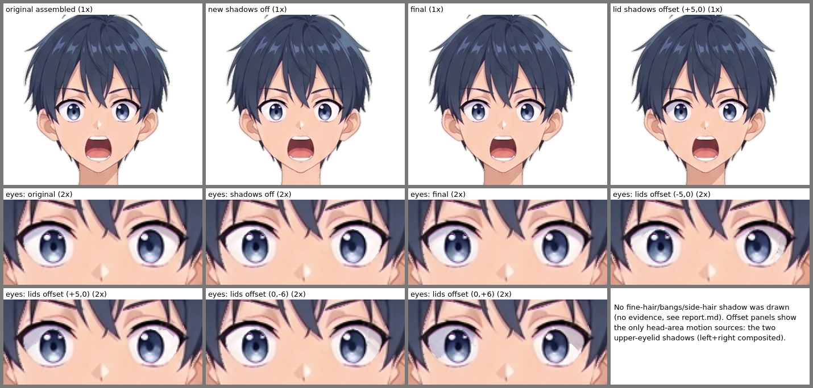
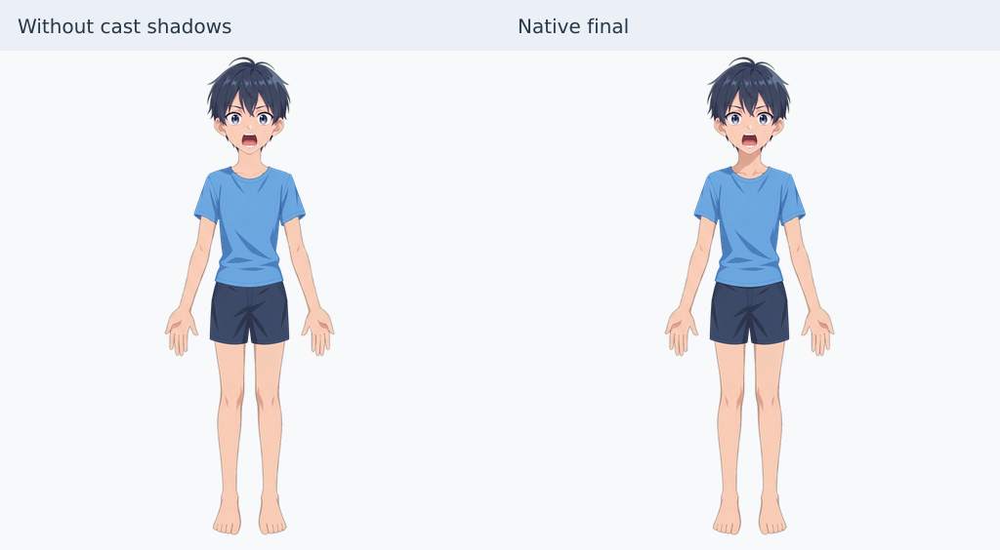
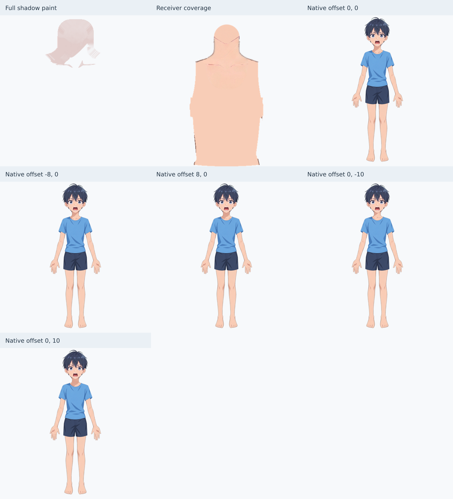
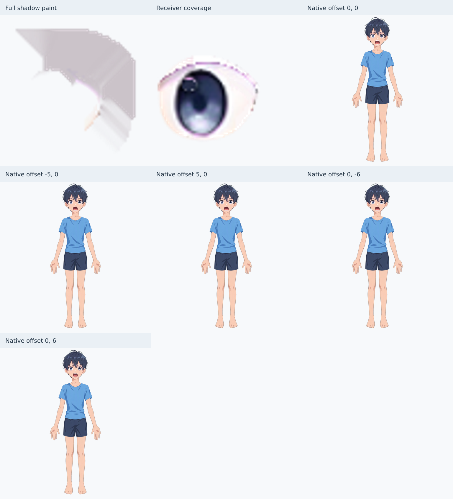
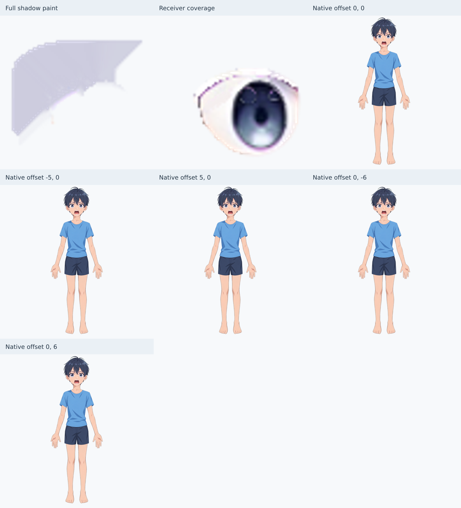
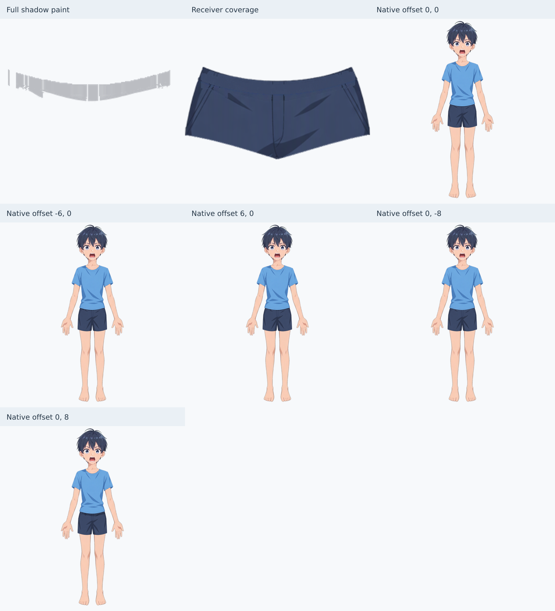

# 投影蒙版报告(clothed-man)

光源:参考图中光从右上来,投影落向左下。共做 4 处独立投影,`inspect_shadow_mask` 结果 passed=true,problems 与 warnings 均为空。

交付:`character-shadowed.kra`、`character-shadowed.png`、`shadows.json`(v2)、`face-review.png`、本报告。

`face-review.png` 依次为原始装配图、新投影全关、最终、偏移后。头部为 1:1,眼部为 2 倍最近邻放大,均未缩小。头发没有画投影,所以"细发偏移"一格用两处上眼睑投影的 ±5/±6 偏移代替,这是头部唯一的运动源。

## 脸部候选的处理

| 候选 | 结论 | 依据 |
|---|---|---|
| 刘海 → 额头/眉/眼 | 不画 | 额头肤色在发缘下 4–12 px 内都是平的(约 (251,208,187)),包括中间长发束下方也没有变暗带。眉旁和眉上的暖褐色带是部件自带的明暗,保留 |
| 侧发 → 太阳穴/脸颊/耳 | 不画 | 发缘旁的皮肤直到发缘都是均匀的。耳朵被侧发压住的位置没有变暗 |
| 外缘细发、卷发尖 | 不画 | 细尖在透明背景或头部轮廓上,背后没有接收投影的皮肤区域。外轮廓线不向内移动做影线 |
| 呆毛/后发 → 脖子 | 不画 | 后发在头和脖子后面。正面看,下巴投影以外没有可见的投影 |
| 耳 → 脸颊 | 不画 | 耳朵在脸部轮廓边缘,耳旁的脸颊是平的 |
| 嘴唇/嘴内 → 牙齿,鼻 → 脸,下眼睑 → 巩膜,眉 → 额头 | 不画 | 牙齿是均匀的白色,鼻子的高光和嘴内明暗是部件自带的。参考图没有这些的投射影 |

## 已画的 4 处投影

四处都是 `multiply`、`follow: caster`,各自单独成层,位于隔离组内,与裁切底层是同级。图层的 `inherit alpha` 为原生设置。

1. **下巴 → 脖子 + 身体**(`chin-to-neck-body`)
   - 投射源是 `face_base`,接收者是脖子和身体,二者共用一个联合裁切底层(组 "receivers: neck + body")。
   - 底色:脖子亮部 (249,204,180)、身体亮部 (248,205,183),参考投影色 (221,163,144) / (223,166,146)。投影层为 (226,205,203) 常色加 alpha。
   - 余量:约 14 px 的扩散余量,并延伸到脸下巴后面(被遮挡部分)。偏移 (±8,0)、(0,±10)。
   - 
2. **左上眼睑 → 眼**(`upper-eyelid-left-to-eye`,巩膜 + 虹膜,裁切到眼球组)
   - 巩膜上原有的烘焙睫毛影还原成亮白 (252,246,246) 后重做。投影色约 (203,195,201),参考巩膜影色 (198,186,192)。
   - 粉色影缘的像素回画成亮部底色,逐像素带阴影色,共 85 个,合成结果不变。
   - 虹膜上原来没有睑影,这次新增一道顶缘月牙(强度 0.7,约 4 px 深),跟随上眼睑而不是视线。虹膜自带明暗、眼线、高光未改动。
   - 余量:超出眼睑轮廓约 12 px(被眼睑和开口蒙版遮住)。偏移 (±5,0)、(0,±6)。
   - 
3. **右上眼睑 → 眼**(`upper-eyelid-right-to-eye`)
   - 做法同上。巩膜亮部 (246,240,240),投影色约 (205,204,223),参考影色 (198,192,210)。粉缘像素 48 个。余量 12 px。
   - 
4. **衬衫下摆 → 短裤**(`shirt-hem-to-shorts`)
   - 参考里下摆下面有 1–9 px 厚的烘焙暗带。这是原先"不画"的候选,实测后改为新增。
   - 从短裤前片还原出亮部 (60,73,104)(影色 (44,54,79)),重做成 ρ=(0.733,0.740,0.760) 的 `multiply` 层,常色约 (187,189,194)。
   - 接收者就是短裤前片 `130 shorts/waist_crotch::front`,同时作裁切底层,放在隔离组 "shadow group: shirt hem on shorts" 里。
   - 向上延伸 14 px 到衬衫下面(被遮挡部分),并向短裤轮廓外侧外推作运动余量。褶皱楔形和两侧深色面板属于短裤自带明暗,保留在原图里。偏移 (±6,0)、(0,±8)。
   - 

## 底色重画

| 位置 | 做法 |
|---|---|
| 脖子、身体 | 烘焙的下巴影按逐通道乘法逆运算还原为亮部皮肤 |
| 两眼巩膜 | 烘焙睑影还原为亮白,粉色影缘像素回画到亮部底色并带逐像素阴影色 |
| 虹膜 | 新增顶缘月牙,没有重画虹膜本身 |
| 短裤前片 | 还原下摆烘焙暗带,并把衬衫下面被遮住的暗像素也还原为亮部,避免偏移时重复变暗 |

合成与原图相比,除了虹膜新月和粉缘像素,其余最大差 ≤6 级;下摆区域最大差 1。

## 偏移检查(原尺寸)

- 脖子:偏移 ±8/±10 时,下巴一侧的投影边缘会露出还原后的亮肤色,右侧脖颈边和领口附近出现浅色细条和斑块。幅度小,可接受。
- 眼睛:偏移后的睑影下缘呈台阶状,并带一条浅色斜带。虹膜、高光和线稿没有变化,没有出现 alpha 增加。
- 下摆:偏移后的暗带呈块状,在接缝和楔形列处有竖切口。这是按列取厚度所致,属于表面粗糙。
- 所有偏移都没有出现裁切外新增 alpha。投影层落在接收者之外的余量像素数(outsideReceiverPixels)为下巴 4184、左眼 1140、右眼 997、下摆 42,这些像素被裁切,不显示。

## 保持不变的蒙版节点(UUID、归属、启用状态)

工具检查没有发现蒙版状态变化。已核对:

- 身体蒙版 `{2a7beaf8-bbb6-4bc6-b525-0ecc14b1bd4c}` 仍在身体下,启用。
- 骨盆蒙版 `{7676732b-7b44-491e-895d-d163233b397d}`、两条腿蒙版 `{500768d8-…}`、`{de389f87-…}` 未动。
- 两只眼的开口蒙版 `{6247cd1e-…}`、`{94e5062e-…}` 仍在眼内部组下,启用。

## 不适用项

脸部候选见上表。其余:

- 袖子 → 上臂:袖口下的手臂肤色是平的((245–251,201–207,180–188)),不画。
- 短裤口 → 大腿:裤口下第一行大腿肤色已是亮部 (248,206,184),不画。内侧大腿暗条属于腿部自带明暗。
- 领口 → 脖子/胸:领口边缘下没有暗带,胸口的锁骨痕迹是自带的。
- 衬衫/短裤的其余褶皱:属于布料自带的折痕明暗,不是部件之间的投影,保留。
- 衬衫 → 骨盆/身体、裤腿 → 腿:这些皮肤被衣服挡住,不可见。
