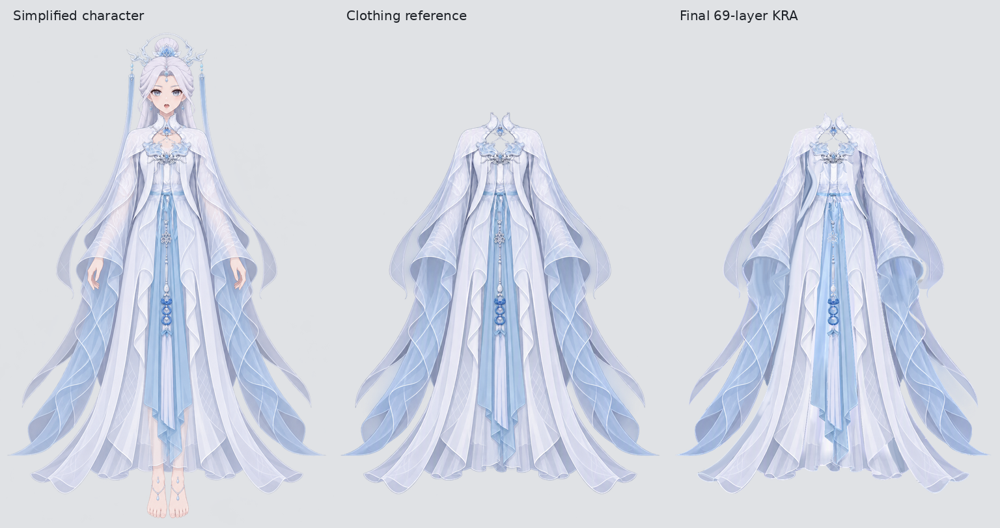

# 衣服工作流：关键工程与过程图片

`live-clothing-20261018` 于 **2026-10-19 22:03（北京时间）**完成。简化穿衣角色经原生 ImageGen 提取纯衣服，再经过分件、深度检查、逐件生图、Krita 拼装、边缘修画及两轮 review／修复，得到 **1024 × 1536、69 个普通绘画层**的衣服工程。

[最终 KRA](clothing-soft-edges.kra) · [透明合成 PNG](images/final-composite.png) · [step01 KRA](clothing-depth.kra) · [后续优化约定](NEXT.md)

对比图仅将三张原图等比缩小并排放到灰底。正式 PNG 和 KRA 保持原尺寸。

## 保留内容

本案例只提交 **2 个关键 KRA、14 张过程／结果图片及简要说明，约 34 MB**。LLM 请求、响应、会话日志、逐次推理与完整历史包保留在本地，不随本次 MR 提交或上传附件。

| 阶段 | 图片或工程 |
| --- | --- |
| 输入与 preparation | [简化穿衣角色](images/simplified-character.png)、[纯衣服参考](images/clothing-reference.png) |
| part 分件 | [最终 68 件色块合成图](images/part-preview.png) |
| 前襟生图示例 | [灰底输入](images/part-neutral-input.png)、[RGB 控制图](images/part-control.png)、[生成候选](images/part-generated.png)；候选还需后续配准和修画 |
| step01 拼装 | [分层工程](clothing-depth.kra)、[从该 KRA 提取的合成图](images/step01-composite.png) |
| 同一物件跨深度拆层 | [参考／拆层前／拆层后](images/depth-split-comparison.png)、[像素分界示意](images/depth-split-cutline.png) |
| step02 局部修画 | [左袖口与前襟接边](images/repair-left-cuff.png)、[右袖口](images/repair-right-cuff.png)、[尖纱](images/repair-gauze.png)，均为参考与修后对照 |
| 最终交付 | [边缘修画后 KRA](clothing-soft-edges.kra)、[透明合成 PNG](images/final-composite.png) |

色块图由最终 `preview.svg` 以原尺寸渲染；除整体并排预览和 KRA 合成导出外，其余图片直接取自本次运行产物。

## 实跑结论

工作流代码入口：[clothing-part-layering](../../workflow-next/clothing-part-layering/README.md)、[clothing-raster-layering](../../workflow-next/clothing-raster-layering/README.md)。两者独立持有复制的调度代码。分件使用 `gpt-6.1-sol / xhigh`，栅格绘制与 reviewer 使用 `gpt-6-astra / xhigh`；生图工具、provider 和鉴权由外部 Codex 提供。

最终分组树为 5 层、93 节点、68 个逻辑 part。part 的最终深度检查曾两次由外部局部重开悬绳分组，原流程再制作前后片。raster step01 又将同一前襟拆为腰带前后两个绘画层，得到 69 层；两片保持共同逻辑归属和运动关系。这次拆层由绘制 agent 自行设计并执行。

step01 与 step02 均已由调度器完成。第二轮提出的 10 项问题交给原绘制 thread 修复，最终修复报告为“已修复”，没有第三轮 reviewer。保存并重开后核对了层名、层序、逐层像素及合成投影；69 层均为普通绘画层，无蒙版、无子节点。最终 PNG 与 KRA 合成投影一致。

本次实跑使用了外部恢复、已确认的跨深度拆层例外、按参考修正不准确色块的交接，以及专用 Codex 的临时图片计数压缩补丁。通用工作流尚未自动化这些处理，不能把本案例完成等同于无人干预验收。隐藏背面缺少直接参考、细微笔触仍可能有差异；后续视觉问题可据关键工程溯源。

最终 KRA SHA-256：`05ed07bc81c07c428c9326152ad02dc2f5de1ccfedb97fec4f9951a55c110fb0`。最终 PNG SHA-256：`7dc65e18ecee99e90847cea518aaac8bb0a336c2a1818cd6fd2af3ba8386fd01`。
