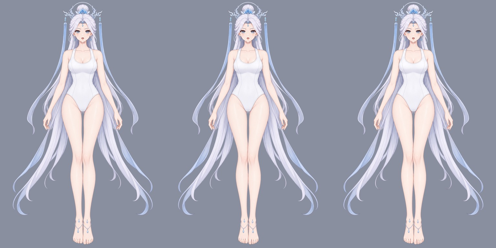

# gpt-image-2.5 → Krita：按深度表的 90 部件拆分与补全

以 [`part-layering/.run/test`](../../workflow-next/part-layering/.run/test/) 的完整色块分层为标准，
依据其新版深度信息 `occlusion.json`（v2，`layers[]` 由后到前，level 0–89）逐部件生成 RGB 控制图，
调用本地 `forgeax-imagegen`（`gpt-image-2.5-flare`，少数为 `-sunburst`）做部件提取与遮挡补全，
再由 Python 配准回原画布并导入 Krita 5.3.4.1。

- [可编辑 Krita 文件](character-depth.kra)：90 个绘画层按 level 由下到上排列，图层名 `"<level> <部件 ID>"`
- [原图 / 原姿势 / 完整补全叠放 对照](compare-reference-pose-depth.jpg)
- [Krita 重开导出：原姿势](krita-reopened-pose.png) · [Krita 重开导出：关闭蒙版的深度叠放](krita-reopened-depth-stack.png)
- 完整部件总览 [1](contact-full-1.jpg) · [2](contact-full-2.jpg) · [3](contact-full-3.jpg) · [4](contact-full-4.jpg)



## 控制图与提示词

像素归属：按深度由后到前绘制各部件完整 SVG，最前方覆盖者拥有该像素；SVG 未覆盖的原图半透明边缘
归最近部件。每个部件的控制图：

- 红：该部件可见主体（原图像素，必须保留）
- 黄：被上层覆盖、需要补全的部分（完整 SVG − 可见）
- 绿：部件外，输出透明

gpt-image-2.5 不保持构图比例，因此每个部件以 1.35 倍外框裁切、放大到 1024×1536 / 1536×1024 / 1024×1024；
图 1 的部件外区域预先涂绿，避免模型把相邻部件一起提取。提示词沿用"请根据图2的 RGB 控制图，对图1进行
部件提取和遮挡补全……"模板，附部件说明、上层遮挡物列表及少量部件专用规则（脸底、头发底、眼白、虹膜、牙齿等）。
每个部件实际使用的提示词与控制图见 `parts/<部件 ID>/prompt.txt`、`control.png`。

被内容审核拒绝的部件改用中性措辞重试：`body/breast`（sunburst）、`arms/arm_right/upper_arm`；
三根手指改为以整只手为上下文生成。

## 重组

`scripts/assemble_depth.py` 对每个返回图在 裁切放置 / 外框拟合 / SIFT 相似变换 之上叠加
形状 ECC（模型 alpha 对标准完整蒙版）与内容 ECC（可见像素），按可见像素误差、覆盖率与 IoU 选最优配准。随后：

- 部件 alpha 严格等于标准完整蒙版；可见像素为原图像素；隐藏区为模型补全，加低频色差校正；
- 蒙版内模型未覆盖的空洞用 push-pull 平滑填充；
- 皮肤部件（颈、手臂、手指、腿、脚）隐藏区由本部件可见皮肤平滑延展，仅保留微弱模型明暗，
  防止模型把脚链、泳衣边等遮挡物画进皮肤层；与标准形状严重不符的返回（如右手中指画成直指）不予采用。

每层带透明蒙版 **「原姿势遮挡 · 关闭以显示完整补全」**：开启时与原图逐像素一致，关闭即可检查补全。

## 验证（[validation.json](validation.json)、[krita-import.json](krita-import.json)、[krita-comparison.json](krita-comparison.json)）

| 检查 | 结果 |
| --- | --- |
| Krita 重开导出（原姿势）vs 原图 | RGB 与 alpha 最大差 0，PSNR 138 dB |
| Krita 重开 90 层像素哈希、层序 | 全部一致，层序等于 occlusion level |
| 关闭蒙版深度叠放 vs 原图 | PSNR 44.5 dB，99.3% 像素不变；差异来自补全部件超出原轮廓的边缘 |
| 关闭蒙版深度叠放：Krita vs Python | PSNR 86 dB，RGB 最大差 1 |

## 已知局限

- 双脚图层上的脚链线条是标准蒙版归给脚的原图可见像素，并非模型画入。
- 眼睑、高光、牙齿、耳坠链等极小部件只有个位数到几十像素，补全较粗；它们几乎全部可见，对画面影响很小。
- 隐藏区质量依赖模型；本目录不对所有补全做"无瑕"认证。

## 复现

```bash
pip install -r scripts/requirements.txt
python scripts/prepare_depth.py                       # .work/：控制图、裁切、提示词、commands.nul
xargs -0 -P 4 -I{} sh -c '{}' < .work/commands.nul    # forgeax-imagegen，每个约 90 s
python scripts/assemble_depth.py                      # 写入本目录 parts/ 与验证文件
TMPDIR=<私有临时目录> ASTRA_QUIT=1 python scripts/launch_krita.py \
  --krita <Krita AppRun> --output . --display :119    # 需独立 Xvfb 显示
```

模型原始返回图未入库（位于工作目录 `.work/parts/*/generated.png`），各部件的生成哈希记录在 [manifest.json](manifest.json)。
