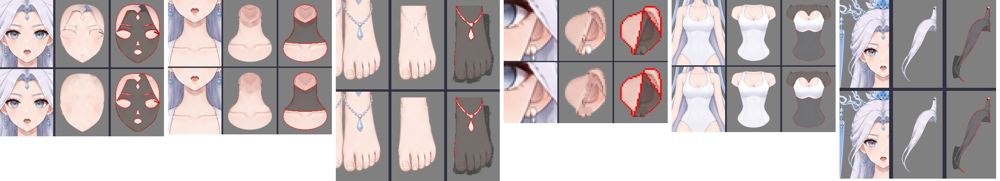

# gpt-image-2.5 → Krita：按深度表的 90 部件拆分与补全

以 [`part-layering/.run/test`](../../workflow-next/part-layering/.run/test/) 的完整色块分层为标准，
依据其新版深度信息 `occlusion.json`（v2，`layers[]` 由后到前，level 0–89）逐部件生成 RGB 控制图，
调用本地 `forgeax-imagegen`（`gpt-image-2.5-flare`，少数为 `-sunburst`）做部件提取与遮挡补全，
再由 Python 配准回原画布并导入 Krita 5.3.4.1。

- [可编辑 Krita 文件](character-depth.kra)：90 个完整部件绘画层按 level 由下到上排列，图层名 `"<level> <部件 ID>"`，无蒙版
- [原图与 Krita 叠放对照](compare-reference-krita.jpg) · [Krita 重开导出 PNG](krita-reopened.png)
- [原姿势逐像素还原 PNG](reassembled-pose.png)（Python 按 `pose-mask.png` 合成，用于校验）
- 完整部件总览 [1](contact-full-1.jpg) · [2](contact-full-2.jpg) · [3](contact-full-3.jpg) · [4](contact-full-4.jpg)


## 控制图与提示词

像素归属：按深度由后到前绘制各部件完整 SVG，最前方覆盖者拥有该像素；SVG 未覆盖的原图半透明边缘
归最近部件。每个部件的控制图：

- 红：该部件可见主体（原图像素，必须保留）
- 黄：被上层覆盖、需要补全的部分（完整 SVG − 可见）
- 绿：部件外，输出透明

gpt-image-2.5 不保持构图比例，因此每个部件以 1.35 倍外框裁切、放大到 1024×1536 / 1536×1024 / 1024×1024；
图 1 的部件外区域预先涂绿，避免模型把相邻部件一起提取。提示词沿用"请根据图2的 RGB 控制图，对图1进行
部件提取和遮挡补全……"模板，附部件说明、上层遮挡物列表及少量部件专用规则（脸底、头发底、眼白、虹膜、牙齿等）。
每个部件实际使用的提示词与控制图见 `parts/<部件 ID>/prompt.txt`、`control.png`。

被内容审核拒绝的部件改用中性措辞重试：`body/breast`（sunburst）、`arms/arm_right/upper_arm`。

### 第二轮：只重生有问题的部件（提示词模板修订）

第一轮生成后逐部件检查，生成结果整体可用的保留，有问题的修改提示词后重新生成；**生成失败的部件一律重生，从不用原图像素冒充补全**。
本轮的目标不是禁止重绘，而是避免生成风格截然不同、细节过多的怪异部件（例如写实厚涂的耳朵、多切面宝石、金色光晕）。
`prepare_depth.py` 的通用模板因此改为：

> 画风必须与图1一致：柔和、浅淡、低对比的日系动漫上色，线条细软，细节很少。补全部分是被遮住的同一部件的自然延续，
> 看起来要像同一位画师在同一张图里画的；不要写实、厚涂或高细节风格，不要加入图1没有的纹理、硬高光、宝石切面、发光、金色或其它新颜色。

并为问题部件补充专用说明（耳朵按外耳轮/内耳/耳垂结构补画且去掉发丝；虹膜保持动漫画法、顶部补深蓝；
牙齿为简单米白带；连接件为浅银白金属；后发两缕沿发丝补淡紫白；脖子不画下巴阴影线；脚去掉脚链；口腔为简单深粉色块）。

重新生成的 20 个部件（`scripts/regen.py`，结果为 `generated-v2.png`，所用提示词见各部件 `prompt.txt`）：
后发 `lock_right/lock_left`、`neck`、`legs/leg_left/foot`、双耳、耳钉 `left_earring/ear_stud`、右眼白、双虹膜、
`mouth_interior`、`upper_teeth`、额饰宝石托、四个冠饰连接件，以及三根手指（`arm_right` 食指、中指，`arm_left` 中指）。
`arm_left/hand/middle_finger` 的手指提示词多次被内容审核拒绝，最终把两张输入图旋转 90° 并改用温和措辞
（"全年龄动漫角色立绘的图层整理任务……"）后由 flare 生成成功，输出再旋转回原方向
（记录在 manifest `generation` 字段）。

## 重组：可见像素叠加到补全上

`scripts/assemble_depth.py` 对每个返回图在 裁切放置 / 外框拟合 / SIFT 相似变换 之上叠加
形状 ECC（模型 alpha 对标准完整蒙版）与内容 ECC（可见像素），按可见像素误差、覆盖率与 IoU 选最优配准。随后：

- 部件 alpha 严格等于标准完整蒙版；隐藏区为模型补全（低频色差校正，模型未覆盖的空洞用 push-pull 平滑填充）；
- **可见区域的原图像素叠加在模型补全之上**，得到"可见 = 原图、隐藏 = 生成"的完整部件；叠加前的补全保留为每个部件的 `model.png`。
  不再对皮肤部件做"用可见皮肤平滑延展"的替代处理，隐藏区一律来自生成结果。

## Krita 修补补全区（[retouch/](retouch/)）

叠加后，可见与补全的交界处常有两类问题：可见像素里带着**前方遮挡物的轮廓线/抗锯齿**（色块形状把轮廓放在前方部件外侧），
叠到补全旁边就成了断线或鬼影；以及补全本身的瑕疵。修补全部用 Krita 5.3 画笔在 KRA 上完成（`scripts/krita_retouch.py`，
`paintLine` 硬圆笔，图层锁 alpha，选区 = 修补蒙版），共 47 个部件、11534 笔：

- **遮挡物轮廓带**（`scripts/plan_retouch_v2.py`）：只考虑紧贴"被**前方**部件覆盖的隐藏区"4 px 内的可见像素；若其颜色明显偏离模型补全
  （通道差 > 40 或暗 22 以上）且更接近遮挡物一侧的颜色，就判为遮挡物轮廓，用模型补全的平滑颜色场重画，使部件成为连续整体。
  部件自身外轮廓（旁边是背景或后方部件）不动；最外 2 px 轮廓保留。共 6976 px。
- **手工指定的瑕疵**（[retouch/flaws.json](retouch/flaws.json)）：`face_base` 上归属残留的眼眶线、睫毛与发缝楔形 → 连续脸部肤色（保留腮红）；
  `neck` 顶部的硬 V 形下巴线 → 皮肤（保留柔和下巴阴影）；双脚残留的脚链 → 肤色；双耳里的发丝 → 耳廓肤色。
- 校验（`scripts/apply_retouch_v2.py`）：每层 alpha 不变、所有改动都在选区内；KRA 保存后重开，层序与像素哈希一致。
- **轮廓移交**（`scripts/transfer_outlines.py`）：被重画的遮挡物轮廓像素原本属于画面，若直接丢掉，前方部件会失去描边。
  因此把这些像素（距前方部件 ≤ 12 px）以原图颜色移交给最近的前方部件：77 个部件共接收 9422 px（manifest `outlineReceived` / `outlineTransfer`）。
  **这是与色块图的小偏差**：接收部件的形状比色块区域向外多出约 1–4 px 的轮廓带。
- 修前/修后对比见 [retouch/before-after/](retouch/before-after/)（上：修前，下：修后；第三列红框为选区），
  关键部件汇总见 [retouch/key-before-after.jpg](retouch/key-before-after.jpg)。



## 验证（[validation.json](validation.json)、[krita-import.json](krita-import.json)、[retouch/krita-retouch.json](retouch/krita-retouch.json)）

| 检查 | 结果 |
| --- | --- |
| Krita 重开 90 层像素哈希、层序 | 全部一致，层序等于 occlusion level，层下无子节点 |
| 深度叠放（= Krita 重开导出）vs 原图 | PSNR 48.0 dB，99.6% 像素不变；Krita 导出与 Python 叠放 RGB 最大差 1 |
| 原姿势合成（pose-mask）vs 原图 | PSNR 55.4 dB，99.96% 像素不变，alpha 一致 |

剩余差异来自补全部件超出原轮廓的边缘，以及被重画后未移交（离前方部件较远）的少量像素。整体观感已逐区与原图比对（脸、身体、发梢、腿部开口）。

## 已知局限

- 轮廓移交使前方部件比色块图多出 1–4 px 的轮廓带；需要严格色块形状时，可按 manifest `outlineReceived` 记录剔除。
- 眼睑、高光、牙齿、耳坠链等极小部件只有个位数到几十像素，补全较粗；它们几乎全部可见，对画面影响很小。
- 隐藏区质量依赖模型；Krita 修补只处理交界轮廓带与逐部件检查中发现的问题，本目录不对所有补全做"无瑕"认证。

## 复现

脚本按工作目录布局运行（`work/` 中间文件、`delivery-v2/` 交付、`retouch-v2/` 修补），本目录内容即 `delivery-v2/` 与 `retouch-v2/` 的入库部分。

```bash
pip install -r scripts/requirements.txt
python scripts/prepare_depth.py                       # work/：控制图、裁切、提示词、commands.nul
xargs -0 -P 4 -I{} sh -c '{}' < work/commands.nul     # forgeax-imagegen 第一轮
python scripts/regen.py <部件 ID...>                  # 问题部件用修订后的提示词重生
python scripts/assemble_depth.py --output delivery-v2 # 配准、补洞、叠加可见像素
K="--krita <Krita AppRun> --display :119"            # 需独立 Xvfb 显示；TMPDIR 用私有目录，ASTRA_QUIT=1
python scripts/launch_krita.py $K --output delivery-v2 --script scripts/krita_depth_import.py
mkdir -p retouch-v2/before && cp -r delivery-v2/parts retouch-v2/before/
python scripts/plan_retouch_v2.py                     # 轮廓带 + flaws.json → 选区与笔触
python scripts/preview_retouch_v2.py                  # 可选：修补前模拟预览
ASTRA_RETOUCH_NAME=retouch-v2 ASTRA_DELIVERY_NAME=delivery-v2 \
  python scripts/launch_krita.py $K --output . --script scripts/krita_retouch.py
python scripts/apply_retouch_v2.py                    # 校验并写回 parts/
python scripts/transfer_outlines.py                   # 轮廓像素移交给前方部件
python scripts/launch_krita.py $K --output delivery-v2 --script scripts/krita_depth_import.py   # 最终 KRA
```

模型原始返回图未入库（位于工作目录 `work/parts/*/generated.png`、`generated-v2.png`），各部件的生成哈希记录在 [manifest.json](manifest.json)。
