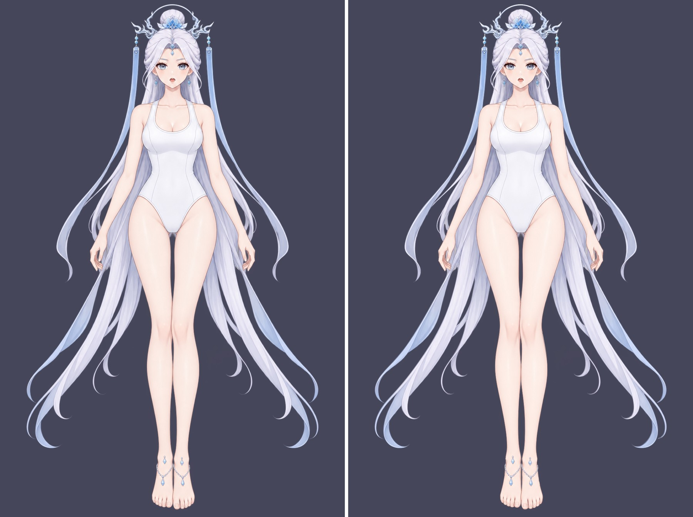

# gpt-image-2.5 → Krita：按深度表的 90 部件拆分与补全

以 [`part-layering/.run/test`](../../workflow-next/part-layering/.run/test/) 的完整色块分层为标准，
依据其新版深度信息 `occlusion.json`（v2，`layers[]` 由后到前，level 0–89）逐部件生成 RGB 控制图，
调用本地 `forgeax-imagegen`（`gpt-image-2.5-flare`，少数为 `-sunburst`）做部件提取与遮挡补全，
再由 Python 配准回原画布并导入 Krita 5.3.4.1。

- [可编辑 Krita 文件](character-depth.kra)：90 个完整部件绘画层按 level 由下到上排列，图层名 `"<level> <部件 ID>"`，无蒙版
- [原图与 Krita 叠放对照](compare-reference-krita.jpg) · [Krita 重开导出 PNG](krita-reopened.png)
- [原姿势逐像素还原 PNG](reassembled-pose.png)（Python 按 `pose-mask.png` 合成，用于校验）
- 完整部件总览 [1](contact-full-1.jpg) · [2](contact-full-2.jpg) · [3](contact-full-3.jpg) · [4](contact-full-4.jpg)



## 控制图与提示词

像素归属：按深度由后到前绘制各部件完整 SVG，最前方覆盖者拥有该像素；SVG 未覆盖的原图半透明边缘
归最近部件。每个部件的控制图：

- 红：该部件可见主体（原图像素，必须保留）
- 黄：被上层覆盖、需要补全的部分（完整 SVG − 可见）
- 绿：部件外，输出透明

gpt-image-2.5 不保持构图比例，因此每个部件以 1.35 倍外框裁切、放大到 1024×1536 / 1536×1024 / 1024×1024；
图 1 的部件外区域预先涂绿，避免模型把相邻部件一起提取。提示词沿用"请根据图2的 RGB 控制图，对图1进行
部件提取和遮挡补全……"模板，附部件说明、上层遮挡物列表及少量部件专用规则（脸底、头发底、眼白、虹膜、牙齿等）。
每个部件实际使用的提示词与控制图见 `parts/<部件 ID>/prompt.txt`、`control.png`。

被内容审核拒绝的部件改用中性措辞重试：`body/breast`（sunburst）、`arms/arm_right/upper_arm`；
三根手指改为以整只手为上下文生成。

## 重组

`scripts/assemble_depth.py` 对每个返回图在 裁切放置 / 外框拟合 / SIFT 相似变换 之上叠加
形状 ECC（模型 alpha 对标准完整蒙版）与内容 ECC（可见像素），按可见像素误差、覆盖率与 IoU 选最优配准。随后：

- 部件 alpha 严格等于标准完整蒙版；可见像素为原图像素；隐藏区为模型补全，加低频色差校正；
- 蒙版内模型未覆盖的空洞用 push-pull 平滑填充；
- 皮肤部件（颈、手臂、手指、腿、脚）隐藏区由本部件可见皮肤平滑延展，仅保留微弱模型明暗，
  防止模型把脚链、泳衣边等遮挡物画进皮肤层；与标准形状严重不符的返回（如右手中指画成直指）不予采用。

## Krita 文件

每层就是一个完整部件（含遮挡补全），不带透明蒙版：隐藏任一前层即可直接看到其后部件的补全内容，
可直接用于后续绑定、动作和换装。按深度叠放已与原图高度一致（99.3% 像素不变）；
需要逐像素还原原姿势时，使用各部件目录中的 `pose-mask.png`（可见像素为原图 alpha / 完整 alpha，其余为 0），
`reassembled-pose.png` 即按此合成的结果。

## 逐部件修瑕（Krita 画笔，[retouch/](retouch/)）

补全完成后不看整图，而是逐个检查 90 个部件（`scripts/review_parts.py` 总览、`scripts/zoom_parts.py` 放大，
可见/隐藏区分开着色），找出三类瑕疵：别的部件残留、崩坏的颜色、与色块图不符的形状。21 个部件在 Krita 里用画笔修补：

- **选区 = 瑕疵蒙版**，且总是落在该部件的**隐藏（补全）区**内（[retouch/plan/](retouch/plan/)`*/selection.png`），
  图层同时锁定 alpha：原图可见像素与部件形状都不会被改动。
- 颜色取自该部件自己的干净像素（push-pull 平滑场）；遮挡物边缘带阴影的可见像素不参与取色，
  避免把遮挡物轮廓重新描回补全区。头发沿局部发丝方向（结构张量）运笔并叠细发丝纹理，其余用硬笔点涂；
  牙齿取最亮的可见牙色。全部 2961 笔用 Krita 5.3 的 `paintLine` 在 KRA 上直接绘制（`scripts/krita_retouch.py`）。
- 每个部件的瑕疵说明见 [retouch/flaws.json](retouch/flaws.json) 与 manifest 中的 `retouch` 字段；
  修前/修后放大对比见 [retouch/before-after/](retouch/before-after/)。

| 部件 | 问题 → 修补 |
| --- | --- |
| 后发两缕 `lock_right/lock_left` | 中段黄/粉色带 → 顺发丝补成淡紫白发色 |
| 颈部 `neck` | 脸下的下巴阴影（心形/V）与躯干下重复的锁骨 V → 平滑肤色 |
| 双脚 `foot` | 脚链下的鬼影线和过亮皮肤 → 周围肤色 |
| 双耳 `ear_left/right` | 画进耳朵的发丝 → 耳廓肤色 |
| 眼白、虹膜 | 眼白中心的虹膜边线/高光点 → 眼白；虹膜顶部的眼睑棕 → 虹膜顶端深蓝 |
| 上/下牙 | 唇红、暗粉 → 米白牙色 |
| 耳钉、额饰托、冠饰链接件（6 个） | 金黄/肤色/宝石残留 → 银色金属 |
| 右侧发 `side_hair_right` | 尖端的深蓝宝石斑 → 发色 |

检查后保留未改（`retouchReview` 字段）：`face_base` 上的眼眶/睫毛线与发缝楔形、双脚上残留的淡脚链阴影都是
色块标准归给该部件的**原图可见像素**（归属残留），修瑕只动补全区，不改原图像素；`hair_cap`、`crown_frame`、
两上臂的补全区经放大确认无需处理。

修瑕验证（`scripts/apply_retouch.py`，[retouch/krita-retouch.json](retouch/krita-retouch.json)）：21 个图层 alpha 与修前完全一致、
可见像素等于原图、所有改动都在选区内；其余 69 层哈希不变；KRA 保存后重开，层序、像素哈希一致，无子节点、无 alpha 锁。

## 验证（[validation.json](validation.json)、[krita-import.json](krita-import.json)、[krita-comparison.json](krita-comparison.json)）

| 检查 | 结果 |
| --- | --- |
| Krita 重开 90 层像素哈希、层序 | 全部一致，层序等于 occlusion level，层下无子节点 |
| Krita 重开导出 vs 原图 | PSNR 44.5 dB，99.3% 像素不变；差异来自补全部件超出原轮廓的边缘 |
| Krita 重开导出 vs Python 深度叠放 | PSNR 86 dB，RGB 最大差 1，alpha 一致 |
| 原姿势合成（pose-mask）vs 原图 | RGB 与 alpha 最大差 0 |

## 已知局限

- 双脚图层上的淡脚链阴影是标准蒙版归给脚的原图可见像素，并非模型画入；修瑕已去除补全区内的鬼影线。
- 眼睑、高光、牙齿、耳坠链等极小部件只有个位数到几十像素，补全较粗；它们几乎全部可见，对画面影响很小。
- 隐藏区质量依赖模型，修瑕只处理逐部件检查中发现的问题；本目录不对所有补全做"无瑕"认证。

## 复现

```bash
pip install -r scripts/requirements.txt
python scripts/prepare_depth.py                       # .work/：控制图、裁切、提示词、commands.nul
xargs -0 -P 4 -I{} sh -c '{}' < .work/commands.nul    # forgeax-imagegen，每个约 90 s
python scripts/assemble_depth.py                      # 写入本目录 parts/ 与验证文件
TMPDIR=<私有临时目录> ASTRA_QUIT=1 python scripts/launch_krita.py \
  --krita <Krita AppRun> --output . --display :119    # 需独立 Xvfb 显示
# 修瑕（plan_retouch.py 需读取修瑕前的部件：retouch/before/parts，或 assemble_depth.py 的原始输出）
python scripts/plan_retouch.py                        # 瑕疵选区与笔触计划
TMPDIR=<私有临时目录> ASTRA_QUIT=1 python scripts/launch_krita.py \
  --krita <Krita AppRun> --output . --display :119 --script scripts/krita_retouch.py
python scripts/apply_retouch.py                       # 校验并写回 parts/、合成图与验证文件（只运行一次）
```

模型原始返回图未入库（位于工作目录 `.work/parts/*/generated.png`），各部件的生成哈希记录在 [manifest.json](manifest.json)。
