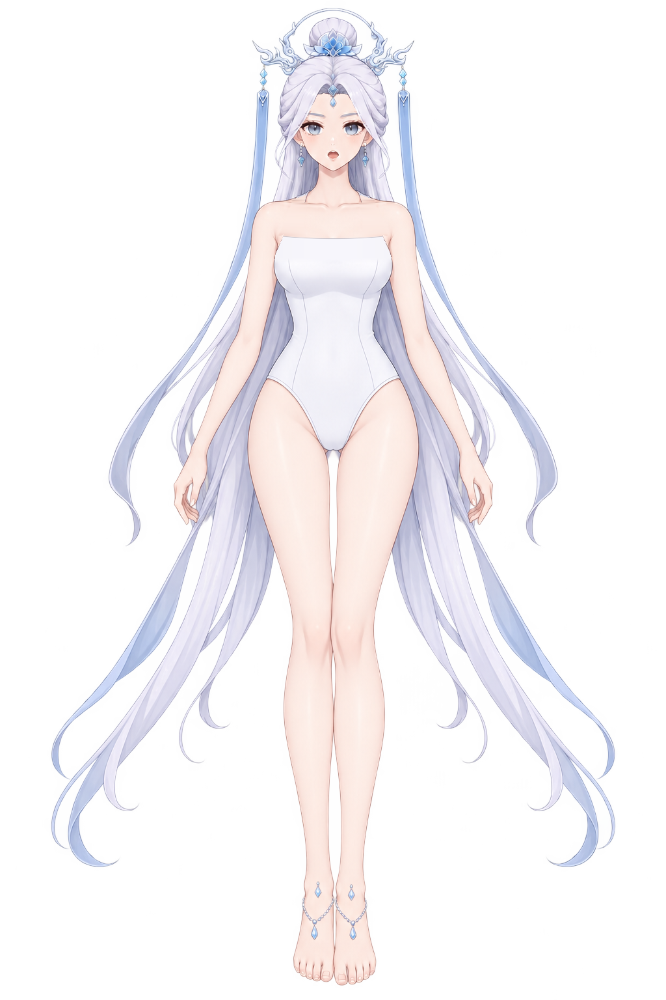
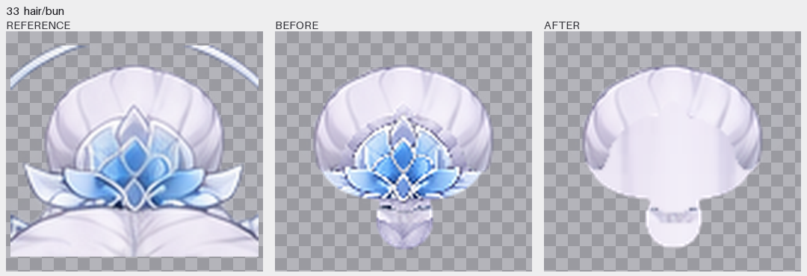
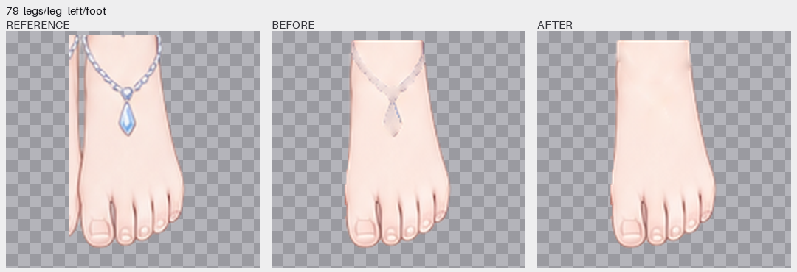

# 角色拆分、Krita 精修与露肩换装底图

当前交付为**露肩换装底图**：肩带区域已补成肤色，胸前、躯干和裆部保留不透明白色遮挡。
下方完整图、默认下载和预览入口均对应这次修整后的版本，原版拆分资料保留在后文。

本目录保留历史处理结果，存在已知的隐藏补全瑕疵：例如耳朵在后处理中被整片颜色延展和平滑，上缘轮廓与折线因此受损。`before-retouch.png` 是已配准的修前部件，并非模型原始返回图；本目录没有保留耳朵的原始生图，不能据最终 PNG 反推模型原始效果。重组相似度和原生文件检查也不代表完整部件的隐藏结构合格。

- [下载最新可编辑 Krita 文件](covered-shoulders/character.kra)
- [最新透明 PNG](covered-shoulders/reassembled.png) · [最新 Krita 重开导出 PNG](covered-shoulders/krita-reopened.png)
- [最新交互图层预览](covered-shoulders/index.html)
- [肩部修改前后对照](covered-shoulders/shoulder-comparison.png)（左为原版，右为最新版本）
- [本轮修整说明与验证](covered-shoulders/README.md)

## 原版拆分资料

按 [`part-layering/.run/test`](../../workflow-next/part-layering/.run/test/) 的完整色块标准，
将参考角色拆成 **90 个透明部件、25 个分组**，保持原有 115 节点层级和 1024 × 1536 坐标。
所有部件均调用本地已配置的 `forgeax-imagegen`，使用 `gpt-image-2.5-flare` 或
`gpt-image-2.5-sunburst` 提取、补全，再通过 Python 配准、清理并导入 Krita。

- [原版可编辑 Krita 文件](character.kra) · [原版 Krita 打开画面](krita-workspace.jpg)
- [原图与原版重组对照](comparison.jpg)
- [原版 90 个部件逐项精修对照](part-review/index.html)
- [原版透明重组 PNG](reassembled.png) · [原版 Krita 重开导出 PNG](krita-reopened.png)
- [原版交互检查页](index.html)：部件搜索、图层显隐、完整部件独显、RGB 控制图、原图对比滑杆
- [原版完整部件总览 1](contact-full-1.jpg) · [2](contact-full-2.jpg) · [3](contact-full-3.jpg) · [4](contact-full-4.jpg)

## 在 Krita 中编辑

打开 `covered-shoulders/character.kra` 即可编辑最新露肩版本；根目录的 `character.kra` 保留原版。
每个部件是独立绘画层，像素中包含遮挡补全。
该层下的原生透明蒙版名为 **「原姿势遮挡 · 关闭以显示完整补全」**：关闭蒙版、独显该部件，
即可检查被头发、饰品或邻接部件覆盖的区域。移动部件时，可按需要关闭或编辑蒙版。

90 个绘画层共同形成画面；文档没有额外的整张原图覆盖层。细小部件在原图中只有少量像素，
总览和独显页会将它们放大显示；最终 PNG 保持原始画布坐标。

## 原版逐部件精修记录

逐项检查 90 个完整部件后，对 **31 个图层**进行了局部像素修整或归层／蒙版调整。
主要处理发髻里重复的莲花饰件、眼白里的虹膜和眼线残影、耳部的邻接细节、头发里的肤色条、
脚部的脚链和坠饰残影，以及部分隐藏关节补全的深色硬边。饰品和五官仍保留在各自图层。

Python 计算选定区域的局部克隆、平滑和像素归属；Krita 打开既有文档，使用原生图层像素与
透明蒙版接口写回这些局部修改，再保存、重开验证。该轮没有重新生图，也没有用整图覆盖修整结果。
具体范围与理由见 [retouch-plan.json](retouch-plan.json)，原生写回记录见
[krita-retouch.json](krita-retouch.json)。

逐部件对照同时列出该轮保留的部件，方便继续做美术审查。小部件按原始像素放大显示；
这些对照与修整记录不等于“所有部件已达到无瑕成稿”的自动认证。

## 部件文件与生成控制

原版位于 `parts/<原部件 ID>/`，最新版位于 `covered-shoulders/parts/<原部件 ID>/`。
两个版本各自保留以下文件，修整蒙版与修前图对应各自的修改批次：

| 文件 | 内容 |
| --- | --- |
| `full.png` | 提取并补全后的透明部件，与原图共用坐标 |
| `visible.png` | 原姿势可见部分，可独立重组成最终角色 |
| `pose-mask.png` | 控制原姿势遮挡的可逆透明蒙版 |
| `control.png` | RGB 控制图：红色保留、黄色补全、绿色排除 |
| `prompt.txt` | 该部件实际采用的完整生图提示词 |
| `before-retouch.png` | 本轮调整前的完整部件，仅受影响图层提供 |
| `retouch-mask.png` | 本轮实际修改像素的位置；归层调整另见透明蒙版 |

生成时将参考图和控制图以相同窗口裁切、局部放大，便于模型处理小部件。生成结果按标准轮廓
校正比例、位置及形状，可见区域优先保留原图像素。皮肤和纯色布料的隐藏区域经过源图引导的
清理，修正误生的邻接细节；脸底去除五官和发饰边缘残影，使皮肤连续。具体模型、裁切、配准
和输出哈希见 [manifest.json](manifest.json)。历史案例脚本及复现说明见
[scripts/README.md](scripts/README.md)。
`control.png` 与 `prompt.txt` 保留原始生图输入；后续精修范围单独记录，不反改生图过程记录。

## 原版验证结果

[validation.json](validation.json) 记录原版拆分与逐部件精修的检查；最新露肩版本的检查见
[covered-shoulders/validation.json](covered-shoulders/validation.json)。以下相似度数字仅适用于原版：

- 90 个透明 PNG、90 个 Krita 绘画层、90 个原生透明蒙版、25 个分组。
- 通过 Krita 5.3.4.1 保存并重开，逐一读取 90 个完整图层，像素缓冲全部与交付 PNG 一致。
- Krita 重开导出与独立部件重组的 RGBA 差异为 **0**。
- 修整后原图与重组的 RGB PSNR 为 **50.05 dB**；以全画布计，**99.7929%** 的 RGB 像素不变。
- 3257 个修整像素限于脸底边缘和明确记录的脚部饰品边缘选区；原图 alpha 保持一致。
- 原图 547267 个非透明像素全部分配至部件，未分配像素为 0。

这些相似度指标衡量原姿势的重组；遮挡区域没有可直接比对的原始像素，其轮廓由色块标准约束。
交付范围是可编辑拆分、补全及原姿势重组，不包含 Live2D 绑定或动画。

交互检查页需要通过静态 HTTP 服务访问，GitHub 文件页仅显示 HTML 源码。
例如在本目录运行 `python3 -m http.server 8037`，然后打开 `http://localhost:8037/`。

参考输入 SHA-256：`d5ca0b2fcf5c8cd42a88b819ee13d7b342b87cf5ce0b7b0e1dc0347f9555f194`。
