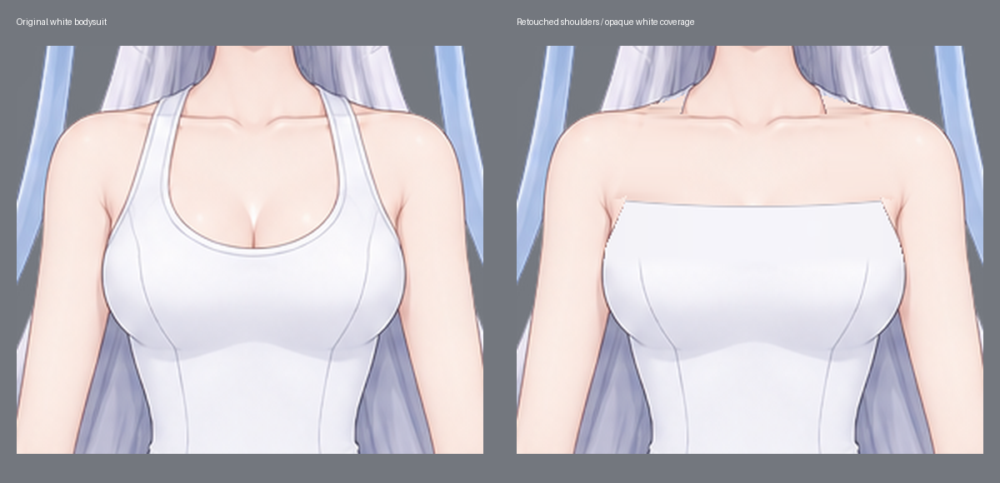

# 露肩换装底图 · 保留白色遮挡

基于[上一版 90 部件精修文件](../README.md)，将两侧肩带覆盖的位置补成邻近皮肤的颜色和明暗，
把白色衣料整理成连续的无肩带上缘。胸前、躯干和裆部保留不透明白色连体遮挡。
这份文件用于后续服装叠加，不包含去除敏感部位遮挡的版本。

- [可编辑 Krita 文件](character.kra)
- [交互图层预览](index.html) · [透明 PNG](reassembled.png)
- [肩部修改前后对照](shoulder-comparison.png)

本轮只修改 `body/torso` 和 `body/breast` 两个图层的肩部及衣料上缘。
原来的 90 个部件、25 个分组、透明轮廓、原姿势透明蒙版与 1024 × 1536 坐标保持不变。
其他 88 个部件及整张画面自第 404 行起的所有像素保持原样。

先用 Python 对明确的肩带选区做邻近肤色插值、柔化边界及白色衣料补绘，再通过 Krita
原生 `setPixelData` 将补丁写入原文档对应图层。这是 Krita 脚本像素修整，没有重新生图，
也没有模拟鼠标手绘。原文件完整保留；本变体另存为独立 KRA。

Krita 保存后重新打开，核对全部 90 个完整绘画层，并检查导出的 PNG 与独立分件重组逐像素一致
（完全透明像素的隐藏 RGB 按 0 比较，保留未经改写的原生导出 PNG）。
结果见 [validation.json](validation.json) 与 [krita-retouch.json](krita-retouch.json)。
修改选区和前后哈希见 [retouch-plan.json](retouch-plan.json)。

部件目录中的 `control.png` 和 `prompt.txt` 来自上一版模型拆分过程，早于这次肩部修整。
本次新增的修改范围由 `retouch-mask.png` 和 `before-retouch.png` 单独记录。
未进行实际服装套装的叠穿测试；不同服装的领口、袖口仍需按其实际遮挡范围检查。
