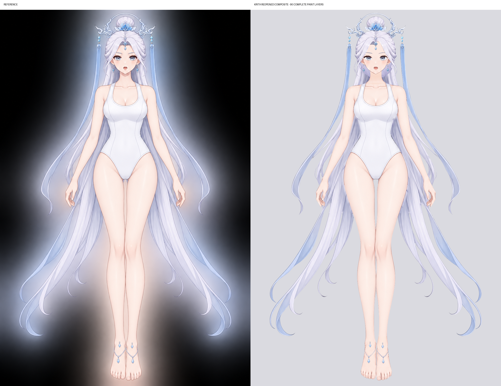

# 灰底清空 → GPT Image 2.5 → Krita：90 个完整部件

已接续 raster-astra 的工作，完成 90 个部件的模型生成、配准、可见原画叠加、Krita 修画和保存重开核对。交付为 1024 × 1536、90 个按深度排列的普通绘画图层；没有透明蒙版，也没有额外的原图覆盖层。

[下载 Krita 工程](character-depth.kra) · [逐层原尺寸查看](index.html) · [透明整图](preview.png) · [原图与终稿对照](reference-vs-final.png) · [逐层验收记录](visual-review.md)

## 参考与身份

本轮沿用前一窗口的标准：`workflow-next/part-layering/.run/test`，提交 `0f11ad1b`。其 90 个叶部件 SVG、分组和深度表完整保存在 [standard](standard/)，便于在后续主线变化后仍能核对。原画为 [reference.png](reference.png)。左右名称沿用标准的角色侧命名，未按画面左右重命名。

每个部件的 `parts/<id>/full.png` 与 KRA 中同名图层像素一致，均为全画布、完成补全的 RGBA 绘画。深度 00 最底、89 最顶；层级顺序见 [occlusion.json](occlusion.json)。

## 生成与修画

使用本地配置好的 `forgeax-imagegen`，经 imagegen 技能 CLI 调用 `gpt-image-2.5-sunburst`，high 质量、透明 PNG。每个部件都有真实模型输出，保存在 `parts/<id>/generated.png`；选用版本和摘要见 [generation-provenance.json](generation-provenance.json)，提示词和成功／失败日志见 [generation-records](generation-records/)。未使用降级模型。

生图前，图 1 中黄色遮挡区和绿色外部区均清为中性灰 RGB(160,160,160)。部件作等比局部放大；手指、手臂和躯干等重试另提供独立的局部参照图，帮助识别部件。内容审核拒绝和生图失败均保留记录，并以明确、中性的部件描述重试；没有用原图隐藏区冒充模型补全。

文件区分实际生图输入与修画后的最终操作分区：

- `input-model.png`、`control-model.png`：生图时的全画布灰底输入及 RGB 操作图。
- `input-crop.png`、`control-crop.png`：实际提交模型的局部放大输入。
- `input.png`、`control.png`：最终分区；纳入 SVG 的抗锯齿边缘及目视清理后的原画使用范围。红区可保留自身原画，黄区使用生成／手绘的本部件，绿区严格对应透明区域。
- `model.png`：配准后的模型中间层，保留配准缺口作为修画依据；它不是交付的成品图层。
- `full.png`：Krita 修画并重开核对过的最终部件。

配准仅调整生成图坐标，保持标准形状。原画只叠回可见归属区；脸底的发际／五官残色、脚链轮廓、耳饰残段等另作手选清理。长发旧横截面配准产生的断纹改为平滑变形；其余缺口、耳缘、脸底、脖子、眼白、牙齿和饰物端点在 Krita 实际画笔中修补，再逐件复看。躯干领口另行重生后采用自然连续的 U 形衣领。

[Krita 操作记录](brush-edits.json)包含具体笔触坐标、颜色、前后像素摘要，以及可见原画的叠加和手选模型表面恢复。文件摘要只用于追溯和保存完整性，不作为美术验收指标。

## 验收与差异

90 个部件已逐层按原尺寸独立查看；原尺寸检查页位于 [review-final](review-final/)。整图按人物轮廓、姿势、五官、服装、发色和饰品的整体观感与原图比较，没有用 PSNR 或逐像素相似度评分代替看图。

**相对于色块标准：未改部件划分、外轮廓或前后归属。** 90 个最终图层的 alpha 与各自标准 SVG 的原尺寸栅格结果一致，没有新增形状、缺失区域或重排层级。有关精确几何和文件完整性的核对见 [delivery-validation.json](delivery-validation.json)。

需要区分的修订和观感差异：

- RGB 红／黄分区在脸底、眼白、脖子、脚面等处按实际遮挡残色收紧，属于清理原画使用范围；部件轮廓和深度没有变化。最终操作图同时补齐最初二值控制图忽略的抗锯齿边缘。
- 原画中看不见的发根、耳内、关节端部和衣料延续由模型和手绘推断，局部线条与明暗不会是不可见原画的逐像素还原。
- 原画背景及周围光晕不属于人物部件，最终为透明；在不同背景上，人物边缘观感会随背景变化。
- `body/breast` 没有黄色隐藏区。该层按标准叠回原画可见衣料、衣领及肤色；多次要求模型单独保留完整可见裁片的重试被审核拒绝，均如实保留日志。这里没有用原图替代隐藏区域补全。

Krita 5.3.4.1 中保存后关闭文档、重新打开，核对 90 个图层的顺序、类型、像素与无蒙版状态；随后又以普通交互模式打开工程确认图层面板可用。结果见 [krita-reopen-verification.json](krita-reopen-verification.json)。

## 复查

直接打开 `character-depth.kra` 即可逐层显隐和编辑。`index.html` 可离线打开；选择部件查看原画、最终控制图、灰底输入和成品，图像按原尺寸裁窗显示。

`scripts/validate_delivery.py` 核对几何、灰底输入、生成物来源和重开像素完整性；它不进行自动美术打分。`scripts/prepare.py` 与 `assemble.py` 是生图准备及中间配准工具，重新运行并不包含之后的人工修画；正式交付以 KRA 和最终 PNG 为准。
