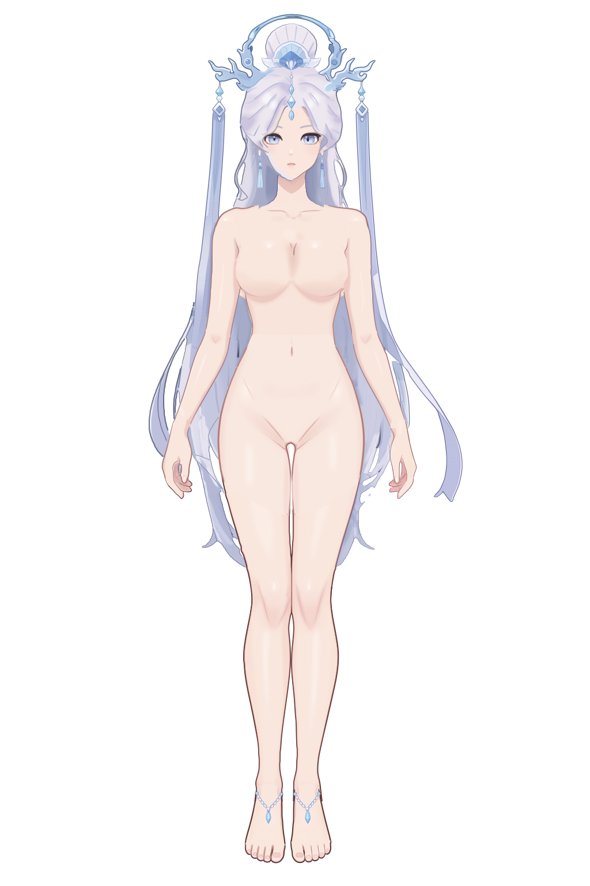

# Jianma SVG 完整运行 / Opus 5.5

2026-10-05 按当时 `workflow-next/live2d-layering` 执行步骤 1–5，语言任务使用 Opus 5.5，参考生成使用该次环境配置的 GPT Image。这里保留完整素体 SVG、必要参考、分组和运行记录。

[成稿 SVG](refinement/character.svg) · [成稿预览](refinement/preview.png) · [运行记录](运行记录.md) · [未解决项](未解决项.md)

主体产物已经生成；脚趾笔触、投影及局部接线等问题仍见未解决项，不能视为全部审查通过。原运行记录中的工作目录和工具路径保留当时状态；当前 SVG 技能入口为 [live2d-layering](../../.agents/skills/live2d-layering/SKILL.md)。

返回[成果索引](../readme.md)。
