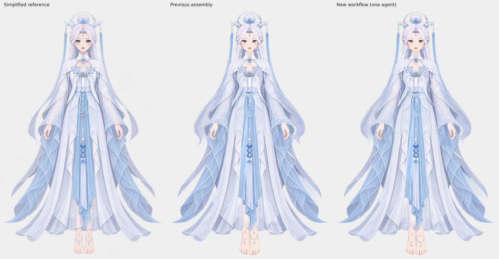

# Jianma：单 agent 穿戴组装实跑

[完整对照图](comparison.png) · [Krita 工程](step01/character-assembled.kra) · [透明 PNG](step01/character-assembled.png) · [绘制报告](step01/report.md)



从左到右为简化穿衣参考、[此前组装](../assembled/README.md)、本次 `character-assembly` 工作流的实际交付。

本次使用 `gpt-6-astra / xhigh`，只有一个绘制 thread，无 reviewer。从人物 `raster-layering/step03/character-dressup-base.kra`、衣服 `clothing-raster-layering/step02/clothing-soft-edges.kra` 和 `../part-layering/references/simplified-subject.png` 开始。没有把此前组装工程作为 agent 输入，也没有追加人工修画；首次短提示词直接完成，中间局部调整由同一 agent 自检执行。

整体观感与此前结果接近，袖口中的手臂穿插、胸腰与大腿漏肤、发尾外露和透纱效果已处理。保留原有 159 个绘画层，添加 16 个可关闭的 Krita 原生透明度遮罩，没有拆分或新增绘画层。允许的局部修画发生在现有内裙领口层；脚链位置也作了调整。

仍有的差异主要来自上游胸饰、挂饰、衣纹、手足造型及局部边缘，纱料的浓淡也不是逐像素复刻。完整说明见绘制报告；本次比较按整体和局部观感验收。

agent 已保存、关闭重开 KRA，并逐个检查遮罩开关；文件复核确认 159 个绘画层、16 个遮罩，PNG 与 KRA 合成一致，两份输入 KRA 未改动。检查记录见 [validation.json](validation.json) 及报告链接。Krita 版本为 5.3.4.1，本地测试通过独立显示环境运行，可选图片 compact 阈值设为 49。

在 skill 根目录使用以下入口，任务目录需已有上述三个上游文件：

```bash
pnpm character-assembly --name jianma --dir /绝对路径/运行根目录 --krita /绝对路径/krita
```

这里只收录关键工程、图片、报告和文件核对记录。完整会话、脚本、调度日志与过程临时文件保留本地，不随成果归档提交。
