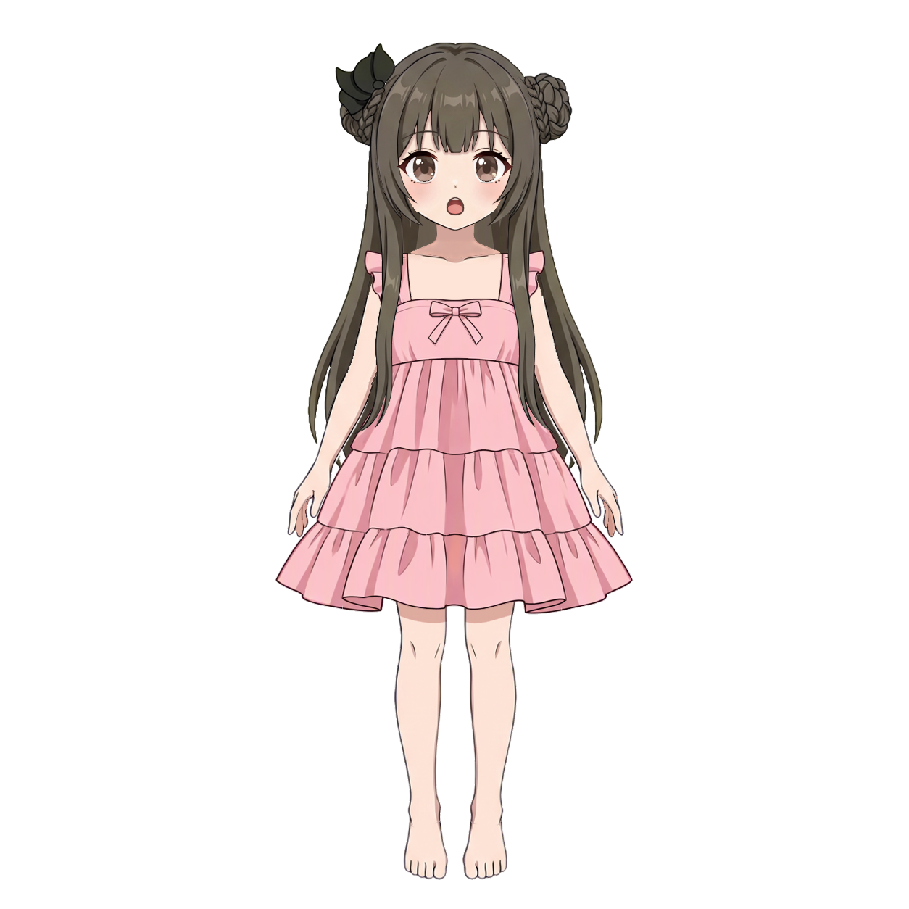

# Pink Doll：标准化、分层、穿戴组装与阴影成果

本例来自本地任务 `pink-doll`，启用姿态标准化。人物分件与栅格、衣服分件与栅格、穿戴组装及原生阴影蒙版均已完成；阴影于 2026-10-23 完成，物理未运行。这里按任务目录组织成果，保留完整分组树、深度表、SVG、七份关键 KRA、代表性过程图和验收报告。

人物有 **68 个节点、55 个叶子**，衣服有 **9 个节点、7 个叶子**。人物栅格工程有 58 个绘画层，衣服有 8 个；组装保留两者共 66 个原绘画层。阴影工程增加 4 条原生投影，保存后的检查通过且没有警告，详见各阶段报告。

| 阶段 | 成果入口 |
| --- | --- |
| 输入与标准化 | [原图](input/original.jpg) · [标准化图](part-layering/references/standard.png) · [简化穿衣角色](part-layering/references/simplified-subject.png) · [人物参考](part-layering/references/base-subject.png) |
| 人物分件 | [SVG 预览](part-layering/preview.svg) · [分组树](part-layering/groups.json) · [深度表](part-layering/occlusion.json) |
| 人物分层补全 | [KRA](raster-layering/step01/character-depth.kra) · [工程内预览](raster-layering/step01/character-depth-snapshot.png) · [报告](raster-layering/step01/report.md) · [人工验收记录](raster-layering/step01/review-01.md) |
| 人物边缘修画 | [KRA](raster-layering/step02/character-soft-edges.kra) · [PNG](raster-layering/step02/character-soft-edges.png) · [报告](raster-layering/step02/report.md) |
| 换装素体 | [KRA](raster-layering/step03/character-dressup-base.kra) · [PNG](raster-layering/step03/character-dressup-base.png) · [报告](raster-layering/step03/report.md) |
| 衣服分件 | [纯衣服参考](clothing-part-layering/references/clothing.png) · [SVG 预览](clothing-part-layering/preview.svg) · [分组树](clothing-part-layering/groups.json) · [深度表](clothing-part-layering/occlusion.json) |
| 衣服分层补全 | [KRA](clothing-raster-layering/step01/clothing-depth.kra) · [工程内预览](clothing-raster-layering/step01/clothing-depth-snapshot.png) · [报告](clothing-raster-layering/step01/report.md) · [首次审核](clothing-raster-layering/step01/review-01.md) · [返修](clothing-raster-layering/step01/repair-01.md) · [第二次审核](clothing-raster-layering/step01/review-02.md) |
| 衣服边缘修画 | [KRA](clothing-raster-layering/step02/clothing-soft-edges.kra) · [PNG](clothing-raster-layering/step02/clothing-soft-edges.png) · [报告](clothing-raster-layering/step02/report.md) |
| 穿戴组装 | [KRA](character-assembly/step01/character-assembled.kra) · [PNG](character-assembly/step01/character-assembled.png) · [整体对照](character-assembly/step01/final-overall-comparison.jpg) · [报告](character-assembly/step01/report.md) |
| 阴影蒙版 | [最终 KRA](shadow/mask/step01/character-shadowed.kra) · [最终 PNG](shadow/mask/step01/character-shadowed.png) · [面部对照](shadow/mask/step01/face-review.png) · [投影定义](shadow/mask/step01/shadows.json) · [检查](shadow/mask/step01/inspection.json) · [报告](shadow/mask/step01/report.md) |

人物 step01 由用户查看全身和拆件预览后人工接受；`review-01.md` 是维护会话根据该验收写入的记录，**不是独立 reviewer 报告**。人物 step02 绘制完成后，旧 step02 review 被移除，任务直接进入 step03。衣服 step01 则保留实际执行的两次审核及首次返修报告。归档沿用这些真实记录，不补写未执行的审核。

两套 `part-layering` 保留 `parts/` 中的全部 SVG，以及 `stages/` 中轮廓、去重、审核、补全检查与深度分析的 SVG／JSON。两套 raster step01 的 `parts/` 保留完整轮廓、可见轮廓及每个叶子的代表性绘制图；跨深度部件还保留前后片图。衣服审核证据、step02 像素检查图、组装对照和阴影检查图按原目录保留。

[清单](manifest.json)记录相对来源、大小与 SHA-256；复制文件已逐字节核对。文件名带 `-snapshot.png` 的两张预览直接提取自对应 KRA 的 `mergedimage.png`，清单注明出处。其余 PNG 与报告均保留源文件，没有重画或改写。

agent 日志、会话、逐次操作记录、提示词副本、脚本、缓存、运行标记、工作 KRA 与备份不收录。历史报告和 JSON 中的机器路径及未收录操作图引用按原文保留用于追溯；本目录是成果快照，不是会话恢复包。源任务仍保留在被 Git 忽略的 `.run/pink-doll/`，归档没有移动或修改运行数据。
