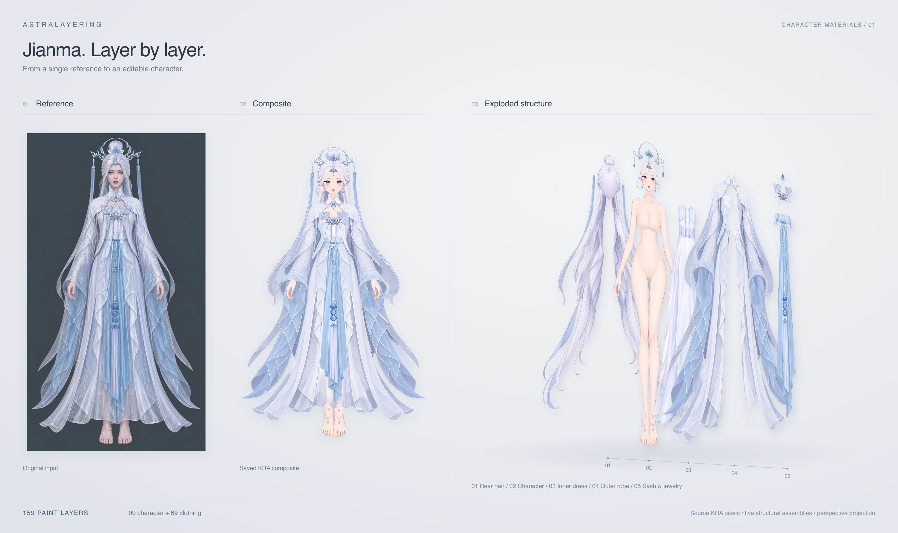
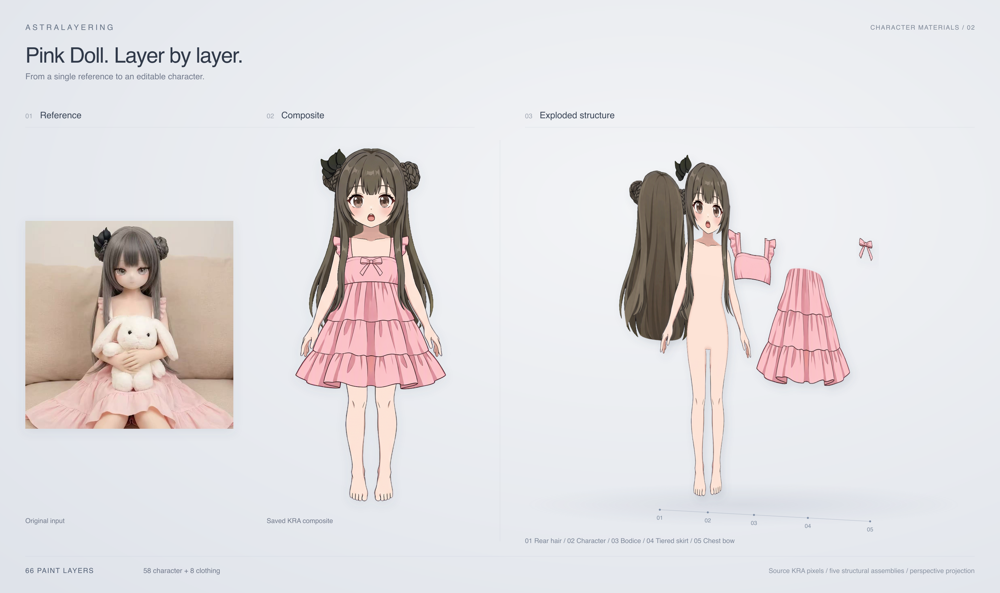
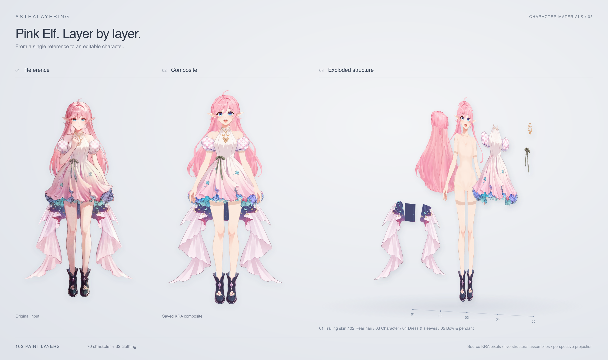

# 人物分层成果

当前主线是 KRA 人物与衣服分层、穿戴组装、阴影蒙版和角色工作台研究。工程、PNG 和必要验收记录保存在各案例，具体美术差异以案例报告为准。

| 案例 | 当前成果 | 入口 |
| --- | --- | --- |
| Pink Doll | 姿态标准化；58 层人物、8 层衣装，66 个源绘画层组装，4 条原生投影 | [完整案例](pink-doll/README.md) · [最终 KRA](pink-doll/shadow/mask/step01/character-shadowed.kra) |
| Pink Elf | 70 层人物、32 层衣装，102 个源绘画层组装；人物三步、衣服两步、组装和阴影完整路线 | [完整案例](pink-elf/README.md) · [最终 KRA](pink-elf/shadow/mask/step01/character-shadowed.kra) |
| Jianma | 90 层人物、69 层衣装、159 个源绘画层合成，单 agent 组装对照 | [完整案例](jianma/README.md) · [组装实跑](jianma/character-assembly/README.md) · [合成 KRA](jianma/assembled/jianma-assembled.kra) |

三组展示统一采用 **原图 + 完整合成图 : 立体爆炸图 = 5:5** 的版式。爆炸图将真实 KRA 绘画层组合为五组，人物保持完整姿态，发束与衣装沿纵深展开，保留组内坐标、比例与绘制顺序。完整分层像素保存在 KRA 与源图层 PNG 中。

Jianma 使用 `jianma/assembled/` 的合成图与 159 层归档；Pink Doll、Pink Elf 使用各自 `character-assembly/step01/` 的 KRA 和合成图，导出的原生图层与来源摘要保存在 `showcase/<案例>/`。维护时在仓库根目录运行 `node scripts/build-demo-showcase.mjs` 可重新生成三张展示图；源 KRA 更新后，先用 `node scripts/export-showcase-layers.ts --krita <Krita可执行文件>` 重新导出对应图层。

## 细看制作过程

- [Jianma 衣服分层](jianma/clothing-raster-layering/README.md)：独立衣服提取、逻辑 part 与绘画分片、两轮审核与修复。
- [人物分层与补全](jianma/raster-layering/step01/README.md)、[边缘精修](jianma/raster-layering/step02/README.md)、[换装素体](jianma/raster-layering/step03/README.md)：保留关键 KRA 与分层观察图。
- [光照研究素材](lighting-lab/README.md)：Jianma 与三组测试角色的原画、法线、深度和灯位对照。

## 在工作台查看

按[项目首页](../readme.md)双击启动工作台。浏览成果可将“工作目录”切换到本仓库 `demos/`，在流程预览或角色工作台加载项目；归档是成果快照，不保证具备可恢复会话。Jianma 旧合成研究也可从 `studio?name=jianma` 打开。

[Jianma 物理研究](../tutorial/live2d-guidance/workflows/physics-preview.md)使用真实分层素材验证固定区、摆动、实时光照与投影；角色部件须手动启用物理。长飘带、裙摆、横向挂布示例从角色工作台“从项目加载”进入。当前成果不包含 Cubism 绑定或动画导出。

KRA 是继续编辑入口，PNG 是快速查看入口。HTML 需从本地网页服务访问，GitHub 会显示源码。早期 SVG 成稿与方法实验保存在本目录各历史案例中。

返回[项目首页](../readme.md)。
