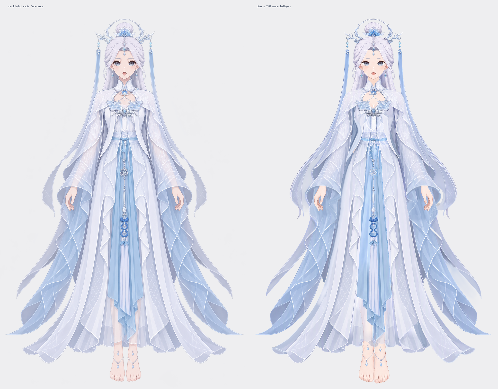

# 成果与实验索引

统一保存可查看、可编辑的产物，以及必要参考和过程记录。优先从最新的 Krita 穿戴合成查看；完整主体产物不等于美术问题或动画绑定均已验收，限制以各案例说明为准。

## Krita 人物、衣服与穿戴合成

人物链路：**分层补全 → 边缘修画 → 换装素体**；衣服独立完成分件与修画，再与人物装配。

| 案例 | 当前交付与状态 | 直接入口 |
| --- | --- | --- |
| [Pink Elf 完整制作路线归档](pink-elf/README.md) | 人物、衣服、穿戴组装及阴影蒙版流程完成；保留报告中的视觉差异说明 | [最终 KRA、PNG 与制作报告](pink-elf/README.md) |
| [Jianma 分层与组装成果归档](./jianma/README.md) | 原 test 改名，保存完整分件结构和人物三步、衣服两步关键结果；排除 agent 操作日志 | [目录与结果](./jianma/README.md) · [部件阶段预览](./jianma/part-layering/previews/index.html) |
| [单 agent 组装工作流实跑](jianma/character-assembly/README.md) | high 模型从两份 KRA 组装；159 个原绘画层、16 个可关闭遮罩，完成保存重开与新旧对照 | [KRA](jianma/character-assembly/step01/character-assembled.kra) · [对照图](jianma/character-assembly/comparison.png) |
| [Jianma 穿戴合成](jianma/assembled/README.md) | 90 层人物 + 69 层衣装，12 个可关闭的穿戴遮罩；159 个源绘画层像素保留，已核对保存重开 | [KRA](jianma/assembled/jianma-assembled.kra) · [交互页](jianma/assembled/index.html) · [参考对照](jianma/assembled/comparison.png) |
| [独立衣服完整实跑](jianma/clothing-raster-layering/README.md) | 纯衣服提取、68 个逻辑 part、69 个绘画层、边缘修画与两轮 review／修复；记录了人工介入与后续限制 | [最终 KRA](jianma/clothing-raster-layering/step02/clothing-soft-edges.kra) · [透明 PNG](jianma/clothing-raster-layering/images/final-composite.png) |
| [换装素体](jianma/raster-layering/step03/README.md) | 从修画终稿去除连体服；3 层局部补画、87 层保留，保持 90 层结构 | [KRA](jianma/raster-layering/step03/character-dressup-base.kra) · [PNG](jianma/raster-layering/step03/character-dressup-base.png) |
| [边缘柔化与去锯齿](jianma/raster-layering/step02/README.md) | 已完成本轮修画和逐层视觉复看；82 层修改、8 层保留，旧进度另存 | [终稿 KRA](jianma/raster-layering/step02/character-soft-edges.kra) · [终稿 PNG](jianma/raster-layering/step02/character-soft-edges.png) |
| [灰底控制与完整部件补全](jianma/raster-layering/step01/README.md) | 90 个按深度排列的普通绘画层，无蒙版；保留完整部件、修画与验收记录 | [KRA](jianma/raster-layering/step01/character-depth.kra) · [逐层结论](jianma/raster-layering/step01/report.md) |
| [早期 90 部件拆分](jianma/raster-layering/early-imagegen/README.md) | 含可逆遮挡蒙版的历史工程；存在耳部等隐藏补全瑕疵，作为历史对照保留 | [KRA](jianma/raster-layering/early-imagegen/character.kra) · [合成图](jianma/raster-layering/early-imagegen/reassembled.png) |

## SVG 完整案例

| 案例 | 内容与限制 | 直接入口 |
| --- | --- | --- |
| [Jianma：素体与衣装](jianma-svg-ver/readme.md) | 完整素体、独立衣装及默认穿戴快照；实际制作记录集中在同一案例下 | [穿戴 SVG](jianma-svg-ver/character.svg) · [素体制作](jianma-svg-ver/body-run/readme.md) · [衣装制作](jianma-svg-ver/clothing-run/readme.md) |
| [Jianma / Opus 5.5](jianma-svg-ver/opus55/README.md) | 2026-10-05 的 SVG 流程 1–5 步产物；保留未解决的局部问题 | [成稿 SVG](jianma-svg-ver/opus55/refinement/character.svg) · [预览](jianma-svg-ver/opus55/refinement/preview.png) |
| [Milly v1](./milly-complete-case/readme.md) | 完整阶段 1–5 与四个指定节点的独立审查；头发材质、手足局部仍有差异 | [成稿 SVG](./milly-complete-case/step05-base-character/05-2_局部色彩与材质.svg) · [参考对照](./milly-complete-case/reference-vs-svg.png) |
| [Miku v3](./miku-v3/readme.md) | 完整阶段 1–5，重点保留头脸校准；终稿独立审查不可用 | [成稿 SVG](./miku-v3/step05-base-character/05-2_局部色彩与材质.svg) · [本轮复核](../analysis/miku-v3-review/readme.md) |
| [首例 Miku](./first-complete-case/readme.md) | 完整成稿、部件树动图与遮挡补全独显；原阶段文件集中在 `source/` | [成稿 SVG](./first-complete-case/miku.svg) · [阶段文件](./first-complete-case/source/) · [独显示例](./first-complete-case/isolated-parts.png) |

## 方法对比与独立小例

| 案例 | 内容 |
| --- | --- |
| [深海少女：像素临摹与结构重绘](./deep-sea-method-comparison/readme.md) | 同一参考下的外观、路径复杂度、结构编辑与局部细节对比 |
| [wu-tian807](./wu-tian807/README.md) | 早期角色示例与头部试验，含分层不正确的版本 |
| [鹈鹕自行车](./pelican-bicycle/README.md) | 独立 SVG／HTML 绘图展示，不属于人物分层流程 |

## 查看与保留约定

- KRA 是继续编辑的入口；PNG 用于快速查看；SVG 可下载编辑或用 [part-preview](../loading/part-preview.html) 对照参考，匹配的 `groups.json` 提供分组控制。
- HTML 页面在 GitHub 上显示源码。在仓库根目录运行 `python3 -m http.server 8000`，再访问 [穿戴合成](http://localhost:8000/demos/jianma/assembled/index.html) 等页面；标明可离线的页面也能直接打开。
- 同一案例的最终稿、必要参考和制作记录放在一起；新成果补充本页入口与实际限制。工作流缓存、依赖和未完成运行留在任务目录。

## 原 outputs 迁移位置

7 组有效产物已归并到本目录；其余 5 个仅含系统元数据或空锁文件的目录已删除。作品文件保持原样，文档导航随目录调整；历史日志、摘要清单和审查快照里的来源路径保留当时记录。

| 原 `outputs/` 案例 | 当前目录 |
| --- | --- |
| `case1_miku` | [first-complete-case/source](./first-complete-case/source/) |
| `milly_v1` | [milly-complete-case](./milly-complete-case/readme.md) |
| `miku_v3` | [miku-v3](./miku-v3/readme.md) |
| `jianma_v4` | [jianma-svg-ver/body-run](jianma-svg-ver/body-run/readme.md) |
| `jianma_clothing` | [jianma-svg-ver/clothing-run](jianma-svg-ver/clothing-run/readme.md) |
| `jianma2d-opus55-20261005` | [jianma-svg-ver/opus55](jianma-svg-ver/opus55/README.md) |
| `pelican-bicycle` | [pelican-bicycle](./pelican-bicycle/README.md) |

返回[项目首页](../readme.md)。
