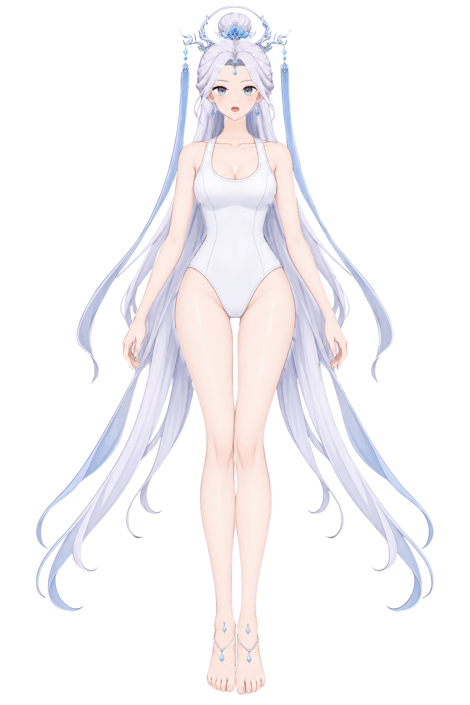

# 第二步：边缘柔化与去锯齿（进行中）

这是第一步之后的**阶段性存档**，用于换会话或换工具后继续修画。当前保存了 33 条局部笔刷操作、56 条笔刷路径，涉及 90 个部件中的 31 层；全层视觉验收尚未完成，不能作为第二步终稿。

[下载当前 KRA](character-soft-edges.kra) · [当前合成 PNG](preview.png) · [90 层进度与待办](PROGRESS.md) · [笔刷操作记录](brush-edits.json) · [工程存储核对](checkpoint-verification.json)



## 两阶段成果的位置

| 阶段 | 文件与记录 | 状态 |
| --- | --- | --- |
| 第一步：分层、补全与头部修正 | [character-depth.kra](../gray-control-krita/character-depth.kra)、[生成记录与验收说明](../gray-control-krita/README.md) | 已交付，基线提交为 `15dc698b60dd7753aa37cdefd85f3c1acfe59ccc` |
| 第二步：边缘、残色、接缝及线条柔化 | [character-soft-edges.kra](character-soft-edges.kra)、[逐层进度](PROGRESS.md) | 已局部修画，等待继续处理和视觉验收 |

本快照取自 2026-10-17 22:41（北京时间）保存的第二步工程。第一步 KRA 未被覆盖，基线文件摘要见 [baseline.json](baseline.json)。右侧发根阴影与耳后发底收小已包含在第一步基线中。

## 已保存的工作

- 脸底横向接缝、下颌边缘，耳轮和耳垂残色。
- 眉毛、眼白、虹膜、眼睑、睫毛，以及鼻部和嘴部已有线条的局部柔化。
- 部分耳链、耳钉、吊坠和额前饰物的边缘处理。
- 90 个完整 RGBA 部件，保存在 `parts/<id>/full.png`，与当前 KRA 的图层像素逐层核对一致。

33 条操作记录中有同一层的多次处理，因此对应 31 个不同图层。其余 59 层没有新增笔刷记录；这不表示每层都必须修改，应先检查再决定。两层眼部高光在历史脚本中暂时保留，也仍需最后复核。

保留的放大检查页位于 [review](review/)：`head-before`、`head-after` 是当时的头部局部检查，`body-before`、`hair-before`、`legs-before`、`crown-before` 是后续部位的修画前资料。这些页面仅证明已有检查材料，不代表全部图层通过验收。

## 继续工作的范围

1. 对照[原图](../gray-control-krita/reference.png)，继续检查长发、手臂与手指、腿脚、服装、颈部及剩余饰物。在 Krita 中逐处使用柔边、涂抹或模糊笔刷，按各处原画边缘的实际宽度处理；脚本只辅助定位与保存已目视选择的笔刷路径。
2. 每层检查三个状态：单独显示该层、隐藏其上方所有层、全部叠加。对照原图放大到 200–400%，检查外缘台阶、异物残色、补全接缝以及发丝和五官线质。已修改的 31 层也需要这轮完整复核。
3. 逐层记录问题、处理方式与剩余缺陷；最终保存新 KRA，重开核对层顺序和像素，再导出最终 PNG。

本阶段不新增阴影、AO 或投影；不改变结构、层级、名称和归属。轮廓变化仅限边缘过渡带内的零点几到一两个像素。不粘贴原图像素，不用全层模糊、统一羽化或公式批量生成修复。每个部件保持一个完整普通绘画层，无蒙版、无子节点；第一步工程继续保留。

## 如何接续

直接在 Krita 打开 `character-soft-edges.kra` 即可继续；它包含所有已保存修改，不依赖旧会话、临时目录或后台进程。`manifest.json` 保留部件 ID 和深度顺序，其中生成模型、隐藏像素、形状摘要等字段继承自第一步，不能当作第二步验收结果。

`scripts/head_brushes.py` 保存已执行的头部路径，`scripts/krita_edge_tools.py` 是当时在 Krita 会话中使用的辅助函数，依赖该会话的文档和图层变量；它们不是独立启动器。不要对当前工程直接重复执行历史笔触，也不要用第一步的导入或保存脚本重建第二步，因为其恢复基线 alpha 的逻辑会覆盖边缘柔化。

需要重新生成只读检查页时，可安装 Pillow、NumPy 后在仓库根目录运行：

```bash
python3 demos/soft-edge-krita/scripts/inspection_pages.py --levels 41-73 --name head-current --scale 3
```

它只读取 PNG 并在忽略的 `runtime/` 下生成放大页；长发等大部件需拆分范围或降低显示倍率。最终显隐验收仍在 Krita 中完成。

## 本次存档的核对范围

通过 Krita 重新读取磁盘上的工程，核对 90 个图层的名称、深度顺序、普通绘画层类型、无蒙版或子节点，以及与独立 PNG 一致的像素。31 个已修改 PNG 的像素摘要与操作日志的最后一次结果一致，其余 59 个与第一步 PNG 像素一致。工程文件本身未在存档过程中改写。

`preview.png` 直接取自已保存 KRA 的 `mergedimage.png`，未重新合成或修图；[checkpoint-verification.json](checkpoint-verification.json)记录的是存储完整性，视觉验收仍为 `pending`。生成记录、原始控制图、参考和第一步验收资料继续在相邻的 `gray-control-krita/` 中保留。

此前 CLI 中断记录包括一次请求图片超过 50 张，以及后续 `Image processing blocked due to content policy violation`。日志没有给出具体触发图片；这些错误不代表当前文件丢失，也不能据此判断作品已经通过或未通过美术验收。
