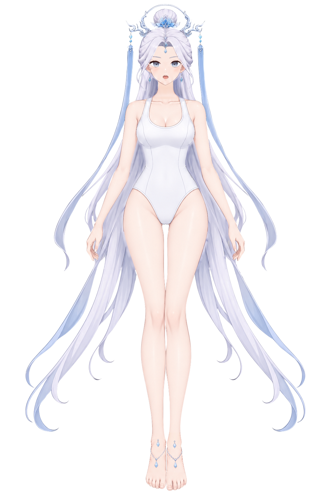

# 第二步：边缘柔化与去锯齿

已在第一步 `character-depth.kra` 的分层结构上完成本轮局部修画并另存。交付文件包含 90 个按原深度排序的普通绘画层，每部件一层，无蒙版、无子节点。第一步文件和旧第二步阶段存档均保留。

- [新的 KRA：character-soft-edges-final.kra](character-soft-edges-final.kra)
- [合成 PNG：preview-final.png](preview-final.png)
- [90 层修改、处理方式与保留项](PROGRESS.md)
- [原图 / 独显 / 隐藏上层检查图索引](review-final/index.html)
- [Krita 重新打开与像素核对](final-reopen-verification.json)

## 本轮处理

82 层有局部修改，8 层检查后保留。重点处理了长发和飘带外缘、手指与掌根残色、手臂和腿脚连接处、服装边缘、面部五官线条，以及头饰和脚饰的硬点。眼睛高光（54、55）和六个细小冠饰连接件（74–79）已有适当的半透明过渡，未再涂抹。

修画在 Krita 内使用柔边笔刷、涂抹与模糊笔刷逐处完成；笔宽和力度按目视对照的部位分别选择。没有全层模糊、统一羽化、粘贴原图像素或公式生成修复。辅助脚本记录手工选定的路径、切换显隐并导出检查图，不从参考图自动描边或生成笔触。

## 验收及保留项

90 层均已查看独显、隐藏上层状态，并在 200–400% 与原图同区对照；最终合成图另行检查外缘、发丝、五官、手和脚。检查图直接使用 Krita 原生显隐导出，放大检查不修改工程像素。

仍保留一项质感限制：**02、03 后长发隐藏补全区的发丝细节密度比原图可见发束略简化。** 其局部接线及肤色残丝已修整，已有柔光层次保留；没有改造发束布局或整片重画。详细记录见逐层表。

工程保存后已重新打开，核对 90 层的名称、顺序、类型、显隐及每层像素一致。合成 PNG 从重开的工程直接导出。`final-reopen-verification.json` 只证明存储完整性；人工视觉记录单独保存在 `final-visual-review.json`。

本步没有新增阴影、AO 或投影，也没有改层名、归属与深度顺序。第一步 KRA 的 SHA-256 与 `baseline.json` 一致。只读轮廓诊断保存在 `geometry-diagnostic.json`，不作为主要视觉评价。

## 文件区分

| 文件 | 用途 |
| --- | --- |
| `character-soft-edges-final.kra` / `preview-final.png` | 本轮交付 |
| `final-parts/` | 与新 KRA 一致的 90 个完整 RGBA 部件 |
| `review-final/` / `review-final-pages/` | 本轮放大复核图及拼页 |
| `brush-edits.json` / `continuation-brush-edits.json` | 历史与本次逐笔操作记录 |
| `character-soft-edges.kra` / `preview.png` / `parts/` | 2026-10-17 22:41 的旧阶段存档，未覆盖 |
| `CHECKPOINT-README.md` / `CHECKPOINT-PROGRESS.md` | 旧存档说明及当时待办 |

第一步成果仍在 [gray-control-krita](../gray-control-krita/README.md)。新 KRA 可独立打开，无需脚本或临时文件。历史笔刷脚本已执行，不要对交付文件重复运行，以免叠加笔触。
