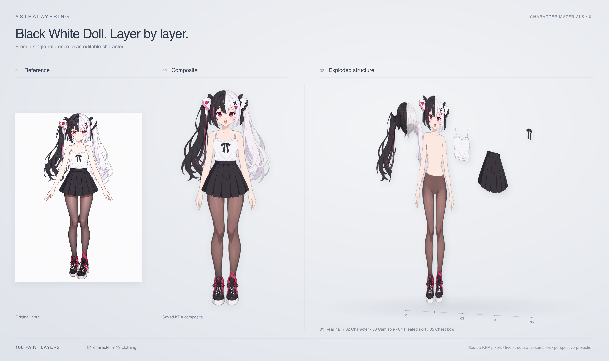
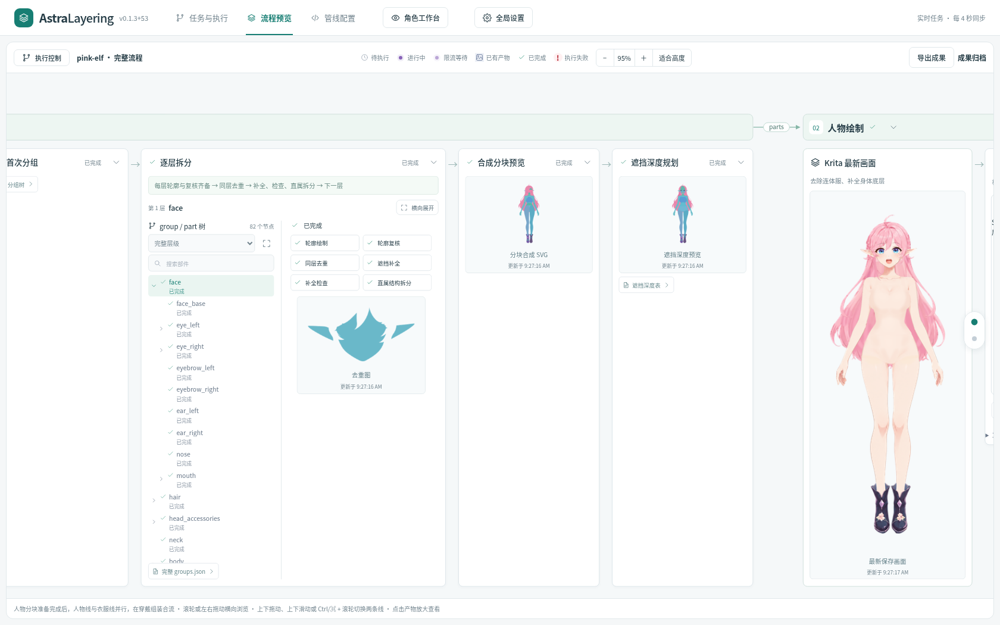
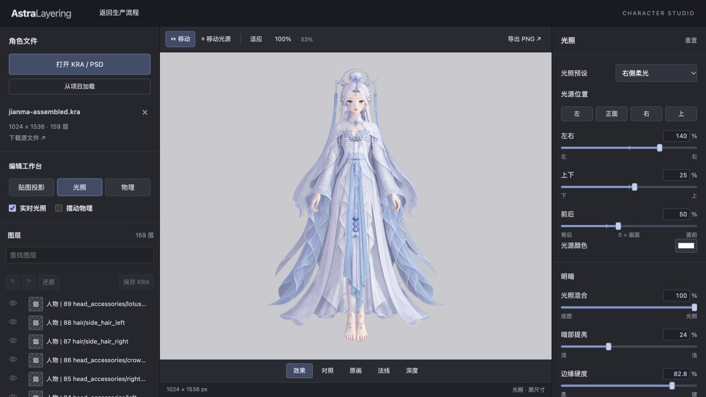
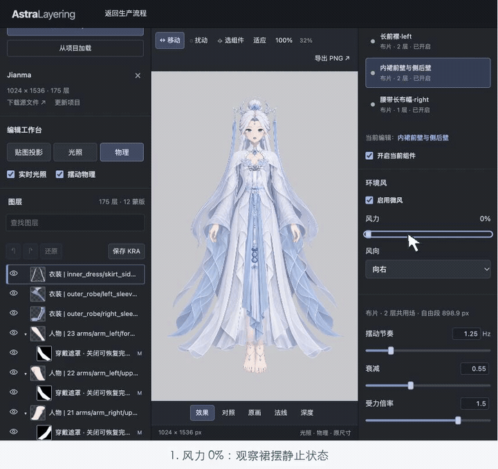
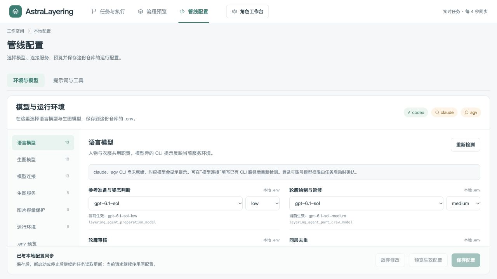
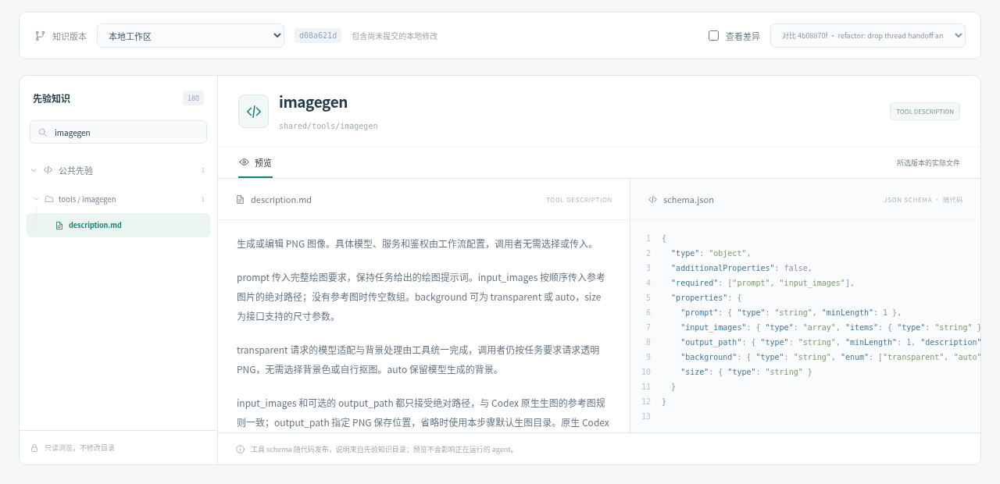

# AstraLayering

从一张角色参考图，制作可编辑、带遮挡补全的人物与衣服分层素材，交付 **Krita KRA、透明 PNG 和制作报告**。当前主线是人物分层、独立衣装、穿戴组装与阴影制作；可视化工作台负责执行与检查，角色编辑器负责图层、光照与物理预览。

## 人物分层成果

人物与衣服分别完成结构拆分、隐藏补全、栅格绘制和边缘修画，再组装成完整角色。新的 KRA 分层路线已完成多个完整案例，是当前成熟的素材制作方案。

**每个案例从左到右：输入原图 → 完整穿戴合成 → 立体爆炸图。** 原图与合成图共占左半，爆炸图占右半，比例 **5:5**。真实 KRA 绘画层按案例结构组合为五组，沿统一纵深展开，通过透视和柔和投影呈现装配关系。脸部与前发随完整人物一起展示，让角色轮廓更连贯。点击图片可看大图。

[](showcase/jianma-reference-composite-exploded.png)

[Jianma](demos/jianma/README.md)：90 层人物、69 层衣装；展示后发、完整人物、内裙、外袍及腰饰首饰。

[](showcase/pink-doll-reference-composite-exploded.png)

[Pink Doll](demos/pink-doll/README.md)：姿态标准化后完成 58 层人物与 8 层衣装，展示后发、完整人物、上衣、层叠裙与胸前蝴蝶结；案例还保留 4 条原生投影的阴影成稿。

[](showcase/pink-elf-reference-composite-exploded.png)

[Pink Elf](demos/pink-elf/README.md)：70 层人物与 32 层衣装，展示后拖裙、后发、完整人物、裙装袖片及蝴蝶结挂饰；案例保留人物、衣服、组装与投影蒙版的完整路线。

[](showcase/black-white-doll-reference-composite-exploded.png)

[Black White Doll](demos/black-white-doll/README.md)：姿态标准化后，组装工程包含 81 层人物与 19 层衣装，分五组展示双马尾后发、完整人物、吊带上衣、百褶裙及胸前蝴蝶结；案例保留分层、换装及投影阴影成果。

[全部成果与工程下载](demos/readme.md) · [Jianma 参考对照](demos/jianma/assembled/comparison.png) · [Pink Doll 标准化与组装对照](demos/pink-doll/character-assembly/step01/final-overall-comparison.jpg)

KRA 可继续逐层编辑，案例保留分件结构、关键工程和验收记录。局部美术差异见各案例说明；当前交付范围是分层素材，Cubism 绑定与动画仍需后续制作。当前流程中的 SVG 用于分件轮廓与深度控制，早期 SVG 成稿路线保留在历史目录。

## 可视化工作台与角色编辑器

**制作工作台**支持在全局设置中选择（或自动扫描）Krita、默认运行目录与先验知识目录，新建任务、上传参考、选择制作范围、运行、停止与续跑、查看日志，全部完成后可导出成果。人物分块准备完成后，人物线与衣服线同时制作，再合流进入穿戴组装和阴影。流程预览按实际部件树展开绘制、审核、补全和深度规划，直接查看图片、报告与 KRA；管线配置页可选择语言模型、生图模型与连接，预览并保存 `.env`，也可在“先验知识”中预览提示词、参考图片与视频、工具说明及其版本。

[](web/demo-screenshots/10-flow-current.png)

截图摄于 2026-10-26，读取 Pink Elf 真实任务：左侧选择部件并检查补全结果，右侧查看最新保存的 KRA 画面与审核产物；之后界面又有更新，细节以实际页面为准。[任务与执行页](web/demo-screenshots/09-workbench-current.png)按“共同准备 → 人物线／衣服线并行 → 合流”排列各管线，可启动、停止、继续和查看日志。

**角色工作台**可打开 KRA / PSD 或加载项目，编辑图层显隐、不透明度、混合和已有蒙版，撤销与重做后另存 KRA。原画、法线、深度和 MToon 光照共用画布，支持移动光源、部件投影、贴图绑定和原尺寸 PNG 导出。



[工作台完整说明](web/README.md)。原生图层编辑按该说明配置 Krita 合成服务后启用。

### Jianma 物理效果研究

在真实 Jianma 分层工程上研究飘带、发束和裙摆的摆动：逐层指定固定侧、固定区和过渡区，调整摆角、位移与拉伸上限，再用鼠标扰动、暂停、单帧与复位检查回弹。颜色、法线和深度使用同一网格形变，运动与实时光照、投影在同一画布预览。

当前运行时使用二维 XPBD，检查拉伸、剪切和防翻折；绑定草稿按 KRA 图层 UUID 保存，可导入／导出。人物部件需要手动启用物理。另有长飘带、裙摆布片、横向挂布三个独立示例，便于比较固定方式和受力效果。

**Jianma 环境风实录：** 2026-10-26 在在线研究工作台加载已有 46 个物理组件的 Jianma，选中“内裙前壁与侧后壁”，依次将风力从 **0% → 30% → 85%**，切换向左吹拂，再归零观察裙摆、袖片与飘带的回弹和衰减。画面为实际网页连续录制，鼠标轨迹、点击圈和步骤字幕为后期引导标注；风力百分比是预览控制量。

[](showcase/jianma-wind-skirt.mp4)

[观看完整 MP4](showcase/jianma-wind-skirt.mp4) · [打开本次在线研究项目](https://gameclaw.woa.com/ai-weapon-spirit/character-layering/studio?project=jianma-shadow-fresh-20261022&preview=mixed&workspace=physics) · [独立长飘带测试画面](web/demo-screenshots/08-cloth-physics.png)

在线演示使用该研究项目已有的物理配置。本地按下文启动工作台后，可在角色工作台「打开项目」中选择布料示例，或打开工作台地址下的 `studio?name=jianma` 加载 Jianma，按当前项目配置启用物理并保存绑定草稿。Cubism 导出作为后续阶段。方法、现有边界及后续组件方案见 [摆动物理](tutorial/live2d-guidance/workflows/physics-preview.md)。

## 启动方式 1：交给 agent（推荐）

用能操作本机、支持定时检查的 agent 打开本仓库，交给它 [live2d-maker 技能](.agents/skills/live2d-maker/SKILL.md) 执行初始化、确认参数、启动、巡检并打开网页。外层管理 agent 推荐使用最低思考力度，例如 **`gpt-6.1-sol-low`**；具体绘图任务由管线按职责选择模型。

先选择是否开启 **姿态标准化（`standard`）**：

- **开启**：先检查原图，需要时调整为正视站立、双手放在身体两侧、双眼睁开且嘴部张大的姿态，再开始后续制作，适合希望统一制作姿态的参考图。
- **关闭**：沿用原图姿态开始参考准备，适合已经准备好制作姿态、希望保留当前动作的参考图。首次默认关闭。

原图画法已经足够简单（平涂、边界清楚）时，简化参考直接沿用原图，不再重新生成。角色没有需要单独制作的衣服时，两条衣服管线显示“无需执行”并自动跳过。

在下面的示例中填写参考图、任务名，并选择开启或关闭：

```text
请使用 $live2d-maker 制作人物与衣服的分层素材。
参考图：/绝对路径/角色.png
任务名：my-character
姿态标准化：开启
```

agent 首次拉取或更新本仓库前，先问一次用户是**使用者**还是**开发者**：使用者用稳定版，即 [Releases](https://github.com/wu-tian807/AstraLayering/releases) 中最新的发布版本（对应同名 tag）；更新时只检查有没有比当前更新的发布版本，有才升级，不直接拉取 `main`。开发者用 `main` 最新提交，它可能还没有经过完整验证，不保证能跑通。用户已说明的不再重复问。

只安装 skill 时，需要安装 `.agents/skills/live2d-maker` 整个目录；可让 agent 通过 Git 稀疏检出安装，避免下载全部 demos。安装与操作能力检查见 [安装与前置](.agents/skills/live2d-maker/references/setup.md)。

## 启动方式 2：一键打开工作台，在网页制作

### 1. 准备软件与仓库

每行一项启动依赖；第二列说明是必选还是可选，以及什么情况下需要。已有安装直接复用。

| 依赖 | 必选／可选与何时需要 |
| --- | --- |
| [**Node.js 24.12+**](https://nodejs.org/en/download) | **必选。** 运行工作台与制作管线，同时提供 npm |
| [**Git**](https://git-scm.com/downloads) | **必选。** 克隆仓库、读取提示词版本，构建 Codex 补丁时获取源码 |
| [**Krita**](https://krita.org/en/download/) | **必选**（完整流程）。人物／衣服绘制、穿戴组装和阴影都要用；只跑人物／衣服分块时可以不装。首次制作时填写其可执行文件路径，见[第 3 步](#3-在网页中启动任务) |
| **Codex CLI（已登录）** | **默认必选。** 默认方案全部职责使用 `gpt-6.1-sol`，生图使用 `codex-native`，账号需具备宿主内置生图能力；所有职责都改用 Claude／Gemini 时可以不装。入口见 [CLI 与 provider](.agents/skills/live2d-maker/references/model-presets.md#cli-与-provider) |
| **C/C++ 编译工具链** | **使用 Codex 时必选。** 首次制作时构建本仓库的 Codex 补丁版，之后复用缓存；不用 Codex 时不需要。安装方式见下方系统表 |
| **Claude Code CLI（已登录）** | **可选。** 想用 Claude 模型（`claude-*`）时安装，例如混合方案中的遮挡补全、栅格绘制、组装与阴影 |
| **Antigravity CLI（已登录）** | **可选。** 想用 Gemini 语言模型（`gemini-4-argon`）时安装 |
| **GPT Image 生图服务** | **可选。** 生图想用 `gpt-image-2.5-sunburst`／`flare` 时，在 `.env` 填写 `layering_openai_image_base_url` 与 `layering_openai_image_api_key`。不用 Codex 时，生图步骤需在它和 Nano Banana 中选一个 |
| **Nano Banana 生图服务** | **可选。** 想用 Gemini 生图（`gemini-nano-banana-2.1`）时，在 `.env` 填写 `layering_google_image_base_url` 与 `layering_google_image_api_key`，协议选 `gemini` 或 `openai` |
| **Xvfb** | **Linux 无桌面时必选**，其他情况不需要。机器没有 `DISPLAY`／`WAYLAND_DISPLAY` 时，工作流用它启动共享虚拟显示给 Krita 使用；用 `apt install xvfb` 等安装 |

模型和生图的组合方式见 [模型方案](.agents/skills/live2d-maker/references/model-presets.md)；启动前可执行 `pnpm env:check` 核对实际生效的模型、CLI 与生图配置（不验证登录）。

C/C++ 编译工具链选择本机对应的一行即可：

| 系统 | C/C++ 编译工具的图形安装方式 |
| --- | --- |
| macOS | 从 [Apple Developer 下载页](https://developer.apple.com/download/all/)安装适配系统的 **Command Line Tools for Xcode** 安装包；已完成初始化的 Xcode 也提供这些工具，见 [Apple 安装说明](https://developer.apple.com/documentation/xcode/installing-the-command-line-tools) |
| Windows | 按 [Microsoft 安装说明](https://learn.microsoft.com/en-us/cpp/overview/acquire-msvc)打开 Visual Studio Build Tools 安装器，选择 **“使用 C++ 的桌面开发”**，包含与本机 Rust 目标架构匹配的 MSVC 工具和 Windows SDK |
| Linux | 在发行版的图形软件包管理器中安装 C/C++ 编译工具包；Ubuntu／Debian 常用 **build-essential**，其他发行版选择对应开发工具包，见 [Ubuntu 软件包说明](https://packages.ubuntu.com/build-essential) |

以下项目由程序自动准备，无需手动安装：

| 自动准备项 | 程序的处理方式 |
| --- | --- |
| **pnpm 10.33.0 与项目依赖** | 双击启动文件时，通过 npm 准备固定版本 pnpm 并安装依赖 |
| **默认 `.env`** | 缺少时以 `example.env` 创建默认方案；已有 `.env` 原样保留 |
| **Rust 1.95.0** | 构建 Codex 补丁时复用已有版本，缺少时临时隔离安装，构建后清理 |
| **本仓库的 Codex 补丁版** | 首次实际使用 Codex 制作时自动构建并缓存；指定已有入口时检查能力后复用 |
| **私有 Krita 环境** | 每个 section 启动一个独立配置的 Krita，不改用户的 Krita 目录；本机同时最多 4 个，超出时排队 |

软件准备好后，获取本项目：**只想使用**时，从 [Releases](https://github.com/wu-tian807/AstraLayering/releases) 下载最新的 `AstraLayering-vX.Y.Z.zip` 并解压，包内含工作台、skill 和 Pink Doll 示例，不含其他案例与教程；**需要完整资料或参与开发**时，用图形 Git 客户端克隆本仓库：macOS／Windows 可在 [GitHub Desktop](https://desktop.github.com/) 的“File → Clone repository → URL”填入 `https://github.com/wu-tian807/AstraLayering.git`，Linux 可使用已有图形 Git 客户端的克隆功能。完整检出包含 `web/`、`.agents/skills/live2d-maker/` 和 demos。更细的安装检查见 [安装与前置](.agents/skills/live2d-maker/references/setup.md)。

发布包附带的 Pink Doll 示例位于默认运行目录 `<解压目录>/.run/pink-doll`。首次打开工作台即可选择它，浏览完整流程与成果；示例保持只读归档状态。

### 2. 双击启动文件

| 系统 | 仓库根目录中的启动文件 | 操作 |
| --- | --- | --- |
| macOS | [start-workbench.command](start-workbench.command) | 在 Finder 双击 |
| Linux | [start-workbench.sh](start-workbench.sh) | 在文件管理器选择“作为程序运行”；必要时在文件属性中允许执行 |
| Windows | [start-workbench.cmd](start-workbench.cmd) | 在资源管理器双击 |

脚本会检查 Node，使用固定版本 pnpm 自动安装项目依赖，在缺少 `.env` 时创建默认配置，启动工作台并打开浏览器。其余依赖请按上表提前准备。首次需要联网；Codex 补丁在首次实际制作时构建或复用。已有 `.env` 保持原样。

默认打开 [本机工作台](http://127.0.0.1:4387/)。同一仓库通过脚本启动的服务可直接复用；端口被其他程序占用时自动选择空闲端口，以启动窗口显示的地址为准。保留启动窗口，关闭会停止本次网页服务；后台制作任务的停止请使用网页按钮。远程服务器访问与部署见 [工作台说明](web/README.md)。

### 3. 在网页中启动任务

1. 在“工作目录”确认结果保存位置，默认是仓库下的 `.run/`。
2. 点“新建任务”，在弹窗中上传角色参考图，填写显示名称和任务目录名。
3. 在同一弹窗中选择“整条流程”或“单条管线”、是否标准化姿态、阴影方式和“调度并发”（默认 3，人物线与衣服线共用），填写 Krita 可执行文件路径（已记录过可留空）；核对后点 **“开始制作”**。每次开始或继续都会先检查 Krita，不可用时页面会提示重新填写。
4. 在“任务与执行”展开“运行记录与日志”，点对应管线的“预览”，进入“流程预览”查看最新 KRA、部件和报告。点击图片可打开成果大图。出错时显示一行错误提示，悬停可看全文，旁边的按钮可复制；本机 Krita 名额已满时，管线旁显示“Krita 排队中”，取得名额后显示“占用 Krita”。
5. 运行中标题栏只有 **“停止”**，停止后保留已画好的成果；中断或失败后用“继续／恢复／重试”接着做。全部完成后点 **“导出成果”** 下载 `<任务名>.zip`，或点顶部 **“角色工作台”**，自动载入当前任务的角色工程。

下面是当前页面的**连续操作录屏**，叠加鼠标轨迹、点击圈和步骤字幕，方便跟着操作；鼠标与点击标记为录制后的引导标注。每段同时提供高清 MP4。

**新建与参数设置：** 选择参考图、填写名称、开启标准化、填写 Krita 路径，再核对“开始制作”。本段演示停在最终启动前。


[高清连续录屏：新建任务](web/demo-screenshots/11-create-task-guide.mp4)

**查看日志与成果：** 使用 Pink Elf 已完成任务的真实记录，连续打开日志、穿戴组装预览、最新 KRA 大图和角色工作台。


[高清连续录屏：查看成果](web/demo-screenshots/12-inspect-task-guide.mp4)

Krita 常见入口如下，以本机安装位置为准：

| 系统 | Krita 可执行文件路径 |
| --- | --- |
| macOS | `/Applications/krita.app/Contents/MacOS/krita` |
| Windows | `C:\Program Files\Krita (x64)\bin\krita.exe` |
| Linux | 实际安装的 `krita` 或 AppImage 入口 |

Krita 安装和 agent 定时巡检由启动方式 1 的 agent 协助处理；网页负责制作任务的运行与查看。

### 默认模型与修改方法

默认方案全部使用 **`gpt-6.1-sol`**，生图使用 **`codex-native`**，复用宿主内置生图能力与登录：

| 管线职责 | 默认思考力度 |
| --- | --- |
| 参考准备、姿态与画风判断 | low |
| 人物／衣服轮廓绘制与 review | medium |
| 分组、同层去重、遮挡补全、深度规划 | high |
| 人物／衣服 raster step01 绘制、返修、review；穿戴组装 | xhigh |
| 边缘精修、去除临时连体服、阴影 | medium |

在网页顶部进入 **“管线配置 → 环境与模型”**，按职责选择语言模型和思考力度，按步骤选择生图模型。页面显示当前服务环境的 CLI 检测结果；对应 CLI 尚未就绪的模型会标注原因并禁用。已有 CLI 可在“模型连接”填写路径后点击“重新检测”，登录和账号权限在任务启动时核对。



| 页面区域 | 可以设置什么 |
| --- | --- |
| 语言模型 | 参考准备、轮廓、审核、分层绘制等 13 个职责的模型与力度 |
| 生图模型 | 默认生图模型及 17 个步骤的覆盖项；步骤可选择继承默认 |
| 模型连接 | Codex／Claude／AGV 的服务地址、密钥、可用模型列表及 CLI 路径，AGV 的协议 |
| 生图服务 | GPT 生图与 Nano 生图的服务地址、密钥和可选协议 |
| 图片容量保护、运行环境 | 每次送给模型的图片数量与大小、重复图片去重、本机同时运行的 Krita 上限（默认 4）及少量兼容选项 |
| .env 预览 | 查看修改后的配置内容，密钥保持隐藏 |

修改后点 **“预览生效配置”** 核对解析结果，再点 **“保存配置”** 写入 `.agents/skills/live2d-maker/.env`。保存逐项保留原有路径、凭据、预算和注释；新任务及停止后继续／恢复的任务读取更新，当前执行中的请求沿用启动时配置。来自工作台启动环境的覆盖会显示实际生效值和来源。


[高清连续录屏：修改模型配置](web/demo-screenshots/14-env-guide.mp4) · [完整配置键与模型方案](.agents/skills/live2d-maker/references/model-presets.md)

同页的 **“先验知识”** 按管线以文件夹树列出 `knowledge/` 中的提示词 Markdown、`agent.json` 与工具说明，以及代码中的参数 schema，可对照 Git 分支、提交历史和差异。选择一个工具后，可并排查看说明与参数定义，便于理解当前制作要求。



可选的混合模型方案使用 GPT、Claude 和独立生图服务，差异、模板与授权要求见同一份 [模型方案](.agents/skills/live2d-maker/references/model-presets.md)。

## 版本与更新

版本以 Git 标签 `vX.Y.Z` 为准，标题栏左侧显示当前版本；在标签之后还有新提交时显示为 `v0.1.0+3`（标签后第 3 个提交）。各版本的变化与升级影响见 [CHANGELOG](CHANGELOG.md)。

工作台每天最多访问一次 GitHub（`api.github.com`）查询最新发布标签，发现新版本时在标题栏提示并链接更新说明，可点 × 不再提示该版本。它只提示，不下载、不替换文件；离线或查询失败时不显示任何提示。完全关闭：在“管线配置”页把“检查新版本”设为关闭，即写入 `.agents/skills/live2d-maker/.env` 的 `layering_update_check=false`，无需重启。

| 获取方式 | 更新方法 |
| --- | --- |
| 克隆的仓库 | 停止制作任务、关闭启动窗口，执行 `git pull`（或在图形 Git 客户端拉取），再双击 start-workbench；依赖会自动补齐 |
| 发布包 ZIP | 下载并解压新版到新目录，从旧目录复制 `.agents/skills/live2d-maker/.env`（模型配置）和 `.run/`（任务），再从新目录启动。在网页改过工作目录的，不必复制 `.run/`，在新版的“工作目录”里重新选一次原目录即可 |

已完成的任务在升级后可直接浏览；续跑时各步骤按指纹决定是否重做，会让已完成步骤重做的变化在 CHANGELOG 的“升级影响”中写明。

## 文档入口

| 入口 | 内容 |
| --- | --- |
| [SKILL.md](.agents/skills/live2d-maker/SKILL.md) | 给 agent 的参数、执行顺序和按需阅读入口 |
| [工作台](web/README.md) | 网页制作、角色编辑、部署与验证 |
| [成果](demos/readme.md) | 当前 KRA 案例、工程与报告 |
| [教程与研究](tutorial/live2d-guidance/readme.md) | 分层、光照、投影与物理依据 |

日常使用只需首页和对应入口；想了解某条管线如何制作，可打开该管线目录里的说明文件。历史作品与旧技能仍保留在仓库中。

## 开源协议

本项目采用 **GNU Lesser General Public License v3.0（LGPL-3.0-only）**，仅适用第 3.0 版。除另有说明外，本仓库的原创内容按此协议提供。

协议全文见 [LICENSE](LICENSE)，其引用的 GNU GPL v3.0 条款见 [COPYING](COPYING)；两份文件共同构成 LGPL v3.0 的完整条款。

LGPL 允许在满足协议条件时被闭源程序链接使用；分发对本项目 LGPL 代码的修改时，仍须遵守相应的源码提供义务。具体权利与义务以协议全文为准。

第三方依赖、引用资料和素材仍遵循各自的许可证或权利声明，本项目的 LGPL 授权不替代其原有授权。
