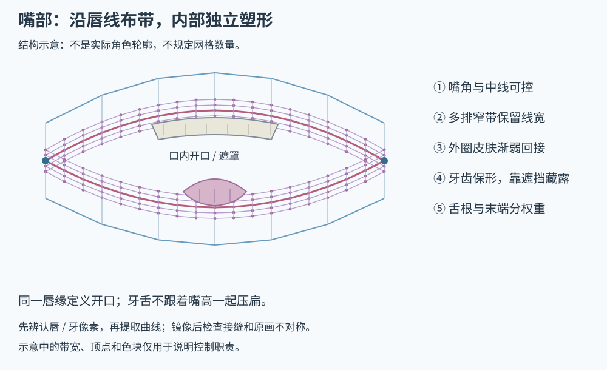

# 嘴部网格与分层联动

依据：[M01 视频与逐帧解析](sources/mouth-video.md)。基础清单和选项编号见[嘴部目录](03-mouth-scope.md)。本轮已做六关键形、特色轮廓和同页试演；后续发现素材中的牙唇语义错误，因此**下面的制作方法可采用，当前嘴部样片不能作为语义分层正确的范本**。

## 1. 先画清楚“哪条才是嘴唇”

在原图上标记上唇的口内接触边、下唇接触边、两侧嘴角、上牙可见边和口腔。不能以颜色简单分类：白色可能是牙齿、唇高光或皮肤；红色可能是唇线、口腔或舌头。图层名字与 alpha 只提供候选，原图语义才是依据。

本轮用户指出，原图中部分裸露上牙被留在了命名为上唇的层里；拆层检查确认隐藏独立上牙后，白块仍在上唇层。按这一原图语义纠正来处理，把整个层当嘴唇移动就会让白牙跟着唇线变形。先核对这一点，再自动提取唇线；否则再密的网格和再多关键形都在控制错误对象。

嘴部结构按作用分三类：轮廓与口周皮肤、口腔内部、紧贴装饰。上嘴皮／下嘴皮可以包含皮肤过渡，不只是两条线；简化画风也不必强制补齐六层。

## 2. 沿唇线布窄带，而非把嘴部铺成粗矩形

这是布线原则示意，颜色不代表原图的实际颜色。红线为唇缘，紫色带为保留厚度的控制区，蓝色为口周接回区域；牙舌网格独立。

1. 先标两侧嘴角、中央、左右弧段。上下唇分别有接触曲线，不能只给整张嘴一个缩放中心。
2. 沿接触曲线布多排邻近顶点，保留线宽与颜色过渡。线内、线上、线外都有控制，避免闭嘴时笔触被压没。
3. 口周皮肤向外放疏，并以平滑权重接回固定脸皮。鼻下、嘴角和下巴不能出现突兀拼接或整脸牵拉。
4. 半边镜像可作为起点，但要检查中线拼接、嘴角连接与原画不对称，不强制把所有角色做成完全对称。
5. 牙齿、舌头、口腔使用自己的网格；唇线需要窄带，牙板更重视形体，舌头更重视根端分工。
6. 极值和中间姿态检查三角形方向、细长三角形与线宽。顶点多不能替代正确的曲线、关键形与分层。

本轮自动生成上下唇 32 列、6 排窄带，内部层使用不同分段；这是约 20 像素宽嘴部的工程实现，不是教程要求所有角色照抄的密度。实际 Cubism 手工网格应按轮廓和要变形的位置布置。

## 3. 基础是两个参数、六个边界形

开合 `P01=0…1` 与嘴形 `P02=-1…1` 分工。先制作下面六形：

| | 下撇 -1 | 自然 0 | 上扬 +1 |
| --- | --- | --- | --- |
| 闭合 0 | 下撇闭嘴 | 自然闭嘴 | 微笑闭嘴 |
| 开口 1 | 下撇张嘴 | 自然张嘴 | 微笑张嘴 |

这是本轮起点，不是所有 Live2D 模型的官方最低配置。原画本来张口时，原画复位不能硬设为闭嘴；Jianma 的中性复位开合是 0.65。

先连续扫描六形间的过渡。微张、曲率反转、嘴角和牙齿藏露最容易出问题；只在失败位置加入修正关键形。视频提到 3×3、3×4、5×5 等扩展，不意味着越满越好。自定义特殊轮廓与嘴形轴的组合也要逐项声明支持。

相同拓扑可插值，不同拓扑不能直接强拉。叉号嘴没有普通开口，通常需要经闭合姿态或离散切换；直接混合会有双嘴线，强行连续变形可能翻折。

## 4. 牙齿保形，露出交给遮挡

口腔可见区域由同一上下唇边界形成。内部纹理需要超过当前开口的覆盖余量：原图是闭嘴且没有口腔时，补入口腔才是明确的新增绘制量。

上唇遮住牙根，上牙从接触边向口内露出；下牙与下唇保持对应关系。上下牙各自控制形状、位置和露出量，不能随嘴高把整排牙压成细白线。闭嘴应靠唇线接触与开口遮挡藏牙，不是把牙图缩成零高。

本轮原型让牙齿保持厚度并随各自唇线偏移，能够验证开合遮罩，但这种同位移映射还不能证明牙唇藏露自然。当前素材又存在牙像素误归上唇的问题，两者均不能记为最终美术验收通过。

口内深色、上牙、下牙、舌头分别检查法线和深度来源。脸底取样排除口腔语义区域，否则闭嘴后可能残留嘴腔法线造成的黑线。

## 5. 紧贴装饰与内部部件的联动不同

唇彩、嘴边贴花等真正贴在同一表面上的层，可复制匹配的拓扑与关键形。不同裁片通过原画坐标对齐 UV；把同一个顶点数组直接套到不同裁切坐标并不等于对应正确。

牙舌与口中物品不应只复制唇层的所有形变。它们有自己的形体、挂接和遮挡；含住的物品不因闭嘴而被压扁。原画已有痣或花纹且受嘴动影响时，其正确随动属于该角色基础工作。

## 6. 三种特色轮廓如何复用

| 轮廓 | 应改变的结构 | 避免的替代做法 |
| --- | --- | --- |
| S01 圆口 | 上下弧度、开口高宽与弱化嘴角 | 只横向缩小一张普通张嘴图 |
| S02 嘟嘴 | 收拢、中央唇峰、上下唇曲率、口周牵拉，表达轻微前噘 | 把嘟嘴直接等同于宽度滑杆 |
| S03 猫嘴 | 中央转折与两侧弧瓣，维持嘴角接合、线宽和开合关系 | 预设必须重新画一张 ω，或拉出尖锐破折线 |

先复用原层关键形和局部曲线，实际出现缺失表面或严重拉伸后再登记补画。P04 特色强度只在确有连续过渡的形态上开放，不对未做过渡的符号假造一个平滑滑杆。

虎牙先判断角色是否需要。已有白牙可做局部网格变化或拆片；外露部分有独立可见性，不被普通闭嘴遮罩全部吞掉。皮肤色唇尖与真实白牙不是同一种语义。Jianma 没有明确虎牙，本轮不启用 F01。

## 7. 吐舌分根部、末端和跨唇遮挡

舌根留在口内，尖端负责伸出与弯曲，根到端权重连续。口内部分接受开口裁切；越过下唇的舌尖允许在外侧显示。不能让整张舌头一起穿出，也不能给整层套口内遮罩而看不到舌尖。

F03 的口内随动、直向吐舌、侧摆、卷舌、舔唇是五个不同子项。Jianma 仅选短距离直向吐舌／收回；现有舌图可试作，不代表长度、厚度和边缘已经够用。长舌、卷舌和舔唇必须单独评估素材与接触轨迹。

## 8. 交付前怎么验

保存中性原画、闭嘴、微张、半开、全开、上下嘴形和选中特殊组合的原分辨率裁片。连续扫描参数并暂停逐帧；同时看整脸比例和嘴部放大，不用局部夸张细节代替整脸自然感。

通过标准包括：唇线正确、牙根遮挡清楚、闭合无漏白／黑腔、线宽连续、牙舌保形、舌头收回不残留、皮肤平顺以及地图跟随。原型还必须保留已发现的失败项，不把单元测试或可点击的菜单当作美术完成。
