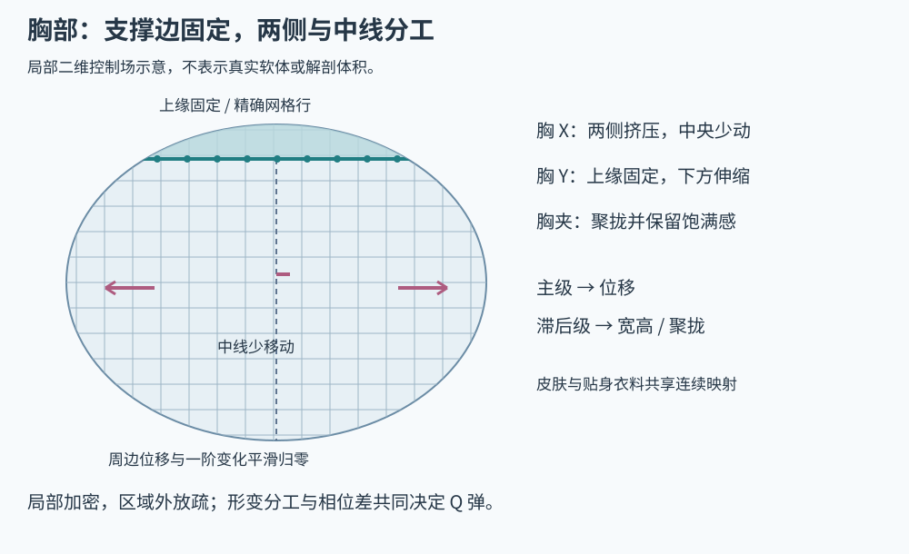

# 胸部果冻网格与自然回弹

依据：[C01 视频解析](sources/chest-video.md)、[Jianma 实战](cases/jianma.md)。本轮用户在胸部联动优化后反馈效果可以接受。该结论限于当前正面皮套和试验范围，不包含真实软体碰撞、完整身体九轴或任意服装。

## 1. 要制作的是形体变化

自然的 Q 弹包含主位移、局部宽高变化、两侧挤压与聚拢，而且这些变化不会同时到达极值。整片胸部沿同一方向平移，再统一缩放，只能产生贴片或固定弹簧感。

本轮使用两级相关惯性：`offset` 表示主运动，`shape` 表示滞后的形变响应。共用物理循环，胸部有自己的参数到网格映射；不是另起一个物理引擎或独立画布。

## 2. 支撑边界和网格



图示强调固定边、两侧与中线的分工，不是解剖测量或视频网格的逐点复刻。

- 上缘连接胸廓处尽量固定；颈部和腰部不随局部果冻移动。支撑边需要精确网格行。
- 两侧安排可挤压的控制区域，中线的横向移动明显小于两侧，避免整片左右漂移。
- 曲率和聚拢变化集中处加密，外圈逐渐放疏，位移与一阶变化平滑接回固定区域。
- 皮肤、躯干底层、贴身衣料和胸饰使用相容的连续映射，跨层不能各自找一个缩放中心。
- 衣料的透视和受力方向要一起检查。自由挂饰可另用摆动模型，贴身部分不能脱离身体漂浮。

Jianma 的实现以椭圆局部区域约 24×24 格采样，并额外插入上缘固定行。区域外的大躯干不额外细分。这是局部场的工程方案；手工 Cubism 网格则可沿轮廓与关键挤压方向布置，不能把矩形格数当成标准答案。

可编辑局部坐标 `u=(x-cx)/rx`、`v=(y-cy)/ry`，本轮权重示例为：

```text
v <= -0.78: w = 0
otherwise: w = smooth(max(0, 1-u²-v²)) × smooth((v+0.78)/0.7) × influence
smooth(t) = clamp(t,0,1)² × (3-2×clamp(t,0,1))
```

这里的 `-0.78` 是当前绑定的固定边位置。关键是固定区严格为零、进入活动区时连续，不是所有角色沿相同比例固定。

## 3. 三个通道分别塑形

| 通道 | 形变职责 | 观察重点 |
| --- | --- | --- |
| 胸 X / 左右挤压 | 两侧较多横向挤压，中央少动，附带少量反向倾斜 | 左右不只是整片平移，衣料纹理不漂移 |
| 胸 Y / 上下回弹 | 上缘固定，下方逐渐伸缩，横向补偿宽度 | 下落不能整块拉长，上升不能体积消失 |
| 胸夹 / 聚拢展开 | 两侧向内／向外变化，同时补充纵向和深度饱满感 | 聚拢不是把整个胸部压成窄平片 |

简化保形可用一轴缩放 `s`、另一轴 `1/s`，并平滑限制组合应变。这只是在二维图像里保留面积和饱满感的线索，不是物理体积守恒。外圈渐弱、透视和 Z 提示都会使实际结果偏离简单公式。

本轮聚拢与 `shape.y - 0.3 × offset.y` 相关，所以主位移反转后聚拢仍能继续变化。数值是本轮调参结果；正式原则是**给不同形态相关的输入，但保留相位差和各自幅度**。

## 4. “慢回弹、多弹”怎么调才自然

1. 先关闭次级形变，确定主方向、合理幅度和固定边。
2. 降低过快的频率，使主回弹有可读的节奏，再调阻尼得到逐次衰减；不能只降低阻尼造成长时间乱晃。
3. 开启形变级，让它稍迟于主位移；检查宽高和聚拢是否在主反转后仍有自然延续。
4. 小幅增强局部挤压，避免位移和缩放同时过大。一个有控制的次级形变往往比更大主位移更有弹性感。
5. 使用平滑可见限幅，保留弹簧内部动量；不可到边界就清速度或把每次回弹硬切回静止。
6. 检查受力结束后的第二、第三次衰减以及最终归位，避免不停外加力造成“看起来很弹”的假象。

本轮实例：主频 1.2 Hz、阻尼系数 1.8/s、最大显示位移 5 原图像素；形变级频率为主频的 0.88 倍再除以延迟设置，阻尼为 1.15 倍。最大位移还受较短半径的 12% 限制。左右、上下、聚拢幅度可分别调；形变延迟范围 0.6–1.6。

这些不是 Cubism“速度／收敛”等字段的换算表，不应复制到另一求解器后宣称效果相同。响应公式、单位、输入脉冲和空间形变都不同。

## 5. 布线与时间要一起验

对单次 X、Y、聚拢输入，分别记录静止、第一极值、反转、次级极值、尾段。视频 C01 有身体九轴与编辑器缩放，不能把整个人物的运动都当成胸部自由衰减，也不能据此估算唯一频率。

组合时重点看 X/Y、Y/聚拢的四角及中间值，上缘不能滑，左右不能变成相互割裂的贴片。网格方向、连续法线和衣料对齐均需要检查。形状不对先改空间控制；时间不自然再改频率、阻尼和延迟。

本轮已检查固定边、中线／两侧差异、聚拢饱满感、多次衰减、相位差、不同展示帧率下固定步一致以及组合极值的网格方向。该验证并不意味着有胸部与手、衣服的接触碰撞；鼠标仍是外力试验。

## 6. 不归入已验证能力的内容

完整身体九轴、自动呼吸输入、衣物滑动接触、真实体积与自碰撞都需要另外制作。原视频展示或提及过的内容，不自动变为本轮已完成项目。正面局部果冻与大幅转身后的重力、透视和遮挡也不能直接等同。
