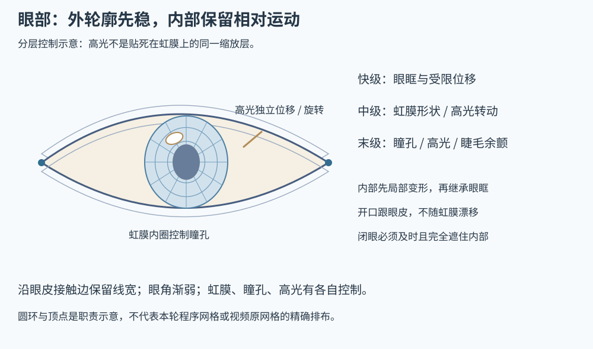

# 眼部网格与灵动联动

依据：[E01 视频解析](sources/eye-video.md)、psd2live 的分级响应参考和[Jianma 实战](cases/jianma.md)。本轮在眼眶、虹膜、瞳孔、高光和睫毛分工后，用户认可了眼部联动方向。

## 1. 眼睛不能照搬胸部弹簧

眼部需要快速恢复可读的视线与开合，随后留下细微余颤。整只眼长时间上下跳、虹膜像独立球在眼眶里弹，通常削弱自然感。参考视频明确降低过度持续的眼球整体弹动。

因此需要同时解决两件事：外轮廓怎么变，以及内部如何产生**相对运动**。只让瞳孔和高光完全跟随眼眶，或只把虹膜统一缩放，都不够。

## 2. 各层职责和布线



| 部位 | 控制与网格重点 | 不应发生的事情 |
| --- | --- | --- |
| 上下眼皮、睫毛根部 | 沿原画接触边布控制带，保留笔触厚度；眼角两侧渐弱 | 闭眼把线条压没、拉成黑块，或两端漂移 |
| 眼眶外轮廓 | 两侧、中央、上下弧段可分别控制，外围接回皮肤 | 整只眼只做一个椭圆的统一缩放 |
| 眼白 / 开口 | 覆盖内部并随眼眶开合 | 眼内运动时开口跟着虹膜漂走 |
| 虹膜 | 整体压扁／拉长、受限位移，保留外围形状 | 主体长期大幅弹跳，越过眼眶 |
| 瞳孔 | 内圈局部权重，相对虹膜小幅形变与延迟 | 与整个虹膜永远同相同比例缩放 |
| 高光 | 单独平移、绕眼球中心转动、微小大小变化 | 贴死在虹膜上或只与虹膜一起挤压 |
| 睫毛末端 | 根部随眼皮，末端小幅延迟弯曲 | 整片睫毛和眼皮脱离 |

眼皮接触边应来自经检查的原画轮廓，沿弧线加密，外侧放疏。虹膜和瞳孔按中心与内外圈设置控制；高光围绕自己的可读形体布网，不需要复制虹膜全部拉伸。嘴唇与眼皮的共同经验是：**沿线控制厚度，内部内容按各自职责布网**。

本轮瞳孔画在虹膜图中，没有独立 layer。使用虹膜网格内的紧凑局部控制区就能做相对变化，不必因此重画整眼。若需要独立遮挡或暴露缺失表面，才另行拆片或补画。

当前工程采用约每原图像素一格、最多 40×32 格的分层采样网格，配合逐列眼皮边界和语义局部场；它不是视频手工环线网格的逐点复制。正式原则是控制区域和映射可表达目标形变，格数不作为跨角色规范。

## 3. 先局部，再继承外轮廓

推荐明确写出每层组合顺序：

```text
P_layer = F_outer(F_local_layer(P_source))
```

内部先做自己的形变，然后继承眼眶的公共变化。这样眼眶变窄时虹膜仍在其中，但虹膜、瞳孔和高光还能错开相位。紧贴眼皮的装饰继承眼皮映射，而不是独立漂移。

法线、深度和选取均使用这个最终映射。若只按外层修正法线，却忽略内部的拉伸和高光运动，颜色与方向数据会不一致。绘画高光的可控动画是表现手段，不由 shader 的实时高光自动替代。

## 4. 三级响应分配

| 响应 | 主要职责 | 时间与幅度目标 |
| --- | --- | --- |
| 快级 | 眼眶、受限位移、基础冲击响应 | 外轮廓较快稳定，幅度受限 |
| 中级 | 虹膜主形变、高光旋转等 | 跟随快级而有少许滞后 |
| 末级 | 瞳孔、高光微形变、睫毛余颤 | 小幅、较持久的细节变化 |

它们是同一动作激发的相关状态，不是三套随机振荡。各层不同时到极值，正是灵动感的重要来源。视频参数名中的 Z1／Z2 表示其高光旋转或形变通道，不能仅凭字母 Z 解释为三维深度位移。

本轮基频 1.6 Hz、阻尼系数 1.8/s。快、中、末级频率倍率约 2.2、1.5、1.15，中末级再除以内部延迟；阻尼倍率约 4.5、2.5、1.6。所有状态在同一 120 Hz 循环推进。这些仅是当前求解器的起点，不能换算成视频中的 Cubism 面板数值。

同页面板分别暴露眼眶、虹膜、瞳孔、高光、睫毛幅度与内部延迟。调试先减到零确认每通道的职责，再逐项恢复，避免所有通道同时调大而无法归因。

## 5. 眨眼是基础姿态，弹性是附加反应

基础开合负责何时闭合、何时重开；其变化可激发物理，但物理不能延迟完全闭眼。眼皮闭合不是等弹簧慢慢回到某个位置。

Jianma 试验动作采用约 0.10s 闭合、0.04s 停留、0.18s 睁开，支持单眼／双眼和手动开合。这是可重复测试输入，不是由视频帧精确反推的普适眨眼曲线，也不是摄像头跟踪已经接通。

关闭附加弹性通道时仍保留基础开合，便于判断是眨眼姿态还是余弹出错。表情动画、眼部物理与未来追踪可共享形变，但姿态目标与附加响应应分开保存。

## 6. 开口遮罩必须随眼眶变

静止眼白和虹膜的 alpha 并集可用于构建初始开口。之后开口网格跟随眼眶及眼皮开合，在目标位置裁切虹膜、高光等内部层。遮罩既不能保持不动，也不能跟着内部虹膜自由位移。

完全闭眼时开口覆盖为零，内部不留一条白线或高光。眼皮笔触独立保留厚度。拾取也要反解同一变形与同一遮罩，不可继续点中已经被眼皮挡住的虹膜。

法线和深度在眼部下方的皮肤补全必须排除整个眼部语义区域。否则闭眼露出的“脸皮”会带着开眼时的眼球数据，打光时出现黑线；这类问题不是简单降低阴影强度就能解决。

## 7. 如何验出灵动，而不是只验出会动

使用一次眨眼或一致的水平／竖直拨动。先看外轮廓闭合是否及时，再看重开时虹膜、瞳孔、高光的形状和相对位置，最后看主体已稳时有没有克制的余颤。选取极值前后连续帧，单张截图不能说明相位关系。

需要检查左右眼输入隔离、手动开合与余弹组合、完全闭眼、高光裁切、瞳孔独立变化、眼角固定、极值网格不翻折。既看放大局部，也看整张脸的视线稳定；小眼睛必须在实际预览尺度下可辨识，不能只有十倍放大后才看得到动。

本轮修正过“水平扰动只有约 0.1 原图像素、几乎不可见”的问题。也验证了动态 GPU 开口与 CPU 选区的一致性；软件栅格化在少数抗锯齿边界存在亚像素差异，不能写成逐像素绝对相同。当前约 20×22 像素的虹膜素材仍是细节上限，不因加密网格而变成高清新画。

流泪、星星眼、夸张眼型在原视频中另有章节，它们是表情扩展，不属于本轮果冻眼的必选效果。
