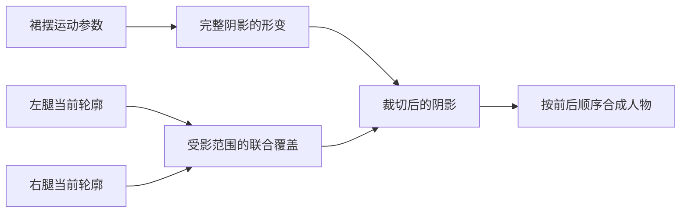
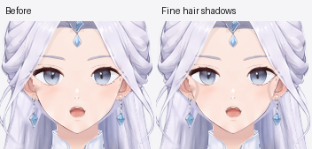
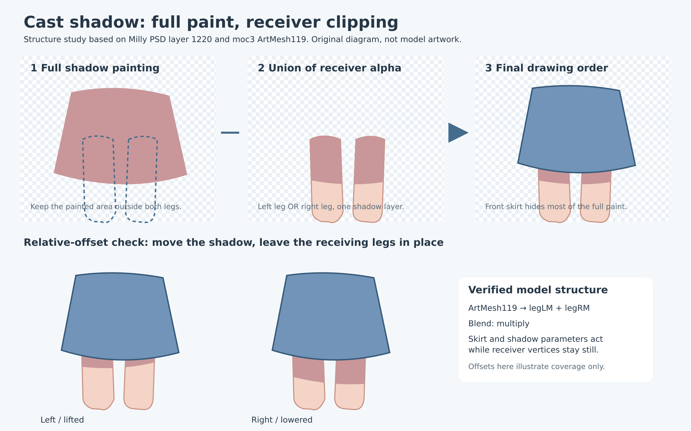
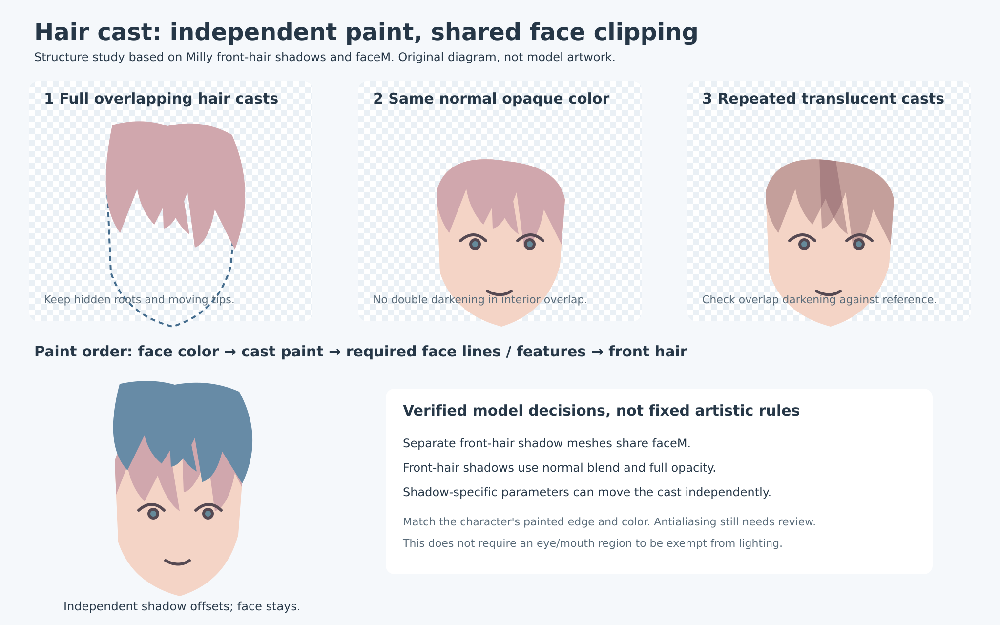

# 09 Live2D 蒙版投影：完整阴影素材、受影裁切与运动关系

版本：2026-10-22 / v1。适用于刘海投到脸上、头部投到颈部、袖口投到手臂、裙摆投到大腿等**部件之间的投影阴影**。衣服褶皱、肌肤本身的转面暗部与材质纹理继续保留在原画里，不在此步骤拆成投影。

采用的方法是：**画出有充分延伸的完整阴影素材，让它依据投影物的运动发生形变，再用受影面的当前轮廓裁切。** 当前静帧露出的阴影只是结果，不是素材应有的全部范围。制作素材、建立裁切、制作动画是三个不同阶段。

本篇依据仓库内真实 PSD、moc3 与纹理、原教程正文和官方 SDK 源码整理。[来源与复现记录](sources/shadow-mask-models.md)区分文件事实、参数测量和制作建议；[数值清单](sources/shadow-mask-models.json)保留文件指纹。没有从二进制 cmo3 读出变形器树，也没有把样例结构当成所有角色都必须遵守的规定。

## 1. “阴影蒙版”到底包含什么

日常制作把这一整套东西叫阴影蒙版，但至少要区分三个对象：

| 对象 | 作用 | 裙子例子 |
| --- | --- | --- |
| 投影物 | 决定阴影来自哪里、需要响应哪些动作 | 裙摆 |
| 阴影绘画层／ArtMesh | 保存阴影颜色、边界和透明度；包含被遮住的完整区域 | 完整裙摆状阴影素材 |
| 受影裁切源 | 限定阴影可以显示在哪个表面 | 左右大腿的颜色／专用轮廓网格 |

“画一张黑白图”不是必需条件。Cubism 的裁切来源可以是已有 ArtMesh 的纹理 alpha；阴影本身通常是有颜色的独立素材。专用裁切网格也可以使用，但不能凭它的名称判断是否正确，需核对真实像素和引用关系。

对于普通裁切，可把有效 alpha 理解为 `阴影 alpha × 受影覆盖`。多个受影来源是联合覆盖，不是要求同时位于左右腿内部；在全不透明区域表现为并集，半透明边缘仍有渐变。官方 Web SDK 有自己的通道、缓冲与预乘 alpha 实现，不应把这个说明式当成逐行等价的 shader。[S03]

前方裙子还会覆盖一部分阴影。因此，**原始阴影面积、与腿轮廓相交的面积、最终画面露出的投影面积**是三种不同的测量，不能混用。

## 2. 真实模型是怎么做的

### Milly：一张裙子阴影，裁切到两条腿

仓库的 `Milly原画.psd` 为 3200×4800。独立 `yy裙子` 层的 PSD layer ID 是 **1220**，边界为 `[1129, 2136, 2070, 2819]`，实际混合模式是**正片叠底**，不透明度 255/255，PSD 剪贴标记开启。[S02]

读取未裁切的原始 alpha，阴影有 **451,111** 个非零像素；与左右大腿层 **505、510** 的 alpha 并集相交为 **188,597** 个像素，前者是后者的 **2.392 倍**。这还没扣掉前方裙子遮住的区域，不能称为“最终可见投影的 2.392 倍”。它证明了作者保留了腿轮廓之外的完整素材，而不是只提取当前露出的两条阴影。

运行模型的 **ArtMesh119** 属于 **Part21**；包内显示信息把 Part21 命名为“裙子”。实际 mask 引用为 **`legLM`、`legRM`**，普通裁切，正片叠底；网格有 173 个顶点。纹理核对显示它是一块独立的完整有色阴影，裁切来源为腿部素材。[S02]

将其他参数复位到作者默认值，只改变单个参数，得到：

| 参数与包内显示名称 | 阴影网格最大顶点位移，参数 -1 / +1 | 两腿裁切网格位移 |
| --- | --- | --- |
| `ParamXBody7`：36x裙子 | 0.067576 / 0.067755 | 0 / 0 |
| `ParamXBody8`：37x裙子s | 0.047755 / 0.047666 | 0 / 0 |
| `ParamYBody2`：43y裙子 | 0.039338 / 0.022445 | 0 / 0 |
| `ParamYBody7`：44y裙子s | 0.016106 / 0.011430 | 0 / 0 |

位移单位为 Core 模型坐标，不是像素、角度或推荐振幅。本次只采样各参数的端点，没有运行物理时间序列。证据说明：**阴影可以变化，而受影裁切源不必跟着裙子摆动。** 多组参数也说明不能把这种结构简化为“一张影层复制裙子的整体位移”。这不证明它必须挂在哪个 deformer 父节点。

### Milly 与 Mao：发影不是小块额头色斑

Milly PSD 的 `头部/脸/发影/yy前发` 下有独立 `yy前发L / R / M`，layer ID 为 **834 / 833 / 832**，均为普通混合、不透明度 255/255。例如中发原件与阴影的边界：

| 层 | PSD layer ID | 原画坐标边界 |
| --- | --- | --- |
| `头部/头发前/前发/前发M` | 976 | `[1490, 442, 1721, 846]` |
| `头部/脸/发影/yy前发/yy前发M` | 832 | `[1484, 452, 1725, 856]` |

两者覆盖范围接近，并带位置差与延伸；视觉复核也显示完整发束形状。运行模型的 **ArtMesh48、49、50、47、51** 都裁切到 **`faceM`**，所属 Part 的显示名称分别为“yy前侧发”“yy前发”。这些影层使用普通混合。对 **ArtMesh50**，`ParamXHead1` 与 `ParamXHead19` 都能使影层变形，`faceM` 保持不动；显示名称分别为“14x前发R”“15x前发Rs”。这支持发影与脸轮廓分开处理，也支持影层具有自己的响应。[S02]

Mao 的导入 PSD 为 5800×8400，`顔/髪影 乗算` layer ID **116** 保留完整前发轮廓，边界 `[2482, 1489, 3328, 1980]`。**名称含“乗算”，PSD 实际却是普通混合，且未设置 PSD 剪贴。** 本次没有解析其 cmo3 绑定，不能进一步宣称其运行裁切怎样设置。[S02]

### Haru 与 Hiyori：避免拿错证据

Haru 分件 PSD 的 `脚R/影`、`脚L/影` 各保留 3,865,904 个非零 alpha 像素，与各自“タイツ”基底相交为 564,509，约 6.848 倍。但原始像素包含多个部位的明暗，**不把这些层全部认定为动态裙摆投影**。它们只补充证明原作者会保留裁切之外的像素，不构成固定面积倍率规范。

Haru 的部分运行裁切对象经纹理复核是发片；Hiyori pro 的八个被裁切对象属于眼球 Part。不能看到 mask 引用就称为投影阴影。部件、像素与运行引用必须交叉核对。[S02]

## 3. 在绘图阶段决定哪些投影要做

先对照 simplified 参考与组装后的分件，逐处记录候选关系：刘海→脸、头部→颈部、袖口→手臂、裙摆→腿等。每处回答四件事：

1. 原参考是否有这类投影，它是否参与人物的风格和体积表达？
2. 哪个部件的移动会改变它，受影表面是否是独立部件？
3. 原分件有没有已经画死的同一投影，新增后是否会重复压暗？
4. 当前制作的动作范围是否真的需要拆分，是否存在多个独立运动的来源？

有投影需求才制作。不要把所有深色像素都提取成影层，也不要为角色没有的服装或饰品硬加关系。分件生图通常已去掉跨部件投影；检查后复用干净底色。残留旧投影时才局部补画，保留褶皱、轮廓线和固有明暗。

原绘制指南明确提出：“裙子在大腿上的阴影”可独立拆分，并在 Cubism 中用剪贴蒙版制作随裙子摇摆的效果。[S01a] 这里将它作为有需要时采用的制作原则，而非要求每个角色都添加。

## 4. 绘制完整阴影，而不是裁死当前可见区

原指南对完整性有明确要求：“裙子阴影的面积应该类似于裙子”“头发阴影的面积应该类似于对应发束”，目的在于运动时不出现破绽。[S01b] 这与真实 Milly 素材一致。

制作时先画出投影物对应的完整形状，再依据原参考修整偏移、边界与颜色。它是绘画设计的投影，不要求机械复制投影物 alpha；发束阴影可以简化细丝，裙影也可根据画法调整宽度。**同样不能只把裙下露出的暗条复制出来，沿腿轮廓擦成一条死边。**

余量应覆盖预期相对运动会扫过的范围：前发左右摆时可能进入额头的新区域、裙摆上下动时可能进入大腿的新区域都要有素材。不要设“一律膨胀 10%”或“面积必须达到两倍”这样的门槛；画布尺度、动作范围和受影轮廓不同，倍率不能代替检查。也不需要无条件把整个画布涂满。

每个独立运动来源原则上保留独立可编辑影层；多个发束始终作为整体运动时可以合并为同一制作单元。一个来源照到多个受影面，可以共享完整阴影并用联合裁切；若受影面需要不同颜色或响应，再拆为多层。**不能为左右腿强制复制两张相互重叠的正片叠底影层。**

## 5. Krita、PSD 与 Cubism 的裁切关系

### Krita 作者工程

把受影底色与其阴影放在**隔离组**里，关闭组穿透，为阴影开启“透明度继承”。阴影在受影底色之上，线稿与必要的五官细节在其之上。保留原分件和已有穿戴／透明度蒙版，不合并掉正式部件。[S04]

Krita 的透明度继承依据同组下方已经合成的 alpha 工作，**不是 Photoshop 那种仅绑定最近一个底层的剪贴标记**。如果组里混入袖子、裙子或其他不应受影的实色层，它们也可能扩大裁切范围。用干净的受影颜色子组限定范围；复杂已有蒙版要重开检查。专用透明度蒙版可继续限制额外区域，但不要把完整影层永久擦除。

多受影面的联合裁切可在隔离组中使用左右腿的覆盖。必须确认原前后层序与组混合未被改变；必要时保留独立受影子组，并明确记录其覆盖来源，不能为了裁切把所有角色图层混在一组。

本次 Krita 5.x 保存／重开实验确认，RGBA 影层的透明度继承序列化为 `channelflags="1110"`，隔离组为 `passthrough="0"`。这是 KRA 保存检查的实现细节，不要求画师手改 XML。

### PSD 交换与 Cubism 绑定

保留完整影层为独立可导入素材。Krita 的透明度继承、PSD 剪贴标记和 Cubism 的 ArtMesh mask 引用是不同的数据结构。**不能因为 KRA 静帧裁切正确，就宣布 moc3 已绑定完成。** 在 Cubism 阶段核对影层 ArtMesh，显式指定受影 ArtMesh 的 ID；多来源时核对完整列表。

Milly 的发影 PSD 层没有剪贴标记，但运行模型真实绑定了 `faceM`；反过来，PSD 中开启了剪贴也不能代替运行包检查。这正是必须分别验收作者工程和导出模型的原因。[S02]

## 6. 颜色、层序与重叠怎么选

原指南列出三种画法：正片叠底、较深颜色的半透明层、不透明有色层，并指出重叠发影可能因多次混合而变黑。[S01b] 选项按关系决定：

| 做法 | 适用情况 | 必查问题 |
| --- | --- | --- |
| 普通混合、不透明颜色 | 参考有明确统一发影色，多个发束会重叠 | 色彩衔接、抗锯齿边；不同阴影色互相覆盖时是否跳色 |
| 正片叠底 | 需要保留底层纹理、随受影底色调色；如 Milly 裙影 | 多个影层重叠是否压暗两次、跨材质颜色是否合适 |
| 普通混合、半透明颜色 | 参考是柔和薄影，少量重叠可接受 | 重叠处 alpha 叠加、底色变化后的发灰或失色 |

不把乘算作为所有阴影的默认，也不全面禁止它。两个相同乘算影重叠会连续乘两次；相同半透明普通色也会提高覆盖。普通不透明、同颜色的发影可以避免内部区域二次压暗，但半透明抗锯齿边和不同颜色仍需检查。

刘海投脸时通常将阴影放在脸颜色之上、眼口与线稿之下，按参考保留五官清晰度。这是**绘画层序**，不等于给眼嘴硬编码一块“永不受影”的保护区域。原图需要的眼部暗色仍由相应素材表达。裙影则位于腿之上、前方裙摆之下；裁切正确也不能代替前后排序。

软硬边、色相与深浅首先匹配 simplified，不在这一步增加全局实时打光，也不抹掉角色原本的绘画风格。

## 7. 阴影如何跟随运动

绑定的语义是“谁的运动决定投影变化”，不是“阴影必须是投影物 deformer 的直接子节点”。可按后续模型复杂度选择共用运动域、独立阴影 deformer 或影层自己的参数响应；如果需要修正投影范围、压缩程度和相位，就为阴影保留独立控制。

Milly 裙影同时响应裙子与裙子 s 参数，发影也同时响应对应前发与前发 s 参数。这是已有模型的具体做法，不能据此要求新模型照搬参数数量、相位或范围。[S02]

基础素材工作流只交付完整形状、颜色、受影裁切和运动来源说明。后续 deformer 制作阶段才确定实际关键形与参数联动；本阶段不额外制作九轴、物理关键形或多光向动画。受影面与阴影各自形变后，运行裁切使用双方当前的结果。[S03]

这套方法可作为 Live2D 的纹理／ArtMesh／参数数据交付，随已制作动作变化。**它没有根据移动光源或深度几何自动重新求投影。** 大幅前后穿越、受影面切换或投影物替换，仍需模型作者预先设计相应显示和形变关系。实时法线＋深度是另一个工作流，见 [01](01-lighting-and-depth.md) 与 [08](08-part-surface-completion.md)。

## 8. 制作检查与交付标准

### 头脸优先复核：Jianma 的实测修正

Jianma 首版已通过原生裁切和偏移检查，但同一侧发 part 中两条分叉外弯细发的轮廓未进入完整发影，脸颊缺少对应窄影。返修对照原分层像素与前后关系，将细弧补进原来两层发影，继续使用原 UUID、受影裁切和运动来源。脸部放大后还发现，大片发影使用的浅暖粉色在腮红附近不足以显出细弧；只对窄弧使用稍深的暖粉，保留原宽影、脸底、五官与其他投影。

此图按原画像素裁切，没有缩小。制作和复核先看头脸：逐束判断刘海、侧发、游离细条及卷尾与额头、太阳穴、脸颊的投影关系，再查看全身。向外伸出的发束是否落脸，需要结合实际轮廓、前后位置和参考光向判断；确实不适用的候选也要说明原因。完整影层、正确裁切和最终可见效果分别检查，不能靠整体加深脸部补救细影缺失。工作流交付 `face-review.png`，展示原组装、去影、最终脸部及细发偏移；无脸角色使用主要识别区域。

素材阶段检查当前静帧，并临时移动完整影层模拟合理的相对运动：左右偏移、上下伸缩、发束重叠、裙摆抬起，以及受影部件独立移动。测试后复位、保存并重开。此检查只能证明素材有覆盖和裁切余量，不冒充完整物理或九轴验收。

| 观察到的问题 | 优先检查 |
| --- | --- |
| 一摆就断影，腿上露出矩形或短条边 | 阴影是否预裁死、余量是否缺失 |
| 阴影跑到另一件衣服或脸外 | 裁切源是否混入其他实色层、组是否穿透 |
| 两撮刘海重叠处出现黑斑 | 双重乘算／半透明叠加，是否适合统一普通不透明色 |
| 阴影贴在腿上不随裙摆变化 | 是否误把受影部件当成唯一运动来源 |
| 裙摆摆动后影子过度拉长或漂浮 | 是否直接复制整件变换，缺少投影自己的形变控制 |
| KRA 正确，Cubism 中越界 | 运行 mask ID 是否真正绑定；交换格式是否丢失关系 |

交付保持原画分辨率与透明背景，包含可编辑工程、无损预览、关系表和检查报告。每个制作单元记录投影物、全部受影来源、完整影层、实际裁切结构、混合模式、颜色依据、运动来源与余量检查；不适用关系写明原因。报告区分素材检查、实际 Cubism 绑定与动态验收，不能用“文件存在”代替美术通过。

### 工作流参考图与自动检查

下面两张图是依据上述 Milly 图层与运行 mask 关系绘制的原创结构示意，不是模型原图，也不作为新角色的形状模板：

[制作工作流](../../../.agents/skills/live2d-maker/shadow/README.md)已加入真实 part／深度／UUID 索引和固定 Krita 检查。每处影层记录原像素偏移；保存工程在独立进程中只读打开，输出完整影层、接收面、去影对照及偏移图。量化记录用于发现空层、错裁切或预裁死风险，未规定素材面积倍率，也不能代替画法复核或实际 Cubism 动态验收。

## 9. 引用

- **[S01a]** 夏卜卜讲解的 Live2D 绘制指南，仓库原文[《8.下半身的拆分与制作》](../../live2d-tutorial-text/8.下半身的拆分与制作.txt)，裙子投影拆分及剪贴段。
- **[S01b]** 同系列[《14.透明，阴影，高光的拆分方式》](../../live2d-tutorial-text/14.透明，阴影，高光的拆分方式.txt)，阴影尺寸、三种混合与发影重叠段。本次阅读的是保存正文，未声称重新逐帧看完原视频。原文“64 个剪贴蒙版”有版本背景，本篇不把它当成现代 SDK 的通用限制。
- **[S02]** [模型证据与复现](sources/shadow-mask-models.md)：Milly、Haru、Mao 的 PSD，Haru、Hiyori pro、Milly 的运行包。原件入口及许可见[模型目录](../model-originals/readme.md)。本次不新增分发其图片、纹理或工程。
- **[S03]** 官方 CubismWebFramework，固定版本 `198a3769c26ca3d7b600e932590433badd392edd`：[裁切管理](https://github.com/Live2D/CubismWebFramework/blob/198a3769c26ca3d7b600e932590433badd392edd/src/rendering/cubismclippingmanager.ts)、[WebGL 裁切与逐帧网格](https://github.com/Live2D/CubismWebFramework/blob/198a3769c26ca3d7b600e932590433badd392edd/src/rendering/cubismrenderer_webgl.ts)、[遮罩与颜色合成 shader](https://github.com/Live2D/CubismWebFramework/blob/198a3769c26ca3d7b600e932590433badd392edd/src/rendering/cubismshader_webgl.ts)。本次实际取得并读取源码；未嵌入 SDK。缓冲尺寸、数量和高精度模式影响预算，不能照搬旧教程单一数量上限。
- **[S04]** Krita 原生透明度继承保存／重开实验，以及其[官方 Alpha Inheritance 说明](https://docs.krita.org/en/tutorials/clipping_masks_and_alpha_inheritance.html)。本次实验范围是隔离组内阴影裁切及保存数据；PSD／Cubism 转换不在该实验范围内。官方说明的阅读状态见来源记录。
