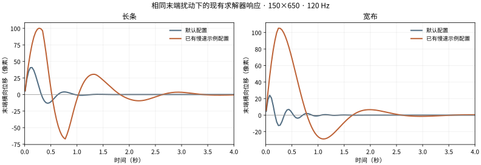

# 组件物理：连接、形变与自然响应

状态：2026-10-22 的正式制作方法与下一阶段实现设计。已完成源码研究、真实 physics3 数据检查和现有求解器的数值测量；本章的新组件管线、自由形固定区、摆链及材质标定尚待实现和画面验收。研究范围与固定版本见[来源记录](sources/component-physics-research.md)。本阶段制作飘带、裙摆、长发等摆动物体；果冻另有制作流程。

## 1. 自然感由哪些东西共同决定

一张图层不是天然的物理体。发束的发根、发梢、线稿和局部暗部可能是不同绘图层，却属于同一个运动组件；一张裙子图层中的左右自由布片也可能需要不同活动区。组件定义必须同时回答：

| 要决定的事 | 制作依据 | 判断错了会出现什么 |
| --- | --- | --- |
| 挂在哪里、跟随谁 | 贴头范围、腰口、缝线、真实连接处 | 根部滑动、衣服离开身体 |
| 哪些像素固定、过渡、自由 | 原图和分层像素，不只看名称和外接矩形 | 整片摆动、连接处折断 |
| 哪些层共享运动 | 同一表面的线稿、颜色、印花、贴身装饰 | 细节漂浮、纹理与轮廓错位 |
| 哪些地方能弯、能压缩 | 材质、自由长度、轮廓与线稿 | 橡皮拉伸、纸板转动 |
| 反应多快、余摆多久 | 规范输入下的响应曲线与完整播放 | 快速抖动、无限晃动、突然停住 |
| 最大可以动到哪里 | 角色轮廓、连接余量、相邻部件和防翻折检查 | 穿帮、极端形变、持续顶到限幅 |

采用“动作姿态 → 运动求解 → 作者形变 → 最终限制 → 渲染”的分工。Cubism 和 psd2live 的参数链，以及 Inochi2D 的物理驱动参数，都支持这一分工。物理合理并不自动等于角色画法自然。

## 2. 研究给出的直接依据

- **psd2live：**同一物理体可以包含多张网格；固定点、逐顶点刚度和保形是独立权重组。胶水可以让固定点跟随腰部等另一张网格的实际形变。SWING 的轴角、固定边偏移、根部柔软度和横截面平行程度，说明作者空间比一组弹簧数值更重要。多段输出负责逐段跟随。
- **Cubism 与真实模型：**虚拟摆链驱动作者参数。莉尔的“侧发x”有根节点加四节摆链，输出读取第 2、3、4 节；樱桃蛋糕天使的“前发x”有四个不同节的输出。它们证明作者使用分段输出，不证明这些数值可以复制到我们的 XPBD。两份文件的部分设置很接近，也不能当成大量独立样本。
- **Inochi2D v0.8.7：**挂点更新与动态状态分开；摆与弹性摆分开；弹性响应明确使用 Hz 和阻尼比，并补偿静止重力。适合借鉴可理解的时间参数及原画平衡态。
- **Rive、DragonBones、Synfig：**提供骨骼权重、绑定姿态和变形空间的参考。此轮读取的文件不能证明它们有适合长发的次级动力学；它们主要帮助解决多层共用形变及姿态更新。
- **Spine 公开源码：**骨骼的移动和转动可产生惯性，并支持独立的 reset、固定步积累及插值。它使用专有 Runtime 许可，作为架构对照，不作为可直接搬入的开源依赖。

## 3. 组件与绘图层分开管理

建议的运动类型：

| 类型 | 适用组件 | 求解和形变路线 |
| --- | --- | --- |
| `strand` | 长发、细飘带、长绳 | 少量连续摆链控制点，保长、恢复原曲率，再生成平滑中心线与网格 |
| `cloth` | 裙摆、宽袖尾、宽布片 | 二维 XPBD，固定接缝，区分拉伸、剪切、弯曲与保形 |
| `pendant` | 硬挂件、耳坠 | 挂点附近的摆动或旋转，保持自身形状 |
| `follow` | 线稿、印花、贴身装饰 | 采样所属组件的同一个形变场，不重复求解 |
| 不绑定 | 身体、贴头短发、贴身衣料等 | 由动作／姿态负责；只有明确自由段才另建物理组件 |

这里的 `follow` 是层角色，不是另一个弹簧。多个纹理边界不同的层，应在各自原始 UV 和网格上采样共享形变场，不能直接套同一张外接矩形网格，否则可能把纹理边缘拉满、出现重复像素。绘制顺序保持原工程顺序，不按物理组重排。

双侧长发、多个裙片各自标定连接关系；没有视觉依据时不随机增加相位。投影蒙版按 [09](09-clipped-cast-shadows.md) 的投影源／受影者／裁切关系配置，不能把阴影层一概当作布料，或直接与受影者共用一个摆链。

## 4. 支撑区与自由段先于时间参数

制作顺序：先找连接处，画固定区域及自由轴，再编辑过渡和活动上限，最后调回弹。

1. **固定区：**网格顶点跟随当前支撑姿态，物理残差严格为零。固定并不是永远停在原图世界坐标。
2. **过渡区：**从固定区连续接入，形变值与切向尽可能平滑；在边界插入网格点／边，避免一块大三角形跨过去。
3. **自由段：**沿真实自由长度安排分段，支持斜轴、曲轴和非矩形接缝；多连通区域检查是否真的连接，透明间隔不能自动粘成一块。
4. **空间刚度：**根部更保形，末端更能弯；布片保形、顺纹理拉伸和横向剪切分别控制，不用统一“硬度”替代。

整齐直条可用固定侧＋比例作为快捷编辑；不规则头发和裙口需要可见的固定线／区域以及权重画刷。外接矩形比例仅是初值，不是自动分析已经正确的证据。

沿组件轴可把活动权重写成 `w(s)=smoothstep(s0,s1,s) × b(s)`。这只是作者空间权重；与求解器中的质量、刚度分开保存。固定区 `w=0`，自由段的上限也应渐增。

## 5. 两条主要求解路线

### 5.1 长发／飘带：摆链与保长中心线

初版可用根节点加 3–5 个控制节点作为起点；节数按可见弯曲段和曲率决定，不能由图片像素数决定。使用约束长度和恢复原曲率的弯曲约束，把上节传来的运动向后传递。输出是各节的相对角度／偏移，而非所有顶点收到同一个正弦或弹簧位移。

把控制链转换为连续曲线时检查弧长与根部切向；Hermite／样条本身不保证保长，需要按弧长重采样和校正。沿曲线驱动原网格，横截面可按作者参数在“跟随切向转动”和“保持原方向”间过渡。长条向侧面摆开时应自然缩短纵向投影，避免只左右平移而把发束拉长。

末端滞后应来自耦合运动与作者输出分段。只有控制曲线移动而内部纹理仍独立拉伸，也不能算完成。

### 5.2 裙摆／宽布：材质化的二维 XPBD

沿用当前 XPBD 基础，补足以下作者输入和尺度约定：

- 顶点质量按邻接三角形面积分配；尺寸、网格密度变化不应意外改变材质响应。
- 拉伸、剪切、弯曲、面积／保形分别有柔度及空间权重。XPBD 的时间缩放使用 `alphaTilde=alpha/dt²`；实际材料映射还须结合质量、几何与离散方式校验，不能只把所有网格填同一个常数。
- 拉伸约束负责保长；柔软对角／剪切约束允许宽布片弯折；原形恢复不能强到让整张裙子变成弹簧板。
- 原画作为中性平衡姿态。加入重力时先标定静止偏置，避免开启物理后整体掉下去。
- 先保证跟随支撑和局部受力，再考虑碰撞。此阶段不把单视角深度当作可靠的布料厚度或身体碰撞模型。

## 6. 动作、父空间与物理叠加

令 `Xpose(t)` 是作者动作／deformer 已经产生的姿态，物理计算其上的残差 `u(t)`，最终为 `Xpose(t)+u(t)`。每个组件在自己的参考空间里求解，父级挂点的位移和角速度产生惯性；父级的实际形变同时更新组件的中性几何、接缝和目标曲率。

必须区分三种操作：

| 操作 | 应有行为 |
| --- | --- |
| 拖动画布、缩放视图 | 改变取景，不输入物理力 |
| 真正的头部／身体动作 | 对其连接的组件传递挂点运动；头部不直接驱动裙摆 |
| 切项目、复位、跳到不连续姿态 | 明确 reset／重标定，不把瞬移当成猛烈甩动 |

普通连续动作不能逐帧把物理状态清零；也不能永远把拉伸约束锁到原图长度，与作者九轴变形对抗。连续过渡与“瞬移”的判定要由动作系统给出，不用一个世界距离阈值猜测。

## 7. 时间参数、软边界与硬约束

基础响应可用 `u'' + 2ζω u' + ω²u = F`，`ω=2πf`。频率 `f` 控制响应节奏，阻尼比 `ζ` 控制振荡衰减，两者独立；欠阻尼通常产生余摆，阻尼为零不是自然感的目标。摆链和宽布还有耦合模态，最终仍以测得的响应曲线为准。

材质预设应保存实际参数及作者权重，适用于明确的运动类型。不要使用角色名作为预设，也不要复制 Cubism 的 Delay／Mobility 当作我们的 Hz／阻尼比。设置“柔软”时也不应顺带放大允许位移。

活动范围分为两层：日常接近边界时平滑减弱输出或增加阻尼；最终仍检查固定点、每段弯角、最大位移、拉伸、剪切、三角形面积与方向。硬限制作为兜底，常规测试中不应持续顶在边界。现有求解器的整体回退可以作为最后保护；新的局部约束应减少“某个小三角形越界让整件衣服同时停住”的情况。

## 8. 配置管线与产物设计

下一阶段采用独立 `physics` 管线，输入是正式组装 KRA／PNG、两套 part 结构、原图／simplified 参考。阴影不是前置条件。流程：

建议产物：

| 产物 | 内容与职责 |
| --- | --- |
| `physics/step01/components.json` | 全部候选组件、层关系、连接依据，以及明确不绑定／待确认的对象 |
| `physics/step01/weights/` | 固定、过渡、刚度／保形等作者权重；用组件空间关联，记录原尺寸与指纹 |
| `physics/step02/physics.json` | 检查通过的完整配置：组件、运动类型、稳定层引用、支撑、求解与输出限制 |
| `physics/step02/review/` | 中性／峰值／反转／回落的图像、短动画与响应曲线 |
| `physics/step02/report.json` | 实测响应、约束统计、完成状态、输入与配置指纹、遗留问题 |

这些路径和字段是拟定契约，还没有被当前程序消费。正式配置至少要有：

- `version`、求解器与作者生成器版本。
- `source`：组装输入、稳定图层目录和像素／几何的指纹；不能把浏览器会话当作身份。
- `components[]`：组件 ID、显示名、运动类型、真实 `layerRefs`、共享场／跟随关系、支撑引用、局部轴／中心线和权重引用。
- `material` 与 `response`：实际材质参数、频率／阻尼、根部与末端的空间分配。
- `limits`：独立保存运动边界，不与材质或输入倍率混在一起。
- `review`：规范输入、峰值／衰减／限幅及视觉复核的证据引用。

### 已落地：图层身份与绑定草稿

工作台图层树和部件快照现统一使用 KRA 原生 UUID；`n0.1` 等遍历编号只作为旧草稿迁移别名，不再用于新绑定。颜色／法线／深度和图层选择引用同一个 UUID。部件快照同时保留人物／衣服来源前缀的完整 `partPath`、源像素指纹及隔离合成片段的全部源层 UUID。

`groups.json` 的完整部件路径适合组件管线的语义关联；实际工程定位使用 UUID。工作台当前的 `partPath` 是规范化图层名称中的可读来源信息，不按同名自动重绑。后续组件管线需要明确记录 `groups` 部件路径与源层 UUID 的一对多对应。图层改名或重排不改 UUID；复制／重建图层产生新 UUID 时，必须有明确迁移记录。

物理草稿／导出配置升级为 schema 2，逐条保存 UUID、原画布、bounds、源像素指纹、合成成员和参数。项目草稿按项目目录与名称存储，添加阴影或重新保存整份 KRA 后仍能找到。兼容性检查按被绑定部件进行，整份文件哈希变化不再使全部绑定失效。新增图层默认不绑定；原有未变部件继续沿用参数。旧 schema 1 只在原始文件哈希、画布和遍历别名都匹配时迁移。

真正改变部件像素、尺寸或合成组成，以及删除／替换原层时，相关旧配置保留为待确认，不转绑到同名层，也不被自动保存的默认值覆盖。复原原工程后可以恢复；明确编辑当前部件会以当前结构重新创作该条绑定。若原有独立层被新剪贴隔离组包成合成片段，虽然 UUID 来源仍在，当前逐层求解不能自动推断多个运动场和阴影跟随关系，因此保留绑定并提示合成结构变化，等待组件映射处理。

PSD 首次导入产生的 UUID 应通过另存规范化 KRA 作者工程固定下来。未规范化的 PSD 再导入时不假定 Krita 生成的 UUID 相同；本节没有用名称或图层顺序冒充持久身份。

加载 shadow KRA 时，按源层身份与 `shadows.json` 关系映射到同一组件；若复制／重建改变身份，必须有显式来源映射，不能只按相同名字猜。只增加阴影不会使组装组件全部过期。实际组装像素、几何或连接结构改变时则重新分析或明确迁移。

恢复按步骤的输入、权重、配置和审核指纹判断；已有 JSON 只证明文件存在。编辑草稿与已审核配置分开保存，工作台修改后标为待复核，再由同一工具完成检查并发布新版 `physics.json`，避免把手工改动伪装成管线已经审核。

## 9. 工作台与 agent 必须共用测试

只保留当前项目的物理页签和同一画布，包含组件列表、相关图层联动、固定线／区域编辑、运动轴、材质与空间权重、最大约束及测试。原尺寸颜色、法线、深度继续使用同一最终网格与源 UV；法线按 Jacobian 逆转置修正，深度沿用已有表面数据，适用前提见 [08](08-part-surface-completion.md)。

agent 的测试工具调用同一配置解析、求解器和渲染器，以离线脚本／无界面浏览器执行同一规范输入；不能另写一段接近的渲染或正弦动画。至少有单次轻扰动、明确方向的挂点牵动后释放、往返动作、持续小幅驱动和极端输入。鼠标悬停测试保留，只有选中扰动工具才输入力。

数值检查：固定残差、无输入平衡态、第一峰值／回落时间、衰减包络、局部相位、常规输入的限幅占比、防翻折与原尺寸。没有统一“自然分数”；数值先排除失稳，视觉再判断根部连接、连续曲率、纹理保长、接缝和相邻层是否协调。

最先验证四类案例：斜轴长发／飘带、带线稿和印花的多层布片、非水平腰口的宽裙摆、两条相邻但独立连接的发束。通过后再给 Jianma 生成初始配置；不能凭名称把整个人物默认启用物理。果冻、身体碰撞、九轴补画与 Cubism 烘焙不在这一轮验收内。

## 10. 当前实测能说明什么

[测量记录](sources/physics-component-measurements.json)在相同 150×650 的测试矩形上施加归一化末端脉冲，120 Hz 运行 8 秒。默认长条的末端首次最大位移约 41.29 px，峰值在 0.125 s；默认宽布约 24.01 px，峰值在 0.075 s。已有慢速示例初值分别约 100.22 px／0.283 s 和 105.33 px／0.258 s。所有固定点残差为零，最终约束均有效。

这说明当前求解器已有稳定底座，而角色初值、固定范围、限制和时间响应共同影响效果。两套预设同时改了多项配置，本测量不能把差异全部归因于阻尼，也不能证明慢速示例更好看。测试从末端施力，不用于证明父级驱动下的根到尾滞后。下一阶段最需要补齐的是组件连接、共享形变场、非矩形作者权重和完整响应审核。

复现：在仓库根目录运行 `node tutorial/live2d-guidance/tools/probe_component_physics.mjs <输出 JSON 路径>`。它只读已有模型文件并运行本项目的数值求解，不运行第三方模型、付费生成或管线任务。
