# 脸部与五官九轴

来源：B 站铁锭 Ferrum《Live2D Cubism Tutorial No.004 ④ 五官九轴》，用户 2026-10-30 提供，见 [sources/face-nine-axis.mp4](sources/face-nine-axis.mp4)。讲解约 13.5 分钟，之后是无讲解的头发、发饰制作。本页只整理脸和五官（不含头发）。live2d-maker 的 `nine-axis` step02（[脸部转向提示词](../../../../.agents/skills/live2d-maker/knowledge/nine-axis/step02_head/prompts/脸部转向.md)）按本页做角度 X。

## 制作顺序

1. 用脸底和线稿建脸部 XY 父变形器，再把其他脸部部件放进去。
2. 做脸的 X：注意转面一侧的形状（三峰三谷）。做完一侧再反转。
3. 先做眉、眼、腮红一组。关掉鼻子和嘴，给这三类部件建一个变形器。
4. 做嘴。
5. 做鼻子。嘴定好后，鼻子就容易定位。
6. 除耳朵外，对五官和脸型整体微调。

总原则是**大造型小细节**：父变形器决定位置、造型和透视，子变形器只补父级做不到的细节。做一个五官时，要同时看它和其他五官、脸型的关系，不对就回头调整别的。

## 要点

| 帧 | 要点 |
| --- | --- |
| 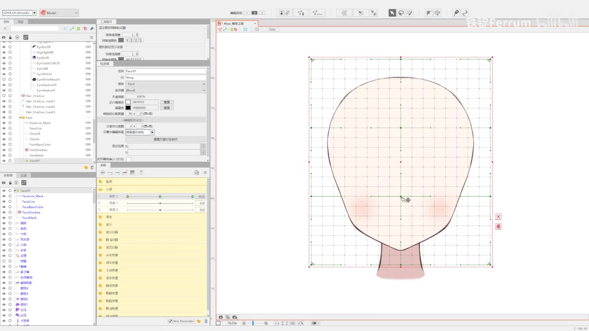 | 脸 X：重点是转面一侧的形状 [03:38] |
| 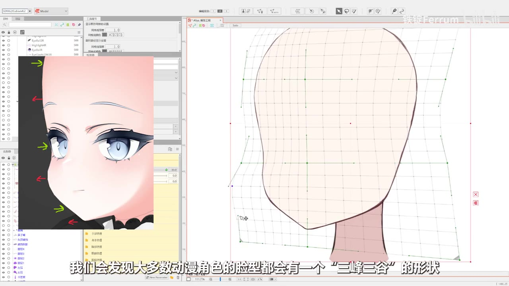 | **三峰三谷**：多数动漫脸在转面一侧有三处外凸、三处内凹 [03:47] |
| 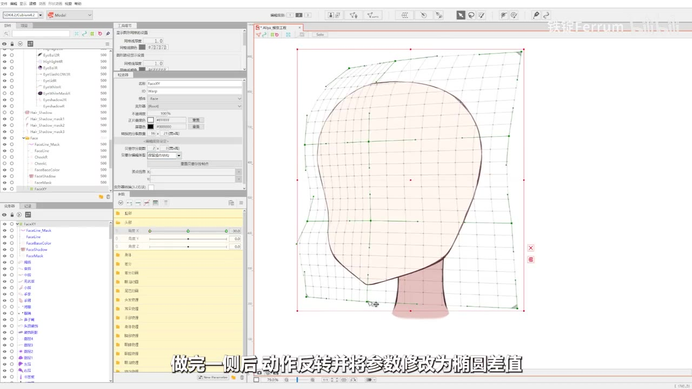 | 一侧做完后反转。这一阶段不用细调脸，做五官时会随时修改 [04:03] |
| 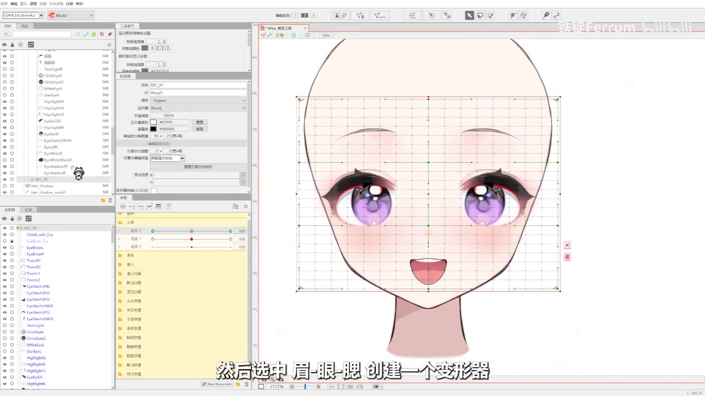 | 关掉鼻子和嘴，用眉、眼、腮建一个变形器同时做 [06:03] |
| 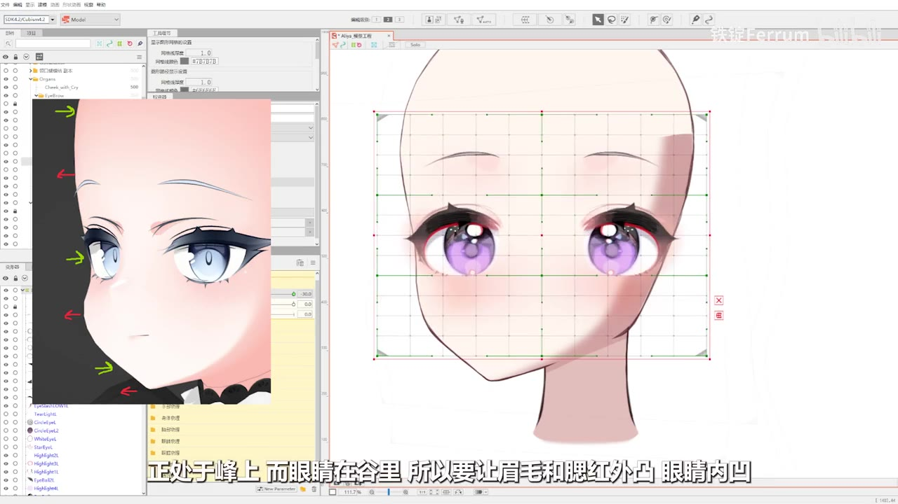 | 眉毛和腮红在峰上，向外凸；眼睛在谷里，向内凹 [06:25] |
| 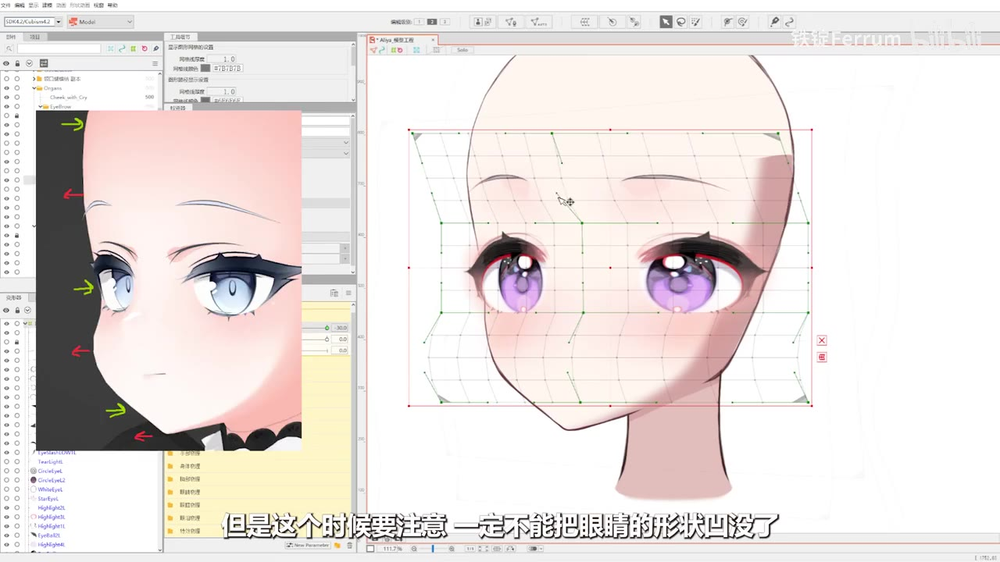 | 不能把眼睛的形状凹没。瞳孔处的分割点尽量横平竖直 [06:32] |
| 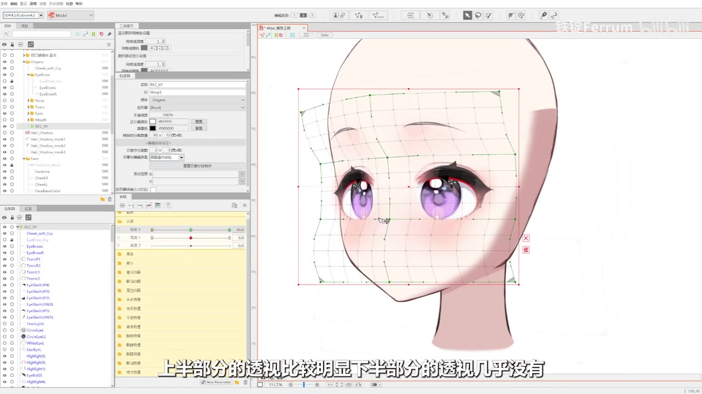 | 透视不可无，也绝不能过。眉眼上半部分透视明显，下半部分几乎没有，符合头部的球形结构 [06:43] |
| 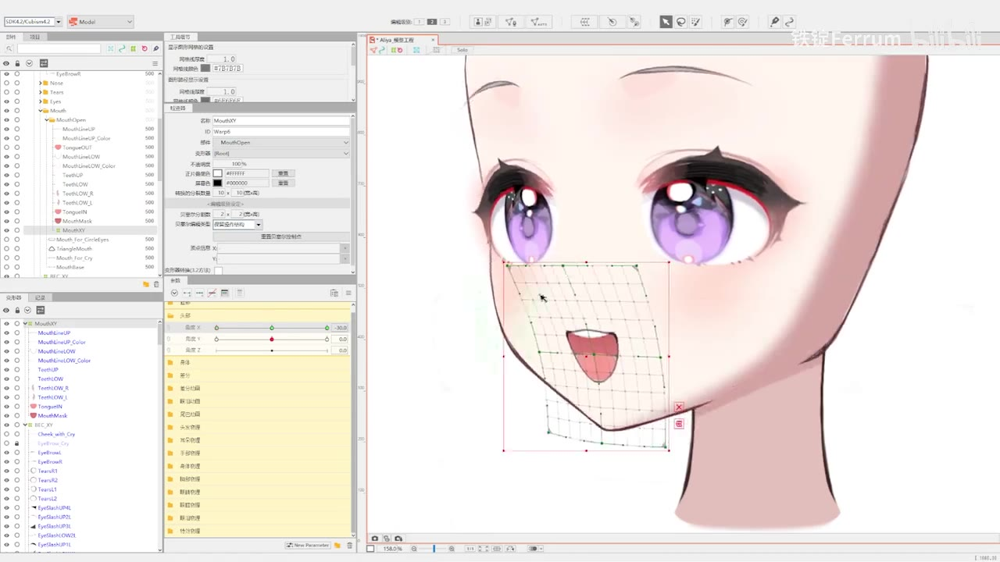 | 嘴和眉眼相反：下半部分透视明显 [10:15] |
| 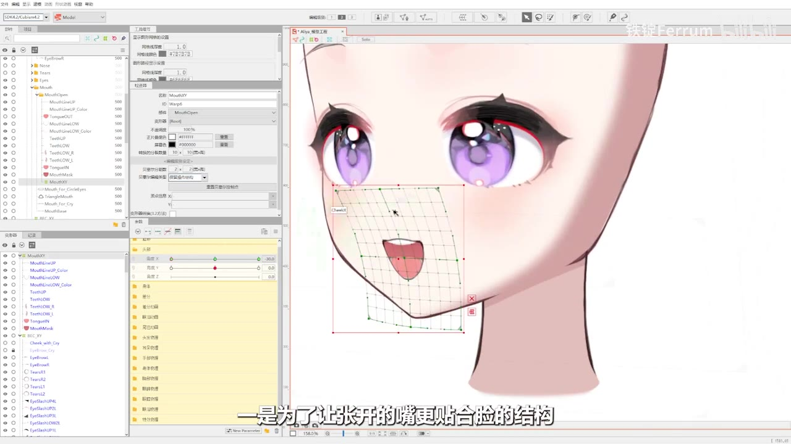 | 这样张嘴时更贴合脸的结构，也更二次元 [10:28] |
| 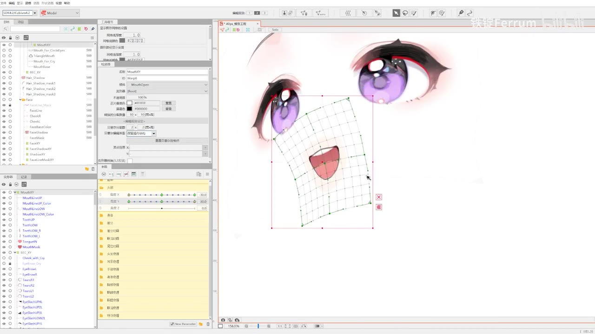 | 鼻子 X 主要是位置偏移，把形状做对即可 [11:11] |
| 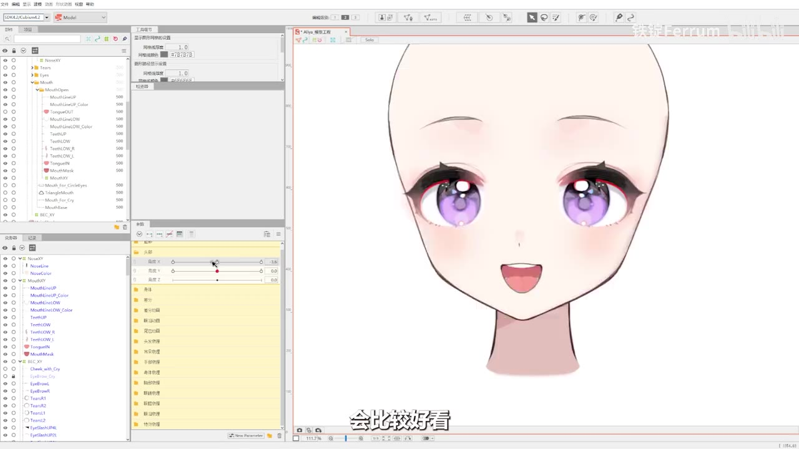 | 鼻、嘴、下巴连成一条线比较好看 [11:27] |

其他要点：

- **只看五官**：做嘴时，可以关掉除眉眼腮和嘴之外的头部图层，单独对比两者的关系。脸型可能还不对，会干扰透视判断 [10:39]。
- **Y 轴**：重点不在透视，而在距离关系。低头时眉眼距离缩小，抬头时增大 [07:12]。嘴低头变扁，抬头变高 [10:34]。鼻子低头更靠近嘴，抬头时跟着嘴一起动 [11:39]。
- **斜切（四角合成）**：建议手动做，不用自带斜切。不碰中间手柄，留作中轴参考。斜切后整体上下微移，过渡会更圆滑。静态轴始终以画面中心为准保持透视 [08:02–09:37]。
- **检查**：反转后反复拖动参数，看过渡是否流畅、是否沿一条好看的弧线 [04:45、06:59]。

## 耳朵（用户补充，2026-10-31）

教程的微调明确跳过耳朵。耳朵整体跟随父级，只做平移和横向透视缩放，不扭曲形状。远侧耳（转离观众的一侧）在该转向的关键形上用不透明度 0 隐藏，而不是靠形变压扁或塞进脸里；近侧耳保持原形。step02 的 `deformers.json` 为每个部件记录各关键形的 `opacity`，+30 取配对部件 −30 的值。

起因：step02 首次试跑时，agent 让耳朵贴合生图中的耳朵像素。结果远侧耳仍然露在外面，近侧耳被拉扭曲。

## 资料

| 文件 | 内容 |
| --- | --- |
| [sources/face-nine-axis.mp4](sources/face-nine-axis.mp4) | 教程视频（24:55）。原片 149 MB，超过 GitHub 单文件上限，因此转码为 15 fps 的 H.264 CRF 30 与单声道 AAC 64k（70 MB）。转码后 SHA-256 `a4a5c5778041b60ab677ba60edbf53d8c6cb1d4f13863e4e09161e5bc11aab41`，原片 SHA-256 `55e64a20b14cafddd314523b118aaa8ab061b997fc9bdba22088593c887d9255` |
| [sources/face-nine-axis-transcript.txt](sources/face-nine-axis-transcript.txt) | faster-whisper medium 机器听写，带时间戳，有同音错字，以画面字幕为准（如「三丰三鼓」应为「三峰三谷」，「配音器」应为「变形器」，「外轴」应为「Y 轴」） |
| [sources/face-nine-axis-frames/](sources/face-nine-axis-frames/) | 上表的 11 张原分辨率关键帧 |
