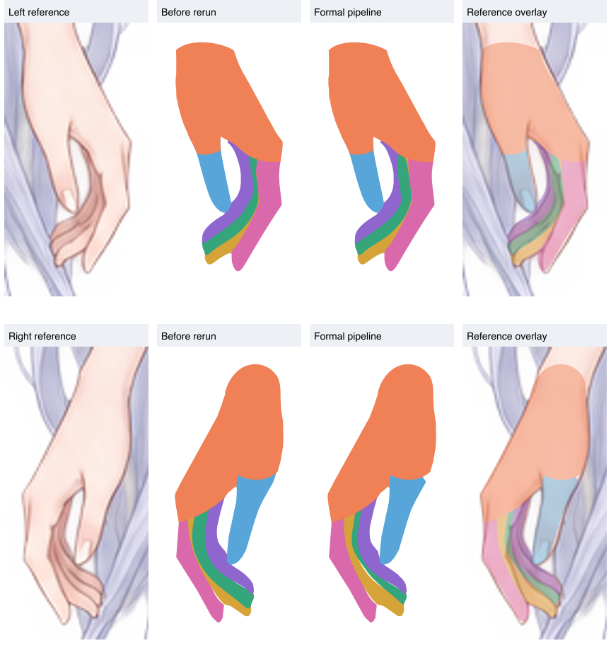

# 十指连接先验：正式收录与主流程重跑验收

2026-10-15。左右按角色自身：左手在画面右侧。

## 收录位置与适用范围

连接先验已写入 `prompts/groups/arms/arm_left/hand/<手指>/completion.md` 与 `arm_right` 对应目录。适用于左右手的 thumb、index_finger、middle_finger、ring_finger、little_finger，共十个完整 ID，全部为终止 part。手指都可能在遮挡下缺少真实掌指连接，先验不限于小指；拇指按自身根部和鱼际附近处理。hand group 与 palm part 不套用手指伸入侧规则。已有合理搭接时无需新增。

每个手指旁的 `completion.references.json` 显式声明 `{ "sibling": "palm", "description": "…" }`。正常补全适配器读取该配置，以同手已审查、去重的掌片 SVG 生成完整画布参考 PNG，并开放该源 SVG 的只读读取；请求保留组 ID、源路径、版本和用途。参考不依赖同级补全先后顺序，不隐式继承父组提示词。适用清单和格式见 [提示词规范](../../../part-layering/prompts/groups/README.md)。

教程依据：[手臂细节拆分](../../../../tutorial/live2d-tutorial-text/12.手臂细节拆分.txt) 中手掌与五指的分工，以及关节处局部近似圆形交错的连接方式。运行时不追加教程全文或旧验收返修提示词。

## 真正执行的范围

已先保存旧稿作对照，再删除十根手指的正式补全 SVG 与 completion-check，共 20 个文件；指定草稿亦清理。原轮廓、独立审查、整层去重和组树保留。正常流程由缺失的事实恢复为十个待补全 part，然后执行：

```text
pnpm start --name test --groups .run/test/supervision/2026-10-15T10-52-51-370Z-finger-prior-mainflow/selection.json --jobs 3
```

上方保留当时旧布局下实际执行的命令。迁入统一任务目录后，从仓库根目录使用以下等价入口；相对输入从 `.run/test/` 解析：

```bash
pnpm --dir workflow-next part-layering --name test --groups part-layering/supervision/2026-10-15T10-52-51-370Z-finger-prior-mainflow/selection.json --jobs 3
```

入口是 `run.ts` 与默认适配器，没有拦截模型调用，没有继承旧补全稿作为参考。程序成功退出，共产生十次真实模型调用；每次均来自该完整 ID 的正式 completion.md，都实际读取了同手掌片 SVG。调用并发峰值为 3，未设置组任务数量上限。模型配置：`gpt-6.1-sol / xhigh`。

## 结果

十根手指全部完成补全及程序检查。其中左中指、左无名指、左小指各新增一条闭合路径；另外七根的去重底形已经具备连续指体和实际掌片搭接，因此提交无需新增。part 未执行子组分析，整树仍为 115 个节点、四层，没有第五层。

| part | 正式提示词 | 本次补全 | 与实际掌片重叠面积 |
| --- | --- | --- | ---: |
| 左 / index_finger | [completion.md](../../../part-layering/prompts/groups/arms/arm_left/hand/index_finger/completion.md) | 无需新增 | 74.44 |
| 左 / little_finger | [completion.md](../../../part-layering/prompts/groups/arms/arm_left/hand/little_finger/completion.md) | 1 条新增 | 68.00 |
| 左 / middle_finger | [completion.md](../../../part-layering/prompts/groups/arms/arm_left/hand/middle_finger/completion.md) | 1 条新增 | 25.50 |
| 左 / ring_finger | [completion.md](../../../part-layering/prompts/groups/arms/arm_left/hand/ring_finger/completion.md) | 1 条新增 | 34.19 |
| 左 / thumb | [completion.md](../../../part-layering/prompts/groups/arms/arm_left/hand/thumb/completion.md) | 无需新增 | 219.63 |
| 右 / index_finger | [completion.md](../../../part-layering/prompts/groups/arms/arm_right/hand/index_finger/completion.md) | 无需新增 | 51.25 |
| 右 / little_finger | [completion.md](../../../part-layering/prompts/groups/arms/arm_right/hand/little_finger/completion.md) | 无需新增 | 152.75 |
| 右 / middle_finger | [completion.md](../../../part-layering/prompts/groups/arms/arm_right/hand/middle_finger/completion.md) | 无需新增 | 39.25 |
| 右 / ring_finger | [completion.md](../../../part-layering/prompts/groups/arms/arm_right/hand/ring_finger/completion.md) | 无需新增 | 44.81 |
| 右 / thumb | [completion.md](../../../part-layering/prompts/groups/arms/arm_right/hand/thumb/completion.md) | 无需新增 | 84.44 |

面积按四倍采样折算为原图像素面积，仅作为诊断数据，不是新增阈值。所有指根均与实际掌片相交；左小指本次独立重建后重叠为 68.00，首次默认失败稿为 0。左手父范围未被子片覆盖的面积为 1.75，与此前已修好案例一致；右手为 20.19，包含边缘与内部指缝差异，未将父范围整体填满作为验收规则。

已查看双手组合、参考叠图与每根手指独显：左小指此前的可见掌指断口未再出现，虎口与真实指间空隙保留。参考与父底稿的已有细小外缘差异、上游范围限制仍保留；本次不将连接验收表述为所有轮廓偏差已修复。第四层当前总新增路径数为 16，取代首批统计中的 23 条。



对照图 Before rerun 是本轮清理前的既有结果，其中左小指已包含此前单次定向修补；Formal pipeline 是本次从去重底形重新补出的结果。

## 验证与边界

- TypeScript 检查与 123 项测试通过，含正式调度自动读取十指提示词与同手掌片、依赖缺失报错、参考隔离及 part 终止验证。
- 十份真实请求均核对了提示词正文、来源、参考图片、源掌片版本、读取行为与提交工具；不含旧验收追加段或 previousDefaultCompletion 输入。
- 原组树、轮廓、审查、去重、其他 part 与检查记录共 560 个文件保持一致。
- 补全检查验证原形保留与父范围；视觉判断来自补全 agent 自检及本轮组合图验收，没有另造独立补全 review。
- 本轮十指验收之后已接入最终 preview.svg 合并，当前入口见 [案例说明](README.md)；原先八项上游范围问题仍见 [首批验收记录](acceptance-level4.md)。

[本轮输入、清理范围及基线](supervision/2026-10-15T10-52-51-370Z-finger-prior-mainflow/run.json) · [真实调用核验](supervision/2026-10-15T10-52-51-370Z-finger-prior-mainflow/verification.json) · [左手](previews/level4/left-hand.png) · [右手](previews/level4/right-hand.png) · [完整预览](previews/index.html)
