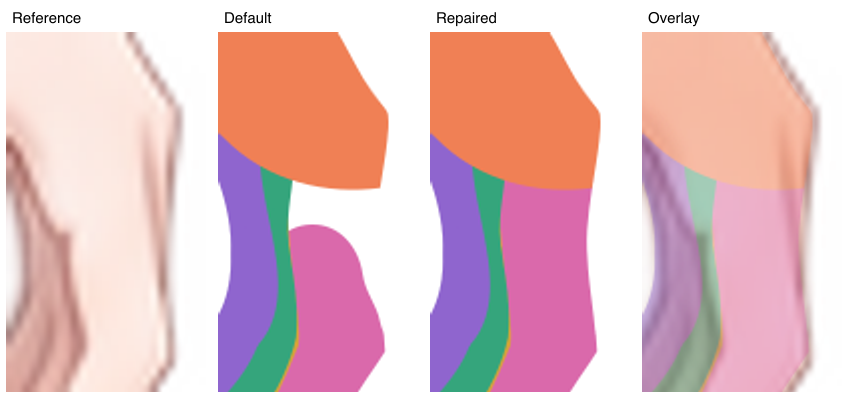

# 第四层 29 个 part：首批执行与验收

2026-10-15。左右均按角色自身：左侧在画面右侧。

本页保留首批执行和单次定向修补时的快照，表内补全数量与先验范围属于该轮。随后连接先验已正式收录到左右十指配置，并从统一入口重新补全十指；当前结果、适用范围与真实请求核验见 [正式接入与十指重跑验收](acceptance-finger-priors.md)。

## 完成情况

本批实际为 **29 个 part**：冠饰 10、双手 12、踝饰 7。全部完成轮廓、独立审查流程、整层去重、正面遮挡补全和程序自检。整棵树 **115／115 个节点完成**，四层节点数为 8、27、51、29，没有第五层。part 完成后终止，未调用子组分析。

轮廓结果：27 个首轮 pass、1 个第二轮 pass、1 个完成两轮意见返修与绘制自检后进入下一步；最后一种没有被写成独立审查通过。整层去重检查未修改轮廓。最终补全共新增 23 条闭合路径，11 个本来已完整而提交无需新增。

本次只完成色块轮廓与隐藏补形。正式整树 SVG 合并仍为待接入，未制作最终着色、绑定或动作测试。

## 调度修正与验证

已删除组任务数量上限。`--jobs / -j` 现在只控制 agent 实际调用并发，默认 3；`--agents / -a` 是同一上限的兼容别名。依赖满足的同层任务全部进入队列。旧文将默认组并发 5 写成用户要求的错误已更正。

实际续跑命令为 `pnpm start --name test --jobs 3 --max-depth 4`。续跑日志中的实际 agent 调用峰值为 **3**，模型为 `gpt-6.1-sol / xhigh`。TypeScript 检查及 121 项测试通过；macOS 测试运行将临时目录规范到真实路径，避免 `/var` 与 `/private/var` 别名影响已有路径断言。原前三层及组树共 **431 个文件哈希全部保持一致**。完整事实见 [验证记录](supervision/2026-10-15T08-56-39Z-finish-level4/verification.json) 与 [最终节点事实](supervision/2026-10-15T08-56-39Z-finish-level4/final-facts.json)。

## 本次确实需要补强的先验

**左手小指的补全需要实际掌片作为连接参考。** 默认结果虽然补了圆弧根端，但它仍停在邻指附近，没有进入实际 palm；重组时掌指之间留有参考图中本应连续的皮肤空档。这是父范围内的连接问题。

我保留默认稿，只对 `arms/arm_left/hand/little_finger` 通过原调度器重新执行补全及自检。补充了实际 palm SVG／PNG、默认补全稿以及 [连接先验原文](supervision/2026-10-15T08-56-39Z-finish-level4/hand-connection-prior.md)。原轮廓、掌片与其他部件均保持不变。修补后，小指与实际掌片的重叠由 0 增至约 **79.19 原图像素面积**，整手父范围中未被子片覆盖的面积由 79.25 降至 1.75；局部图确认原可见空档已接上。面积来自四倍采样，用于辅助定位，不能将父色块的全部范围当成必须填满的目标。

可推广的是：补全真实连接时，把**实际相邻覆盖件**作为显式输入，并在同坐标下核对连续性与重叠；只有“在掌下”“圆弧指根”的文字描述，可能与实际掌片不一致。此次作为 case 先验验证保存，没有改写全局补全提示词或添加隐式继承。

其余 28 个 part 本轮没有新增特化先验，继续使用通用提示词及已有节点 note。冠饰的硬宝石与短连接、踝饰的软链与硬件已有清楚的职责与连接说明，当前结果不支持再为它们扩张拆分层级。若以后要统一左右踝链的拆法，应在父 group 的 children 规划中约定控制粒度：当前左链两臂为一个 part，右链两臂为两个 part，两种均可按实际控制需求使用。

## 对照的教程

- [手臂细节拆分](../../../../tutorial/live2d-tutorial-text/12.手臂细节拆分.txt)：手掌与五指；通常每根手指单独一片即可；连接处保留局部圆形交错。本批没有拆指节、指甲或替换手势。
- [物理饰品与衣服细节](../../../../tutorial/live2d-tutorial-text/9.物理饰品与衣服细节.txt)：软链与硬坠分开，保留隐藏连接，不因内部切面、高光继续拆分。
- [判断拆分与否](../../../../tutorial/live2d-tutorial-text/13.判断拆分与否.txt)：按独立控制与遮挡需求决定颗粒度。

已检查左右冠饰、双手与双踝饰六组的独显、组合及参考叠图。右手五指与掌片均有实际重叠；链端与硬件的隐藏搭接保留，右踝链的环孔保留。局部诊断叠放顺序用于验收，不代表最终绑定层序。

## 仍保留的上游范围问题

独立审查在 **8 个节点**记录了父轮廓偏窄：7 件冠饰的金属包边／连接外缘，以及左手小指的斜外缘与最低指尖。这些参考外缘位于父容纳范围之外；本次没有扩大父图，也没有放宽父范围校验。它们需要回到相应父轮廓处理，继续给末端 part 加补全先验不能恢复父范围外的区域。

左手小指外缘的这项上游限制，与本次已经修好的掌指根端空档是两处不同问题。完整原始说明见 [上游限制清单](supervision/2026-10-15T08-56-39Z-finish-level4/upstream-limitations.json)。

- [冠饰左/crown_connector](stages/review/head_accessories/left_crown_ribbon/jeweled_suspension/crown_connector.review.json)
- [冠饰左/lower_gem](stages/review/head_accessories/left_crown_ribbon/jeweled_suspension/lower_gem.review.json)
- [冠饰左/ribbon_connector](stages/review/head_accessories/left_crown_ribbon/jeweled_suspension/ribbon_connector.review.json)
- [冠饰右/crown_gem_link](stages/review/head_accessories/right_crown_ribbon/gem_suspension/crown_gem_link.review.json)
- [冠饰右/upper_diamond_gem](stages/review/head_accessories/right_crown_ribbon/gem_suspension/upper_diamond_gem.review.json)
- [冠饰右/lower_diamond_gem](stages/review/head_accessories/right_crown_ribbon/gem_suspension/lower_diamond_gem.review.json)
- [冠饰右/gem_ribbon_link](stages/review/head_accessories/right_crown_ribbon/gem_suspension/gem_ribbon_link.review.json)
- [手左/little_finger](stages/review/arms/arm_left/hand/little_finger.review.json)

## 全部 29 件产物

| part | 轮廓审查结果 | 新增路径数 | 本轮先验 |
| --- | --- | ---: | --- |
| [冠饰左/crown_connector](parts/head_accessories/left_crown_ribbon/jeweled_suspension/crown_connector.svg) | [首轮 pass](stages/review/head_accessories/left_crown_ribbon/jeweled_suspension/crown_connector.review.json) | 1 | 通用提示＋节点 note |
| [冠饰左/upper_gem](parts/head_accessories/left_crown_ribbon/jeweled_suspension/upper_gem.svg) | [首轮 pass](stages/review/head_accessories/left_crown_ribbon/jeweled_suspension/upper_gem.review.json) | 0 | 通用提示＋节点 note |
| [冠饰左/inter_gem_connector](parts/head_accessories/left_crown_ribbon/jeweled_suspension/inter_gem_connector.svg) | [首轮 pass](stages/review/head_accessories/left_crown_ribbon/jeweled_suspension/inter_gem_connector.review.json) | 2 | 通用提示＋节点 note |
| [冠饰左/lower_gem](parts/head_accessories/left_crown_ribbon/jeweled_suspension/lower_gem.svg) | [首轮 pass](stages/review/head_accessories/left_crown_ribbon/jeweled_suspension/lower_gem.review.json) | 0 | 通用提示＋节点 note |
| [冠饰左/ribbon_connector](parts/head_accessories/left_crown_ribbon/jeweled_suspension/ribbon_connector.svg) | [首轮 pass](stages/review/head_accessories/left_crown_ribbon/jeweled_suspension/ribbon_connector.review.json) | 1 | 通用提示＋节点 note |
| [冠饰右/crown_gem_link](parts/head_accessories/right_crown_ribbon/gem_suspension/crown_gem_link.svg) | [第二轮 pass](stages/review/head_accessories/right_crown_ribbon/gem_suspension/crown_gem_link.review.json) | 1 | 通用提示＋节点 note |
| [冠饰右/upper_diamond_gem](parts/head_accessories/right_crown_ribbon/gem_suspension/upper_diamond_gem.svg) | [首轮 pass](stages/review/head_accessories/right_crown_ribbon/gem_suspension/upper_diamond_gem.review.json) | 0 | 通用提示＋节点 note |
| [冠饰右/inter_gem_link](parts/head_accessories/right_crown_ribbon/gem_suspension/inter_gem_link.svg) | [首轮 pass](stages/review/head_accessories/right_crown_ribbon/gem_suspension/inter_gem_link.review.json) | 2 | 通用提示＋节点 note |
| [冠饰右/lower_diamond_gem](parts/head_accessories/right_crown_ribbon/gem_suspension/lower_diamond_gem.svg) | [两轮返修＋自检，未第三次复审](stages/review/head_accessories/right_crown_ribbon/gem_suspension/lower_diamond_gem.review.json) | 0 | 通用提示＋节点 note |
| [冠饰右/gem_ribbon_link](parts/head_accessories/right_crown_ribbon/gem_suspension/gem_ribbon_link.svg) | [首轮 pass](stages/review/head_accessories/right_crown_ribbon/gem_suspension/gem_ribbon_link.review.json) | 1 | 通用提示＋节点 note |
| [手左/palm](parts/arms/arm_left/hand/palm.svg) | [首轮 pass](stages/review/arms/arm_left/hand/palm.review.json) | 0 | 通用提示＋节点 note |
| [手左/thumb](parts/arms/arm_left/hand/thumb.svg) | [首轮 pass](stages/review/arms/arm_left/hand/thumb.review.json) | 0 | 通用提示＋节点 note |
| [手左/index_finger](parts/arms/arm_left/hand/index_finger.svg) | [首轮 pass](stages/review/arms/arm_left/hand/index_finger.review.json) | 1 | 通用提示＋节点 note |
| [手左/middle_finger](parts/arms/arm_left/hand/middle_finger.svg) | [首轮 pass](stages/review/arms/arm_left/hand/middle_finger.review.json) | 1 | 通用提示＋节点 note |
| [手左/ring_finger](parts/arms/arm_left/hand/ring_finger.svg) | [首轮 pass](stages/review/arms/arm_left/hand/ring_finger.review.json) | 1 | 通用提示＋节点 note |
| [手左/little_finger](parts/arms/arm_left/hand/little_finger.svg) | [首轮 pass](stages/review/arms/arm_left/hand/little_finger.review.json) | 2 | 实际 palm＋连接先验 |
| [手右/palm](parts/arms/arm_right/hand/palm.svg) | [首轮 pass](stages/review/arms/arm_right/hand/palm.review.json) | 0 | 通用提示＋节点 note |
| [手右/thumb](parts/arms/arm_right/hand/thumb.svg) | [首轮 pass](stages/review/arms/arm_right/hand/thumb.review.json) | 1 | 通用提示＋节点 note |
| [手右/index_finger](parts/arms/arm_right/hand/index_finger.svg) | [首轮 pass](stages/review/arms/arm_right/hand/index_finger.review.json) | 2 | 通用提示＋节点 note |
| [手右/middle_finger](parts/arms/arm_right/hand/middle_finger.svg) | [首轮 pass](stages/review/arms/arm_right/hand/middle_finger.review.json) | 1 | 通用提示＋节点 note |
| [手右/ring_finger](parts/arms/arm_right/hand/ring_finger.svg) | [首轮 pass](stages/review/arms/arm_right/hand/ring_finger.review.json) | 1 | 通用提示＋节点 note |
| [手右/little_finger](parts/arms/arm_right/hand/little_finger.svg) | [首轮 pass](stages/review/arms/arm_right/hand/little_finger.review.json) | 0 | 通用提示＋节点 note |
| [踝饰左/ankle_chain](parts/legs/leg_left/anklet/ankle_chain.svg) | [首轮 pass](stages/review/legs/leg_left/anklet/ankle_chain.review.json) | 2 | 通用提示＋节点 note |
| [踝饰左/center_link](parts/legs/leg_left/anklet/center_link.svg) | [首轮 pass](stages/review/legs/leg_left/anklet/center_link.review.json) | 0 | 通用提示＋节点 note |
| [踝饰左/teardrop_pendant](parts/legs/leg_left/anklet/teardrop_pendant.svg) | [首轮 pass](stages/review/legs/leg_left/anklet/teardrop_pendant.review.json) | 0 | 通用提示＋节点 note |
| [踝饰右/outer_chain](parts/legs/leg_right/anklet/outer_chain.svg) | [首轮 pass](stages/review/legs/leg_right/anklet/outer_chain.review.json) | 1 | 通用提示＋节点 note |
| [踝饰右/inner_chain](parts/legs/leg_right/anklet/inner_chain.svg) | [首轮 pass](stages/review/legs/leg_right/anklet/inner_chain.review.json) | 1 | 通用提示＋节点 note |
| [踝饰右/central_connector](parts/legs/leg_right/anklet/central_connector.svg) | [首轮 pass](stages/review/legs/leg_right/anklet/central_connector.review.json) | 0 | 通用提示＋节点 note |
| [踝饰右/gem_pendant](parts/legs/leg_right/anklet/gem_pendant.svg) | [首轮 pass](stages/review/legs/leg_right/anklet/gem_pendant.review.json) | 1 | 通用提示＋节点 note |

## 可视验收入口

[完整交互预览](previews/index.html) · [左冠饰](previews/level4/left-crown.png) · [右冠饰](previews/level4/right-crown.png) · [左手](previews/level4/left-hand.png) · [右手](previews/level4/right-hand.png) · [左踝饰](previews/level4/left-anklet.png) · [右踝饰](previews/level4/right-anklet.png)
